# Recommendation and key data

**Recommendation: BUY (event-driven / deep value, medium conviction).** 12-month target price **¥3,650 (+21%)**. The probability-weighted value is ¥3,652: bear ¥2,350 (−22%, 25%), base ¥3,680 (+22%, 50%), bull ¥4,900 (+63%, 25%).

| Item | Value | Item | Value |
|---|---|---|---|
| Price (21-Oct-2026) | ¥3,010 | 52-week range (intraday) | ¥2,652–4,072 |
| Shares outstanding (S&P, ex-treasury) | 244.3m | Market cap | ¥735bn (US$4.6bn at ¥159) |
| S&P TEV | ¥581bn | Net cash (cash + ST securities − debt, 30-Jun-26) | ¥191bn |
| Bonds held to maturity and bond funds (LT) [e] | ~¥200bn | Listed equity stakes at market (pre-tax) [e] | ~¥500bn, of which Recruit ~¥418bn |
| P/E FY3/26A / FY3/27E (ours) | 13.2x / 12.8x | P/E on recurring EPS FY3/27E (ex-securities gains) | 18.4x |
| P/B (30-Jun-26 book) | 0.69x (0.62x adjusted for the post-June Recruit gain) | Dividend (FY3/27 guidance) | ¥45 (1.5% yield) |
| ROE FY3/26 | 5.8% | Avg. daily value traded (3m) | ~¥1.7bn |
| Largest holder | Yomiuri group 28.46% of votes | Foreign ownership | 19.99% of votes: at the Broadcasting Act cap |
| Consensus target (7 analysts) | ¥3,504 mean (3 Buy, 2 Outperform, 2 Hold) | Next event | 1H FY3/27 results, ~5–6 Nov-2026 [e] |

Sources: S&P Capital IQ (prices, financials, estimates, multiples, key developments, transactions, filings including the FY3/26 有価証券報告書 (yuho) and integrated reports), Dentsu, MIC, company disclosures via search summaries, and our estimates. **[u]** = unverified (one secondary source or a search summary; primary document not opened). **[e]** = our estimate or calculation. Japanese fiscal years end in March: "FY3/26" = April 2025 to March 2026.

## Investment summary

- **The market pays you to own Japan's leading commercial broadcaster.**
  - At ¥3,010 the market cap is ¥735bn.
  - Against that, NTV holds ¥191bn of net cash, about ¥200bn of held-to-maturity bonds, and roughly ¥500bn of listed equity stakes at today's prices. After 30.6% tax on gains, the equity stakes are worth about ¥355bn.
  - Netting off affiliates, unlisted stakes, Studio Ghibli's minority holders and the pension deficit, non-core assets total **¥767bn, more than the market cap**.
  - The implied value of an operating business that earned ¥81.7bn EBITDA in FY3/26, and will earn about ¥68bn in a trough FY3/27, is **about −¥32bn**. Our base-case NAV is ¥1,124bn, or ¥4,600 per share; the shares trade at a 35% discount to it.
- **The Recruit stake has become the story.**
  - NTV bought Recruit shares decades ago at about ¥300 each. It held 24.4m shares at March 2026, and about 22.2m [e] after a partial sale in May–June 2026 that produced a ¥19.6bn gain.
  - Recruit has risen from ¥6,526 (31-Mar-2026) to ¥18,845 (+189%). The stake is now worth about **¥418bn pre-tax, 57% of NTV's market cap**, up from 21% in March.
  - Listed strategic holdings are therefore about **41% of net assets** [e]. That is double both the mid-term plan's own ceiling (<20%) and ISS's 20% "vote against the CEO" threshold. The 25% votes against the Yomiuri-linked Chairman and CEO at the June-2026 AGM came while the ratio was still 26%.
  - Getting back to 20% means selling about ¥250bn of stock. After tax that releases roughly ¥180bn, about **24% of the market cap**.
- **Earnings are at a trough, and management guides low.**
  - FY3/27 operating profit (OP) is guided at ¥49.0bn (−29%). Three things hurt at once: the FIFA World Cup cost hump, the unwinding of the 2025 windfall in spot advertising as Fuji TV recovers from its scandal, and KANAMEL goodwill.
  - NTV beat its initial OP guidance by 31% in FY3/25 and 26% in FY3/26, and has raised guidance in March in both years.
  - We forecast OP of ¥52.0bn in FY3/27, rising to ¥58bn in FY3/28 and ¥60bn in FY3/29. Recurring EPS (excluding securities gains) recovers from ¥164 to ¥200.
- **The de-rating has been stock-specific.**
  - The shares are down 27% from the September-2025 high. Over the last 12 months they lag TOPIX by 45pp and are the worst performer among the four Tokyo listed key-station groups.
  - Price-to-book has fallen from 1.02x to 0.66x, while the asset base behind each share has risen.
- **What could make us wrong:**
  - Yomiuri entrenchment, with the Recruit proceeds recycled into low-return M&A (KANAMEL at ~11x OP; Tipness; Hulu) rather than returned.
  - A sharp reversal in Recruit, which moves NTV's NAV by ¥63 per share for every ¥1,000.
  - A faster structural decline in linear TV.
  - Structural limits on outside influence. Foreign ownership is at the 20% cap, and no holder may exercise more than one-third of the votes. Neither a conventional takeover nor a foreign activist's vote is available. **The catalyst has to come through capital policy, not control.**

**Positioning.** We treat this as an event-driven value position.
- Sizing: medium. Liquidity is ¥1.5–1.7bn a day, and the stock's beta to TOPIX is about 0.3.
- Hedging: funds that want only the discount, not Recruit's momentum, can short about 0.06 Recruit shares per NTV share (the after-tax exposure). That leaves a "stub" of about ¥1,820 per share, covered by ¥1,590 of net cash and bonds alone.
- Review triggers:
  - an M&A announcement above ¥50bn;
  - no new buyback at the 1H results;
  - cancellation of the cross-holding reduction target.

## Our estimates vs consensus and guidance

| ¥bn (March FY) | FY3/26A | FY3/27E ours | FY3/27 guidance | FY3/27 consensus | FY3/28E ours | FY3/28 consensus | FY3/29E ours | FY3/29 consensus |
|---|---|---|---|---|---|---|---|---|
| Net sales | 484.4 | 535.0 | 535.0 | 517.6 | 560.0 | 542.0 | 572.0 | 548.2 |
| Operating profit | 69.3 | 52.0 | 49.0 | 55.2 | 58.0 | 61.5 | 60.0 | 62.6 |
| OP margin | 14.3% | 9.7% | 9.2% | 10.7% | 10.4% | 11.3% | 10.5% | 11.4% |
| EBITDA | 81.7 | 67.7 | 64.7 | 68.5 | 75.0 | 76.6 | 77.5 | 78.5 |
| Ordinary profit | 82.1 | 64.5 | 59.0 | 66.7 | 72.0 | 71.2 | 74.5 | 73.7 |
| Net income to owners | 56.8 | 57.4 | 51.5 | 56.2 | 57.0 | 58.4 | 55.0 | 56.5 |
| EPS (¥) | 228.1 | 234.4 | 208.2 | 229.9 | 238.0 | 249.5 | 235.8 | 237.3 |
| Recurring EPS ex-securities gains (¥) | 214.2 | 163.9 | n/a | n/a | 188.3 | n/a | 199.8 | n/a |
| DPS (¥) | 45 | 45 | 45 | 45.2 | 50 | 48.6 | 55 | 49.1 |

Actuals and consensus: S&P Capital IQ (consensus as of 13–21 Oct-2026; 6–7 estimates). Guidance: company, 14-May-2026, reiterated 31-Jul-2026. FY3/27 guidance EBITDA = OP + guided D&A of ¥15.7bn.

**How we differ.**
- **FY3/27:** our OP is above guidance and below consensus. We assume spot advertising falls 8% for the year (−12.2% in 1Q). The World Cup cost hump sits in 1Q–2Q, the comparison base eases in 2H, and NTV's habit of raising guidance in March supports the rest.
- **FY3/28–29:** our OP is below consensus. We assume linear TV keeps losing 1–3% of volume a year, KANAMEL goodwill amortisation (~¥4bn a year) offsets most of its profit, and the cost of the Los Angeles Olympics lands in FY3/29.
- **Net income:** reported NI stays at ¥55–57bn only because we assume continued sales of Recruit shares (gains of ¥29bn, ¥20bn and ¥15bn).
- **Bottom line:** the earnings line is not the thesis. The balance sheet is.

# 1. Executive Summary and Investment Conclusion

## 1.1 The set-up in one paragraph

Nippon Television Holdings (NTV) owns Nippon Television Network, the Tokyo key station of Japan's largest commercial network (NNN/NNS). It is the #1 station in terrestrial advertising revenue and in the 13–49 "core" audience that advertisers pay most for. Around that core it has built a content group: Studio Ghibli (42.3%, consolidated since October 2023), Hulu Japan, anime studios, BS/CS channels, events and merchandise, and since April 2026 the TV-commercial producer KANAMEL (the former AOI TYO). It is controlled in practice by the Yomiuri Shimbun group, which holds 28.46% of the votes.

FY3/26 was a record year, flattered by advertisers fleeing Fuji TV after its scandal: OP was ¥69.3bn, +26%. FY3/27 is guided down 29%. The stock has de-rated from ¥4,146 to ¥3,010. Meanwhile a decades-old stake in Recruit has nearly tripled, pushing NTV's non-core assets above its market cap.

## 1.2 Investment thesis: four forces converging

1. **Asset value has run far ahead of the share price.**
   - Since 31-Mar-2026, Recruit has added about ¥230bn of pre-tax value to NTV's holdings (¥160bn after tax), equal to ¥650 per NTV share.
   - Over the same period NTV's share price fell 5%.
   - On our base case the discount to NAV is 35%. Excluding the operating business entirely, the shares trade at about 0.96x non-core assets.
2. **The cross-holding problem has become acute.** The mid-term plan (MTP 2025–27) commits to cutting strategic holdings below 20% of net assets. The Recruit rally pushed the ratio from ~25% to ~41% [e].
   - **ISS** recommends against top executives when cross-holdings are ≥20% of net assets. About a third of non-Yomiuri votes already went against Chairman Yamaguchi and CEO Sugiyama in 2025 and 2026.
   - **Execution has started.** NTV sold Recruit shares in FY3/26 (¥8.3bn gain) and May–June 2026 (¥19.6bn gain), and Recruit is selling its own NTV stake.
3. **Earnings trough, conservative guide.**
   - 1Q FY3/27 OP was ¥11.1bn (−36.6%) and missed consensus by 13%. The miss came from World Cup costs and spot −12%, while time revenue rose 11%.
   - Ordinary profit was nevertheless 24.8% of the full-year guide, in line with the five-year average.
   - The FY3/27 guide assumes spot −6% and OP ¥49bn. NTV has beaten initial guidance in each of the last two years and raised guidance in March both times. The sell side sits at ¥55bn, so expectations are not heroic.
4. **Shareholder returns are institutionalised, and peers are being pushed harder.**
   - NTV policy: total return ratio ≥35%; ¥22bn of buybacks in 12 months, all cancelled; DPS ¥37 → ¥45 in two years.
   - Fuji Media's activists (Dalton/NAVF, then the Murakami group) won a ¥235bn buyback and a real-estate separation.
   - TBS faces repeated proposals from Monex/Japan Catalyst. The Murakami family has a stake in TV Asahi.
   - NTV is the obvious next case: the largest balance sheet relative to market cap, the most liquid listed stake (Recruit), and the weakest one-year TSR.

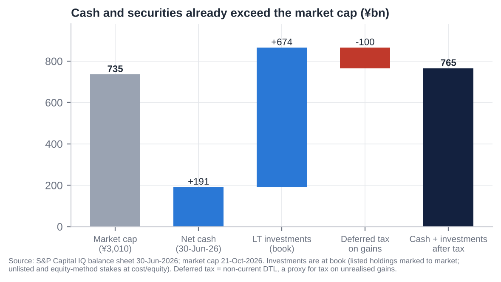

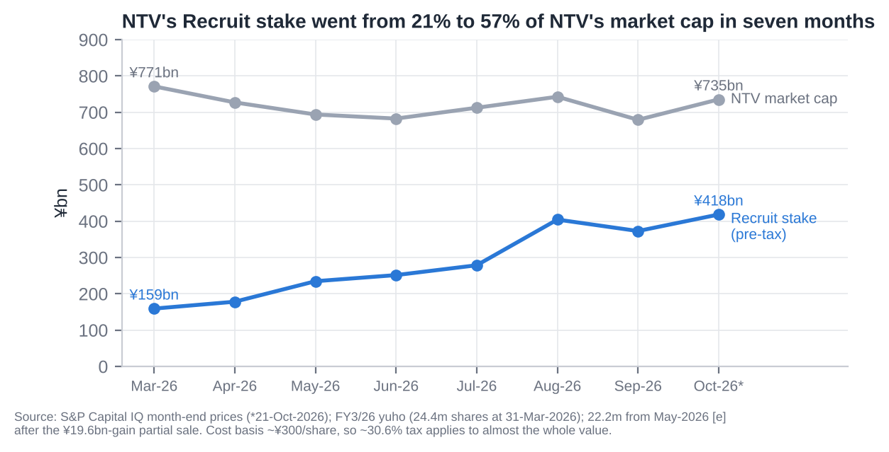

## 1.3 Why it is cheap: what the bears are right about

- **Structural decline.**
  - TV took 21.8% of Japanese ad spend in 2025, down from 27% in 2021; internet passed 50%.
  - NTV's core 13–49 all-day rating fell from 2.9% (FY2022) to 2.2% (FY2025).
  - Terrestrial ad revenue is flat at best over five years (¥245.6bn FY3/22 vs ¥231.7bn FY3/26).
- **FY3/26 was a windfall that is reversing.** Fuji's advertiser count recovered to 93% of the prior year by January 2026. NTV's spot revenue fell 12% in 1Q FY3/27, and the company admits it lost share.
- **Governance and control.**
  - The Board Chair and the Chairman & CEO are both Yomiuri appointees.
  - Only one of four statutory auditors is independent, and one "independent" director is a Yomiuri auditor.
  - The foreign cap is full, so foreign capital cannot vote. Friendly and stable holders are probably above 50% [e].
- **Capital allocation is still mixed.**
  - ¥400bn+ of cash and bonds earns almost nothing.
  - The ¥100bn "growth investment" budget has gone partly to KANAMEL (¥49.8bn acquisition cost; ~5.5% OP margin; ¥41.5bn goodwill).
  - Tipness has liabilities exceeding assets by ¥19.4bn. Hulu Japan was impaired in FY3/25. La belle vie also has negative net assets.
- **Low ROE.** 3.9–5.8% over five years, against a cost of equity of 7–8%.

## 1.4 Valuation and scenarios

| | Bear (25%) | Base (50%) | Bull (25%) |
|---|---|---|---|
| Recruit price (¥) | 12,250 (−35%) | 18,845 (spot) | 21,700 (+15%) |
| Core EBITDA (¥bn) × multiple | 65.0 × 3.5x | 71.4 × 5.0x | 75.0 × 6.5x |
| Affiliates (x book) | 0.6x | 0.7x | 1.0x |
| NAV (¥bn) / per share | 883 / ¥3,614 | 1,124 / ¥4,602 | 1,329 / ¥5,440 |
| Discount to NAV applied | 35% | 20% | 10% |
| **Value per share** | **¥2,349 (−22%)** | **¥3,681 (+22%)** | **¥4,896 (+63%)** |
| Implied P/B (Jun-26 book) | 0.52x | 0.82x | 1.09x |

The probability-weighted value is ¥3,652, and our target price is **¥3,650**.

**Cross-checks.**
- The base value equals 0.74x book adjusted for the post-June Recruit gain.
- It is 15.5x our FY3/28E EPS.
- It is close to the consensus target of ¥3,504.

## 1.5 What has to go right

1. Recruit sales continue, and the proceeds go mainly to buybacks and dividends, not M&A. The buyback room is limited by Yomiuri's one-third voting cap; see section 26.
2. Terrestrial spot stabilises in 2H FY3/27, so the ¥49bn OP guide proves conservative again.
3. Recruit does not fall back below ~¥12,000.
4. Yomiuri accepts a higher total return ratio. The MTP's ≥35% was set when the stake was worth a third of today's value.

## 1.6 Positioning

- **Sizing:** event-driven, medium conviction. The stock is liquid enough to build a 1–2% position over 4–6 weeks.
- **Hedge:** short 0.06 Recruit shares per NTV share (after-tax exposure) if we want to isolate the NAV discount from Recruit's momentum. The stub left is ¥1,820 per share, against ¥1,590 per share of net cash and bonds plus the whole operating business.
- **Hard review triggers:**
  - any acquisition above ¥50bn;
  - a 1H result without a new buyback while Recruit sales continue;
  - a formal retreat from the <20% cross-holding target;
  - Recruit below ¥12,000.

# 2. Layman's Guide: What Nippon TV Does and How It Makes Money

**What it is.**
- Nippon TV is the company behind Japan's "Channel 4" in Tokyo. It is the flagship of a network of about 30 regional stations that carry its programmes across Japan.
- It makes and broadcasts variety shows, dramas, news, anime and sport: the Hakone Ekiden university relay race every January 2–3, Yomiuri Giants baseball and, in 2026, World Cup football.
- It also owns most of Studio Ghibli (*Spirited Away*, *My Neighbor Totoro*), a share of the Hulu Japan streaming service, satellite channels, a chain of Tipness fitness clubs and its headquarters buildings in Tokyo.

**How it makes money.** Roughly in order of size:

1. **Advertising (54% of FY3/26 sales, ¥259.5bn).** Companies pay to put commercials on NTV, almost always through ad agencies (Dentsu alone is a quarter of NTV's sales). There are two kinds:
   - **"Time" sales (¥104bn):** a sponsor buys commercials attached to a specific programme for 3–6 months.
   - **"Spot" sales (¥128bn):** 15-second commercials sold between programmes, priced by audience rating and more sensitive to the economy.

   The more people (especially 13–49-year-olds) watch, the more NTV can charge. Satellite (BS/CS) and online ads (TVer catch-up) add ¥28bn.
2. **Content (29%, ¥140bn).** NTV sells its programmes and films to streaming services (Netflix, Amazon), runs Hulu Japan, licenses Ghibli films worldwide and sells anime.
3. **Merchandise and events (11%, ¥53bn).** Ghibli and character goods, concerts, exhibitions and an online fashion retailer.
4. **Fitness (6%, ¥27bn).** Tipness gyms, which roughly break even.
5. **Property (1% of external sales, but 6% of profit).** Rent from its Shiodome tower and other buildings.

**How each division contributes (FY3/26).**

| Division | Sales | Share of sales | Operating profit | Share of profit | Comment |
|---|---|---|---|---|---|
| Media & Content (TV, streaming, Ghibli, events, goods) | ¥452.9bn | 93% | ¥67.1bn | 94% | Almost all profit; advertising is the engine |
| Wellness (Tipness) | ¥27.7bn | 6% | −¥0.1bn | 0% | Break-even; a long-time drag |
| Real estate | ¥11.6bn (¥4.6bn external) | 2% | ¥4.1bn | 6% | Mostly rent charged inside the group |
| Group (after eliminations) | ¥484.4bn | 100% | ¥69.3bn | 100% | 14.3% OP margin |

**What makes it unusual.** NTV is also a large investor.
- It holds about ¥390bn of cash and bonds and ¥500bn of shares in other companies, mainly Recruit.
- Together these are worth more than the whole company on the stock market.
- That makes NTV part broadcaster, part investment holding company. The question for investors is whether management will ever hand that money back.

# 3. Business Model, Products, Customers, Suppliers and Competitors

## 3.1 Business model in simple terms

NTV is a **free-to-air, advertiser-funded content factory with a network multiplier**.

- **Making the programmes.** It spends about ¥90bn a year making programmes (production cost ¥89.5bn in FY3/26). It airs them on its Tokyo licence and feeds them to ~30 affiliated regional stations. Network time is sold nationally, and affiliates receive network compensation.
- **Monetising the audience.** It sells that audience to advertisers through agencies.
  - Programme sponsorship ("time") is sold in 3–6-month cycles starting April/October.
  - Spot is sold continuously, priced per gross rating point (GRP).
- **Selling the content again.** It re-monetises the same content through catch-up streaming (TVer, ad-funded), subscription streaming (Hulu Japan), licensing (Netflix, Amazon, Disney+ and overseas broadcasters), merchandise and events.
- **Ghibli** adds a global, evergreen IP library with very high incremental margins.
- **The cost base is largely fixed.** Programming, staff and transmission do not move with revenue. So spot advertising swings drop through to profit at 80–90% [e]. That is why FY3/26 OP rose 26% on sales up 5%, and why FY3/27 OP is guided down 29% on sales up 10% (KANAMEL included).

## 3.2 Key products and services

| Product / service | Description | FY3/26 revenue | Trend |
|---|---|---|---|
| Terrestrial TV advertising | Time ¥104.1bn (−0.9%), spot ¥127.6bn (+9.2%) | ¥231.7bn | Spot −12.2% in 1Q FY3/27; time +11.2% (World Cup) |
| BS/CS advertising | BS Nippon, CS Nittele | ¥15.9bn (+1.1%) | Flat |
| Digital advertising | TVer catch-up, AVOD | ¥11.9bn (+13%) | Up from ¥5.2bn in FY3/23; −11.7% in 1Q FY3/27 [u] |
| Content | Programme/film/anime sales, Hulu Japan subscriptions, Ghibli licensing, overseas sales | ¥140.3bn (+5.6%) | Up from ¥103.7bn in FY3/23. MTP target ¥187bn FY3/28 |
| Merchandise | Ghibli goods, character goods, la belle vie (fashion e-commerce) | ¥34.0bn | Up from ¥18.1bn (FY3/23) |
| Events | Exhibitions, concerts, Ghibli-related events, Anpanman museums | ¥18.8bn | Up from ¥10.5bn (FY3/23) |
| Wellness | Tipness fitness clubs | ¥27.2bn | Flat; MTP target ¥40bn looks out of reach |
| Real estate | Shiodome and other leasing (external) | ¥4.6bn | Stable; Bancho redevelopment pending |
| Ad and film production (from FY3/27) | KANAMEL (AOI Pro., TYO): #1 TV-commercial producer in Japan | CY2025 revenue ¥78.3bn (not yet consolidated in FY3/26) | Consolidated from 2Q FY3/27 [e] |

Source: FY3/26 yuho revenue disaggregation (via S&P Capital IQ); company tanshin via search summaries.

## 3.3 Main customers

- **Advertising is sold through agencies.**
  - Dentsu accounted for **¥122.1bn (25.2%)** of consolidated sales in FY3/26 and Hakuhodo for **¥75.2bn (15.5%)**: **40.7%** combined (FY3/25: 25.0% and 16.0%).
  - That is about 76% of advertising revenue [e].
- **No single advertiser exceeds 10% of sales.** The largest TV advertisers in Japan are consumer staples (Kao, Suntory, Kirin, Asahi, P&G), autos (Toyota), pharma (Takeda), telecoms and financial services [u: ranking not retrieved].
- **Content customers:** Netflix, Amazon Prime Video and Disney+ (programme licensing [u for specific deals]); WBD's HBO Max (Ghibli US streaming, renewed March 2024); Netflix (Ghibli outside US/Canada/Japan); GKIDS (Ghibli North American theatrical); Toho (Japanese theatrical) [u]; overseas broadcasters (format sales).
- **Consumers:** about 18–19m Kanto TV households [u]; Hulu Japan subscribers (number not disclosed); Tipness members; Ghibli Park visitors (operated by a Ghibli/Chunichi Shimbun JV).

## 3.4 Main suppliers and counterparties

| Category | Counterparties |
|---|---|
| Talent and production | Talent agencies: Yoshimoto Kogyo, STARTO Entertainment, Amuse (4301), Horipro, Watanabe Pro. In-house producers: AX-ON, Nippon TV Art, NTV Technical Resources. Independent producers. |
| Sports and event rights | NPB/Yomiuri Giants (rights bought from Yomiuri Shimbun Tokyo, a related party); Kanto Gakuren (Hakone Ekiden); FIFA (15 terrestrial World Cup 2026 matches); IOC via the NHK/JBA Japan Consortium [u] |
| News | Yomiuri Shimbun group; Kyodo/Jiji [u] |
| Music rights | JASRAC blanket licence |
| Broadcast equipment | Sony, Panasonic, Ikegami Tsushinki, NEC; EVS, Harmonic and Tektronix appear in peer supplier lists. FY3/27 capex plan includes ¥20bn for broadcast equipment and HQ upgrades. |
| Transmission | Tokyo Skytree (Tobu Railway); SKY Perfect JSAT (satellite; NTV holds 20.9m shares); Denki Kogyo (relay-station maintenance) |
| Audience measurement | Video Research (Dentsu group): the single ratings currency |
| IT and streaming technology | NTV Wands (in-house), PLAY (94.5%), J-Stream |

## 3.5 Competitors

| Competitor | Type | Listed? | Overlap |
|---|---|---|---|
| TV Asahi HD (9409) | Tokyo key station | Yes | Individual-ratings triple crown 2024–25; spot ¥105.2bn (+11.2%) |
| TBS HD (9401) | Tokyo key station | Yes | Drama; U-NEXT stake; spot gains on share |
| Fuji Media HD (4676) | Tokyo key station | Yes | Recovering from the 2025 scandal (Fuji TV FY3/26 OP −¥32.5bn); 1Q FY3/27 back to profit |
| TV Tokyo HD (9413) | Tokyo key station | Yes | Anime, economics; record spot FY3/26 |
| NHK | Public broadcaster | No (licence-fee funded) | Viewing time; NHK ONE streaming mandatory from Oct-2025 |
| YouTube (Alphabet), LINE Yahoo (4689), Meta, TikTok | Online video/ads | Yes / Yes / Yes / No | Ad budgets and youth viewing time |
| Netflix, Amazon Prime Video, Disney+, U-NEXT (9418), ABEMA (CyberAgent 4751), DAZN | Streaming | Mostly yes; DAZN private | Viewing time; sports and drama rights (DAZN has all 104 World Cup matches; Netflix the 2026 WBC [u]) |

## 3.6 Key markets and geographies

- **Japan accounts for essentially all sales:** S&P reports 100% Japan, and overseas sales are below the 10% disclosure threshold.
  - Overseas content sales were about ¥12bn [u; period unclear], driven by Ghibli.
  - Targets: ¥30bn by FY3/28 and ¥100bn by FY3/34.
- **Advertising is concentrated in the Kanto (Tokyo) region** for spot. Network time is national.
- **Ghibli** is the only meaningful global revenue stream: theatrical, streaming licences and Ghibli Park inbound tourism.

## 3.7 Contracts and key payment terms

| Item | Terms |
|---|---|
| Time sales | Programme sponsorship, typically 6-month (April/October) or quarterly cycles. Specials and sports are sold separately. Network time revenue is shared with affiliates via network compensation [u on mechanics]. |
| Spot sales | GRP-based buying priced per rating point ("per-cost"). Prices move with supply and demand: Fuji's 2025 outage raised unit prices at the stations that gained share. |
| Agency commission | Booked as cost; rises with spot. Typical 15–20% [u]. |
| Revenue recognition | On broadcast. The auditor tests broadcast logs against agencies' monthly payment notices. |
| Receivables | ¥119.7bn at Mar-2026, about **90 days** of sales [e]. Agencies typically settle on a month-end closing plus about 2–3 months [u]. |
| Hulu Japan | Monthly subscription of about ¥1,026 including tax [u]. |
| Ghibli licensing | Multi-year platform licences (HBO Max US renewal Mar-2024; Netflix outside the US/Japan); terms undisclosed. |
| KANAMEL | Project-based production contracts with advertisers and agencies. |

# 4. Key Business Drivers

| Driver | What matters | Recent evidence | 2026–27 direction |
|---|---|---|---|
| **Volume: audience (GRPs)** | Ratings, especially the 13–49 core | Core all-day rating 2.9% → 2.2% (FY2022–25), still #1 for 13 years; individual all-day 3.6% → 3.3% (lost #1 to TV Asahi) | ↓ structural, about −0.1 to −0.3pt a year |
| **Volume: share of spot** | NTV's share of Kanto spot vs four rivals | ~35% share among four stations in FY3/26 [e], inflated by Fuji's outage; 1Q FY3/27 share down | ↓ near term |
| **Pricing** | Spot unit price per rating point | Spiked in 2025 on tight supply; normalising as Fuji's inventory returns | → / ↓ |
| **Mix: time vs spot** | Spot is cyclical; time benefits from events | FY3/26: spot 55% of terrestrial ads [e]; World Cup lifted time 11% in 1Q FY3/27 | Spot volatile |
| **Mix: digital** | TVer / CTV growth | Digital ads ¥11.9bn (+13%) = 4.6% of ads; TVer 44.7m monthly users (record) | ↑ but small |
| **Content / IP** | Ghibli, anime, global drama sales, Hulu | Content ¥103.7bn (FY3/23) → ¥140.3bn (FY3/26) | ↑ |
| **Cost: programming and rights** | Production cost; sports-rights inflation | Production ¥89.5bn (+2.1%); World Cup cut 1Q OP by 37% | ↑ |
| **Cost: wages** | Shunto settlements | +5.01% in 2026 (third year above 5%) | ↑ |
| **Capex cycle** | Master-control/IP upgrades, HQ, Bancho | Capex ¥10.1bn (FY3/26) → ¥27.6bn guided (FY3/27); consensus ¥30–33bn for FY3/28–29 | ↑ (temporary) |
| **Regulation** | Broadcasting Act, holding-company rules, MIC governance rules | Post-Fuji reporting duties (Jan-2026); 1-station-2-channels rule (2026); NHK ONE | Mixed |
| **Balance sheet** | Recruit price; cross-holding sales; interest income | Recruit +189% since March; interest and dividend income ¥7.3bn (+40%) | ↑ value; volatile |

# 5. Macro and Micro Factors; Tailwinds and Headwinds

## 5.1 Macro

- **GDP and consumption.**
  - Q2-2026 real GDP grew 1.4% annualised (third straight positive quarter), but private consumption was flat quarter on quarter. Daiwa expects Q3 to contract about 1% annualised on Middle East risk.
  - Spot advertising is the most cyclical line, so a soft second half of 2026 is negative for NTV's spot.
- **Wages and inflation.**
  - The 2026 Shunto settlement was +5.01%, and real wages turned positive.
  - That supports consumer advertisers but raises talent, production and staff costs.
- **Interest rates.**
  - The BoJ raised the policy rate to 1.00% in June 2026, the highest since 1995, and more hikes are expected.
  - Higher rates help NTV's interest income: it has ~¥400bn in cash and bonds, and interest income was ¥3.1bn in FY3/26 vs ¥2.3bn a year earlier.
  - They hurt real-estate valuations and could weigh on equity cross-holdings.
- **Yen at ¥158–163 per US dollar.**
  - The weak yen helps overseas content and Ghibli licensing and inbound tourism (Ghibli Park, events).
  - It raises the cost of dollar-denominated rights such as the World Cup.
- **Equity markets.** TOPIX rose 29% in the year to October 2026, and Recruit's rally is a large mark-to-market gain for NTV. The flip side is that NTV's NAV now carries meaningful beta to Japanese growth stocks.

## 5.2 Micro

- **Ad market:** 2025 total ¥8.06tn (+5.1%, fourth straight record); internet ¥4.05tn (50.2%); TV ¥1.756tn (−0.3%); TVer-type video ads ¥80.5bn (+23%).
- **Competitive reshuffle:**
  - Fuji TV lost about ¥39.7bn of broadcast revenue in FY3/26. NTV (+¥10.7bn spot) and TV Asahi (+¥10.6bn) were the biggest gainers [e].
  - Fuji's advertisers were back to 93% of the prior year by Jan-2026, and its 1Q FY3/27 OP swung to +¥16.0bn (group).
- **Ratings:** TV Asahi won the individual triple crown in 2024 and 2025. NTV retains the core-audience crown.
- **Sports rights are migrating to streamers.** DAZN carried all 104 World Cup matches, and NTV had 15 terrestrial matches. Netflix took exclusive Japanese rights to the 2026 WBC [u].
- **Regulation:**
  - MIC's post-Fuji governance rules (Jan-2026) add reporting duties.
  - The 2026 1-station-2-channels rule eases consolidation among local affiliates.
  - The FYCS holding company (Yomiuri TV, Chukyo TV, Sapporo TV, FBS) was formed in April 2025; NTV owns 24.4%.

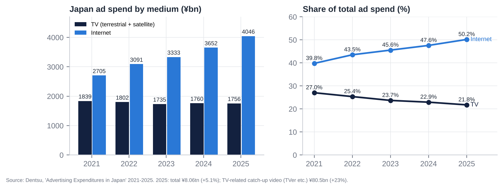

## 5.3 Tailwinds and headwinds

| Tailwinds | Headwinds |
|---|---|
| #1 key station by ad revenue and in the core demographic | Fuji's recovery is clawing back share and pricing (NTV spot −12.2% in 1Q FY3/27) |
| Recruit stake +189% since March; ¥400bn of cash and bonds; rising interest income | Structural decline of linear TV: internet 50% of ad spend; ratings falling every year |
| IP diversification (Ghibli, anime, global drama) helped by the weak yen | Sports-rights inflation and migration to streamers (World Cup cost cut 1Q OP 37%) |
| TVer and connected-TV growth (+23% market; TVer 44.7m users) | Weak 2H 2026 macro (Q3 GDP seen negative; Middle East oil) |
| TSE / ISS pressure on P/B and cross-holdings; peer activism precedents | Cost inflation: wages +5%, production, AI and technology |
| Network consolidation and deregulation (FYCS, relay-station sharing) | Agency concentration (Dentsu + Hakuhodo 40.7% of sales) |
| Conservative guidance habit (initial OP guide beaten by 26–31%) | Governance: Yomiuri control; foreign cap full; one-third voting cap |
| Wage growth supports consumer advertisers | Weak non-core businesses (Tipness, la belle vie, Hulu, Murayama) |

# 6. Competitive Position and Economic Moats

## 6.1 Product strength vs competitors

- **Brand and perceived value.**
  - NTV has the strongest commercial-TV brand among younger and middle-aged viewers. It has been #1 in the 13–49 core audience for 13 consecutive years, and that is what lets it charge a premium per rating point.
  - Its variety franchises (*ZIP!*, *Shabekuri 007*, *The! Tetsuwan! DASH!!*), the annual *24-Hour TV* telethon, *Friday Roadshow* (the Ghibli showcase) and the Hakone Ekiden are national institutions.
- **Marketing reach.** The NNN/NNS network gives national reach. Being first on TVer catch-up (where NTV programmes rank highly [u]) extends that reach to younger viewers online.
- **Where it is weaker:**
  - TV Asahi now wins total-audience ratings with older-skewing news and wide-shows.
  - TBS has more prestige drama.
  - Streaming services offer bigger budgets per episode.
  - Hulu Japan is a sub-scale SVOD against Netflix (27% share of Japanese SVOD), U-NEXT (17%) and Amazon (12%).
  - Reputation took hits from the *Sexy Tanaka-san* affair (2024) and the Kokubun/TOKIO removal (2025).

## 6.2 Moat scorecard

| Moat category | Rating | Evidence | Trend |
|---|---|---|---|
| **Brand** | Strong | #1 core-audience ratings for 13 years; Ghibli is a global top-tier IP; #1 key station by ad revenue | Stable; dented by compliance scandals |
| **Hard assets** | Moderate–strong | Broadcast licence and transmission; Shiodome HQ and Bancho land (¥209bn book; fair value undisclosed); ¥900bn of cash, bonds and securities | Financial assets growing |
| **Long-term contracts** | Weak–moderate | Ad sales are short-cycle (spot daily; time 3–6 months); Ghibli platform licences are multi-year; Hakone Ekiden and Giants relationships are long-standing | Sports rights moving to streamers |
| **Network effect** | Moderate | Affiliate network (NNN/NNS, ~30 stations) and national reach; content library feeds TVer/Hulu/licensing; little direct user network effect | Weakening as reach fragments |
| **Regulatory barriers and switching costs** | Strong (supply) / weak (switching) | Licences limit the number of key stations (5 in Tokyo); certified-holding-company rules and the foreign cap block entry by acquisition. Advertisers can switch easily, as Fuji's 2025 sponsor flight showed. | Barriers intact; switching easier |
| **Oligopolistic industry** | Strong | Five Tokyo key stations plus NHK; no new terrestrial entrants possible; consolidation of locals now permitted | Oligopoly shrinking in relevance as online grows |
| **Cash-flow predictability** | Moderate | FCF ¥35–51bn a year for five years, never negative; but OP swings ±25% with spot and events | Stable cash; volatile profit |
| **Scalability** | Moderate | Fixed-cost broadcasting gives high operating leverage; IP (Ghibli, anime) scales globally; ad-production (KANAMEL) and fitness do not | Improving with content mix |
| **Risk / history of government interference** | Moderate | MIC licensing, Article 4 political-fairness duty, BPO, post-Fuji governance rules, NHK funding rules; no adverse NTV-specific licence action | Rising scrutiny |
| **Bargaining power over stakeholders** | Mixed | Strong over producers, talent and affiliates; weak over the two agencies (40.7% of sales); weak over sports rights holders; Yomiuri controls the board | Agencies and rights holders gaining |

**Verdict.** NTV has a real but **eroding** moat. It is protected from new entrants by licensing and ownership rules, and from peers by brand and the core-audience lead. But it is exposed to the substitution of TV advertising by online advertising, and its pricing power depends on rivals' supply (as 2025 showed). The durable part of the moat is IP (Ghibli, anime, formats) and the balance sheet, not the airwaves.

# 7. Supply Chain Map: From Upstream Inputs to the End Customer

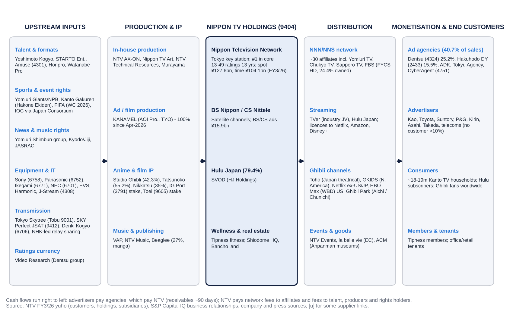

**Where NTV sits.** NTV sits in the middle of the chain, as an integrated aggregator. It commissions or produces content, owns the distribution licence and the network relationship, and sells audiences to agencies.

**Who captures value at each stage.**
- **Upstream** (talent, sports rights, equipment) is fragmented, except for sports rights, where FIFA, the IOC and NPB have pricing power and streamers now bid.
- **Downstream** is concentrated: two agencies control 41% of NTV's sales, and Video Research (Dentsu group) supplies the single ratings currency.
- **Studio Ghibli** has its own chain: Toho in Japan, GKIDS in North America, Netflix and WBD for streaming, and Ghibli Park with the Chunichi Shimbun.

**Cash conversion.** Advertisers pay agencies, which pay NTV on roughly 90-day terms. NTV pays network fees to affiliates and fees to talent, producers and rights holders. Working capital is modest, and inventory (programme rights and work in progress) is only ¥13bn (¥24bn after KANAMEL).

# 8. Five-Year Financial Analysis by Division and Geography

All figures: S&P Capital IQ (J-GAAP, consolidated) unless stated. EBITDA = OP + D&A.

## 8.1 Group income statement, FY3/22–FY3/26 (plus FY3/21 base and FY3/27 guidance)

| ¥bn | FY3/21 | FY3/22 | FY3/23 | FY3/24 | FY3/25 | FY3/26 | FY3/27G |
|---|---|---|---|---|---|---|---|
| Net sales | 391.3 | 406.4 | 414.0 | 423.5 | 461.9 | 484.4 | 535.0 |
| YoY | – | +3.8% | +1.9% | +2.3% | +9.1% | +4.9% | +10.4% |
| Gross profit | 123.4 | 152.9 | 142.2 | 141.9 | 163.0 | 180.9 | n/a |
| Gross margin | 31.5% | 37.6% | 34.3% | 33.5% | 35.3% | 37.3% | n/a |
| SG&A | 88.9 | 94.2 | 95.6 | 100.1 | 108.1 | 111.6 | n/a |
| **EBITDA** | 52.0 | 74.6 | 60.7 | 55.7 | 68.3 | 81.7 | 64.7 |
| EBITDA margin | 13.3% | 18.3% | 14.7% | 13.1% | 14.8% | 16.9% | 12.1% |
| D&A | 17.4 | 15.9 | 14.1 | 13.8 | 13.4 | 12.3 | 15.7 |
| **Operating profit (EBIT)** | 34.5 | 58.7 | 46.6 | 41.9 | 54.9 | 69.3 | 49.0 |
| OP margin | 8.8% | 14.4% | 11.3% | 9.9% | 11.9% | 14.3% | 9.2% |
| Interest and dividend income | 4.4 | 3.5 | 4.4 | 4.7 | 5.2 | 7.3 | n/a |
| Equity-method income | 4.0 | 3.1 | 0.9 | 2.7 | 5.8 | 5.4 | n/a |
| Ordinary profit | 42.9 | 64.8 | 51.8 | 49.5 | 65.7 | 82.1 | 59.0 |
| Gains on sale of securities | 27.8 | 6.8 | 0.0 | 14.1 | 8.6 | 8.0 | ~19.6 |
| Impairments | (21.4) | (2.6) | (1.9) | (12.3) | (5.3) | (3.6) | n/a |
| Pre-tax income | 45.4 | 68.8 | 49.1 | 51.7 | 69.1 | 87.0 | n/a |
| Effective tax rate | 48.1% | 30.9% | 29.5% | 31.5% | 31.4% | 29.0% | n/a |
| Minorities | (0.5) | 0.1 | 0.5 | 0.8 | 1.4 | 5.0 | n/a |
| **Net income to owners** | 24.0 | 47.4 | 34.1 | 34.7 | 46.0 | 56.8 | 51.5 |
| EPS (¥) | 94.2 | 185.9 | 133.6 | 136.4 | 183.4 | 228.1 | 208.2 |
| DPS (¥) | 35 | 37 | 37 | 40 | 40 | 45 | 45 |

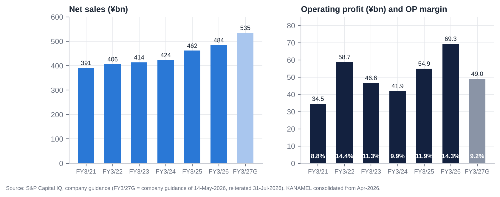

## 8.2 Revenue, EBITDA and operating profit by division

| ¥bn | FY3/22 | FY3/23 | FY3/24 | FY3/25 | FY3/26 | 1Q FY3/27 |
|---|---|---|---|---|---|---|
| **Media & Content: revenue** | 376.8 | 385.0 | 393.6 | 431.1 | 452.9 | 106.8 |
| YoY | – | +2.2% | +2.2% | +9.5% | +5.0% | – |
| EBITDA [e] | 70.6 | 56.3 | 50.5 | 63.9 | 77.8 | n/a |
| EBITDA margin | 18.7% | 14.6% | 12.8% | 14.8% | 17.2% | n/a |
| Operating profit | 58.3 | 44.2 | 38.5 | 52.2 | 67.1 | 10.7 |
| OP margin | 15.5% | 11.5% | 9.8% | 12.1% | 14.8% | 10.0% |
| **Wellness (Tipness): revenue** | 23.2 | 26.1 | 26.5 | 26.8 | 27.7 | 6.9 |
| EBITDA [e] | (1.4) | 0.9 | 1.7 | 1.2 | 0.9 | n/a |
| Operating profit | (3.1) | (0.4) | 0.5 | 0.2 | (0.1) | (0.0) |
| **Real estate: revenue (gross)** | 10.3 | 10.6 | 11.2 | 11.5 | 11.6 | 2.8 |
| EBITDA [e] | 4.5 | 4.4 | 4.9 | 5.1 | 4.8 | n/a |
| Operating profit | 3.8 | 3.7 | 4.3 | 4.5 | 4.1 | 0.9 |
| OP margin | 37.1% | 35.4% | 38.4% | 38.6% | 35.8% | 31.9% |
| Others (merged from FY3/23): revenue / OP | 7.0 / 0.5 | – | – | – | – | – |
| Eliminations: revenue / OP | (11.0) / (0.9) | (7.6) / (0.9) | (7.7) / (1.5) | (7.5) / (1.9) | (7.7) / (1.9) | (2.0) / (0.5) |
| **Group operating profit** | 58.7 | 46.6 | 41.9 | 54.9 | 69.3 | 11.1 |

Segment EBITDA = segment OP + segment D&A (S&P segment D&A). Net income is not reported by segment.

**Revenue by business line within Media & Content** (yuho revenue disaggregation; selected years):

| ¥bn | FY3/23 | FY3/26 | Change |
|---|---|---|---|
| Terrestrial TV advertising | 231.7 | 231.7 | 0% (time −¥7bn, spot +¥7bn) |
| BS/CS advertising | n/a | 15.9 | – |
| Digital advertising | 5.2 | 11.9 | +129% |
| Content (programme sales, Hulu, Ghibli, anime, film) | 103.7 | 140.3 | +35% |
| Merchandise | 18.1 | 34.0 | +88% (Ghibli; la belle vie from 2023) |
| Events | 10.5 | 18.8 | +79% |

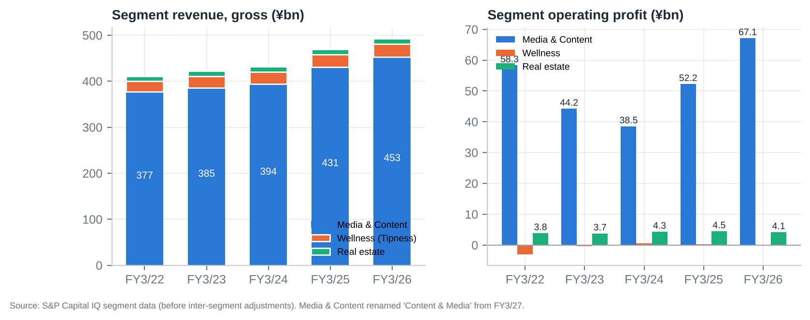

**Nippon TV (broadcaster) advertising:**

| ¥bn | FY3/22 | FY3/23 | FY3/24 | FY3/25 | FY3/26 | 1Q FY3/27 |
|---|---|---|---|---|---|---|
| Time | 121.1 | 111.4 [u] | 105.2 | 105.0 | 104.1 | 27.5 (+11.2%) |
| Spot | 124.5 | 120.3 [u] | 113.9 | 116.9 | 127.6 | 27.4 (−12.2%) |
| Terrestrial total | 245.6 | 231.7 | 219.0 | 222.0 | 231.8 | 54.9 |
| Programme production cost | n/a | n/a | n/a | ~87.7 [u] | 89.5 | ↑ (World Cup) |

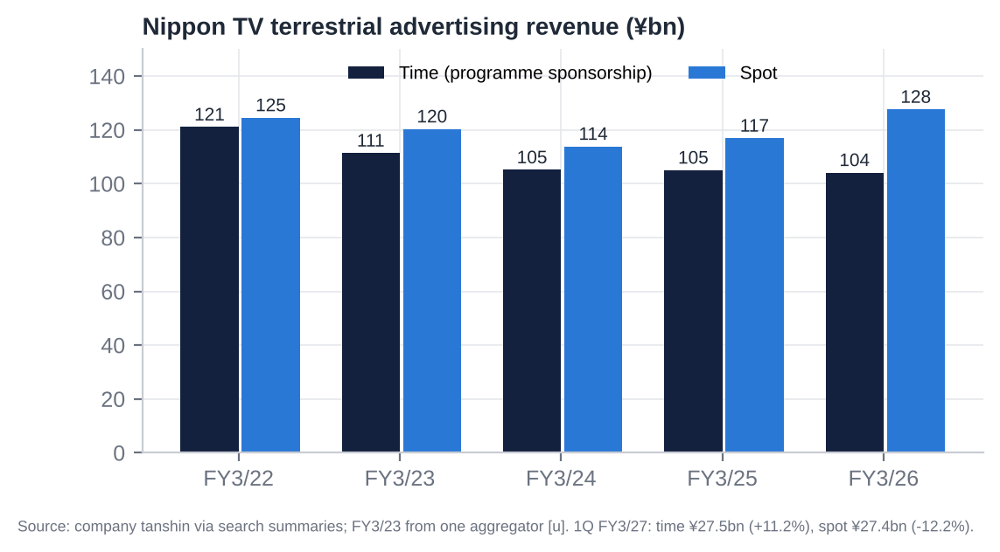

## 8.3 Geography

NTV reports no geographic segments: S&P shows 100% Japan, and overseas sales are below the 10% threshold. The relevant geographic split is between domestic advertising (~54% of sales) and domestic/overseas content.
- **Overseas sales** were about ¥12bn [u], mostly Ghibli licensing and global drama/anime distribution.
- **MTP targets:** ¥30bn by FY3/28 and ¥100bn by FY3/34.
- **Studio Ghibli** distributes through Netflix (190+ territories ex-US/Canada/Japan), HBO Max (US) and GKIDS (North American theatrical), and Ghibli Park draws inbound tourists.

So the business is effectively a single-country company, with a small but growing global IP tail.

## 8.4 Trends in growth and margins: what changed and why

1. **FY3/22: post-COVID rebound.** Terrestrial ads rose 8.6% (spot +¥19.3bn). EBITDA margin peaked at 18.3% on a fixed cost base. NI of ¥47.4bn included ¥6.8bn of securities gains.
2. **FY3/23–FY3/24: ad recession plus cost creep.**
   - Time revenue fell 13% over two years as sponsors cut programme budgets (Noto earthquake, inflation). Spot also fell.
   - OP fell from ¥58.7bn to ¥41.9bn and OP margin to 9.9%.
   - Impairments (¥12.3bn in FY3/24) and Ghibli's consolidation (from Oct-2023; NCI jumped) hurt NI quality.
   - FY3/24 missed its own guidance (OP ¥41.9bn vs ¥48bn).
3. **FY3/25–FY3/26: content scale plus the Fuji windfall.**
   - Content rose to ¥140bn (Ghibli, anime, global sales), and events and merchandise doubled.
   - From Jan-2025, advertisers fleeing Fuji TV pushed NTV's spot up 9.2% at higher unit prices.
   - With costs broadly fixed (production +2.1%), OP rose 64% in two years and OP margin reached 14.3%.
4. **FY3/27: normalisation.**
   - Spot reverses (1Q −12.2%), the World Cup costs land (1Q gross margin −4.6pp), and KANAMEL adds sales (~¥55–60bn for 9 months) at low margins plus goodwill amortisation.
   - Guided OP margin falls to 9.2%.
5. **Wellness has been structurally weak.** Tipness swung from −¥3.1bn to roughly break-even but never earns its capital: negative equity of ¥19.4bn. **Real estate** is steady (~¥4bn OP, ~37% margin), mostly on internal rent.
6. **Below the line:** interest income is rising with BoJ hikes, equity-method income comes mainly from FYCS, and securities gains are recurring "one-offs" every year.

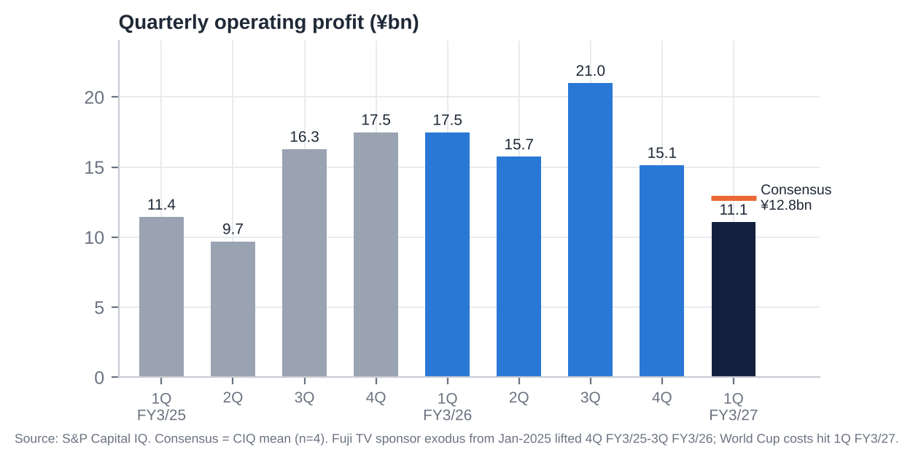

## 8.5 Most relevant operational KPIs

| KPI | Latest | Trend / comment |
|---|---|---|
| Core (13–49) all-day rating, Kanto | 2.2% (FY2025), #1 for 13 calendar years | Down from 2.9% (FY2022): −24% in three years |
| Individual all-day / golden / prime rating | 3.3% / 5.1% / 4.7% (FY2025), #2 | Lost the individual triple crown to TV Asahi (2024–25) |
| Spot revenue growth | FY3/26 +9.2%; 1Q FY3/27 −12.2% | Fuji windfall reversing; peers' spot −15.9% in 1Q |
| Time revenue growth | FY3/26 −0.9%; 1Q FY3/27 +11.2% | World Cup boost; underlying trend flat to down |
| Spot share among four key stations [e] | ~35% (FY3/26) | Peak; falling in FY3/27 |
| Digital ad revenue | ¥11.9bn (+13%) | 4.6% of advertising; TVer 44.7m monthly users |
| Content revenue | ¥140.3bn (+5.6%) | MTP target ¥187bn (FY3/28) |
| Programme production cost | ¥89.5bn (+2.1%) | World Cup spike in FY3/27 |
| Capex / sales | 2.1% (FY3/26) | Rising to ~5% in FY3/27 (¥27.6bn guided) |
| D&A / capex | 1.2x (FY3/26) | Below 1x from FY3/27 |
| Receivable days | ~90 | Stable; up QoQ at 1Q (KANAMEL) |
| Headcount | 5,933 [u] (pre-KANAMEL) | Rising with M&A |
| Tipness | Revenue ¥27.2bn; OP −¥0.07bn; negative equity ¥19.4bn | Chronic underperformer |
| Hulu Japan subscribers | Not disclosed | Impairment FY3/25; improving FY3/26 [u] |
| Overseas sales | ~¥12bn [u] | Target ¥30bn FY3/28 |

# 9. Historical Share Price Catalysts (Moves of More Than 10%)

NTV has re-rated roughly threefold since its January-2023 trough and then given back a third of the gain. There was no stock split in the period (S&P Capital IQ). The five-year beta to TOPIX is only about 0.3, so the stock is driven by company and sector events rather than the market.

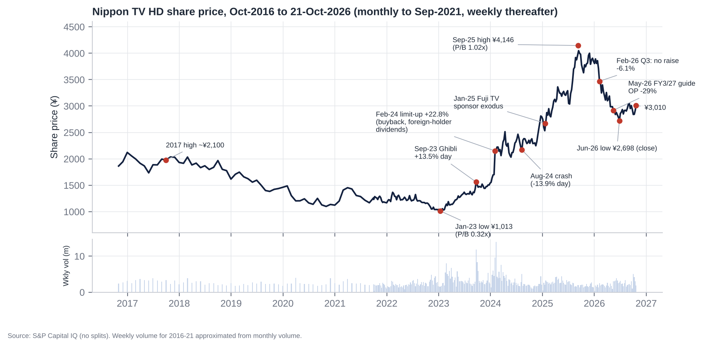

## 9.1 Single-day moves of 10% or more (last five years)

| Date | Move | Price | Driver |
|---|---|---|---|
| 22-Sep-2023 | **+13.5%** (opened limit-up; volume ~17x normal) | ¥1,375 → ¥1,561 | Board approved buying control of **Studio Ghibli** (42.3% of votes); price undisclosed |
| 2-Feb-2024 | **+22.8% (limit-up)**; volume ~7x | ¥1,751 → ¥2,151 | Q3 FY3/24 results plus a return package: ¥7bn buyback (the first since at least 2016), ¥3 commemorative dividend, and a proposal to **pay dividends on foreign-held shares refused registration** under the 20% Broadcasting Act cap |
| 5-Aug-2024 | **−13.9%** | ¥2,216 → ¥1,908 | Market crash: Nikkei −12.4% on the yen carry-trade unwind |
| 6-Aug-2024 | **+11.6%** | ¥1,908 → ¥2,130 | Market-wide rebound |

## 9.2 Multi-week swings of 10% or more since October 2021

| Window | Move | Driver |
|---|---|---|
| Jan → Feb 2022 | +11% | FY3/22 guidance raise (OP ¥46bn → ¥55bn) on the post-COVID ad rebound |
| Feb → Mar 2022 | −10% | Ukraine-invasion risk-off [u] |
| Feb-2022 → Jan-2023 | **−26%** | Ad-market slowdown: FY3/23 OP −21%; P/B hit a record low of 0.32x (Dec-2022) |
| Feb → Mar 2023 | +15% | Start of the TSE "cost of capital and share price" (P/B <1x) re-rating [u] |
| Aug → Sep 2023 | +18% | Studio Ghibli control |
| Jan → Feb 2024 | **+31–38%** | Return package and foreign-holder dividend fix (limit-up on 2-Feb) |
| Mar → Apr 2024 | +22% | Momentum and buyback execution |
| Apr → May 2024 | −16% | FY3/24 OP missed guidance (¥41.9bn vs ¥48bn) and the FY3/25 guide was flat; April risk-off |
| Jul → Aug 2024 | −12% | August-2024 crash |
| Nov → Dec 2024 | +12% to +21% | Fuji TV / Masahiro Nakai scandal coverage begins; rivals priced for ad-share gains [u timing] |
| 17-Jan → 14-Feb 2025 | **+16.5%** | **Fuji TV sponsor exodus** after Fuji's 17-Jan press conference; 75 sponsors suspended ads by 20-Jan |
| Feb → Mar 2025 | +12% | FY3/25 guidance raised (OP ¥42bn → ¥48bn), citing strong ads and cross-holding sales |
| Jul → Aug 2025 | +14% to +22% | Q1 FY3/26: OP +53%, +38% vs consensus; rally to the all-time high of ¥4,146 on 9-Sep-2025 (P/B 1.02x) |
| Jan → Feb 2026 | **−11% to −16%** | Q3 FY3/26: records but no guidance raise at 92% progress; read as peak earnings (−6.1% on 6-Feb while TOPIX rose 10% in February) |
| Sep-2025 → Jun-2026 | **−35%** | Earnings-peak fears; ¥39bn KANAMEL purchase (Mar-2026); FY3/27 OP guide −29% (May-2026). TOPIX +29%, Fuji +9% and TBS +11% over the same window |
| Jun → Oct 2026 | +12% | ¥12bn buyback completed (27-Aug); October sector rebound; Recruit rally |

**Other notable days.**

| Date | Move | Event |
|---|---|---|
| 20-Jan-2025 | +5.6% | Fuji sponsor exodus |
| 7-Apr-2025 | −6.7% | US tariff shock |
| 18-Apr-2025 | +6.7% | Sector-wide TV rally; cause [u] |
| 3-Jul-2025 | −6.1% | No news found [u] |
| 1-Aug-2025 | +5.9% | Q1 FY3/26 beat |
| 15-May-2026 | Opened −4.5%, closed flat | FY3/27 guide, cushioned by a ¥12bn buyback |
| 4-Aug-2026 | −3.9% | Second day after the Q1 FY3/27 miss |

The Kokubun/TOKIO scandal day (20-Jun-2025) moved the stock only −1.0%.

## 9.3 Ten-year context and relative performance

| TSR to 21-Oct-2026 | 1 year | 3 years | 5 years |
|---|---|---|---|
| **NTV** | **−17.7%** | +113.8% | +159.1% |
| TOPIX (1306 ETF proxy; total return [e]) | +27.7% | +93.0% | +128.5% |
| Fuji Media | +32.0% | +194.9% | +278.8% |
| TBS HD | +14.8% | +157.4% | +237.1% |
| TV Asahi HD | +7.8% | +111.3% | +93.3% |

- Over ten years NTV's price rose 61.5%, against +198% for the TOPIX ETF.
- NTV beat TOPIX over three and five years but lagged the key-station peers in every period. Over the last year it is the worst of the group, 45pp behind TOPIX.
- That underperformance came while NTV's NAV rose: the Recruit stake added about ¥650 per share after tax.

Source: S&P Capital IQ prices and dividends; peers' dividends added without reinvestment [e].

# 10. Earnings Calls, Management Focus and Sentiment

**Data note.**
- NTV holds results briefings only for H1 and full-year results. S&P lists Scripts Asia-recorded briefings on 11-Nov-2024, 13-May-2025, 10-Nov-2025 and 18-May-2026, but no transcript text was retrievable for NTV.
- ProntoNLP was not available in this session.
- We therefore built a **transparent, disclosure-based sentiment score**. It counts positive, negative and hedging signals in tanshin text, TSE notices, guidance actions and capital actions, scored −1 to +1 by topic. The overall score weights Advertising 30%, Content/Digital 20%, Costs 20%, Capital returns 10% and Outlook 20%.
- It measures disclosed tone, not spoken tone. Analyst-question themes are inferred [e].

## 10.1 Event-by-event summary

| Release | Period | OP (YoY) | OP vs consensus | Guidance action | Capital action | Day-1 stock (vs TOPIX) |
|---|---|---|---|---|---|---|
| 31-Jul-24 | Q1 FY3/25 | 11.4 | +7.0% | Kept (OP ¥42bn) | – | −2.0% (+1.1pp) |
| 7-Nov-24 | H1 FY3/25 | Q2 9.7 | +29.3% | Kept | – | −2.1% (−2.1pp) |
| 6-Feb-25 | Q3 FY3/25 | Q3 16.3 | **−5.2%** | Kept, then raised 21-Mar (OP ¥42bn → ¥48bn) | – | −3.0% (−2.3pp) |
| 8-May-25 | FY3/25 + MTP 2025–27 | 54.9 (+31%) | +10.9% | FY3/26 guide OP ¥55bn (flat) | Total return ≥35%; cross-holdings <20% of net assets; DPS ¥40 | −1.8% (−3.2pp) |
| 31-Jul-25 | Q1 FY3/26 | 17.5 (+53%) | **+37.9%** | Kept | – | **+5.9%** |
| 6-Nov-25 | H1 FY3/26 | Q2 15.7 (+62%) | +35.0% | **Raised** (OP ¥55bn → ¥59bn) | ¥10bn buyback (cancelled) | −1.1% (−0.9pp) |
| 5-Feb-26 | Q3 FY3/26 | Q3 21.0 (+29%) | +12.7% | **Kept despite 92% progress** | Shareholder benefits expanded | **−6.1% (−7.2pp)** |
| 19-Mar-26 | Revision + M&A | – | – | **Raised** (OP ¥67bn) | KANAMEL 78% for ¥37.3bn | −2.6% |
| 14-May-26 | FY3/26 + FY3/27 guide | 69.3 (+26%) | +1.5% | **FY3/27 OP ¥49.0bn (−29%)** | DPS ¥45; ¥12bn buyback (cancelled) | 0.0% (opened −4.5%) |
| **31-Jul-26** | **Q1 FY3/27** | **11.1 (−37%)** | **−13.3%** | Kept | Buyback completed 27-Aug | −0.6% day 1; −3.9% day 2 |

## 10.2 What management is focused on

1. **Advertising share and pricing in a post-Fuji market.**
   - In FY3/26 the message was "a high share among Tokyo key stations".
   - In FY3/27 it is defending share as Fuji returns. The guide assumes spot −6% and time +0.3%; Q1 came in at spot −12.2% and time +11.2%.
2. **Content/IP as the growth engine.**
   - Studio Ghibli (global distribution, Ghibli Park, Hosoda's new film), anime (expanded slot; *The Apothecary Diaries*, *Frieren*), the *Detective Conan* film, global drama sales and Hulu's recovery after its FY3/25 impairment.
   - The segment was renamed "Content & Media" from FY3/27, putting content first.
3. **"Global content company" ambitions.**
   - KANAMEL (ad and film production, seven overseas subsidiaries), the GYOKURO STUDIO overseas studio and an LA office.
   - Overseas sales targets: ¥30bn (FY3/28) and ¥100bn (FY3/34).
4. **Cost discipline versus event costs.** World Cup production costs (1Q gross margin −4.6pp), the Milano-Cortina Olympics, wage inflation and "upfront investment".
5. **Capital policy as a response to the TSE.**
   - Total return ≥35%, buybacks with cancellation, cross-holdings to <20% of net assets.
   - A commitment to raise ROE, but no numeric ROE or P/B target found [u].
   - Recruit sales are framed as part of the TSE "cost of capital" response.

**Likely analyst questions [e]:**
- spot assumptions after Fuji's recovery;
- the World Cup cost profile;
- KANAMEL goodwill and margins;
- why a 35% total return target when cash, bonds and securities exceed the market cap;
- what happens to the Recruit stake after its rally;
- ROE and P/B targets.

## 10.3 How sentiment has shifted

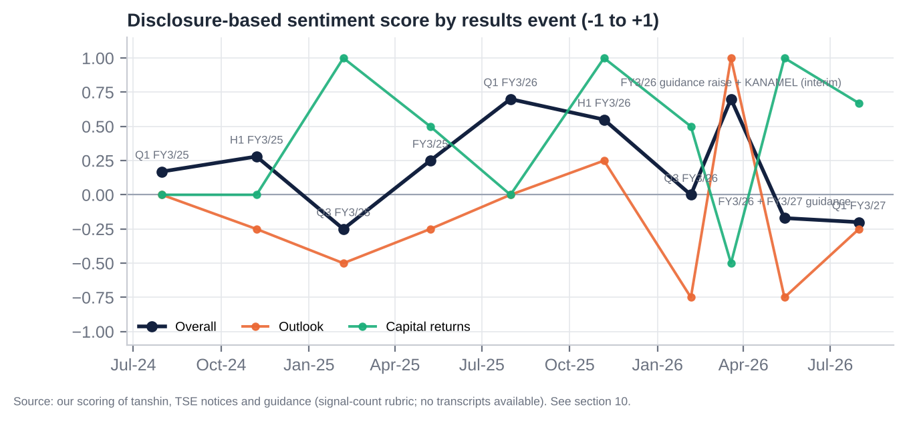

| Event | Overall | Advertising | Content/Digital | Costs | Capital returns | Outlook |
|---|---|---|---|---|---|---|
| Q1 FY3/25 (Jul-24) | +0.17 | +0.25 | +0.25 | +0.25 | 0.00 | 0.00 |
| H1 FY3/25 (Nov-24) | +0.28 | +0.25 | +0.25 | +1.00 | 0.00 | −0.25 |
| Q3 FY3/25 (Feb-25) | −0.25 | −0.17 | 0.00 | −1.00 | +1.00 | −0.50 |
| FY3/25 + MTP (May-25) | +0.25 | +0.50 | +0.25 | +0.25 | +0.50 | −0.25 |
| Q1 FY3/26 (Jul-25) | **+0.70** | +1.00 | +1.00 | +1.00 | 0.00 | 0.00 |
| H1 FY3/26 (Nov-25) | +0.55 | +0.50 | +1.00 | +0.25 | +1.00 | +0.25 |
| Q3 FY3/26 (Feb-26) | 0.00 | 0.00 | +0.25 | +0.25 | +0.50 | **−0.75** |
| Mar-26 raise + KANAMEL | +0.70 | +1.00 | +0.25 | +1.00 | −0.50 | +1.00 |
| FY3/26 + FY3/27 guide (May-26) | −0.17 | −0.17 | +0.50 | −0.83 | +1.00 | −0.75 |
| Q1 FY3/27 (Jul-26) | **−0.20** | −0.38 | +0.33 | −0.83 | +0.67 | −0.25 |

**The arc.**
1. **Mid-2024 (~+0.2):** steady but unexciting.
2. **Early 2025:** Fuji's collapse created a windfall that management under-promised on, keeping guidance flat in May 2025.
3. **Peak, Jul–Nov 2025 (+0.55 to +0.70):** OP beat consensus by 35–38% for two quarters, guidance was raised and the first ¥10bn cancellation buyback came.
4. **The turn, Feb-2026:** management refused to raise at 92% progress, signalling that FY3/27 would be hit by Fuji's comeback and event costs.
5. **Reset and trough, May–Jul 2026:** OP guided −29% and Q1 missed.

**The constant is capital returns,** the most positive topic in seven of ten events. **The swing factor is outlook.**
- **Read-across:** sentiment is near its low while the balance sheet is at its strongest. Historically that combination preceded NTV's best periods: the Feb-2023 and Feb-2024 re-ratings started from negative-tone setups.

# 11. Latest Result: 1Q FY3/27 (Apr–Jun 2026, released 31-Jul-2026)

## 11.1 Revenue and profit vs expectations

| ¥bn | 1Q FY3/27 | 1Q FY3/26 | YoY | S&P consensus (n) | vs consensus | Progress vs FY guide |
|---|---|---|---|---|---|---|
| Revenue | 114.6 | 114.65 | −0.0% | 123.2 (3) | −7.0% | 21.4% |
| Operating profit | **11.08** | 17.48 | **−36.6%** | 12.77 (4; range 11.8–14.0) | **−13.3%, below the lowest estimate** | 22.6% |
| Ordinary profit | 14.66 | 21.83 | −32.8% | 18.5 (1) | −20.8% | 24.8% (five-year average 24.5%) |
| Net income | **22.66** | 14.79 | **+53.2%** | 24.3 (1) | −6.8% | 44.0% |
| Gross margin | 33.1% | 37.8% | −4.6pp | – | – | – |
| OP margin | 9.7% | 15.2% | −5.6pp | – | – | – |

**Verdict.**
- **A clear miss at the operating level**: the first OP miss after five straight beats.
- **On track against the company's own guidance**: ordinary-profit progress was in line with history.
- **Net income rose 53% only because of ¥20.7bn of securities gains**, chiefly the partial Recruit sale. NI quality is low.

## 11.2 Segment drivers

- **Nippon TV advertising:**
  - **Time ¥27.53bn (+11.2%)**, lifted by World Cup sales. NTV was the only key station whose time revenue grew.
  - **Spot ¥27.37bn (−12.2%, −¥3.8bn)**, as Fuji's inventory returned. The four non-Fuji key stations' spot fell 15.9% in aggregate (TV Asahi and TV Tokyo more than −20%), so NTV held relatively more of its gained share.
  - Digital ads −11.7% [u: definition].
- **Content:** sales +3.9% (global distribution of past dramas, anime).
  - Anime: revenue +23.4%, profit −32.3% against *The Apothecary Diaries* comparison [u].
  - Film: revenue +27.8% (*Detective Conan*) [u].
- **Segments:**
  - Content & Media: revenue ¥106.8bn, OP ¥10.7bn (≈−37% YoY [e]).
  - Wellness: −¥0.02bn.
  - Real estate: ¥0.9bn.
- **Acceleration and deceleration.** OP growth by quarter: +52.8%, +62.2%, +28.9%, −13.5%, −36.6%. Revenue growth: +8.1%, +8.2%, +6.4%, −2.0%, 0.0%. The decline has steepened for two quarters as the Fuji comparison arrives and event costs land.

## 11.3 Margin trends

- **Gross margin fell 4.6pp to 33.1%** because of World Cup production costs. NTV broadcast 15 terrestrial matches, including one Japan group match.
- **SG&A rose 4.2%** (KANAMEL balance-sheet consolidation; personnel).
- **OP margin halved:** 15.2% → 9.7%.
- **Expect 2Q to remain weak.** The World Cup ran 11-Jun to 19-Jul. Consensus 2Q OP is ¥9.6bn (−39% YoY).
- **Margins should recover from 2H** on easier spot comparisons and no major events.

## 11.4 Guidance and outlook

- **FY3/27 guidance unchanged:** sales ¥535bn, OP ¥49.0bn, ordinary ¥59.0bn, NI ¥51.5bn, EPS ¥208.18, DPS ¥45 (10 + 35). No H1 guidance was disclosed.
- **What it needs:** OP of ¥37.9bn in 2Q–4Q, against consensus of ¥42.8bn summed by quarter. Spot needs to improve from −12% to about −4% for the rest of the year to hit the −6% plan [e].
- **Tone:** neutral-to-cautious on spot, positive on content.
- **Pattern:** NTV never raises at Q3. It pre-announces raises in March (2025 and 2026), and initial OP guides were beaten by 31% (FY3/25) and 26% (FY3/26).

## 11.5 Balance sheet flags

| Item (¥bn) | 31-Mar-26 | 30-Jun-26 | Comment |
|---|---|---|---|
| Goodwill | 9.0 | **50.6** | KANAMEL (+¥41.5bn). J-GAAP amortisation of ~¥2–4bn a year hits OP [e] |
| Interest-bearing debt incl. leases | 8.6 | **28.4** | KANAMEL's borrowings |
| Inventory and WIP | 13.1 | 24.0 | KANAMEL production work in progress |
| Receivables | 120.1 | 124.4 | +3.6% QoQ on flat revenue: consolidation effect; check at H1 |
| Long-term investments | 614.7 | 674.3 | Recruit mark-to-market, despite the partial sale |
| Deferred tax liabilities | 71.4 | 100.2 | Tax on unrealised gains |
| Net cash (cash + ST securities − debt) | 210.6 | 191.0 | KANAMEL cash out (~¥39bn), buyback, dividends |
| Total equity | 1,031 | 1,100 | Valuation gains on securities |

- **Revenue was flat even though KANAMEL was consolidated** on the balance sheet. That implies its P&L starts in 2Q (deemed acquisition at quarter-end) [e], and explains why the sell-side revenue consensus was too high.
- **No first-quarter cash-flow statement** is published (Japanese GAAP practice).

## 11.6 Market reaction and what it signals

| Window | NTV | TOPIX ETF | Relative |
|---|---|---|---|
| 29 → 31-Jul (pre-release) | −4.5% | +0.5% | −5.0pp |
| Day 1 (3-Aug; opened −3.4%) | −0.6% | −1.2% | +0.6pp |
| Day 2 (4-Aug) | −3.9% | flat | −3.9pp |
| 31-Jul → 7-Aug | +0.1% | +1.9% | −1.8pp |
| 31-Jul → 21-Oct | +3.2% | n/a | – |

**What it signals.** The bad news was largely priced in.
- The stock had already fallen 21% from February to May on the guidance reset.
- TV Tokyo's weak Q1 (net profit −43%, 29-Jul) had flagged the spot weakness.
- The gap-down was bought, helped by the ongoing ¥12bn buyback.

The market now treats the World Cup cost and the loss of the spot windfall as known. It is watching whether spot stabilises and whether the sell side cuts its above-guidance forecasts.

## 11.7 Unusual relative to recent history

1. The first OP miss since Q3 FY3/25, below the lowest estimate.
2. NI up 53% with OP down 37%: record securities gains.
3. The largest acquisition in NTV's recent history: goodwill up 5.6x and 26 newly consolidated companies.
4. Time revenue rose while every peer's fell (World Cup).
5. A segment rename that puts content ahead of media.

# 12. Earnings Estimates, FY3/27E–FY3/29E

## 12.1 Our forecasts vs consensus and guidance

| ¥bn | FY3/26A | FY3/27E | FY3/28E | FY3/29E | Cons. FY3/27 | Cons. FY3/28 | Cons. FY3/29 |
|---|---|---|---|---|---|---|---|
| Net sales | 484.4 | 535.0 | 560.0 | 572.0 | 517.6 | 542.0 | 548.2 |
| Growth | +4.9% | +10.4% | +4.7% | +2.1% | | | |
| EBITDA | 81.7 | 67.7 | 75.0 | 77.5 | 68.5 | 76.6 | 78.5 |
| Operating profit | 69.3 | 52.0 | 58.0 | 60.0 | 55.2 | 61.5 | 62.6 |
| OP margin | 14.3% | 9.7% | 10.4% | 10.5% | 10.7% | 11.3% | 11.4% |
| Non-operating, net | 12.8 | 12.5 | 14.0 | 14.5 | | | |
| Ordinary profit | 82.1 | 64.5 | 72.0 | 74.5 | 66.7 | 71.2 | 73.7 |
| Securities gains | 8.0 | 28.7 | 20.0 | 15.0 | | | |
| Impairments / other | (3.1) | (4.0) | (3.0) | (3.0) | | | |
| Pre-tax income | 87.0 | 89.2 | 89.0 | 86.5 | 83.8 | 87.2 | 84.9 |
| Tax rate | 29.0% | 30.0% | 30.0% | 30.0% | | | |
| Minorities | 5.0 | 5.0 | 5.3 | 5.5 | | | |
| **Net income** | **56.8** | **57.4** | **57.0** | **55.0** | 56.2 | 58.4 | 56.5 |
| Average shares (m) | 248.9 | 245.0 | 239.5 | 233.5 | | | |
| **EPS (¥)** | **228.1** | **234.4** | **238.0** | **235.8** | 229.9 | 249.5 | 237.3 |
| **Recurring EPS ex-gains (¥)** | 214.2 | **163.9** | **188.3** | **199.8** | | | |
| DPS (¥) | 45 | 45 | 50 | 55 | 45.2 | 48.6 | 49.1 |
| P/E (x) / recurring P/E (x) | 13.2 / 14.1 | 12.8 / 18.4 | 12.6 / 16.0 | 12.8 / 15.1 | 13.1 | 12.1 | 12.7 |

## 12.2 Key assumptions

| Driver | FY3/27E | FY3/28E | FY3/29E | Rationale |
|---|---|---|---|---|
| Industry growth (Japan TV ad market) | −2% | −1% | −1% | TV share of ad spend falling about 1pp a year; internet +10% a year |
| NTV terrestrial time | +2% | −2% | +0% | World Cup lifts FY3/27; LA 2028 Olympics in FY3/29 |
| NTV terrestrial spot | **−8%** | −1% | −1% | 1Q −12.2%; easier 2H comparison; Fuji back to ~90–100% of pre-scandal levels |
| Market share | Spot share 35% → ~32% [e] | Stable | Stable | Core-audience leadership keeps a premium |
| Pricing | Spot unit prices normalise (−3–5%) | Flat | Flat | Supply returns as Fuji recovers |
| Content | +5% | +6% | +5% | Ghibli, anime, overseas (target ¥30bn by FY3/28); weak yen helps |
| KANAMEL | ~¥56bn sales for 9 months; ~break-even after goodwill | ¥77bn; OP ~¥0.5bn after ~¥4bn goodwill amortisation | ¥79bn | Ad-production margin ~5.5% before amortisation |
| Costs | World Cup ~¥6bn net; wages +5%; upfront investment ¥3bn | No major event; production +2% | LA Olympics share ~¥2bn | Operating leverage works both ways (80–90% drop-through on spot) |
| D&A / capex | 15.7 / 27.6 | 17.0 / 30 | 17.5 / 32 | HQ and broadcast-equipment cycle, Bancho |
| Financing | Interest income up with BoJ at 1.0%+ | +¥1.5bn | +¥0.5bn | ~¥390bn in cash and bonds; debt only ¥28bn |
| Securities gains | ¥28.7bn (1Q ¥20.7bn + 2H ¥8bn) | ¥20bn | ¥15bn | Recruit sell-down towards the <20% target |
| Share count | −1.6% | −2.2% | −2.5% | Buybacks of ¥15–20bn a year at ~¥3,200–3,500 |
| Tax / minorities | 30% / ¥5.0bn | 30% / ¥5.3bn | 30% / ¥5.5bn | Ghibli's 57.7% minority |

**Sensitivities [e]:**
- ±1% on NTV spot revenue ≈ ±¥1.1bn OP (±¥3 EPS).
- ±1% on time revenue ≈ ±¥0.9bn OP.
- ±¥10bn of securities gains ≈ ±¥29 EPS.
- ±¥10bn of buybacks ≈ ±1.3% EPS.

**The key message.** Reported EPS is flat at ~¥235 for three years only because recurring securities gains offset a lower operating base. Recurring EPS bottoms at ¥164 in FY3/27 and grows 10% a year after that. On recurring EPS the stock is not optically cheap (16–18x), so the valuation case rests on the balance sheet.

# 13. Capital Structure, Debt, Covenants and Liquidity

## 13.1 Summary (30-Jun-2026)

| ¥bn | 30-Jun-2026 | Comment |
|---|---|---|
| Cash and deposits | 112.4 | |
| Short-term securities | 107.0 | Includes current held-to-maturity bonds [e] |
| Interest-bearing debt (short + long + leases) | 28.4 | ST borrowings ¥21.6bn (KANAMEL), LT ¥2.2bn, leases ¥4.5bn; **no bonds** |
| **Net cash** | **191.0** | 2.5x LTM EBITDA |
| Held-to-maturity bonds and other bond funds (inside LT investments) [e] | ~200 | ¥198bn HTM at Mar-26 per yuho (incl. current) |
| Listed strategic equities (book at Jun-26; ~¥500bn at 21-Oct prices) | ~347 | Recruit ~22.2m shares; SKY Perfect JSAT; Toei; Hakuhodo DY; others |
| Equity-method affiliates (book) | ~101 | FYCS HD 24.4%, Nikkatsu 35%, Beaglee, All About, JSS |
| Unlisted stocks and LPs | ~23 | 55 unlisted names |
| Total equity / shareholders' equity | 1,100 / 1,063 | Equity ratio 75.5% |
| Non-controlling interests | 37.1 | Studio Ghibli (57.7% minority), HJ Holdings, Tatsunoko |
| Retirement benefit liabilities | 12.7 | |
| Deferred tax liabilities (non-current) | 100.2 | Mostly on ~¥320bn+ unrealised gains |

Source: S&P Capital IQ balance sheet; FY3/26 yuho (holdings, HTM, affiliates) via S&P; our split of LT investments [e].

## 13.2 Maturity profile, covenants, cost of debt, ratings

- **Debt is trivial.** No bonds; ¥21.6bn of short-term borrowings (rolled bank lines, largely inherited with KANAMEL); ¥2.2bn long-term; ¥4.5bn of leases.
- **Interest expense** was ¥0.22bn in FY3/26 (~2.5% on average debt) and ¥0.06bn in 1Q FY3/27.
- **Covenants:** none disclosed. Debt maturities, commitment lines and R&I/JCR ratings were not retrievable (primary documents blocked) [u]. At ~0.4x gross debt/EBITDA and with net cash of ¥191bn (¥390bn including bonds), covenant or refinancing risk is nil.
- **Interest coverage:** OP/interest is above 300x.

## 13.3 Liquidity and capital capacity

| Measure | Value |
|---|---|
| Cash + ST securities + HTM bonds − debt [e] | ~¥390bn (53% of market cap) |
| Listed equities after tax at 21-Oct prices [e] | ~¥355bn (48% of market cap) |
| FCF, five-year average (FY3/22–26) | ¥40bn a year (FY3/26 ¥50.7bn) |
| MTP cash plan (FY3/26–28) | OCF ¥190bn; growth investment ¥100bn; capex ≥¥76bn; total return ≥35% |
| Capacity to return capital without debt [e] | ¥300bn+ (cash and bonds above a ¥90bn operating buffer) plus ~¥180bn from Recruit sales to the 20% target |

**Assessment.** NTV has one of the most over-capitalised balance sheets in Japanese large caps:
- equity ratio ~76%;
- net cash plus bonds of ¥390bn;
- ROE ~6%.

The capital structure is the thesis. Every ¥100bn returned via buybacks at ¥3,000 retires ~13.6% of the shares and lifts EPS by ~14% after lost interest [e]. The constraint is not liquidity but control (section 26).

# 14. Valuation vs Peers and vs History

## 14.1 Headline valuation (21-Oct-2026, ¥3,010)

| Multiple | S&P basis (TEV ¥581bn) | Adjusted basis (core EV = −¥32bn [e]) | Comment |
|---|---|---|---|
| EV/Sales (LTM) | 1.20x | −0.07x | S&P TEV deducts only cash and ST securities |
| EV/EBITDA (LTM ¥75.0bn) | 7.8x (CIQ-reported 7.4x) | NM (negative) | Core EV after deducting bonds, listed stakes after tax, affiliates, minorities |
| EV/EBIT (LTM ¥62.9bn) | 9.2x | NM | |
| EV/EBITDA FY3/27E (ours ¥67.7bn) | 8.6x | NM | |
| P/E LTM / FY3/27E / FY3/28E | 11.4x / 12.8x / 12.6x | Recurring: 18.4x / 16.0x | Recurring excludes securities gains |
| P/B | 0.69x (Jun-26) | 0.62x (adjusted for the post-June Recruit gain) | 10-year average 0.58x |
| Net debt / EBITDA | −2.5x (net cash) | −5.2x incl. bonds | |
| EBITDA / EBIT margin (LTM) | 15.5% / 13.0% | | Highest among Japanese broadcasters |
| Sales growth LTM / 3-year CAGR | +3.0% / +5.4% | | |
| FCF yield (FY3/26) | 6.9% | | Falls to ~4% in FY3/27E on the capex step-up |
| Dividend yield | 1.5% | | Lowest in the Japanese broadcaster group (median 2.8%) |

## 14.2 Listed peer comparison: multiples

Source: S&P Capital IQ, 21-Oct-2026; LTM mostly to 30-Jun-2026. Japanese forward P/E = NTM consensus NI [e]; non-Japanese = CIQ P/NTM EPS.

| Company | Ticker | Exchange | Mkt cap US$m | EV/Sales | EV/EBITDA | EV/EBIT | P/E LTM | P/E fwd | P/B | ND/EBITDA |
|---|---|---|---|---|---|---|---|---|---|---|
| **Nippon TV HD** | **9404 JT** | **TSE Prime** | **4,650** | **1.20x** | **7.8x** | **9.2x** | **11.4x** | **12.8x** | **0.69x** | **−2.5x** |
| Fuji Media HD | 4676 JT | TSE Prime | 3,810 | 1.92x | 30.6x | 56.1x | 38.5x | 12.1x | 1.12x | 13.8x |
| TBS HD | 9401 JT | TSE Prime | 5,828 | 2.16x | 23.3x | 43.6x | 18.8x | 16.7x | 0.57x | −0.1x |
| TV Asahi HD | 9409 JT | TSE Prime | 2,076 | 0.78x | 7.5x | 12.7x | 11.6x | 13.8x | 0.69x | −1.9x |
| TV Tokyo HD | 9413 JT | TSE Prime | 576 | 0.31x | 3.5x | 5.2x | 13.6x | 11.7x | 0.86x | −2.8x |
| Asahi Broadcasting Group | 9405 JT | TSE | 209 | 0.20x | 2.4x | 4.5x | 13.5x | n/a | 0.41x | −2.1x |
| Chubu-Nippon Broadcasting | 9402 JT | Nagoya SE | 203 | 0.61x | 5.7x | 11.3x | 18.4x | n/a | 0.40x | −3.4x |
| RKB Mainichi HD | 9407 JT | Fukuoka SE | 82 | 0.22x | 2.5x | 5.6x | 16.3x | n/a | 0.30x | −2.4x |
| *JP broadcaster median (ex-NTV)* | | | | *0.61x* | *5.7x* | *11.3x* | *16.3x* | *12.9x* | *0.57x* | *−2.1x* |
| Toho | 9602 JT | TSE Prime | 8,820 | 3.76x | 18.1x | 23.1x | 36.4x | 27.5x | 2.66x | −1.1x |
| Toei | 9605 JT | TSE Prime | 2,363 | 1.98x | 8.9x | 10.0x | 16.0x | n/a | 1.27x | −2.4x |
| Kadokawa | 9468 JT | TSE Prime | 3,548 | 1.74x | 29.7x | 115.5x | NM | n/a | 2.35x | −5.6x |
| Toei Animation | 4816 JT | TSE Prime | 3,854 | 5.41x | 15.9x | 16.3x | 23.6x | 26.2x | 3.62x | −2.7x |
| CyberAgent (ABEMA) | 4751 JT | TSE Prime | 4,259 | 0.68x | 6.6x | 7.2x | 15.4x | 14.4x | 3.22x | −1.2x |
| U-Next HD | 9418 JT | TSE Prime | 2,104 | 0.82x | 8.3x | 12.7x | 22.2x | n/a | 3.04x | 0.8x |
| *JP content median* | | | | *1.86x* | *12.4x* | *14.5x* | *22.2x* | *26.2x* | *2.89x* | *−1.8x* |
| ITV | ITV LN | LSE | 3,244 | 0.88x | 5.9x | 6.5x | 10.4x | 8.0x | 1.40x | 1.2x |
| ProSiebenSat.1 | PSM GR | Xetra | 840 | 0.71x | 6.7x | 10.5x | NM | 5.8x | 0.66x | 4.6x |
| TF1 | TFI FP | Euronext Paris | 1,384 | 0.41x | 4.3x | 4.7x | 9.9x | 12.8x | 0.63x | −1.8x |
| M6 Métropole | MMT FP | Euronext Paris | 1,439 | 1.07x | 8.2x | 9.6x | 12.8x | 9.8x | 1.09x | 0.4x |
| RTL Group | RRTL GR | Xetra | 5,255 | 1.13x | 12.9x | 21.8x | 4.7x* | 16.3x | 1.18x | 2.7x |
| MFE-MediaForEurope | MFEB IM | Borsa Italiana | 1,846 | 0.79x | 9.8x | 17.8x | 10.0x | 6.4x | 0.49x | 6.1x |
| Atresmedia | A3M SM | BME | 1,490 | 1.39x | 14.7x | 16.7x | 24.3x | 12.9x | 1.64x | −0.8x |
| Fox Corp | FOXA US | Nasdaq | 26,655 | 1.76x | 7.8x | 8.7x | 15.8x | 11.3x | 2.29x | 0.9x |
| Nexstar Media | NXST US | Nasdaq | 5,208 | 2.91x | 10.0x** | 14.4x | 27.7x | 5.4x | 2.30x | 7.0x |
| Sinclair | SBGI US | Nasdaq | 962 | 1.37x | 9.4x | 20.6x | 18.5x | n/a | 2.53x | 7.5x |
| Gray Media | GTN US | NYSE | 468 | 2.15x | 9.9x | 14.9x | NM | 2.6x | 0.22x | 8.3x |
| Nine Entertainment | NEC AU | ASX | 746 | 1.20x | 10.4x | 13.1x | 2.1x* | 7.5x | 0.90x | 6.2x |
| TVB | 511 HK | HKEX | 107 | 0.64x | 6.3x | 10.8x | 9.0x | 4.6x | 0.37x | 3.8x |
| CJ ENM | 035760 KQ | KOSDAQ | 619 | 0.64x | 2.6x*** | 26.4x | NM | 16.9x | 0.29x | 1.4x |
| Studio Dragon | 253450 KQ | KOSDAQ | 531 | 1.23x | 3.9x*** | 14.2x | 22.6x | 17.7x | 0.91x | 0.1x |
| *Global broadcaster median* | | | | *1.13x* | *8.8x* | *13.8x* | *11.6x* | *7.5x* | *0.99x* | *3.8x* |

\*LTM NI includes disposal gains. \*\*TEGNA consolidated only from 19-Mar-2026 (CIQ NTM EV/EBITDA 6.0x). \*\*\*CIQ EBITDA adds back content amortisation.

**Removed from the peer set:**
- TEGNA: acquired by Nexstar, delisted 19-Mar-2026.
- Warner Bros. Discovery: acquired by Paramount Skydance, closed early Oct-2026. The combined Skydance (SKYD) is shown as NM.
- SBS (034120 KS): S&P TEV does not reconcile.

## 14.3 Listed peer comparison: operating and balance-sheet metrics

| Company | EBITDA margin | EBIT margin | Sales growth LTM | Sales 3-yr CAGR | ROE | FCF yield | Div. yield | Inv. securities % mkt cap | Adj. EV/EBITDA (pre-tax) |
|---|---|---|---|---|---|---|---|---|---|
| **Nippon TV HD** | **15.5%** | **13.0%** | **+3.0%** | **+5.4%** | **6.1%** | **7.3%** | **1.5%** | **92%** | **NM (−1.2x)** |
| Fuji Media HD | 6.3% | 3.4% | +8.8% | +1.0% | 2.9% | −16.4% | 4.7% | 61% | 20.6x |
| TBS HD | 9.2% | 4.9% | +5.1% | +4.9% | 3.0% | −0.3% | 1.7% | 190% | NM (−20.7x) |
| TV Asahi HD | 10.4% | 6.1% | +4.1% | +3.7% | 5.9% | 3.8% | 2.8% | 69% | 1.1x |
| TV Tokyo HD | 9.0% | 5.9% | +2.1% | +3.0% | 6.3% | 15.3% | 3.9% | 32% | 1.5x |
| Asahi Broadcasting | 8.3% | 4.4% | +0.3% | +3.3% | 3.0% | 15.9% | 4.1% | 54% | 0.1x |
| Chubu-Nippon Broadcasting | 10.7% | 5.4% | +2.5% | +2.2% | 2.2% | 7.1% | 2.2% | 142% | NM |
| RKB Mainichi | 9.1% | 4.0% | +23.8% | +12.7% | 1.8% | −7.3% | 1.3% | 136% | NM |
| *JP broadcaster median* | *9.1%* | *4.9%* | *+4.1%* | *+3.3%* | *3.0%* | *3.8%* | *2.8%* | *69%* | *0.1x* |
| *JP content median* | *15.5%* | *12.9%* | *+3.6%* | *+5.3%* | *10.8%* | *3.0%* | *1.1%* | – | – |
| *Global broadcaster median* | *11.1%* | *8.6%* | *−1.1%* | *−2.9%* | *7.5%* | *9.6%* | *7.2%* | – | – |

**What the comparison shows.**
- NTV is the **most profitable Japanese broadcaster** by a wide margin: EBIT margin 13.0% vs a 4.9% median.
- It also has one of the largest securities books relative to market cap: 92%, against 190% at TBS (driven by Tokyo Electron).
- Against the Tokyo key-station trio (Fuji, TBS, TV Asahi), NTV is **cheap**: EV/EBITDA −67%, EV/Sales −37%, LTM P/E −40%. It is **in line** on P/B and forward P/E.
- Against the full Japanese median, which is pulled down by illiquid regionals at 2–6x EBITDA, it looks expensive on EV/Sales and EV/EBITDA, but only because S&P TEV ignores its securities.
- Against global broadcasters (median 8.8x EBITDA, 3.8x leverage, 7.2% yield), NTV trades at a similar EV/EBITDA with net cash instead of debt. The **dividend yield is NTV's weakest metric** (1.5%).

## 14.4 Private and unlisted competitors

| Competitor | Type | Listed? | Owner / parent (ticker) |
|---|---|---|---|
| NHK | Public broadcaster (licence fees); NHK ONE streaming | No | Statutory public corporation |
| Yomiuri Telecasting (YTV), Chukyo TV, Sapporo TV, Fukuoka Broadcasting | NNN affiliates (Osaka, Nagoya, Sapporo, Fukuoka) | No | Yomiuri Chukyo FS Holdings (FYCS): NTV 24.4%, Yomiuri group. The FYCS stations hold 11.3% of NTV |
| Kansai TV | Fuji-network Osaka station | No | Hankyu Hanshin HD (9042), Fuji Media HD (4676) [u] |
| MBS (Mainichi Broadcasting) | TBS-network Osaka station | No | MBS Media HD; TBS HD minority [u] |
| ABEMA | Free streaming / linear | No (subsidiary) | CyberAgent (4751) majority; TV Asahi HD minority [u] |
| TVer | Broadcasters' catch-up AVOD | No (JV) | NTV, TV Asahi, TBS, TV Tokyo, Fuji TV, Dentsu, Hakuhodo DY [u: cap table] |
| Hulu Japan | SVOD | No (NTV subsidiary) | HJ Holdings: NTV 79.4% |
| DAZN | Sports streaming (all 104 World Cup 2026 matches) | No | DAZN Group (Access Industries) [u] |
| Netflix Japan / Amazon Prime Video / Disney+ / YouTube | SVOD / AVOD | Parents listed | NFLX / AMZN / DIS / GOOGL |
| Yoshimoto Kogyo | Talent agency and producer | No (taken private 2010 by broadcasters and others) | Consortium incl. key stations [u] |

## 14.5 Regression: TEV/Sales vs EBIT margin

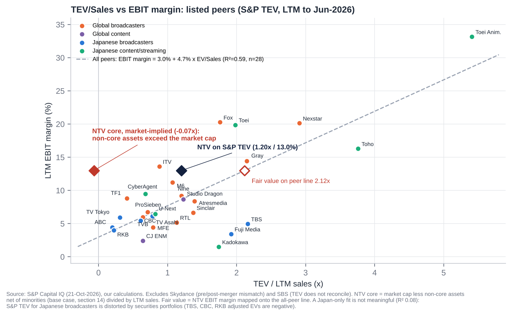

| Regression (n=28 listed peers, LTM) | Value |
|---|---|
| Equation | EBIT margin = 3.0% + 4.7% × TEV/Sales |
| R² / p-value | 0.59 / <0.0001 |
| NTV actual (S&P TEV) | 1.20x / 13.0%. **Below the line**: its margin implies 2.12x on the fitted line |
| NTV core, market-implied (after non-core assets) | **−0.07x** |
| Japanese-broadcaster-only fit | Not meaningful (R² 0.08): S&P TEV is distorted by securities portfolios |

**How to read it.**
- On S&P's own TEV, NTV sits below the peer line. For its margin the market pays about 57% of the fitted EV/Sales.
- On an asset-adjusted basis the core business is valued at less than zero, an outlier against every listed broadcaster or content company.
- Mapping NTV's 13% margin to the line gives an implied core EV of ¥1.0tn. That flatters NTV, because the line is lifted by high-margin US and anime names. We use a far more conservative 5.0x EBITDA (≈0.74x sales) in our SOTP.

## 14.6 Against its own history

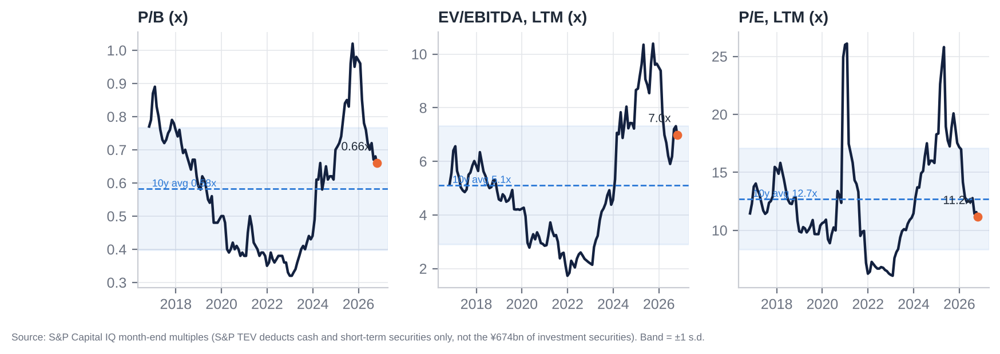

| Multiple (S&P, LTM, month-end) | 10y min | 10y max | 10y median | 5y median | 3y median | **Now** |
|---|---|---|---|---|---|---|
| EV/Sales | 0.30x (Dec-21) | 1.82x (Sep-25) | 0.80x | 0.98x | 1.16x | **1.13x** |
| EV/EBITDA | 1.7x (Dec-21) | 10.4x (Sep-25) | 4.9x | 6.2x | 7.4x | **7.0x** |
| EV/EBIT | 2.2x | 13.1x | 6.1x | 7.2x | 9.7x | **8.3x** |
| P/E | 6.1x (Jan-23) | 26.1x (Jan-21) | 12.4x | 12.4x | 15.8x | **11.2x** |
| P/B | 0.32x (Dec-22) | 1.02x (Sep-25) | 0.59x | 0.61x | 0.70x | **0.66x** |

**Relative to the key-station trio (CIQ year-end multiples):**

| Year-end | EV/EBITDA premium / (discount) | P/E | P/B |
|---|---|---|---|
| 2021 | −72% | −27% | 0% |
| 2023 | −48% | −5% | +2% |
| 2025 | −54% | +29% | +8% |
| **Now** | **−71%** | **−39%** | **0%** |

**Read.**
- P/E (11.2x) and P/B (0.66x) are below their three-year medians and near ten-year medians.
- S&P EV multiples look above history only because S&P's TEV includes the growing securities book. Adjusted for that, the core has never been cheaper.
- On P/E NTV has swung from a premium to peers at end-2025 back to a 39% discount.

## 14.7 Sum-of-the-parts (base case)

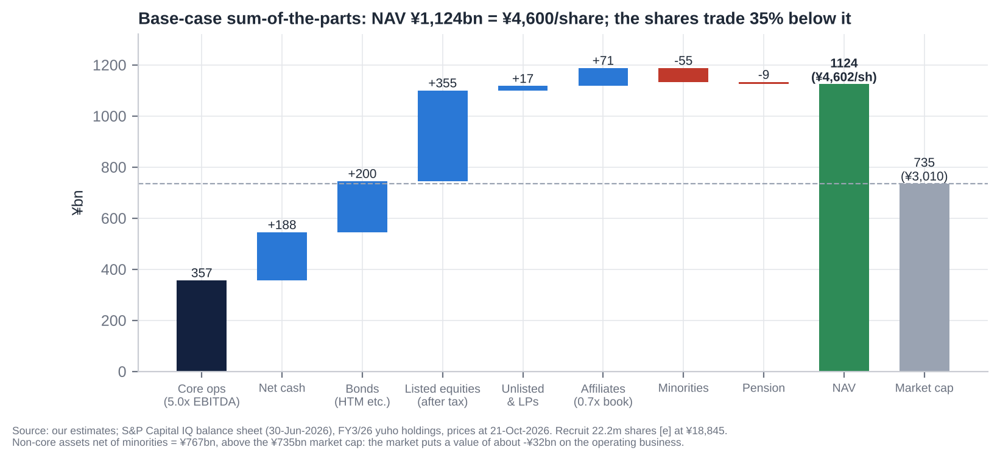

| Component | Method | ¥bn | ¥/share |
|---|---|---|---|
| Core operations | 5.0x normalised EBITDA ¥71.4bn (average FY3/27–28E) | 357 | 1,461 |
| Net cash | Cash + ST securities − debt, 30-Jun-26, less post-June buyback | 188 | 770 |
| Bonds held to maturity and bond funds | At book [e] | 200 | 819 |
| Listed equities | ¥500bn at 21-Oct prices, less 30.6% tax on ~¥473bn of gains | 355 | 1,453 |
| Unlisted stocks and LPs | 0.75x book | 17 | 70 |
| Equity-method affiliates (FYCS etc.) | 0.7x book | 71 | 289 |
| Less: minorities at market | Ghibli 57.7% at ~15x NI, HJ, Tatsunoko [e] | (55) | (225) |
| Less: pension deficit after tax | | (9) | (37) |
| **NAV** | | **1,124** | **4,602** |
| Market cap at ¥3,010 | | 735 | 3,010 |
| **Discount to NAV** | | | **35%** |
| Non-core assets net of minorities | | 767 | 3,141 |
| **Market-implied value of the core** | | **(32)** | **(131)** |

**Listed holdings at 21-Oct-2026 [e]:**

| Holding | Shares (m) | Price (¥) | Value (¥bn) | NTV's view of purpose |
|---|---|---|---|---|
| Recruit Holdings (6098) | ~22.2 (24.4 at Mar-26) | 18,845 | 418.4 | "Diversification partner"; cost ~¥300/share; Recruit holds 2.0% of NTV |
| SKY Perfect JSAT (9412) | 20.89 | 1,908 | 39.9 | Satellite distribution |
| Toei (9605) | 2.40 | 5,980 | 14.4 | Content partner (mutual holding) |
| Hakuhodo DY (2433) | 8.62 | 1,412 | 12.2 | Ad agency (15.5% of sales) |
| Nomura HD (8604) | 3.30 | 1,453 | 4.8 | Financial relationship |
| Dentsu Group (4324) | 0.90 | 3,776 | 3.4 | Ad agency (25.2% of sales) |
| WOWOW (4839) | 2.62 | 920 | 2.4 | Satellite / film |
| IG Port (3791) | 1.99 | 1,130 | 2.3 | Anime |
| Others (Kabuki-za, Denki Kogyo, ANA, SMFG, Kao, peers, Sapeet) | | | 2.2 | Relationship |
| **Total** | | | **~500** | 68% of NTV market cap |

**Sensitivity.** Each ¥1,000 move in Recruit changes NAV by **¥63 per NTV share** after tax. Each 1.0x turn of core EV/EBITDA is worth **¥292 per share**.

## 14.8 Verdict: cheap, fair or expensive?

**Cheap.** Headline multiples look ordinary: 12–13x P/E, 0.69x P/B, 7–8x S&P EV/EBITDA. But that is because every headline metric either ignores the securities book (S&P TEV) or values it at book (P/B, before the post-June Recruit gain).
- **Adjusted for assets:** the market capitalises the most profitable broadcaster in Japan at about zero.
- **On earnings power:** recurring P/E of 16–18x is fair, not cheap.
- **The re-rating needs a mechanism:** buybacks funded by securities sales. That is why we frame the position as event-driven rather than as a multiple-expansion call.

# 15. M&A: Industry Transactions, Takeover Potential and Takeout Multiples

## 15.1 Recent industry M&A themes (2021–2026)

1. **US scale consolidation.**
   - Nexstar–TEGNA ($6.0bn EV, ~7.2x EBITDA, closed Mar-2026); Gray's station purchases.
   - Sinclair's stake in, and abandoned bid for, E.W. Scripps.
   - Skydance's takeovers of Paramount (2025) and Warner Bros. Discovery (2025–26, $110bn EV, ~14x EBITDA), which beat a rival Netflix bid.
2. **European consolidation:** MFE took control of ProSiebenSat.1 (EV ~€4.2bn, ~8.7x EBITDA); RTL bought Sky Deutschland; Comcast/Sky held talks for ITV's M&E arm (~£1.6bn [u]).
3. **Australia and Africa:** Southern Cross–Seven West (A$658m, 5.3x EBITDA); Canal+–MultiChoice (7.3x EBITDA).
4. **IP and studio deals at premium multiples:** Amazon–MGM; Sony–Crunchyroll; Sony stakes in Kadokawa and Bandai Namco; Toho's anime-studio purchases (Science SARU, CoMix Wave); NTV–Studio Ghibli.
5. **Japan: network consolidation and capital-markets pressure rather than takeovers.**
   - Yomiuri Chukyo FS (FYCS) holding company, April 2025.
   - 2023 relay-sharing law and the 2026 1-station-2-channels rule.
   - TBS's U-NEXT stake.
   - Fuji's planned sale of its real-estate and tourism arm under activist pressure (Atra proposed ¥350bn).

## 15.2 Comparable transactions (last five years)

| Target | Acquirer | Announced | Status | EV | EV/Sales | EV/EBITDA | Premium |
|---|---|---|---|---|---|---|---|
| Warner Bros. Discovery | Skydance (Paramount Skydance) | Dec-2025 | Closed Oct-2026 | $110.5bn | 2.9x [e] | 14.2x [e] | +158% vs unaffected; +36% vs prior day [e] |
| TEGNA | Nexstar Media | Aug-2025 | Closed Mar-2026 | $6.0bn | 2.0x [e] | 7.2x [e] | +34.5% (vs 5-Aug-25) |
| ProSiebenSat.1 (29.9% via offer; control) | MFE-MediaForEurope | Mar-2025 | Closed Sep-2025 | €4.2bn | 1.1x [e] | 8.7x [e] | n.d. |
| Paramount Global | Skydance / RedBird | Jul-2024 | Closed Aug-2025 | ~$28bn [u] | ~0.9x [e][u] | ~10.3x [e][u] | n.d. |
| MultiChoice (68%) | Groupe Canal+ | Feb-2024 | Closed Oct-2025 | ZAR63bn | 1.1x [e] | 7.3x [e] | +67% [e] |
| Seven West Media | Southern Cross Media | Sep-2025 | Closed Jan-2026 | A$658m | 0.5x [e] | 5.3x [e] | n.d. |
| Sky Deutschland | RTL Deutschland | Jun-2025 | Closed Jun-2026 | €445m | n.d. | n.d. | n/a |
| Allen Media TV stations | Gray Media | Aug-2025 | Closed May-2026 | $171m | n.d. | n.d. | n/a |
| All3Media | RedBird IMI | Feb-2024 | Closed May-2024 | £1.15bn | n.d. | n.d. | n/a |
| MGM Holdings | Amazon | May-2021 | Closed Mar-2022 | $8.5bn | 5.7x [e] | 29.6x [e] (COVID trough) | n/a |
| WarnerMedia | Discovery | May-2021 | Closed Apr-2022 | $82.6bn | n.d. | n.d. | n/a |
| Crunchyroll | Sony | Dec-2020 | Closed Aug-2021 | $1.23bn | n.d. | n.d. | n/a |
| KANAMEL (ex-AOI TYO), 77% → 100% | Nippon TV HD | Mar-2026 | Closed Apr-2026 | ¥47.8bn (acquisition cost ¥49.8bn) | ~0.6x [e] | ~11x EV/OP [e] | n/a |
| AOI TYO take-private | Carlyle | May-2021 | Closed Jul-2021 | ¥22.5bn | 0.4x [e] | n/m | n.d. |
| Beaglee (25.4% via tender offer) | Nippon TV HD | Nov-2021 | Closed Dec-2021 | ¥16.4bn (implied) | 0.9x [e] | 6.6x [e] | n.d. |
| U-NEXT (20% stake) | TBS HD | 2023 | Closed | ¥24.2bn (100% implied ¥121bn) | n.d. | n.d. | n/a |
| Studio Ghibli (42.3%) | Nippon TV | Sep-2023 | Closed Oct-2023 | n.d. | n.d. | n.d. | n/a |
| Bandai Namco (2.5% stake) | Sony | Jul-2025 | Announced | ¥68bn (implied EV ¥2.3tn) | n.d. | n.d. | n.d. |

Source: S&P Capital IQ transactions and financials; multiples [e] = implied EV ÷ target's last reported revenue or EBITDA before announcement.

**Read-across.**
- Free-to-air broadcasters change hands at **5–9x EBITDA and 0.5–2x sales** (median ~7x).
- Scaled studio and IP assets fetch 14x+.
- NTV's core, on any of these multiples, is worth ¥350–650bn, against a market-implied value below zero.

## 15.3 Is NTV a takeover target?

**Not in the conventional sense.** A whole-company takeover is close to legally impossible.

**Impediments:**
1. **Certified broadcasting holding company rules.** No single shareholder (with related parties) may exercise more than one-third of the voting rights. Votes above that are void. A bidder can buy economics but not control.
2. **Foreign ownership cap.** Foreign voting rights are already 19.99%. Further foreign-held shares are refused registration (about 23.7m shares) and carry no votes. That rules out foreign strategic or private-equity bidders.
3. **Yomiuri group** holds 28.46% of votes, rising mechanically with every buyback. Adding the FYCS stations (~9.9%) and friendly holders (Teikyo University 3.8%, NTT Docomo 3.1%, Recruit 2.0%, Yomiuri Land 2.1%), stable holders are probably above 50% [e].
4. **Licence and political sensitivity.** MIC licensing, the nationality rules for directors, and the Yomiuri editorial link.

**What does make it a special situation:**
- a NAV discount of 35%, with the core valued below zero;
- a liquid hidden asset (Recruit, ¥418bn);
- a cross-holding ratio at about double its own target and the ISS threshold;
- peer precedents of activists forcing buybacks and asset separations (Fuji);
- a parent (Yomiuri) whose own interests may favour realising Recruit gains while keeping control.

**Realistic event paths (probability over 12–18 months [e]):**

| Path | Probability |
|---|---|
| Accelerated Recruit sell-down with a ≥¥50bn buyback or special dividend | 40% |
| Domestic activist (Murakami-family vehicles, Japan Catalyst, Strategic Capital) discloses a stake or files proposals for the June-2027 AGM | 25% |
| Group reorganisation with Yomiuri/FYCS (e.g. NTV absorbing FYCS, or a holding-level merger) | 10% |
| Sale of non-core assets (Tipness, la belle vie, part of the Bancho land) | 25% |
| Take-private or tender offer by a Yomiuri-led group | <5% (structurally hard; Yomiuri would need to surrender certification or restructure) |

## 15.4 Potential takeout multiples and values

A notional control transaction, if the legal structure allowed one, would value the core on trade multiples and the non-core assets at market.

| Core EV/EBITDA (on ¥71.4bn) | Core EV (¥bn) | Equity value (¥bn)* | Per share | Premium to ¥3,010 |
|---|---|---|---|---|
| 5.0x (European FTA) | 357 | 1,160 | ¥4,749 | +58% |
| 6.0x | 428 | 1,232 | ¥5,042 | +68% |
| 7.0x (Nexstar–TEGNA) | 500 | 1,303 | ¥5,334 | +77% |
| 8.0x | 571 | 1,374 | ¥5,626 | +87% |

\*Non-core assets at full value: listed equities after tax, affiliates and unlisted stakes at 1.0x book; less minorities and pension.

For context, Japanese take-private premiums average 40–50%. A theoretical control price of ¥4,750–5,300 (P/B 1.07–1.20x on book adjusted for the post-June Recruit gain) is consistent with that.

## 15.5 Acquisitions and disposals by NTV (2016–2026)

| Target | Date | Stake | Consideration | Multiple | Rationale | Outcome |
|---|---|---|---|---|---|---|
| All About (web media) | Mar-2017 | 25.0% | n.d. | n.d. | Digital media | Equity-method affiliate, 24.0%; small |
| JSS (swim schools) | Mar-2020 | 24.8% | n.d. | n.d. | Wellness | Equity-method affiliate |
| Beaglee (manga app) | Dec-2021 | 25.4% (tender offer) | ¥2.88bn | 0.9x sales; 6.6x EBITDA | IP and comics | Equity-method affiliate, 27.1% |
| Murayama HD (exhibitions/displays) | Mar-2022 | 100% | n.d. (from Rising Japan Equity) | n.d. | Events | **Underperforming**: yuho flags impairment risk on PP&E, goodwill and intangibles |
| R-Bies (running clubs, with ASICS) | Dec-2022 | 35% | n.d. | Target loss-making | Wellness | Small |
| la belle vie (GLADD, GILT fashion e-commerce) | May-2023 | 100% | n.d. | FY12/22 sales ¥15.7bn, OP ¥0.3bn | Merchandise | **Weak**: liabilities exceed assets |
| **Studio Ghibli** | Oct-2023 | 42.3% (control) | **n.d.** (bought from individuals) | n.d. | Succession; global IP | **Success**: Oscar 2024; content revenue ¥103.7bn → ¥140.3bn (FY3/23–26); Ghibli NI ¥6.4bn |
| FYCS HD (Yomiuri TV, Chukyo TV, Sapporo TV, FBS) | Apr-2025 | 24.4% (share transfer) | No cash | n.d. | Network consolidation | Equity method; holds 11.3% of NTV (circular) |
| KANAMEL, step 1 | Apr-2025 | 22.8% | ¥9.0bn | Implies ~¥40bn for 100% | Production; global | Became equity-method |
| **KANAMEL, step 2** | Apr-2026 | → 100% | ¥39.3bn cash (acquisition cost ¥49.8bn) | ~0.6x sales; ~11x OP [e] | "Global content company" | Too early. Goodwill ¥41.5bn; dilutes FY3/27 OP |
| Minority/CVC stakes (iCas, Vook, Gokko, Nature Innovation, ClaN Entertainment, NeoRealX, Sapeet) | 2022–26 | Minority | ClaN round ¥1.15bn; NeoRealX ¥0.54bn | n.d. | New businesses | Small |
| Pre-window anchors: HJ Holdings (Hulu Japan), Tatsunoko, Tipness | 2014 [u] | 79.4% / 55.2% / 100% | n.d. | n.d. | SVOD / anime / fitness | Hulu impaired FY3/25; **Tipness negative equity ¥19.4bn** |
| **Disposals:** Recruit (partial) | FY3/26 (1.1m shares); May–Jun 2026 (~2.2m [e]) | – | Proceeds ¥8.7bn; gains ¥8.4bn and ¥19.6bn | – | Cross-holding reduction | Ongoing |
| Disposals: unnamed listed securities | FY3/25 | – | Proceeds ¥14.2bn; gain ¥9.9bn | – | Same | Done |

**Assessment.**
- **Ghibli was the defining deal:** a likely low price for a world-class IP, with NTV providing a succession solution. Goodwill was minimal.
- **The rest is diversification of mixed quality:** Murayama, la belle vie and Tipness have destroyed value, and KANAMEL is unproven.

# 16. Management Assessment

## 16.1 Archetype

**Parent-appointed manager over career operators. No founder.**
- **Strategy and capital** sit with two Yomiuri appointees: Board Chair Toshikazu Yamaguchi (also President of Yomiuri Shimbun Group HD) and Chairman & CEO Yoshikuni Sugiyama (ex-Yomiuri accounting chief and Yomiuri Land president).
- **Operations** sit with NTV career insiders: President & COO Hiroyuki Fukuda and Vice Chairman Akira Ishizawa, who now also heads FYCS HD.

**Implications.**
- Steady, risk-averse management.
- Capital allocation is subordinated to group stability and editorial independence, not shareholder returns.
- Change tends to come from regulation (TSE, ISS) and peer pressure rather than from within.
- After Tsuneo Watanabe's death in December 2024, the Yomiuri succession has settled on Yamaguchi. That reduces key-person risk but not the control dynamic.

## 16.2 Key executives

| Name | Role | Age | In role since | Track record | Shares held |
|---|---|---|---|---|---|
| **Toshikazu Yamaguchi** | Representative Director, Chairman of the Board (non-executive) | 69 | Jun-2022 (outside director 2019–22) | Yomiuri lawyer-journalist; head of the legal department; President of Yomiuri Shimbun Group HD since 2016; seen as Watanabe's successor | 0 [u] |
| **Yoshikuni Sugiyama** | Representative Director, Chairman & CEO (HD and NTV Network) | 72 | Chairman & CEO since Jun-2022; President 2020–22 | Yomiuri Tokyo Director-General of Accounting; ran Yomiuri's Osaka and Seibu offices; President of Yomiuri Land 2018–20; outside director of JAPEX | 37,725 [u] |
| **Hiroyuki Fukuda** | Representative Director, President & COO (HD and NTV Network) | 65 | 1-Jan-2025 | NTV since 1985 (programming, production, sports, business development); **President of Studio Ghibli Oct-2023 to Jun-2026**; led the post-acquisition integration; ex-WOWOW outside director | ~42,779 [u] |
| **Akira Ishizawa** | Vice Chairman (non-executive); Representative Director of FYCS HD | 70 | Jan-2025 (President & CEO Jun-2022 to Dec-2024) | NTV career (programming, strategy); oversaw Ghibli control and the FYCS formation | n.d. |
| **Finance** | No director-level CFO. Mika Ito, Senior Executive Officer (accounting, internal audit) [u] | – | Promoted Jun-2025 | NTV insider | n.d. |
| Other senior executive officers | Gaku Shibata (sales and media strategy; SKY Perfect JSAT director); Keiichi Sawa (events, overseas, real estate) [u]; Tatsuo Matsumoto (compliance, PR) [u]; Tomohiro Okabe (promoted Jun-2026) | | | | |

## 16.3 Capital allocation and returns under current management

| FY | ROE | ROIC, total capital [e] | ROIC, operating (ex-investments) [e] | Buybacks | DPS |
|---|---|---|---|---|---|
| FY3/22 | 5.7% | 5.9% | 17.8% | 0 | ¥37 |
| FY3/23 | 4.0% | 4.4% | 13.5% | 0 | ¥37 |
| FY3/24 | 3.9% | 3.8% | 12.6% | ¥7.0bn | ¥40 |
| FY3/25 | 4.9% | 4.8% | 17.8% | 0 | ¥40 |
| FY3/26 | 5.8% | 5.9% | **23.1%** | ¥10.0bn | ¥45 |

**The pattern is clear.** The operating business earns 13–23% on its capital. The group earns 4–6% because roughly 60% of equity sits in cash, bonds and securities.

**Good decisions:**
- Studio Ghibli.
- The 2024 article change to pay dividends on refused foreign shares.
- The first buybacks (from 2024), with cancellation.
- The ≥35% total return policy.
- Gradual Recruit sales.

**Poor decisions:**
- No buybacks 2016–2023 while P/B sat at 0.3–0.6x.
- Tipness (negative equity), la belle vie and Murayama.
- Hulu Japan (sub-scale; impaired).
- KANAMEL at ~11x OP for a 5% margin business, which used half of the ¥100bn growth budget.
- Holding ~¥400bn of near-zero-yield cash and bonds.

## 16.4 Red flags

| Issue | Detail | Status |
|---|---|---|
| ***Sexy Tanaka-san*** (Jan–May 2024) | Original author died after disputes over a drama adaptation; NTV's internal report was widely criticised; Shogakukan's report blamed NTV | No director discipline; reputational cost with IP owners |
| **Kokubun Taichi / TOKIO** (Jun-2025) | Removed from *DASH* for "multiple compliance violations"; external committee backed NTV; JFBA petition declined | Closed (Feb-2026) |
| **BPO ethics violation** (Oct-2025) | Misleading edit of a street interview on *Getsuyo kara Yofukashi* | NTV report accepted Feb-2026 |
| **24-Hour TV donation embezzlement** (affiliate, Nov-2023) | Nihonkai TV executive embezzled ¥11m incl. charity money | Affiliate chairman resigned |
| **Related parties** | Giants broadcast rights bought from Yomiuri Shimbun Tokyo (amount undisclosed); Yomiuri interlocks (3 directors, 1 auditor); "independent" director Manago is a Yomiuri auditor; independent director Komoda chairs Mitsui Fudosan, which leads the Tsukiji redevelopment consortium that includes Yomiuri | Structural |
| **Circular holdings** | FYCS (24.4%-owned) holds 11.3% of NTV; Recruit, Toei and Dentsu hold NTV shares back | Entrenchment |
| **Compensation** | ¥218m for 4 inside directors (67% fixed, 27% performance cash, 6% restricted stock); ¥96m for 6 outside directors [u]; no compensation committee | Not excessive; weakly aligned (insider ownership ~0.03%) |
| **Strategy pivots** | From broadcaster to "global content company" (Ghibli, KANAMEL, overseas) to wellness (Tipness target ¥40bn) | Watch M&A discipline |
| **Promotional behaviour** | None found; guidance is consistently conservative | Positive |

## 16.5 Recent senior management changes

| Date | Change |
|---|---|
| Jun-2022 | Sugiyama becomes Chairman & CEO; Ishizawa President; Yamaguchi becomes Representative Director & Board Chair (new post); Chairman Okubo retires |
| Oct-2023 | Fukuda becomes President of Studio Ghibli after NTV takes control |
| Jun-2024 | Board expanded from 9 to 11 (Fukuda, Takako Suwa join) |
| 19-Dec-2024 | Director Tsuneo Watanabe (Yomiuri's editor-in-chief) dies; seat not refilled |
| 1-Jan-2025 | **CEO-level change:** Ishizawa leaves the presidency to head FYCS HD (stays as Vice Chairman); Fukuda becomes President & COO |
| Jun-2025 | Board of 10; restricted-stock plan introduced; Mika Ito and Tatsuo Matsumoto promoted to Senior EO |
| Jun-2026 | Board of 11 with **7 independent** (Yumiko Murakami, ex-Goldman Sachs and OECD, joins); Fukuda hands the Ghibli presidency to Kenichi Yoda |

# 17. Board of Directors

Company with an Audit & Supervisory Board; one-year director terms. After the June-2026 AGM:
- 11 directors, **7 independent (64%)**, 2 women (18%);
- no statutory nomination or compensation committee [u];
- 4 statutory auditors, only 1 independent.

| # | Name | Position | Independent | First appointed | Background | Other affiliations |
|---|---|---|---|---|---|---|
| 1 | Toshikazu Yamaguchi | Representative Director, Board Chair | No | 2019 | Yomiuri; lawyer-journalist | President, Yomiuri Shimbun Group HD |
| 2 | Yoshikuni Sugiyama | Representative Director, Chairman & CEO | No | 2019 | Yomiuri accounting; ex-President of Yomiuri Land | Director, Yomiuri Shimbun Group and Yomiuri Land; outside director, JAPEX |
| 3 | Akira Ishizawa | Vice Chairman | No | 2022 [u] (also 2013–15) | NTV career; ex-President & CEO | Representative Director, FYCS HD; Director, Yomiuri Shimbun Group |
| 4 | Hiroyuki Fukuda | Representative Director, President & COO | No | 2024 | NTV career; ex-President of Studio Ghibli | – |
| 5 | Ken Sato | Outside director | Yes | Pre-2021 [u] (12+ years [u]) | Ex-Administrative Vice-Minister of Defense | Director, NTV Network; ex-Aeon outside director |
| 6 | Tadao Kakizoe | Outside director | Yes | Pre-2021 [u] (12+ years [u]) | Physician; ex-President of the National Cancer Center | Director, NTV Network |
| 7 | Yasushi Manago | Outside director | Yes (**questionable**) | Pre-2021 [u] | Ex-Administrative Vice-Minister of Finance; lawyer | **Auditor of Yomiuri Shimbun Group** |
| 8 | Eijiro Katsu | Outside director | Yes | 2022 [u] | Ex-Administrative Vice-Minister of Finance; ex-President of IIJ | Outside director, ANA HD |
| 9 | Masanobu Komoda | Outside director | Yes | 2023 | Chairman, Mitsui Fudosan | Outside director, JAL; Mitsui Fudosan leads the Tsukiji consortium with Yomiuri |
| 10 | Takako Suwa | Outside director | Yes | 2024 | President, Daiya Seiki | Outside director, Japan Post HD |
| 11 | Yumiko Murakami | Outside director | Yes | 2026 | Ex-Goldman Sachs MD; ex-head of OECD Tokyo Centre | General Partner, MPower Partners; outside director, Daiwa Securities Group |
| A1 | Masayuki Yokota | Standing statutory auditor | No | 2026 | NTV [u] | – |
| A2 | Shigeru Kitamura | Statutory auditor | Yes | 2022 | Ex-Secretary-General, National Security Secretariat | Special Advisor, Ichiryu Associates |
| A3 | Akitoshi Muraoka | Statutory auditor | No | n.d. | Yomiuri | Director and VP, Yomiuri Shimbun Group |
| A4 | Yozo Matsuda | Statutory auditor | No | 2024 | Yomiuri side [u] | n.d. |

**AGM approval rates** (2025 / 2026, from EDINET extraordinary reports via aggregators [u]):

| Director | 2025 | 2026 |
|---|---|---|
| Yamaguchi | 76.4% | 76.8% |
| Sugiyama | 75.1% | 74.6% |
| Fukuda | – | 85.1% |
| Ishizawa | – | 90.4% |
| Sato / Kakizoe | – | 74.7% |
| Manago | – | 76.2% |
| Katsu | – | 90.5% |
| **Komoda** | – | **71.6%** (lowest) |
| Suwa | – | 93.8% |
| Murakami | – | 93.8% |

With Yomiuri voting ~28% in favour, roughly **one-third of non-Yomiuri votes were cast against** the Yomiuri-linked leaders. The likely drivers [e] are ISS's cross-holding (≥20% of net assets) and ROE policies, parent-company conflicts, and the 12-year tenure rule for outside directors.

## 17.1 Board changes in the last five years

| AGM | Board size | Joined | Left | Note |
|---|---|---|---|---|
| Jun-2021 | 12 → 9 | n.d. | n.d. | Board cut; executive-officer system introduced |
| Jun-2022 | 9 | Eijiro Katsu [u]; auditor Shigeru Kitamura | Chairman Yoshio Okubo; Yoshinobu Kosugi [u] | Yamaguchi becomes Board Chair; Sugiyama Chairman & CEO |
| Jun-2023 | 9 | Masanobu Komoda | Takashi Imai (ex-Keidanren chair) | Outside-director refresh |
| Jun-2024 | 9 → 11 | Hiroyuki Fukuda, Takako Suwa; auditor Yozo Matsuda | Auditor Yoshimitsu Ohashi | Majority independent |
| Dec-2024 / Jan-2025 | 11 → 10 | – | Tsuneo Watanabe (died) | Ishizawa moves to Vice Chairman |
| Jun-2025 | 10 | – | – | Watanabe seat left vacant |
| Jun-2026 | 11 | Yumiko Murakami; standing auditor Masayuki Yokota | Standing auditor Yoshiyuki Kusama | 7 of 11 independent |

# 18. Shareholders, Activism and Short Interest

## 18.1 Top 10 shareholders (31-Mar-2026, FY3/26 yuho)

| # | Holder | Shares (m) | % ex-treasury | Type |
|---|---|---|---|---|
| 1 | Yomiuri Shimbun Group HD | 37.65 | 14.76% | Parent-like strategic ("other affiliated company") |
| 2 | Master Trust Bank of Japan (trust) | 23.06 | 9.04% | Custodian / index (domestic institutions) |
| 3 | State Street Bank & Trust 505001 | 21.56 | 8.45% | Foreign custodian; likely includes Capital Group [e] |
| 4 | Yomiuri Telecasting (FYCS) | 17.13 | 6.72% | Affiliated broadcaster (circular) |
| 5 | Yomiuri Shimbun Tokyo HQ | 15.94 | 6.25% | Yomiuri group |
| 6 | Teikyo University | 9.62 | 3.77% | Strategic / long-term |
| 7 | NTT Docomo | 7.78 | 3.05% | Corporate cross-holder |
| 8 | Yomiuri Land | 5.24 | 2.05% | Yomiuri group |
| 9 | Chukyo TV (FYCS) | 5.23 | 2.05% | Affiliated broadcaster |
| 10 | Recruit Holdings | 5.16 | 2.02% [e] | Corporate cross-holder (selling: 6.45m at Sep-2025) |
| | **Top 10** | | **58.2%** | |

**Other register facts:**
- **Yomiuri group voting rights:** 28.46% (16.28% direct, 12.17% indirect).
- **FYCS stations:** 11.3% of NTV in total (YTV 7.4%, CTV 2.2%, FBS 1.0%, STV 0.6%).
- **Capital Group** (Capital Research & Management): peaked at 11.39% (Jul-2025), down to 7.84% by 30-Jun-2026. It is the largest outside investor and a seller.
- **Foreign voting rights:** 19.99%, at the cap (31-Mar and 30-Sep-2026). Economic foreign ownership is ~27% including refused shares [e].
- **Treasury:** 6.27m shares (2.40%) at 31-Mar-2026, and 4.14m bought May–Aug 2026 for cancellation.
- **Insiders:** directors personally hold ~0.03%.

## 18.2 Activism

**At NTV: no campaign found (2021–2026).** S&P key developments and web searches show no shareholder proposals, open letters or ≥5% filings by a known activist. The register is unusually hostile to foreign activists: foreign votes are capped, and incremental foreign shares are unregistered.

**The pressure is indirect:**
- ~25% opposition to the Chairman and CEO in 2025–26;
- ISS's cross-holding policy;
- TSE's P/B disclosure request;
- the peer precedents below.

| Peer | Activist(s) | Main demands | Outcome |
|---|---|---|---|
| **Fuji Media HD** | Dalton / NAVF (Rising Sun); Murakami group (Aya Nomura, Atra and others) | After the Nakai scandal: governance overhaul; 12-director slate; real-estate (Sankei Building) spin-off; cross-holding unwind. Murakami built **17.3%** and threatened to buy up to 33.3% | Proxy fight lost (Jun-2025: dissident nominees <30%). But by Feb-2026 Fuji agreed to seek capital for or sell 11 real-estate and tourism subsidiaries and ran a **¥235bn buyback**, through which Murakami sold. **Activists won the economics** |
| **TBS HD** | AVI (2018); Hibiki Path (2024); Monex/Japan Catalyst (2025–26) | In-kind distribution of Tokyo Electron shares; higher payout; buybacks until ROE reaches 8% | All proposals rejected; TBS sold some cross-holdings (~¥9.3bn gains) and ran a buyback of up to ¥51bn (2026) |
| **TV Asahi HD** | Aya Nomura (Murakami family), 1.86% (Jun-2026) | Reportedly cross-holding sales and capital efficiency; TV Asahi–Toei mutual holdings | No proposal yet |

**Implication.** NTV has the largest asset discount and the most liquid hidden asset of the group, and no activist on the register. A domestic activist (Murakami-family vehicles are domestic, so not capped) is a credible 2027 catalyst. A foreign fund like ours can engage but cannot vote incremental shares.

## 18.3 Short interest

- **Data not retrievable** in this session: JPX short-position reports (karauri.net/9404), margin balances (信用残) and stock-lending data. The sources were blocked by the network policy. To be checked on JPX / irbank before trading.
- **Indirect evidence [e]:**
  - Beta 0.3, continuous buybacks (¥29bn since 2024) and net cash and securities above the market cap make NTV structurally unattractive for fundamental shorts.
  - Volume in October 2026 is running at ~2x the 12-month average on a rising price. That is consistent with short covering or new buyers [u].
- **Known short theses** would centre on structural TV decline and the Fuji normalisation. Neither addresses the asset backing.

# 19. Strategic Initiatives (2016–2026)

| Initiative | When | What | Status | Verdict |
|---|---|---|---|---|
| Hulu Japan (HJ Holdings, 79.4%) | 2014– | SVOD | Content-asset impairment FY3/25; improving FY3/26 [u]; subscribers undisclosed | **Mixed / sub-scale** vs Netflix and U-NEXT |
| TVer (industry JV) and digital ads | 2015– | Catch-up AVOD; connected TV | NTV digital ads ¥5.2bn (FY3/23) → ¥11.9bn (FY3/26); TVer 44.7m monthly users | **Growing but small** (~5% of ads) |
| Studio Ghibli | Oct-2023 | Control (42.3%), succession, global IP | Oscar (2024); content revenue +35% in three years; Ghibli NI ¥6.4bn | **Success** |
| Ghibli Park | Opened Nov-2022 | Aichi theme park (Ghibli / Chunichi JV) | Events/theme revenue ¥10.5bn → ¥18.8bn | Positive |
| Anime push | 2020s | Tatsunoko (55.2%), Madhouse [u], IG Port stake; one-hour anime slot | Anime revenue +23% (1Q FY3/27) | Positive |
| Global content / overseas | MTP 2025–27 | GYOKURO STUDIO, LA office, format and drama sales | Overseas ~¥12bn [u] vs ¥30bn FY3/28 target | **Early** |
| KANAMEL | 2025–26 | Ad and film production, 7 overseas offices | Consolidated Apr-2026; goodwill ¥41.5bn | **Too early; expensive** |
| Wellness (Tipness and others) | 2014– | Fitness clubs, swim schools, running clubs | Revenue ¥27.2bn vs ¥40bn target; Tipness negative equity ¥19.4bn | **Failure** |
| Commerce (la belle vie) | 2023 | Fashion flash-sale e-commerce | Merchandise revenue up; entity has negative net assets | **Doubtful** |
| Events (Murayama) | 2022 | Exhibition/display production | Impairment risk flagged in the yuho | **Underperforming** |
| Real estate (Shiodome, Bancho) | Ongoing | HQ and rental; Bancho redevelopment | Real estate OP ~¥4bn; land book ¥180bn; Bancho capex starting | **Latent value, not monetised** |
| Network consolidation (FYCS) | Apr-2025 | Holding company for 4 core affiliates | Done; NTV 24.4% | Defensive positive |
| Capital policy | 2024– | Buybacks, ≥35% total return, cross-holdings <20% of net assets, dividends on refused foreign shares | ¥29bn of buybacks; DPS ¥37 → ¥45; Recruit sales | **Progress, but too slow** for the balance sheet |
| MTP 2025–27 | May-2025 | FY3/28: sales ¥540bn, OP ¥58bn; FY3/34: ¥700bn / ¥70bn | FY3/26 OP already ¥69.3bn; mix targets (content, wellness) behind | OP target conservative |

# 20. Stakes in Other Companies

| Stake | % / shares | Value (¥bn) | Strategic relevance | Financial relevance |
|---|---|---|---|---|
| **Recruit Holdings (6098)** | ~22.2m shares [e] | **418** (pre-tax, 21-Oct) | Low: historical relationship; Recruit holds 2.0% of NTV | **Very high**: 57% of market cap; cost ~¥300/share; mostly taxable gain |
| SKY Perfect JSAT (9412) | 20.9m shares | 40 | Medium (satellite platform for BS/CS) | Moderate |
| Toei (9605) | 2.4m shares | 14 | Medium (content; mutual holding) | Low |
| Hakuhodo DY (2433) / Dentsu (4324) | 8.6m / 0.9m shares | 12 / 3 | High relationship value (40.7% of sales) | Low |
| Nomura, WOWOW, IG Port, others | – | ~12 | Relationship | Low |
| FYCS HD (Yomiuri TV, Chukyo TV, Sapporo TV, FBS) | 24.4% | Book within ¥101bn of affiliates | **High** (network; circular 11.3% holding in NTV) | Moderate; illiquid |
| Studio Ghibli | 42.3% (consolidated) | Minority worth ~¥55bn [e] implies the 100% equity ~¥95bn | **High** (IP crown jewel) | High |
| HJ Holdings (Hulu Japan) | 79.4% | n.d. | Medium | Low (impaired) |
| Nikkatsu (film studio) | 35.0% | Within affiliates | Medium | Low |
| Beaglee / All About / JSS (listed affiliates) | 27.1% / 24.0% / 24.8% | 3.6 (market) | Low–medium | Low |
| TVer, Yoshimoto Kogyo, others | n.d. (among 55 unlisted names) | ~23 (unlisted and LPs) | Medium (TVer) | Low |

**Assessment.**
- **Financially, the stakes are the valuation.** Listed equities alone are 68% of the market cap pre-tax, and Recruit is 57%.
- **Strategically,** only FYCS, Ghibli and the agencies matter. Recruit, SKY Perfect, Nomura and most of the rest are legacy cross-holdings with no operational logic. That is exactly what TSE, ISS and NTV's own MTP say should be sold.

# 21. Dividends, Buybacks and Treasury Shares (Five-Year Timeline)

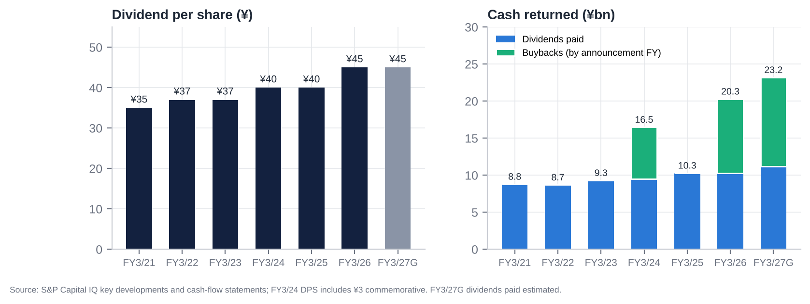

| FY | Interim DPS | Final DPS | Total DPS | Payout | Dividends paid (¥bn) | Buyback announced / executed | Shares bought | Treasury at FY-end (register) | Cancellation | Total return [e] |
|---|---|---|---|---|---|---|---|---|---|---|
| FY3/22 | ¥10 [u] | ¥27 [u] | ¥37 | 19.9% | 8.7 | None | – | ~3.1m [e] | – | 18% |
| FY3/23 | ¥10 | ¥27 | ¥37 | 27.7% | 9.3 | None | – | ~3.1m [e] | – | 27% |
| FY3/24 | ¥10 | ¥30 (incl. ¥3 commemorative) | ¥40 | 29.3% | 9.5 | 1-Feb-2024: up to 5.0m shares / ¥7.0bn; done 17-May-2024 | 3.20m (¥7.0bn) | n.d. | Not cancelled (held) | 46% (company: 39.9%) |
| FY3/25 | ¥10 | ¥30 | ¥40 | 21.8% | 10.3 | None | – | n.d. (consolidated 13.46m incl. trust and look-through) | – | 30% |
| FY3/26 | ¥10 | ¥35 | ¥45 | 19.7% | 10.3 | 6-Nov-2025: up to 3.3m / ¥10bn; done 17-Dec-2025 | 2.60m (¥10.0bn) | **6.27m (2.40%)** | **2.60m cancelled** (issued 263.82m → 261.22m) | 36–38% |
| FY3/27 (G) | ¥10 | ¥35 | ¥45 | 21.6% | ~11.2 [e] | 14-May-2026: up to 5.2m / ¥12bn; done 27-Aug-2026 | 4.14m (¥12.0bn) | ~6.3m [e] | **4.14m to be cancelled** (planned 30-Sep-2026; issued → ~257.08m) | ~45% [e] |

**Policy and history.**
- Stable dividends of ¥34–37 from FY3/16 to FY3/23 and no buybacks before 2024. The first numeric return target came in May 2025: total return ratio ≥35%. There is no DOE or payout floor.
- Since the March-2024 record date, dividends have been paid on foreign-held shares refused registration.
- A restricted-stock plan for executives started in 2025 (22,185 treasury shares disposed in Jul-2026).
- Cumulative buybacks are ¥29bn (9.94m shares, 3.8% of the 2024 share count). The share count is down 4.2% since 2021.

# 22. Adversarial Analysis I: The Bull Case

1. **Competitive advantage that is real, if narrowing.**
   - NTV is #1 in Tokyo key-station ad revenue (spot ¥127.6bn vs TV Asahi ¥105.2bn) and has been #1 in the 13–49 core audience for 13 years, the demographic advertisers pay a premium for.
   - The licence-based oligopoly cannot be entered, and certified-holding-company rules block acquirers.
   - In 1Q FY3/27 NTV's spot fell less than its peers' (−12.2% vs −15.9%), evidence that some of the share gained in 2025 is sticky.
2. **A moat that is migrating to IP, not disappearing.**
   - Ghibli is a world-class, evergreen library with global platform deals (Netflix, HBO Max) and a theme park.
   - Anime revenue grew 23% in 1Q. Content revenue is +35% in three years and targeted at ¥187bn by FY3/28 (¥300bn by FY3/34).
   - The weak yen magnifies overseas licensing.
3. **Earnings surprise potential.**
   - The FY3/27 guide (OP ¥49bn) assumes spot −6% and bakes in the World Cup cost hump.
   - NTV beat its initial guide by 31% and 26% in the last two years and raised in March both times.
   - In 2H, spot comparisons ease, there are no major events, and interest income rises with BoJ hikes.
   - A beat to ¥53–55bn OP plus continued securities gains keeps reported EPS at ~¥230+.
4. **Capital allocation at an inflection.**
   - The Recruit rally has made the cross-holding target impossible to ignore: ~41% of net assets vs the <20% target, and ISS's 20% line.
   - Selling down to 20% would release ~¥180bn after tax, 24% of the market cap, on top of ~¥390bn of cash and bonds.
   - The ¥22bn of buybacks in 12 months, all cancelled, shows the mechanism exists. A step-up to ¥50–100bn a year would retire 7–14% of the shares annually.
5. **Secular and structural tailwinds.**
   - TSE pressure on sub-1x P/B companies; ISS/Glass Lewis cross-holding policies.
   - Domestic activism migrating from Fuji to TV Asahi, with NTV next.
   - Local-station deregulation that lets FYCS consolidate the network.
   - TVer and connected-TV growth (+23% in 2025).
6. **Valuation asymmetry.** At ¥3,010 the market pays ~0.96x non-core assets and nothing for the business. In the bull case (NAV ¥5,440, 10% discount) the value is ¥4,900, +63%. Downside is cushioned by ¥1,590 per share of net cash and bonds.

# 23. Adversarial Analysis II: The Bear Case, Pre-Mortem and Contrarian View

## 23.1 Two to three risks that could permanently impair the business

1. **Structural collapse of linear TV advertising.**
   - The TV share of Japanese ad spend has fallen from 27% to 22% in four years, and ratings fall every year (core rating −24% in three years).
   - If the decline accelerates (e.g., −5% a year, as in Western markets in 2023–24), NTV's high-fixed-cost model gives back margin quickly. A 10% fall in terrestrial ads (~¥23bn) would cut OP by ~¥20bn [e].
2. **Capital lock-up: the value trap.**
   - Yomiuri treats NTV's balance sheet as a strategic reserve for group stability, the Tsukiji redevelopment, M&A and the network.
   - The Recruit proceeds go into low-return acquisitions (KANAMEL-type), more Hulu content, or regional-station rescues.
   - ROE stays at 5–6% and the 30–40% NAV discount persists for a decade, as it did in 2016–2022.
3. **Loss of sports and event rights to streamers.**
   - DAZN carried all 104 World Cup matches; Netflix took the 2026 WBC [u].
   - If marquee rights (WBC, Olympics, possibly the Giants) migrate, NTV loses its highest-rated inventory and its time-sales anchors.

## 23.2 Margin compression and revenue deceleration risks

- **Spot normalisation could overshoot.** If Fuji fully recovers and the macro softens (Q3 GDP seen negative), FY3/27 spot could fall 10–12% rather than 6–8%.
- **Cost inflation:** wages are rising 5% a year and production costs keep climbing. KANAMEL adds low-margin revenue and ~¥4bn of goodwill amortisation.
- **Mix dilution:** KANAMEL (~5% margin) and merchandise and events (low margin) grow faster than advertising (~25%+ incremental margin), so the group margin structurally drifts towards ~10%.
- **Recurring impairments** (¥2–21bn a year) at Hulu, Murayama and Tipness.

## 23.3 Are expectations too high?

- **Earnings:** consensus FY3/27 OP is ¥55.2bn, 13% above guidance, and FY3/28 is ¥61.5bn. Our numbers are 6% below on both. The risk of downward revisions after the H1 results is real; the 2Q consensus of ¥9.6bn looks achievable, but the full-year figure is optimistic.
- **Capital returns:** the market does not expect a big Recruit monetisation. Expectations here are low, which is the opportunity.

## 23.4 Are valuation multiples too high?

- **Headline:** 11–13x P/E and 7–8x S&P EV/EBITDA are not demanding for a market-leading broadcaster, but nor are they cheap on recurring EPS (16–18x).
- **Asset-adjusted:** the multiple is negative. The real question is whether the discount to NAV (35%) is too *narrow* for a controlled company with a poor allocation record. Japanese controlled holding companies often trade at 40–50% discounts.

## 23.5 Pre-mortem: "It is October 2027 and the position lost 30%. What happened?"

1. **Recruit fell 40%**, as the AI-driven growth rally reversed. NTV's NAV fell ¥470 per share, and the stock followed it down without ever closing the discount.
2. **Management bought something big.** NTV used the Recruit proceeds for a ¥100bn+ overseas content acquisition (a US/European studio or format house) at 12–15x EBITDA, "to build a global content company".
3. **Spot advertising kept falling** (FY3/27 −10%, FY3/28 −4%). Guidance was missed for the first time since FY3/24, and consensus EPS fell 15%.
4. **The buyback was capped by control.** Yomiuri's voting share approached the one-third cap, so buybacks stalled at ~¥15bn a year.
5. **No activist emerged.** The Murakami group stayed focused on TV Asahi and Fuji, and foreign holders kept selling (Capital Group exited).

**Early warnings to monitor:**
- M&A rhetoric at the H1 briefing;
- any change to the cross-holding target;
- no new buyback at the H1 results;
- Recruit momentum;
- Capital Group's filings.

## 23.6 Contrarian view: what the market refuses to see

The market sees **a broadcaster coming off a windfall year** (FY3/27 OP −29%, spot −12%, a weak 1Q). It prices NTV on falling earnings and ignores the balance sheet as "dead money", as it has for 20 years.

What it is not seeing: **the Recruit rally has changed the politics of NTV's balance sheet.**
- **The cross-holding problem has become acute.** In March the strategic book was 25% of net assets, and ISS-driven opposition was already 25%. At 41% it is now the single largest governance issue for every domestic institution that votes on ISS or Glass Lewis guidance, and those institutions are the only investors whose votes count, because the foreign cap is full.
- **Management has already started selling** (the ¥19.6bn gain in May–June), and Recruit itself is selling its NTV stake. Mutual unwinding is under way.
- **Tax makes monetisation urgent.** With a cost basis of ~¥300 per share, holding on simply leaves a ¥128bn deferred tax liability exposed to Recruit's volatility. Selling locks in gains that would fund ~24% of NTV's market cap in buybacks.
- **Yomiuri may prefer it.** Buybacks raise Yomiuri's share of the votes towards one-third at no cost to Yomiuri. A large buyback is the way to *strengthen* control while satisfying the TSE.

So the catalyst the market thinks is missing (an activist) may not be needed. **The Recruit rally may do the activist's work.**

# 24. Scenario Analysis (12-Month View)

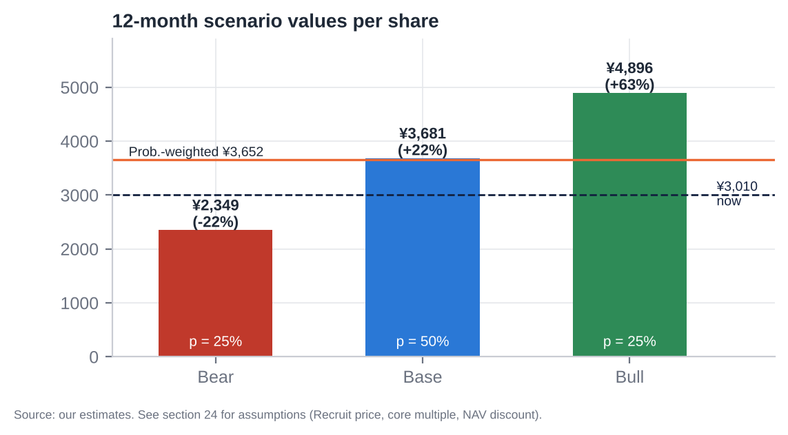

| Assumption | Bear (25%) | Base (50%) | Bull (25%) |
|---|---|---|---|
| Recruit share price | ¥12,250 (−35%) | ¥18,845 (unchanged) | ¥21,700 (+15%) |
| FY3/27E OP / FY3/28E OP | ¥47bn / ¥52bn | ¥52bn / ¥58bn | ¥55bn / ¥62bn |
| Sales growth FY3/28E (ex-KANAMEL) | −2% | +1.5% | +3% |
| Normalised core EBITDA | ¥65.0bn | ¥71.4bn | ¥75.0bn |
| Core EV/EBITDA | 3.5x | 5.0x | 6.5x |
| Listed equities after tax | ¥254bn | ¥355bn | ¥400bn |
| Affiliates (x book) | 0.6x | 0.7x | 1.0x |
| NAV (¥bn) / per share | 883 / ¥3,614 | 1,124 / ¥4,602 | 1,329 / ¥5,440 |
| Discount to NAV applied | 35% (status quo; value trap) | 20% (buybacks step up; cross-holdings sold) | 10% (large buyback or special dividend; activist; reorganisation) |
| **Value per share** | **¥2,349 (−22%)** | **¥3,681 (+22%)** | **¥4,896 (+63%)** |
| Implied P/B (Jun-26 book) | 0.52x | 0.82x | 1.09x |
| Implied FY3/28E P/E (our EPS) | 9.9x | 15.5x | 20.6x |

**Probability-weighted value: ¥3,652 (+21%). 12-month target: ¥3,650.**

The upside/downside ratio is ~1.9:1 in the base case and ~2.9:1 bull vs bear. Downside is cushioned by cash and bonds (¥1,590 per share). The biggest swing factor is Recruit, which is hedgeable.

# 25. The Short-Seller's Case and Forensic Accounting Review

## 25.1 What could structurally break how NTV makes money?

- **Agency-mediated linear ads are a shrinking pool.** 54% of sales is advertising sold through two agencies.
  - Online advertising (Google, Meta, LINE Yahoo, CyberAgent) already takes 50% of spend and is growing 10% a year. TV is flat to falling.
  - The value of a rating point depends on reach. As 13–49 viewing migrates to YouTube, Netflix and TVer, the core-audience premium erodes.
  - TVer monetises at a fraction of linear CPMs, and NTV's digital ads are only ¥11.9bn.
- **Sports rights**, the last mass-reach events, are going to streamers.

## 25.2 Where is revenue concentrated, and what if that shifts?

- **Agencies:** Dentsu 25.2% and Hakuhodo 15.5% of sales. They control media planning, own the ratings currency (Video Research is Dentsu-group) and co-own TVer. A shift of agency budgets to digital, or a fee squeeze, flows straight to NTV's margin.
- **Kanto spot** is the swing factor (¥128bn, ~26% of sales). The FY3/26 windfall shows how quickly it moves on supply; the reversal proves it.
- **Content revenue** is lumpy: hit-driven (*Apothecary Diaries*, *Conan*, Ghibli releases).

## 25.3 Why the moat is weaker than bulls think

- **Ratings leadership is eroding:** NTV lost the individual triple crown to TV Asahi, and the core rating fell from 2.9% to 2.2% in three years.
- **Advertiser switching costs are zero.** Fuji lost 40% of its broadcast revenue in months and has regained it within a year. Share is rented, not owned.
- **The regulatory moat protects incumbents from each other's acquirers, not from YouTube.**
- **Hulu Japan is losing** to Netflix and U-NEXT. NTV has no scale streaming platform of its own; TVer is shared with all rivals.

## 25.4 The most dangerous competitor that bulls underestimate

**TVer, the industry's own catch-up platform, and the agencies behind it.** TVer aggregates every key station's content, so on TVer NTV competes programme by programme with no channel loyalty and a much lower CPM. As linear viewing moves to TVer (44.7m monthly users; 20–34s +50% in FY3/26), NTV swaps high-margin linear GRPs for low-margin, agency-intermediated digital impressions on a platform it does not control.

YouTube is the obvious threat. TVer is the subtle one, because it cannibalises from inside.

## 25.5 The worst capital-allocation decisions

1. **Not buying back stock from 2016 to 2023** at 0.3–0.6x P/B, while accumulating cash, bonds and cross-holdings.
2. **Tipness:** liabilities exceed assets by ¥19.4bn; NTV carries a ¥21.5bn allowance on loans to affiliates; revenue is far from its ¥40bn target.
3. **KANAMEL:** ¥49.8bn acquisition cost for a ~5.5% margin TV-commercial producer (~11x OP). It created ¥41.5bn of goodwill and dilutes FY3/27 OP.
4. **la belle vie and Murayama:** negative net assets; impairment risk.
5. **Hulu Japan:** content impairment in FY3/25; sub-scale against global platforms.

## 25.6 Related-party transactions, accounting and incentives

- **Related parties:**
  - Yomiuri Giants broadcast rights are bought from Yomiuri Shimbun Tokyo (amount undisclosed).
  - Yomiuri director and auditor interlocks; one "independent" director is a Yomiuri auditor.
  - FYCS: NTV's former President runs it while sitting on NTV's board, and it holds 11.3% of NTV.
- **Incentives:**
  - Insiders own ~0.03%.
  - Pay is 67% fixed, and the restricted stock is token (6%).
  - There is no ROE, P/B or TSR metric in pay [u].
  - Management is accountable to Yomiuri, not to minorities.

## 25.7 What must hold for the current price to be justified, and what if growth disappoints by 20–30%?

**What the current price assumes.** At ¥3,010 it requires only that:
- the non-core assets are worth ~96% of what we estimate; or
- equivalently, a ~35% discount to NAV persists.

**If growth disappoints by 20–30%** (core EBITDA ¥50–57bn instead of ¥71bn):

| Effect | Change in value |
|---|---|
| Core value at 5.0x | −¥70–100bn (−¥290–420 per share) |
| NAV per share | Falls to ~¥4,200 |
| At today's 35% discount | ~¥2,730 (−9%) |
| At a 40% discount | ~¥2,520 (−16%) |

**The bigger sensitivity is Recruit.** A 30% fall (−¥5,650) costs ¥357 per share of NAV (−¥230 at a 35% discount).

## 25.8 The single scenario that would permanently impair the business

**Permanent capital lock-up combined with secular decline.**
- Yomiuri uses the cash and the Recruit proceeds for group purposes: large M&A, the Tsukiji project, regional-station rescues.
- Linear advertising falls 3–5% a year.
- Over five years, ¥300–400bn is reinvested at 2–4% returns while the core's EBITDA shrinks from ~¥70bn to ~¥50bn. The NAV discount never closes, and NAV itself erodes.

**Plausibility: ~20–25%.** That is our bear weight. The counterweights are the TSE/ISS framework, peer precedent and the Recruit tax arithmetic.

## 25.9 Forensic accounting review: red flags and risks

| Area | Finding | Risk |
|---|---|---|
| **Revenue recognition** | Advertising recognised on broadcast, gross of agency commission (commission in costs); auditor tests broadcast logs against agency payment notices. KANAMEL production revenue (percentage-of-completion / milestone [u]) adds judgement from FY3/27 | Low (ads); medium (KANAMEL) |
| **Segment reporting** | Media & Content = 94–97% of OP and lumps advertising, Ghibli, Hulu, anime, events and now KANAMEL; renamed "Content & Media". No profit disclosure for Ghibli, Hulu or KANAMEL | **Medium: opacity** hides loss-makers inside the profitable broadcaster |
| **Consolidation judgement (Ghibli)** | Consolidated on control with only 42.3% of votes. 100% of revenue and EBITDA consolidated; 57.7% to minorities (P&L NCI ¥5.0bn) | Flatters revenue and EBITDA; minority share of value material (~¥55bn) |
| **Goodwill and intangibles** | Goodwill ¥9.0bn → ¥50.6bn after KANAMEL. J-GAAP amortisation (~¥4bn a year [e]) depresses OP but makes impairment less likely. The yuho flags Murayama impairment risk. Ghibli goodwill was minimal, so the price was likely low | Medium |
| **Recurring "non-recurring" items** | Securities gains every year (¥0–28bn); impairments every year (¥2–21bn). Guidance NI includes planned gains (¥19.6bn in FY3/27) | **Medium: NI quality.** Use recurring EPS |
| **Equity-method and circular holdings** | FYCS (24.4%) holds 11.3% of NTV. The look-through own shares are deducted from the EPS share count (244m vs ~251m outstanding). Equity-method income ¥5.4bn | Low accounting risk; governance flag |
| **Leases** | ¥4.5bn of lease liabilities; owns its HQ | Low |
| **Pension** | Retirement liability ¥12.7bn | Low |
| **Contingencies** | Kokubun dispute closed; BPO matter resolved; no material litigation found | Low |
| **Stock-based compensation** | Restricted stock of ~22k shares a year; employee RS plan | Negligible |
| **Working capital** | DSO ~90 days; inventory small; receivables +3.6% QoQ at 1Q on flat sales (consolidation) | Low; watch H1 |
| **Cash flow** | CFO tracks NI + D&A − gains well. FCF ¥35–51bn a year. Capex step-up to ¥27.6bn in FY3/27 (HQ and equipment) | Low |
| **Balance sheet** | Investment securities at market (listed) or cost/equity (unlisted, affiliates); DTL ¥100bn; Tipness and la belle vie have negative equity (internal loans provisioned ¥21.5bn) | Medium (Tipness losses absorbed via allowances) |
| **Off-balance sheet** | Bancho / Tsukiji project commitments not quantified [u] | Unknown; watch |

**Overall: accounting is conservative and plain-vanilla J-GAAP.** The real risks are opacity (segment lumping, Ghibli minorities) and earnings quality (recurring securities gains), not aggressive accounting.

# 26. Is There an Activist Angle? What an Activist Would Push For

**The constraint set.**
1. Foreign voting rights are at the 20% cap, so a foreign fund's incremental shares do not vote.
2. No holder may exercise more than one-third of the votes.
3. Yomiuri holds 28.46%, rising with buybacks.
4. Friendly and stable holders are probably above 50%.

Proxy contests are therefore unwinnable. The effective tools are:
- engagement with domestic institutions (who already vote ~33% against the leadership);
- public campaigns tied to TSE and ISS standards;
- domestic activist partners (who can vote).

## 26.1 What an activist would ask for

1. **A Recruit monetisation plan.** Sell to below 20% of net assets within 24 months (~¥250bn pre-tax; ~¥180bn after tax) and **commit 100% of the proceeds to buybacks and special dividends**.
2. **Raise the total return ratio to ≥100% of NI for FY3/27–29**, and add a DOE floor of 4% (≈¥170 DPS at current book), against ¥45 today.
3. **Cut cash and bonds to an operating buffer** (~¥100bn), returning ~¥250bn+.
4. **ROE target ≥8% by FY3/30**, with ROE and TSR in executive pay.
5. **Exit or fix non-core assets:** sell Tipness and la belle vie; review Murayama; strategic options for Hulu Japan (merge with U-NEXT or another platform).
6. **Governance:**
   - a nomination and compensation committee;
   - replace the Yomiuri-auditor "independent" director;
   - separate the Board Chair from the Yomiuri presidency;
   - disclose the Giants rights payments;
   - segment disclosure for Ghibli, Hulu and KANAMEL.
7. **Real estate:** disclose the fair value of Shiodome and Bancho and evaluate a sale-and-leaseback or a REIT for the non-HQ assets.

## 26.2 Feasibility and limits

**The buyback ceiling.** Buybacks from non-Yomiuri holders raise Yomiuri's voting share. At 28.46%, roughly **~14–15% of the shares (~¥100bn at today's price) can be bought before Yomiuri approaches 33.3%** [e; depends on the voting-right denominator and refused foreign shares]. Two ways around it:
- Yomiuri sells into a ToSTNeT-3 buyback alongside;
- the excess goes out as **special dividends**, which have no voting effect.

Either way, the arithmetic supports at least ¥100bn of buybacks plus special dividends, ~25–30% of the market cap over two to three years.

**Our role.** As a foreign holder we cannot add votes. The play is to hold the economics (dividends are now paid on refused shares), engage with management and domestic institutions, and position ahead of a domestic activist or a self-help announcement.

**Probabilities [e]:**
- self-help step-up (≥¥50bn buyback or special dividend) within 12 months: ~40%;
- a domestic activist disclosure: ~25%.

# 27. Fifteen Questions for the CEO and Chairman (Ordered by Information Value)

1. **Recruit:** After Recruit's rally, your listed strategic holdings are ~41% of net assets, double your own <20% target and ISS's 20% threshold. What is the timetable to get below 20%, and what share of the ~¥180bn after-tax proceeds will go to shareholders rather than investment?
2. **Capital allocation framework:** What is the minimum cash and bond balance the business needs? Why hold ~¥390bn of net cash and bonds when ROE is 6% and the cost of equity is 7–8%?
3. **The one-third cap:** Will Yomiuri participate in buybacks (e.g., ToSTNeT-3) so that capital returns are not constrained by its approach to the one-third voting cap? If not, will you use special dividends?
4. **ROE target:** Will you publish a numeric ROE and P/B target, and link executive pay to ROE or TSR?
5. **M&A discipline:** What hurdle rate did KANAMEL clear at ~11x OP? What is left of the ¥100bn growth budget, and what size and type of deal are you considering next?
6. **Spot advertising:** How much of the share gained from Fuji in FY3/26 have you retained? What spot trend are you seeing in Jul–Sep and October against the −6% plan?
7. **Guidance:** Your initial OP guidance has been beaten by 26–31% in two years. Is ¥49bn for FY3/27 similarly conservative, and what were the World Cup's net costs?
8. **Core audience:** The core 13–49 rating fell 24% in three years. What is the plan to stabilise linear reach, and what is NTV's share of TVer revenue and viewing?
9. **Ghibli:** What are Ghibli's revenue and profit? What is the long-term ownership plan for the 57.7% minority, and is there a succession plan for creative leadership?
10. **Hulu Japan:** Is a sub-scale SVOD still strategic? Would you merge it with another platform or exit?
11. **Tipness, la belle vie and Murayama:** These carry negative equity or impairment risk. Why not sell them?
12. **Real estate:** What is the fair value of Shiodome and the Bancho land? What are the Bancho redevelopment and Tsukiji project commitments, and who benefits?
13. **Governance and Yomiuri:** How do you ensure decisions on capital returns and related-party transactions (Giants rights, Tsukiji) are made in the interest of minority shareholders, given the Board Chair is Yomiuri's president?
14. **FYCS:** Do you intend to consolidate the network further (e.g., NTV absorbing FYCS)? How will you unwind the circular 11.3% holding?
15. **Long-term risk:** Which do you see as the bigger threat to NTV in 2030: YouTube and streamers taking viewing time, or sports rights moving to DAZN and Netflix? How does the FY3/34 plan (¥700bn sales, ¥70bn OP) address both?

# 28. Timeline of Key Past Events and Upcoming Catalyst Calendar

## 28.1 Timeline of key past events

| Date | Event |
|---|---|
| Oct-2012 | Becomes a certified broadcasting holding company (Nippon Television Holdings) |
| 2014 | Acquires Hulu Japan (HJ Holdings), Tatsunoko and Tipness [u] |
| Mar-2017 | 25% of All About |
| Mar-2022 | Acquires Murayama |
| Dec-2022 | P/B hits a record low of 0.32x |
| Jan-2023 | Share price trough (¥1,013) |
| Mar-2023 | TSE asks sub-1x P/B companies for improvement plans |
| May-2023 | Acquires la belle vie |
| Sep/Oct-2023 | **Studio Ghibli control (42.3%)**; stock +13.5% |
| Jan–May 2024 | *Sexy Tanaka-san* author death and NTV report |
| 1-Feb-2024 | First buyback (¥7bn) and foreign-holder dividend proposal; stock limit-up (+22.8%) |
| Mar-2024 | *The Boy and the Heron* wins the Oscar |
| Aug-2024 | Market crash (−13.9%) and rebound (+11.6%) |
| Dec-2024 | Fuji TV / Nakai scandal begins; Tsuneo Watanabe dies |
| 1-Jan-2025 | Fukuda becomes President; Ishizawa moves to FYCS |
| 17–20 Jan 2025 | Fuji sponsor exodus; NTV +16.5% in four weeks |
| 1-Apr-2025 | FYCS HD formed (NTV 24.4%) |
| 30-Apr-2025 | KANAMEL 22.8% (¥9bn) |
| 8-May-2025 | MTP 2025–27: total return ≥35%; cross-holdings <20% of net assets |
| Jun-2025 | Kokubun/TOKIO removal; Capital Group stake peaks at 11.39% (Jul) |
| 9-Sep-2025 | All-time high ¥4,146 (P/B 1.02x) |
| 6-Nov-2025 | Guidance raised; ¥10bn buyback |
| 5-Feb-2026 | Q3: no raise at 92% progress; −6.1% |
| Feb-2026 | Fuji Media's ¥235bn buyback and real-estate separation (peer precedent) |
| 19-Mar-2026 | FY3/26 guidance raised to OP ¥67bn; KANAMEL 78% for ¥37.3bn |
| Mar–Oct 2026 | Recruit +189% (¥6,526 → ¥18,845) |
| 24-Apr-2026 | KANAMEL consolidated |
| 14-May-2026 | Record FY3/26 (OP ¥69.3bn); FY3/27 guide OP ¥49bn (−29%); ¥12bn buyback; DPS ¥45 |
| May–Jun 2026 | Partial Recruit sale (¥19.6bn gain) |
| 16-Jun-2026 | BoJ raises the policy rate to 1.00% |
| 26-Jun-2026 | AGM: Chairman 76.8%, CEO 74.6% approval; 7 of 11 directors independent |
| 31-Jul-2026 | 1Q FY3/27: OP −36.6%, miss; guidance kept |
| 27-Aug-2026 | ¥12bn buyback completed (4.14m shares) |
| 30-Sep-2026 | Planned cancellation of 4.14m shares; foreign voting rights still 19.99% |

## 28.2 Upcoming catalyst calendar

| Date | Event | What to watch | Importance |
|---|---|---|---|
| **~5–6 Nov-2026 [e]** | **1H FY3/27 results** | New buyback (last year ¥10bn at H1); 2Q spot trend; KANAMEL P&L; further Recruit sales; guidance | **Critical** |
| ~9–10 Nov-2026 [e] | 1H results briefing (Scripts Asia transcript) | Tone on the cross-holding target post-Recruit rally; M&A appetite | High |
| Nov-2026 – Mar-2027 | Recruit share price; possible further Recruit sales (TDnet extraordinary-gain notices) | Size of sales; use of proceeds | **Critical** |
| Early Dec-2026 | Interim dividend ¥10 paid | – | Low |
| Ongoing | Large-shareholding reports | Domestic activist entry (Murakami family, Japan Catalyst, Strategic Capital); Capital Group selling | High |
| ~4–5 Feb-2027 [e] | 3Q FY3/27 results | NTV never raises at Q3; a stock reaction risk as in Feb-2025 and Feb-2026 | Medium |
| Mid/late Mar-2027 [e] | Possible guidance pre-announcement (raises on 21-Mar-2025 and 19-Mar-2026) | Upside to the ¥49bn guide | High |
| Mar-2027 | Dentsu "Advertising Expenditures in Japan 2026" | TV vs internet share | Medium |
| ~Mid-May-2027 [e] | FY3/27 results, FY3/28 guidance; possible MTP update | Total return policy beyond 35%; ROE target; buyback | **Critical** |
| Late Jun-2027 | AGM | Approval rates for Yamaguchi and Sugiyama (ISS cross-holding policy); possible shareholder proposals (deadline ~8 weeks before the AGM) | High |
| Jul–Aug 2028 | LA Olympics (Japan Consortium) | Rights cost in FY3/29 | Medium |
| ~2028 [u] | Terrestrial broadcast licence renewals | MIC governance conditions | Low |

# Appendix A: Sources, Methodology and Data Notes

## A.1 Data sources

- **S&P Global Capital IQ** (via S&P Global Adaptive Retrieval):
  - market data (prices, market cap, TEV, shares);
  - financials (annual, quarterly, segments, balance sheet, cash flow);
  - CIQ consensus estimates, guidance, target prices and recommendations;
  - CIQ multiples (current and history);
  - key developments (results dates, guidance, buybacks, dividends, management changes);
  - transactions (M&A comparables);
  - filings, including the FY3/26 有価証券報告書 (yuho), Integrated Reports 2024/2025, and peer filings;
  - business relationships.
- **Company disclosures** (tanshin, presentations, TSE notices, AGM materials) read via search-engine summaries. Primary PDFs on ntvhd.co.jp, EDINET and TDnet could not be opened in this environment; affected figures are marked [u].
- **Industry:** Dentsu "Advertising Expenditures in Japan" (2021–2025); MIC white papers and study-group reports; Video Research ratings via press; TVer releases; Fuji Media, TBS, TV Asahi and TV Tokyo filings.
- **Governance:** AGM vote results from EDINET extraordinary reports via aggregators (Buffett Code, the-shashi) [u]; large-shareholding reports via Kabutan, Matsui and MAonline [u].
- **Not available:** ProntoNLP (not authorised in this session), so sentiment analysis uses our own disclosure-based rubric. Earnings-call transcripts were not available for NTV in S&P. Short-interest, margin and lending data (JPX/karauri) could not be retrieved.

## A.2 Key definitions

- **EBITDA** = operating profit + D&A (S&P).
- **Ordinary profit (経常利益)** = OP + non-operating income (interest, dividends, equity-method income) − non-operating expenses.
- **Recurring EPS** = ordinary profit × (1 − tax) − minorities, ÷ average shares. It excludes securities gains and impairments.
- **S&P TEV** = market cap + debt + minorities − cash − short-term investments. It does *not* deduct long-term investment securities.
- **Core EV (ours)** = market cap − (net cash + bonds + listed equities after tax + unlisted stakes + affiliates − minorities − pension).
- **Share count:** 244.3m per S&P / EPS basis. It excludes treasury shares and NTV's look-through share of its own stock held by equity-method affiliates (FYCS). Register shares outstanding are ~250.8m after the Aug-2026 cancellation [e].

## A.3 Model notes

- **Recruit shares:** 24.4m at 31-Mar-2026 (yuho). We estimate ~22.2m after the May–June 2026 sale, back-solved from the ¥19.6bn gain at ¥7,163–11,755 prices and the Jun-2026 balance-sheet move. The 1H report will confirm.
- **Listed-equity cost basis:** ¥27.3bn at Mar-2026. Tax on gains: 30.6%.
- **HTM bonds (~¥200bn):** derived from the yuho split of investment securities (¥591.4bn = listed ¥257.0bn + other non-listed securities ¥68.9bn + affiliates ¥111.4bn + HTM ~¥154bn) plus non-listed bond funds [e].
- **Ghibli minority value:** 57.7% × ~15x FY3/26 Ghibli NI of ¥6.4bn [e].
- **Scenario probabilities** are judgemental.

## A.4 Important caveats

This report was prepared with restricted access to primary Japanese filings. Before trading, items marked [u] should be verified against the FY3/26 yuho, the 1Q FY3/27 tanshin, the EDINET extraordinary reports and the JPX short-selling data. All prices are as of 21-Oct-2026. This is not investment advice to any person; it is an internal research document for professional investors.
