# Cameco Corporation (CCJ US / CCO CN): Equity Research Deep-Dive

**Event-driven / value review | Uranium, nuclear fuel and reactor services | Canada | 3 November 2026**

> **Recommendation: HOLD (event watchlist; accumulate below ~US$60). 12-month target US$76 (base case, ~flat); probability-weighted value US$75 (−2%); bull US$111 (+44%); bear US$39 (−49%).** Cameco owns the best uranium assets in the Western world and 49% of Westinghouse, the leading Western reactor and nuclear-fuel company. The long-term story is intact: the term uranium price is at an 18-year high (US$96.50/lb), utilities are contracting well below replacement rate, and Westinghouse has US-government backing for at least US$80bn of new AP1000 reactors plus a confidential IPO filing (Jul-2026). But the shares, down 43% from the Jan-2026 high, still discount most of this. At US$76.91 the market pays ~23x our FY27E EBITDA and ~52x our FY27E EPS. Our sum-of-the-parts (20x FY28E EBITDA for uranium and fuel services plus US$10bn for the Westinghouse stake) lands at today's price. 2026 has exposed execution risk: a flood, a Cigar Lake halt, a long Key Lake outage, two cost-guidance increases and the first adjusted loss in eight quarters. We would turn buyers on (1) a price below ~US$60, or (2) hard evidence that Westinghouse is worth well above US$20bn of equity (a public S-1, definitive US-government agreements or firm AP1000 orders).

| Key data (30-Oct-2026 close) | | Key data | |
|---|---|---|---|
| Share price (NYSE) | US$76.91 (≈C$106 on TSX [e]) | Largest holder | BlackRock ~5% [u]; no holder near the statutory caps |
| 52-week range | US$73.89-135.24 | Ownership caps (ENL Act) | Non-resident ≤15% each, ≤25% of votes in aggregate; resident ≤25% |
| Shares / market cap | 435.5m / US$33.5bn (C$46.2bn) | Net debt (30-Sep-26) | C$0.14bn (cash C$0.86bn; debentures C$1.0bn) |
| Enterprise value | ≈C$46.4bn / US$33.6bn | LTM revenue / adj. EBITDA | C$3.48bn / C$1.76bn (incl. C$0.64bn Westinghouse share) |
| EV/EBITDA FY26E / FY27E / FY28E (ours) | 29.0x / 22.7x / 20.6x | P/E FY26E / FY27E / FY28E (ours) | 105x / 52x / 44x |
| Adj. EPS FY26E / FY27E / FY28E (ours) | C$1.01 / C$2.05 / C$2.40 | Consensus adj. EPS FY27 | ~C$2.6 (range C$2.57-2.98) [u] |
| Dividend | C$0.24 (yield ~0.2%) | Short interest | 7.9m shares, ~1.8% of float, 2.5 days [u] |
| Credit rating | DBRS BBB (Stable) | Next catalyst | Q4-26 results ~12-Feb-2027 [u]; Westinghouse S-1 / US-government definitive agreements |

*Tags used throughout: [u] = single secondary source, not verified against a primary document; [e] = our estimate; [m] = analyst recollection, not re-verified in this pass; [d] = derived arithmetically from reported figures. All C$ unless stated. Primary documents (sec.gov, cameco.com) could not be opened in this session; figures come from search-engine extracts of those documents and are cross-checked where possible (see Appendix A).*

# 1. Executive Summary and Investment Conclusion

## 1.1 The set-up in one paragraph

Cameco is the largest listed uranium producer in the West. It mines high-grade ore in Saskatchewan's Athabasca Basin (McArthur River/Key Lake and Cigar Lake), buys its 40% share of JV Inkai's output in Kazakhstan, refines and converts uranium at Blind River and Port Hope (Ontario), makes CANDU fuel, and since November 2023 owns **49% of Westinghouse** (Brookfield 51%). It sells mostly under long-term contracts: ~230 Mlb committed with 39 utility customers, ~28 Mlb/yr over 2026-30. FY2025 was a record (revenue C$3.48bn, adjusted EBITDA C$1.93bn, adjusted EPS C$1.44). 2026 has gone badly. A May flood cut road access to Key Lake, Cigar Lake stopped for two weeks in July when Orano's McClean Lake mill failed, and an extended Key Lake outage in Q3 led to an **adjusted net loss of C$2m in Q3-26 (consensus ~C$0.32/share profit)**. Cameco cut its 2026 production guidance (19.5-20.5 Mlb), raised unit-cost guidance for the second time (C$67-70/lb) and announced that its CFO will retire in Q1-27. The shares fell 7.9% on the day to US$76.91 and are 43% below their 28-Jan-2026 high. Meanwhile the industry backdrop has rarely been better: the long-term price is US$96.50/lb, Russian enriched uranium is barred from the US after 2027, Kazatomprom is cutting output, and Westinghouse has a US$80bn US-government term sheet, a US$17.5bn DOE conditional loan for up to ten AP1000s, a US$120bn US-Korea framework and a confidential IPO filing.

## 1.2 Investment thesis: what the bulls own

1. **Scarce, long-life, tier-one assets in a safe jurisdiction.** McArthur River and Cigar Lake are the two highest-grade uranium mines in the world. Western utilities that are moving away from Russian supply, and will not take more Kazakh risk, have few alternatives. On S&P's Feb-2026 numbers Cameco traded at ~2.3x NAV against Kazatomprom at ~1.0x [u].
2. **A contract book that reprices up slowly but surely.** Cameco's realised price (US$66.64/lb in 9M-26) lags spot (~US$90) by >US$20/lb. Its own sensitivity table shows realised prices rising to US$75-93/lb by 2030 at spot of US$80-120. Earnings leverage is back-end loaded into 2028-30.
3. **Westinghouse is the swing factor.** A nuclear technology and services platform with ~85% recurring revenue [m] has three new growth drivers: a US-government-backed AP1000 programme, a 91-reactor pipeline [u] and Poland (EPC terms agreed Sep-26). Its IPO could reveal a value well above the ~US$2.2bn Cameco paid. Desjardins values the 49% stake at ~US$10.8bn [u].
4. **Conservative balance sheet.** Net debt is C$0.14bn, the C$1.0bn revolver is undrawn and runs to 2030, and DBRS rates Cameco BBB. The first debt maturity is C$400m in Oct-2027.

## 1.3 Why we are not buyers at US$77: what the bears are right about

- **Near-term earnings are disappointing and the multiple is still high.** Our FY27E adjusted EPS of C$2.05 is ~20-25% below consensus (C$2.57-2.98). At C$106 the stock trades on ~52x FY27E and ~44x FY28E.
- **Execution risk is real.** In 2025-26 the company missed McArthur River's original 18 Mlb plan (it produced 15.1 Mlb). Since then it has had a flood, the Cigar Lake/McClean Lake halt, the Key Lake outage and two cost raises. Unit cost of sales hit C$72.17/lb in Q3-26.
- **Disclosure-quality flags.** The Q3-26 price-sensitivity table was lowered after a "methodology correction" on one contract. Operating cash flow was C$3m in Q3 [u]. Management also reversed its Q2 statement that disruptions "have not changed our production guidance".
- **Westinghouse is not yet a cash machine for Cameco.** It ran a C$80m net loss (Cameco share) in 9M-26. The US-government deal is still a term sheet: the government takes 20% of distributions above US$17.5bn, and new-build projects need ~US$500m of Westinghouse equity each.
- **There is no takeover put.** Under the Eldorado Nuclear Act no single holder may exceed 25% (15% for a non-resident). The stock carries no bid premium, and management faces no market for corporate control.

## 1.4 Valuation and scenarios

| | Bear (25%) | Base (50%) | Bull (25%) |
|---|---|---|---|
| Uranium spot / long-term (US$/lb) | 70 / 80 | 90 / 95 | 120 / 115 |
| FY28E EBITDA ex-Westinghouse (C$bn) | 1.18 | 1.57 | 1.87 |
| Multiple on uranium + fuel services | 14x | 20x | 24x |
| Westinghouse 49% (US$bn) | 4.9 (~15x EBITDA) | 10.0 (~27x) | 15.0 (~40x) |
| Equity value (C$bn) | 23.5 | 45.7 | 66.6 |
| **Per share (US$)** | **39 (−49%)** | **76 (−1%)** | **111 (+44%)** |

**Probability-weighted value: ~US$75 (−2%).** At today's price the market pays ~20x FY28E EBITDA for uranium and fuel services if Westinghouse is worth US$10bn, or ~17x if it is worth US$15bn. Either way the stock embeds a scarcity premium; there is no margin of safety. We would accumulate below ~US$60, where the probability-weighted value offers ~25% upside.

## 1.5 What has to go right (for upside)

- Key Lake returns to normal by Q1-27 and the 2027 unit cost falls back towards C$62-65/lb.
- Utilities return to replacement-rate term contracting (>150-180 Mlb/yr), pushing the term price above US$100/lb.
- Definitive US-government agreements are signed, AP1000 sites and partners are named, and the Westinghouse IPO prices at ≥US$25bn of equity.
- JV Inkai delivers its 4.2 Mlb 2026 allocation and keeps paying dividends despite Kazakhstan's tiered mineral extraction tax.
- GLE's Paducah licence is issued (expected early 2027 [u]).

## 1.6 Positioning

- **For an event-driven/value book this is a watchlist name, not a position, at US$77.** The main event, the Westinghouse IPO, is real but probably 2027-28. Its value is partly in the price already.
- **Entry triggers:** (1) a price below ~US$60 (about 16x FY28E EBITDA for uranium plus fuel services after US$10bn for Westinghouse); (2) a public Westinghouse S-1 showing EBITDA of ≥US$1bn and a valuation indication ≥US$25bn; (3) definitive US-government agreements plus two or more named AP1000 FIDs.
- **A hedged alternative** for those who want the Westinghouse event: long Cameco against a short in a basket of uranium developers (NexGen, Denison, UEC) [e]. This isolates Westinghouse plus Cameco's contract book from pure uranium-price beta. Its drawback is that the developers carry more torque to the spot price.
- **No activist angle.** Cameco is widely held, statutorily takeover-proof, capitalised conservatively and generally well governed. The levers an activist would normally pull (a sale, a break-up, leverage) are blocked or unattractive (Section 26).

# 2. Layman's Guide: What Cameco Does and How It Makes Money

**In one sentence:** Cameco digs uranium out of the ground in northern Saskatchewan (and buys more from a Kazakh partner), turns some of it into nuclear-fuel feedstock, and sells it on contracts lasting 5-10+ years to the power companies that run nuclear reactors. It also owns half of the company that designs, fuels and services many of those reactors.

**How the money is made**

1. **Uranium (≈80% of revenue, most of the operating profit).**
   - Cameco mines ore that is up to 100 times richer than the global average, mills it into "yellowcake" (U3O8) and sells it by the pound. In 2025 it delivered ~33 Mlb at an average of US$62/lb (C$87/lb).
   - Prices are set by long-term contracts. Some are fixed and rise with inflation; others are linked to the market price on the delivery date, often with a floor and a ceiling.
   - Because Cameco sells more than it mines (~30 Mlb sold vs ~20 Mlb produced in 2026), it buys the gap from JV Inkai, the spot market and loans. Its profit is the difference between the contract price and the blended cost of produced and purchased pounds.
2. **Fuel services (≈16% of revenue).**
   - Cameco refines yellowcake at Blind River into UO3, then converts it at Port Hope into UF6 (the gas that enrichers need) or into UO2 powder for Canada's CANDU reactors. It also assembles CANDU fuel bundles.
   - It charges a processing fee per kilogram (C$43/kgU in 2025). Conversion capacity is scarce outside Russia and China, so the business earns steady margins.
3. **Westinghouse (49%, equity-accounted, so not in revenue).**
   - Westinghouse supplies fuel, spare parts, outage services and engineering to roughly half the world's ~440 reactors, and designs new reactors (the AP1000, the smaller AP300 and the eVinci microreactor).
   - Cameco books its 49% share of Westinghouse's profit as one line. In its "adjusted EBITDA" it includes 49% of Westinghouse's EBITDA (C$780m in 2025, C$427m in 9M-26).
   - Cash arrives as distributions (e.g. C$171.5m in Oct-2025, linked to the Czech Dukovany project).
4. **Smaller pieces.** 49% of Global Laser Enrichment (a future US enrichment plant using laser technology; carried at nil); 40% of JV Inkai (equity-accounted, paid C$~120m / US$87m of dividends in 2025).

**How each division contributed (FY2025)**

| Division | Revenue (C$m) | Share of revenue | Adj. EBITDA contribution (C$m, approx.) | Share of adj. EBITDA |
|---|---|---|---|---|
| Uranium | 2,874 | 83% | ~1,000-1,100 [e] | ~55% |
| Fuel services | 562 | 16% | ~200-250 [e] | ~12% |
| Westinghouse (49%, not consolidated) | (3,458 share; not in revenue) | n/a | 780 | ~40% |
| Corporate (admin, exploration, other) | 46 (other) | 1% | ~(150-200) [e] | n/a |
| **Total** | **3,482** | **100%** | **1,929** | **100%** |

*Segment EBITDA levels were not available in the extracts; the split is our estimate, reconciled to the reported total and to Westinghouse's reported share. Westinghouse's 2025 share included ~C$170m from the one-off Dukovany project.*

**The simplest way to think about it:** Cameco is a toll on the world's need for nuclear fuel. Each reactor needs ~400-500 thousand lb of U3O8 a year [m], the plants run for 60-80 years, and the fuel is a small part of the cost of nuclear power, so utilities care more about security of supply than price. Cameco's risk is that its mines are complex, cold-climate, underground operations that do not always produce what they plan.

# 3. Business Model, Products, Customers, Suppliers and Competitors

## 3.1 Business model in simple terms

- **Contract-first, not spot-first.** Cameco commits volumes years ahead and produces to meet contracts. It does not produce to sell into the spot market. Management's stated discipline is to sign only at prices that reward "tier-one" supply. In 2025-26 it declined to commit large volumes "at current economics" and is now seeing "three-digit escalated prices" for the base-escalated part of new contracts [u].
- **Integrated across the front end of the fuel cycle.** Mining → milling → refining → conversion → (via GLE, future) enrichment → (via Westinghouse) fuel fabrication, reactor services and new build.
- **Flexible supply.** Between 2016 and 2022 Cameco shut high-cost and even tier-one supply (Rabbit Lake, US ISR, McArthur River 2018-22) and bought in the market to meet contracts. That protected the long-term contract price. It still holds back production (US ISR on care and maintenance) rather than "chase volume".

## 3.2 Key products and services

| Product / service | Assets | Capacity / 2026 guide | Comment |
|---|---|---|---|
| Uranium concentrate (U3O8) | McArthur River (69.805%) / Key Lake mill (83.33%); Cigar Lake (54.547% → ~57.4% after the Jul-26 TEPCO purchase [u]) milled at Orano's McClean Lake; JV Inkai 40% (purchases) | 2026 production 19.5-20.5 Mlb (Cameco share); deliveries 29.5-30.5 Mlb | McArthur River licensed to 25 Mlb/yr at 100% [m]; 2026 plan ~14-15 Mlb at 100% |
| UO3 refining | Blind River, ON (100%) | ~18 kt U/yr [m] | Feeds Port Hope |
| UF6 conversion | Port Hope, ON (100%) | ~12 kt U/yr target [v]; record output 2025 [u] | One of only three Western converters (with ConverDyn and Orano) |
| UO2 / CANDU fuel | Port Hope; Cameco Fuel Manufacturing (Port Hope, Cobourg) | 2026 fuel-services production 13-14 Mkg U | Customers: Bruce Power, OPG |
| Reactor fuel, services, new build | Westinghouse (49%) | 2026 share of adj. EBITDA initially guided C$370-430m; 9M-26 actual C$427m | AP1000, AP300, eVinci; fuel plants at Columbia SC, Springfields UK, Västerås SE [m] |
| Laser enrichment (future) | GLE (49%; option to 75%) | Paducah licence expected early 2027 [u] | Re-enrichment of DOE tails; carried at nil |

## 3.3 Main customers

- **39 uranium customers** worldwide [u], mostly investor-owned and state utilities. Named or likely counterparties include:
  - **Canada:** Bruce Power and Ontario Power Generation (UO2 and CANDU fuel) [m].
  - **United States:** Constellation, Duke, Southern, Dominion, Vistra, TVA and other US utilities, generally unnamed [m].
  - **Europe:** EDF [m]; Energoatom (Ukraine; supply agreements in 2018 and 2023) [m]; Slovenské elektrárne (long-term UF6 supply) [u].
  - **Asia:** CGN and CNNC [m]; India's Department of Atomic Energy (a new ~22 Mlb, 2027-35, market-related contract worth ~C$2.6bn, signed Mar-2026 [u]).
- **Concentration:** Cameco does not disclose its largest customer. Historically its five largest customers have taken a large minority of deliveries [m]. US utilities are the largest group by region (Section 8.3).

## 3.4 Main suppliers and counterparties

- **Orano:** joint-venture partner in McArthur River (30.195%), Key Lake (16.67%) and Cigar Lake (~42.6% after Jul-26 [u]). It operates the McClean Lake mill that processes all of Cigar Lake's ore, which makes it a critical single point of failure, as the July 2026 acid-plant halt showed.
- **Kazatomprom:** 60% partner and operator of JV Inkai. It controls Cameco's 4.2 Mlb/yr purchase entitlement, sulphuric-acid supply and the export logistics (Trans-Caspian route or via Russia [m]).
- **Market counterparties:** traders and financial holders (e.g. Sprott Physical Uranium Trust) for spot purchases and loans.
- **Inputs:** sulphuric acid, reagents, explosives, ground-freezing plant, diesel, SaskPower electricity, mining equipment (e.g. Sandvik, Epiroc, Caterpillar [m]), and northern/Indigenous-owned contractors such as Kitsaki-affiliated firms [m].
- **Governments:** the Saskatchewan government (royalties of 5% of gross sales plus a 10-15% profit royalty [m]), the CNSC (licensing) and Kazakhstan (mineral extraction tax, export permits).

## 3.5 Competitors

| Segment | Main competitors | Comment |
|---|---|---|
| Uranium mining | Kazatomprom (~40% of world supply [m]), Orano, Uranium One/Rosatom, CNNC/CGN, Navoiyuran; Western mid-tiers Paladin, BHP (Olympic Dam), Boss, UEC, Energy Fuels, enCore; developers NexGen and Denison (Athabasca) | Cameco is the #2 producer globally and #1 in the West |
| Conversion | ConverDyn (Honeywell / General Atomics), Orano, Rosatom, CNNC | A Western oligopoly; Russia is excluded from US supply after 2027 |
| Enrichment (via GLE) | Urenco, Orano, Rosatom/TENEX, CNNC, Centrus, General Matter | GLE is a long-dated option |
| Reactors and services (via Westinghouse) | Framatome/EDF, KHNP/KEPCO, GE Vernova Hitachi, Rosatom, CNNC/CGN, Holtec, NuScale, BWXT | Westinghouse leads PWR fuel and services in the West |

The full peer list with tickers and listing status is in Section 14.4.

## 3.6 Key markets and geographies

- **Production:** Canada (Saskatchewan, ~80% of Cameco-share output) and Kazakhstan (Inkai, ~20% of supply via purchases). The US ISR assets in Nebraska and Wyoming are on care and maintenance.
- **Processing:** Ontario (Blind River, Port Hope, Cobourg).
- **Sales:** global. The Americas (mainly the US) are the largest market, followed by Europe and Asia (Section 8.3). Westinghouse adds exposure to the US, Europe (Sweden, Poland, Bulgaria, Czech Republic via the KHNP settlement), Ukraine and Asia.

## 3.7 Contracts and key payment terms

- **Tenor:** typically 5-10+ years of deliveries, signed 2-5 years before first delivery [m]. Average annual commitments are ~28 Mlb over 2026-30, heavier in 2026-28 and lighter in 2029-30 [v]. Total commitments are ~230 Mlb at end-2025 [u].
- **Pricing mechanisms:**
  - **Base-escalated:** a fixed base price, set at signing and escalated by an inflation index.
  - **Market-related:** a spot and/or term reference near delivery, usually with floors and ceilings.
  - Cameco's mix has historically been roughly 40/60 base-escalated/market-related [m]. Older market-related contracts carry ceilings that cap upside, which helps explain why the 9M-26 realised price rose ~10% while spot rose ~22% [u].
- **Sensitivity (31-Dec-25 table):** expected realised price of US$65/68/69 in 2026 and US$75/87/93 in 2030 at spot of US$80/100/120 [v]. The Q3-26 table was lowered slightly after a "methodology correction" on one contract [u].
- **Delivery and payment:** uranium is delivered by book transfer at converter accounts (Port Hope, Metropolis, Tricastin) [m]. Payment is typically due ~30 days after delivery [m], so working capital is driven by inventory, not receivables. Revenue is recognised on transfer of title.
- **Fuel services:** long-term conversion contracts priced in C$/kgU (C$43.04/kgU in 2025) with similar escalation mechanisms [m].
- **Westinghouse:** long-term fuel and outage-service contracts with utilities. New-build revenue is recognised over time on engineering and procurement work. In the new US programme, DOE-financed project SPVs pay Westinghouse, and Westinghouse commits ~US$500m of equity per two-unit project [v].

# 4. Key Business Drivers

| Driver | Mechanism | Current reading | Direction |
|---|---|---|---|
| **Long-term uranium price** | Sets the base price of new base-escalated contracts and the floors and ceilings of market-related ones | US$96.50/lb (Q3-26), an 18-year high, +8% YTD | Positive |
| **Spot price** | Reprices market-related deliveries and sets the cost of purchased pounds | US$89.63 (30-Sep-26), −5% YTD | Mixed |
| **Contracting volume (industry)** | Determines when the "uncovered requirements" wedge turns into price | ~116 Mlb in 2024 and 2025 vs ~150-180 Mlb/yr replacement | Lagging; a pent-up catalyst |
| **Volume (Cameco)** | Deliveries drive revenue; production drives unit cost | Deliveries 29.5-30.5 Mlb in 2026 (vs 33.0); production 19.5-20.5 Mlb | Negative in 2026 |
| **Unit cost of sales** | Blend of produced cost, purchase cost (spot/Inkai) and D&A | C$67-70/lb guide (from C$61.5-65); Q3 C$72.17 | Negative |
| **USD/CAD** | Revenue is in US$, costs mostly in C$; hedged with forwards [m] | ~1.38 [e] | Neutral to positive |
| **Westinghouse new build** | Engineering and long-lead procurement earnings (~US$400-600m EBITDA per AP1000 during construction [u]) | DOE US$17.5bn conditional loan; Korea US$120bn framework; Poland EPC terms | Positive, but timing uncertain |
| **Westinghouse core** | Fuel and outage services on ~half the world fleet | Q3-26 share of adj. EBITDA +15% y/y on fuel volumes | Positive |
| **Regulation and trade** | Russian ban after 2027; Section 232 (uranium covered, no tariff); Kazakh MET | Supportive for Western supply | Positive |
| **Capex cycle** | 2026 capex cut to C$440-490m (from C$490-540m); McArthur River extension and modernisation | Moderate intensity (~13% of revenue) | Neutral |
| **Mix** | Fuel services and Westinghouse diversify away from uranium-price beta | ~40% of adj. EBITDA from Westinghouse in 2025 | Diversifying |

# 5. Macro and Micro Factors; Tailwinds and Headwinds

## 5.1 Macro

- **Demand.** The WNA's 2025 Fuel Report (reference case) sees installed nuclear capacity rising from 398 GWe to 746 GWe by 2040, and to 966 GWe in the upper case. Reactor requirements rise from ~68,920 tU (~179 Mlb U3O8) to >150,000 tU [v]. Drivers are China's build-out (~10 approvals a year [m]), India's 100 GW target by 2047, US restarts and uprates (Palisades, Crane/TMI-1, Duane Arnold), life extensions, the COP28 pledge to triple capacity (30+ countries [m]) and hyperscaler PPAs (Microsoft, Amazon, Meta, Google).
- **US policy.** The May-2025 executive orders target 400 GW of nuclear by 2050 and 10 large reactors under construction by 2030 [m]. Other measures: DOE financing (the Office of Energy Dominance Financing), the US$80bn Westinghouse framework, US$2.7bn of DOE enrichment awards (Jan-2026), and the Russian uranium import ban (waivers end 1-Jan-2028).
- **Supply.**
  - Kazatomprom cut its 2026 subsoil-use level by ~10% and is downflexing. A tiered mineral extraction tax raised its 2026 C1 cost guidance by +34% [u].
  - Niger nationalised SOMAÏR (Jun-2025); ~1,000t of yellowcake was stranded in 2026.
  - Paladin's Langer Heinrich is ramping up slowly.
  - NexGen received its CNSC construction licence (Mar-2026) and Denison its approval (Feb-2026 [u]), but first production is ~2030.
- **Rates and risk appetite.** Uranium equities trade as long-duration, AI-power-linked assets. The DeepSeek shock (−15% on 27-Jan-2025) and the Oct-2026 sell-off on a hot CPI print show that sensitivity.
- **Trade.** The 14-Jan-2026 Section 232 proclamation named uranium but imposed no tariff. The 2025 IEEPA 10% "energy" duty applied only to non-USMCA entries and reportedly ended in Feb-2026 [u].

## 5.2 Micro

- **Operating reliability in Saskatchewan** is now the swing factor for 2026-27 earnings. McArthur River's development-area issues (2025), the May-2026 flood and bridge failure, the Key Lake outage (Q3-Q4 2026) and the McClean Lake acid plant (Orano) have all hit output.
- **Inflation** in labour, reagents and supplies pushed unit costs up; Cameco says ore grade has not changed.
- **JV Inkai deliveries** are back-end loaded. Only 1.6 of 4.2 Mlb had reached Blind River by Q3-26; the rest was in transit.
- **Westinghouse earnings are lumpy.** The 2025 Dukovany boost will not repeat, the US programme is not yet definitive, and each project will need equity.

## 5.3 Tailwinds and headwinds

| Tailwinds | Headwinds |
|---|---|
| Term price at an 18-year high (US$96.50) and rising | Spot soft (~US$90), equity sentiment weak; shares −43% from the high |
| Utilities under-contracted (~116 Mlb vs ~179 Mlb needs); RFPs rising | Contracting "rarely linear": utilities keep deferring |
| Russian ban 2028; Niger lost; Kazakh tax and acid constraints | Operational disruptions; unit cost C$67-70/lb, Q3 C$72 |
| Westinghouse: US$80bn framework, DOE US$17.5bn, Korea US$120bn, Poland EPC, IPO filing | Westinghouse deals are term sheets or non-binding; 20% US-government participation; equity calls of ~US$500m per project |
| Conversion and SWU at or near record prices; GLE licence early 2027 | Contract ceilings cap realised prices; the sensitivity table was lowered |
| Strong balance sheet; revolver to 2030 | CFO retiring Q1-27; COO, CLO and CMO turnover in 2025-26 |
| AI and data-centre power demand; US restarts | AI demand is "upside, not core" (CEO); high-multiple sensitivity to rates |

# 6. Competitive Position and Economic Moats

## 6.1 Product strength vs competitors

- **Perceived value:** Utilities buy uranium on reliability, jurisdiction and origin, not branding. Cameco's Canadian origin, CNSC-regulated supply and 30+ year delivery record are its "brand". After Russia's 2022 invasion and Niger's 2023 coup, Western utilities pay a premium for this; the term-over-spot spread (~US$7/lb) partly reflects it.
- **Cost position:** McArthur River and Cigar Lake are high-grade (~7-15% U3O8 [m]) but costly underground, frozen-ground mines. Their all-in costs are mid-curve rather than lowest-cost. Kazakh ISR is cheaper in cash terms but rising (higher MET, imported acid).
- **Marketing:** a direct utility sales force with a long-term contracting philosophy. Cameco has no meaningful consumer-style marketing, and needs none.
- **Westinghouse:** the leading Western PWR fuel and services brand. The AP1000 is the only Gen III+ design with operating units in the US (Vogtle 3 and 4) and China. Vogtle's ~US$35bn cost history [m] damages its new-build reputation, which the government-arranged financing is designed to offset.

## 6.2 Moat scorecard

| Moat category | Strength | Assessment |
|---|---|---|
| **Brand** | Moderate | A reliability/jurisdiction brand with utilities, not a consumer brand. Valuable in an era of supply security. |
| **Hard assets** | **Strong** | Two of the world's highest-grade mines; one of three Western UF6 converters; CANDU fuel capacity. Irreplaceable on a 10-15-year view (NexGen took ~13 years from discovery to licence [m]). |
| **Long-term contracts** | **Strong** | ~230 Mlb, ~28 Mlb/yr to 2030, 39 customers. Visibility is high, but the same contracts delay the benefit of higher prices. |
| **Network effect** | Weak | None in mining. There is a modest installed-base effect at Westinghouse (fuel and services on Westinghouse-designed plants). |
| **Regulatory and switching costs** | **Strong** | Licensing (CNSC, NRC, Euratom) takes years. Fuel fabrication is design-specific (Westinghouse fuel for Westinghouse reactors). Utilities qualify few suppliers. |
| **Oligopolistic / monopolistic industry** | **Strong** | Five producers control ~75% of mined supply [m]. Conversion and enrichment are Western oligopolies, and Russia is being excluded. |
| **Cash-flow predictability** | Moderate | The contract book gives volume visibility. Operating disruptions, lumpy Westinghouse earnings and Inkai logistics reduce predictability (9M-26 CFO weak). |
| **Scalability** | Moderate | Expansion is possible (McArthur River towards 25 Mlb, US ISR restart, Port Hope) but capital- and licence-intensive. Westinghouse new build is scalable if financed. |
| **Risk/history of government interference** | Moderate (two-edged) | Supportive governments: Canada, Saskatchewan, US. Risks: Kazakh MET increases and export routes; the statutory ownership caps (protective but entrenching); the US government's 20% participation in Westinghouse; royalties. |
| **Bargaining power over other stakeholders** | Moderate to strong | Strong with utilities in a deficit market (Cameco can "walk away"). Weak versus Orano (McClean Lake mill) and Kazatomprom (Inkai). |

**Verdict:** Cameco has a **real but narrow-to-moderate moat**. It rests on irreplaceable assets, licensing barriers and an oligopolistic market structure. It is not a cost moat, and it does not protect earnings from operating mishaps or contract-price lags.

# 7. Supply Chain Map: From Upstream Inputs to the End Customer

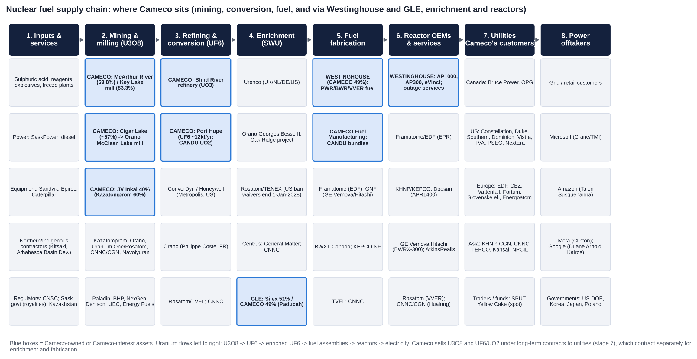

**Stakeholders by stage (named companies):**

1. **Inputs and services:**
   - Sulphuric acid and reagents (Kazakh and imported acid for Inkai).
   - Explosives and ground-freezing plant.
   - SaskPower electricity and diesel.
   - Mining equipment (Sandvik, Epiroc, Caterpillar [m]).
   - Northern and Indigenous contractors (Kitsaki Management, Athabasca Basin Development [m]).
   - Regulators and fiscal authorities: CNSC; the Saskatchewan government (royalties); Kazakhstan (MET, export licences); US NRC and DOE.
2. **Mining and milling (U3O8):**
   - Cameco: McArthur River/Key Lake; Cigar Lake, whose ore goes to **Orano's McClean Lake** mill; JV Inkai with **Kazatomprom**.
   - Competitors: Kazatomprom; Orano (Canada, Kazakhstan, ex-Niger); Uranium One/Rosatom; CNNC (Rössing) and CGN (Husab, Kazakh JVs); Navoiyuran; Paladin; BHP; Boss; UEC; Energy Fuels; enCore; developers NexGen and Denison.
3. **Refining and conversion (UF6):**
   - Cameco: Blind River and Port Hope.
   - Competitors: **ConverDyn/Honeywell** (Metropolis, IL); **Orano** (Philippe Coste, Tricastin); Rosatom/TVEL; CNNC.
4. **Enrichment (SWU):**
   - Urenco (UK, NL, DE, and US-LES); Orano (Georges Besse II; Oak Ridge project); Rosatom/TENEX; CNNC; Centrus (Piketon); General Matter.
   - **GLE** (Silex 51% / Cameco 49%, Paducah).
5. **Fuel fabrication:**
   - **Westinghouse** (49%): Columbia SC, Springfields, Västerås [m].
   - **Cameco Fuel Manufacturing:** CANDU bundles.
   - Competitors: Framatome; Global Nuclear Fuel (GE Vernova/Hitachi); BWXT Nuclear Energy Canada; KEPCO NF; TVEL; CNNC.
6. **Reactor vendors and services:**
   - Westinghouse: AP1000, AP300, eVinci, outage services.
   - Others: Framatome/EDF; KHNP/KEPCO E&C/Doosan Enerbility; GE Vernova Hitachi; AtkinsRéalis (Candu); Rosatom; CNNC/CGN; Holtec; NuScale; BWXT; Curtiss-Wright.
   - EPC contractors: Bechtel (Poland), Fluor; The Nuclear Company (V.C. Summer JV with Brookfield).
7. **Utilities (Cameco's direct customers):**
   - Canada: Bruce Power, OPG.
   - US: Constellation, Duke, Southern/Georgia Power, Dominion, Vistra, TVA, PSEG, NextEra, Santee Cooper.
   - Europe: EDF, CEZ, Vattenfall, Fortum, Slovenské elektrárne, Energoatom; Polskie Elektrownie Jądrowe (Westinghouse customer).
   - Asia: KHNP, CGN, CNNC, TEPCO, Kansai, NPCIL/India DAE.
   - Financial intermediaries: Sprott Physical Uranium Trust, Yellow Cake, and traders on spot and loans.
8. **Power offtakers and sponsors:**
   - Grid and retail customers.
   - Hyperscalers: Microsoft (Crane), Amazon (Talen Susquehanna), Meta (Clinton), Google (Duane Arnold; Kairos).
   - Governments as financiers: US DOE and Commerce; the Korean and Japanese investment frameworks; Poland (with EXIM financing).

**Where Cameco sits:** upstream (mining and milling) and midstream (refining, conversion, CANDU fuel). Through Westinghouse it also reaches downstream into fuel fabrication, reactor services and new build, and through GLE it holds an option on enrichment. That is the broadest Western footprint in the fuel cycle; only Orano and Rosatom are comparably integrated.

# 8. Five-Year Financial Analysis by Division and Geography

*All figures C$m, IFRS, calendar year. Adjusted EBITDA has included 49% of Westinghouse's adjusted EBITDA since the 2024 redefinition (FY23 restated). LTM = Q4-25 + 9M-26. [d] = derived; [e] = estimate; [m] = recollection, to verify.*

## 8.1 Group income statement, FY2021-FY2025 and LTM to Sep-2026

| C$m | FY2021 | FY2022 | FY2023 | FY2024 | FY2025 | LTM Sep-26 |
|---|---|---|---|---|---|---|
| Revenue | 1,475 | 1,868 | 2,588 | 3,136 | 3,482 | 3,479 [d] |
| Growth y/y | n/a | +26.6% | +38.5% | +21.2% | +11.0% | −0.1% |
| Gross profit | n/a | n/a | n/a | 783 | 970 | ~880 [e] |
| Gross margin | n/a | n/a | n/a | 25.0% | 27.9% | ~25% [e] |
| Adjusted EBITDA (reported definition) | n/a | 431 (old def.) | 884 (restated) | 1,531 | 1,929 | 1,758 [d] |
| – of which 49% of Westinghouse | – | – | 53 (2 months) | 483 | 780 | 638 [d] |
| – Cameco ex-Westinghouse | n/a | 431 | 831 | 1,048 | 1,149 | 1,120 [d] |
| EBITDA margin ex-Westinghouse (on revenue) | n/a | 23.1% | 32.1% | 33.4% | 33.0% | 32.2% |
| EBIT, ex equity earnings [e] | n/a | n/a | n/a | ~660 | ~755 | ~740 |
| EBIT margin [e] | n/a | n/a | n/a | ~21% | ~22% | ~21% |
| Share of Westinghouse net earnings (after PPA) | – | – | n/a | (218) | 58 | (80) for 9M-26 |
| Net earnings attributable | (103) | 89 | 361 | 172 | 590 | 398 [d] |
| Adjusted net earnings | (98) | 135 | 383 (restated; 339 as first reported) | 292 | 627 | 496 [d] |
| Adjusted EPS (C$) | ~(0.25) [d] | ~0.33 [d] | ~0.88 [d] | ~0.67 [d] | 1.44 | ~1.14 [d] |
| Cash from operations | n/a | 305 [u] | 688 | 905 | 1,408 | n/a (Q3-26: 3 [u]) |
| Capex | n/a | n/a | n/a | 212 [u] | 333 [u] | 2026 guide 440-490 |
| Free cash flow (CFO − capex) | n/a | n/a | n/a | 694 [d] | 1,075 [d] | n/a |
| Dividend per share (C$) | 0.08 | 0.12 | 0.12 | 0.16 | 0.24 | 0.24 (2026) |

*EBIT is not reported as such. Our estimate is adjusted EBITDA ex-Westinghouse less D&A (C$314m FY24, C$305m FY25 [u]) and less JV Inkai equity earnings (~C$70-90m [e]). FY2021 adjusted EBITDA and pre-2024 gross profit were not retrieved.*

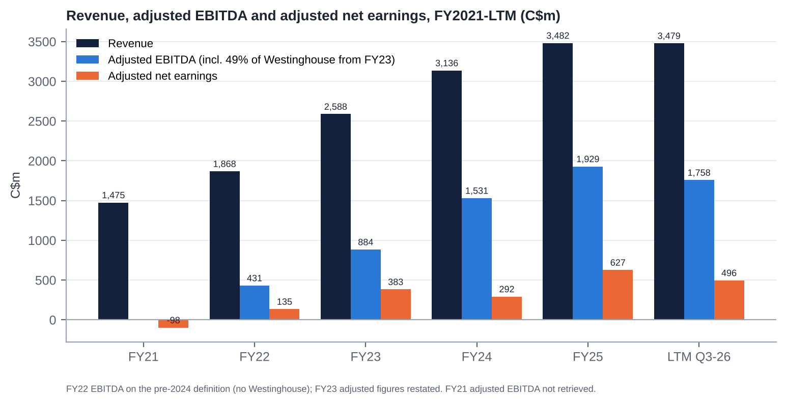

## 8.2 Revenue and profit by division

| C$m | FY2021 | FY2022 | FY2023 | FY2024 | FY2025 | 9M-2026 |
|---|---|---|---|---|---|---|
| **Uranium revenue** | ~1,150 [m] | ~1,480 [m] | ~2,200 [m] | 2,677 | 2,874 | ~1,890 [d] |
| Sales volume (Mlb) | ~24 [m] | ~26 [m] | ~32 [m] | 33.6 | ~33.0 | 20.5 |
| Avg realised price (US$/lb) | n/a | n/a | n/a | 58.34 | 62.11 | 66.64 |
| Avg realised price (C$/lb) | n/a | n/a | n/a | 79.70 | ~87.1 | ~92 |
| Uranium adjusted EBITDA | n/a | n/a | n/a | ~880 [e] | ~1,000-1,050 [e] | ~720-760 [e] (Q3: 179 vs 220) |
| **Fuel services revenue** | ~300 [m] | ~360 [m] | ~380 [m] | ~461 [d] | 562 | n/a |
| Fuel services adjusted EBITDA | n/a | n/a | n/a | ~150 [e] | ~225 [e] | 120 (vs 158) |
| Fuel services earnings before tax | n/a | n/a | n/a | n/a | n/a | 87 (vs 129) |
| **Westinghouse (49%): revenue share** | – | – | n/a | n/a | 3,458 [u] | n/a |
| Westinghouse (49%): adjusted EBITDA share | – | – | 53 | 483 | 780 | 427 (vs 569) |
| Westinghouse (49%): net earnings share | – | – | n/a | (218) | 58 | (80) |
| Other / corporate (revenue) | ~25 [d] | ~28 [d] | ~8 [d] | ~(2) [d] | ~46 [d] | n/a |

*Segment adjusted EBITDA levels for uranium and fuel services before 2026 were not in the extracts. Our estimates reconcile to the reported group totals after corporate costs (admin ~C$220-250m, exploration ~C$25-35m). Pre-2024 segment revenue is from recollection and sums to the reported totals; verify against the 2021-23 MD&As before relying on it.*

## 8.3 Geography

Cameco reports revenue by customer location in the notes to its financial statements; that note could not be retrieved here. Historical disclosure gives the following indicative mix [m]:

| Region (customer location) | Indicative share of revenue | Comment |
|---|---|---|
| Americas (mainly US; Canada for CANDU fuel) | ~50-60% | US utilities are the largest buyer group; Canadian revenue is mostly fuel services (Bruce Power, OPG) |
| Europe | ~20-30% | EDF, Nordic, Central European and Ukrainian utilities; Westinghouse adds further European exposure |
| Asia | ~15-20% | China (CGN, CNNC), Korea, Japan; India from 2027 (DAE contract) |

*Westinghouse's revenue (not consolidated) is weighted to the US and Europe, with growing new-build exposure in Poland, Bulgaria, the US and, through the KHNP settlement, the Czech Republic.*

## 8.4 Trends in growth and margins: what changed and why

1. **FY2021-22: the trough and the restart.** McArthur River/Key Lake were suspended (2018-22) and Cigar Lake had COVID shutdowns, so Cameco bought most of the material it delivered. Revenue was depressed (C$1.5-1.9bn) and Cameco made a loss in 2021. The 2022 restart decision and the post-invasion price rise drove the turn.
2. **FY2023-24: volume and price.**
   - Revenue rose 38% and then 21%, as deliveries rose to ~33 Mlb and realised prices moved up.
   - Westinghouse was added from Nov-2023. It lifted adjusted EBITDA (+73% in FY24) but cut reported earnings through purchase-price amortisation (a C$218m share of losses in FY24).
   - Adjusted net earnings fell 24% in FY24 because of Westinghouse PPA effects and Inkai issues.
3. **FY2025: the peak so far.**
   - Revenue rose 11% to C$3.48bn on a +6% realised price and +22% fuel-services revenue.
   - Adjusted EBITDA rose 26% to C$1.93bn, helped by a ~C$170m one-off Dukovany contribution at Westinghouse. Adjusted EPS more than doubled to C$1.44.
   - Free cash flow was ~C$1.1bn.
4. **2026: a step back.**
   - LTM revenue is flat and LTM adjusted EBITDA is down 9%.
   - Three causes: (a) Westinghouse normalising after Dukovany (9M share C$427m vs C$569m); (b) lower deliveries by design (29.5-30.5 Mlb vs 33.0); (c) higher unit costs from lower production and inflation (Q3 unit cost C$72.17/lb; guide C$67-70).
   - Uranium segment margins compressed even though realised prices rose ~10%. The contract ceilings and the lag mean revenue per pound rises more slowly than cost per pound when production falls.
5. **Margins in summary.** Ex-Westinghouse EBITDA margins rose from ~23% (FY22) to ~33% (FY23-25), driven by price recovery and the restart of tier-one production. They are slipping in 2026 (Q3 ex-Westinghouse EBITDA margin ~20% [d]). Recovery depends on Key Lake and on the contract book repricing in 2027-30.

## 8.5 Quarterly trend (Q1-25 to Q3-26)

| C$m | Q1-25 | Q2-25 | Q3-25 | Q4-25 | Q1-26 | Q2-26 | Q3-26 |
|---|---|---|---|---|---|---|---|
| Revenue | 789 | 877 | 615 | 1,201 | 845 | 814 [u] | 619 |
| Net earnings | 70 | 321 | ~0 | 199 | 131 | 25 | 43 |
| Adjusted net earnings | 70 | 308 | 32 | 217 | 203 | 77 | (2) |
| Adjusted EPS (C$) | 0.16 | 0.71 | 0.07 | 0.50 | 0.47 | 0.18 | 0.00 |
| Adjusted EBITDA | 353 | 673 | 310 | 591 | 509 | 391 | 267 |
| – Westinghouse share | 93 [d] | 352 | 124 | 211 [d] | 121 [d] | 163 | 143 |
| Uranium deliveries (Mlb) | n/a | 8.7 [d] | 6.1 | 11.2 | n/a | 7.1 | 5.6 |
| Realised uranium price (US$/lb) | ~66 [u] | n/a | 62.12 | 65.53 | n/a | n/a | 65.78 |

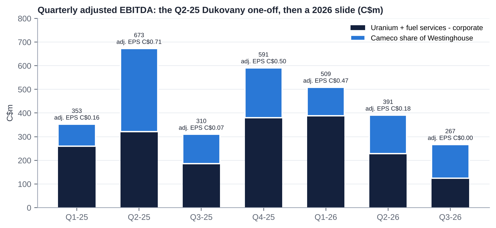

## 8.6 Most relevant operational KPIs

| KPI | FY2023 | FY2024 | FY2025 | 2026 YTD / guide | Trend and comment |
|---|---|---|---|---|---|
| Uranium production, Cameco share (Mlb) | 17.6 | 23.4 | 21.0 | 19.5-20.5 (Q3: 3.5, −20%) | Down two years running: McArthur River development (2025), floods and the Key Lake outage (2026) |
| McArthur River/Key Lake, 100% (Mlb) | n/a | 20.3 | 15.1 (plan 18) | Cameco share 10.0-10.5 | The key reliability risk |
| Cigar Lake, 100% (Mlb) | n/a | ~16.9 | 19.1 | 17.5-18.0 | Strong, but exposed to Orano's McClean Lake mill |
| Inkai purchases, Cameco share (Mlb) | n/a | 3.6 | 3.7 | 4.2 (1.6 delivered by Q3) | Back-end loaded; logistics risk |
| Deliveries (Mlb) | ~32 [m] | 33.6 | ~33.0 | 29.5-30.5 | Down ~9% by design |
| Long-term commitments | n/a | n/a | ~230 Mlb; ~28 Mlb/yr 2026-30; 39 customers | "No material change" at Q3 | Order-book equivalent; stable |
| Realised price vs spot (US$/lb) | n/a | 58 vs ~85 | 62 vs ~74 | 67 vs ~89 | A >US$20/lb lag; closing only by 2029-30 |
| Unit cost of sales (C$/lb) | n/a | n/a | ~63 [e] | Guide 67-70; Q3 72.17 | Rising: the main 2026 margin drag |
| Fuel services production (Mkg U) | n/a | 13.5 | 14.0 (record UF6) | 13-14 (9M: 9.5) | Utilisation near nameplate |
| Fuel services price (C$/kgU) | n/a | 37.87 | 43.04 | ~42.90 (Q3) | +14% in 2025; flat in 2026 |
| Westinghouse share of adj. EBITDA | 53 | 483 | 780 | 427 (9M) | 2025 inflated by Dukovany; core +15% in Q3 |
| Capex intensity (capex / revenue) | n/a | ~7% | ~10% | ~13-14% (guide C$440-490m) | Rising with McArthur extension, Key Lake modernisation and Port Hope |
| Net debt / LTM adj. EBITDA | n/a | ~0.5x [d] | net cash | ~0.1x | Conservative |

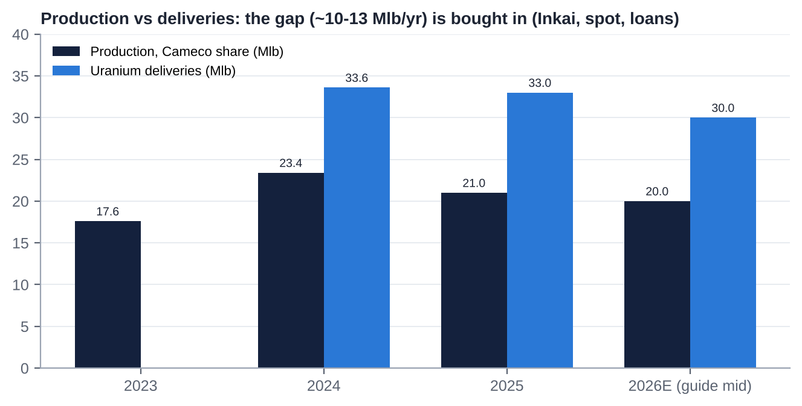

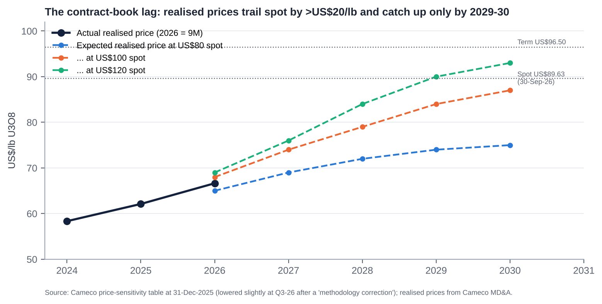

# 9. Historical Share Price Catalysts (Moves of More Than 10%)

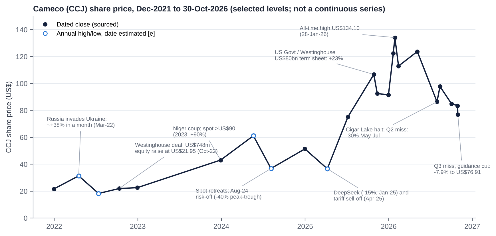

CCJ went from US$21.68 at end-2021 to an all-time closing high of US$134.10 on 28-Jan-2026 (+519%). It then fell 43% to US$76.91 by 30-Oct-2026. The five-year return to date is +255%.

## 9.1 Events that moved the stock by about 10% or more (Nov-2021 to Nov-2026)

| Date / window | Move | Cause |
|---|---|---|
| Aug-Nov 2021 | ~+80% (to Mar-22) | Sprott Physical Uranium Trust starts buying physical U3O8; spot rerates |
| 24-Feb to 25-Mar 2022 | **~+38% in a month** | Russia invades Ukraine; Russian supply and sanctions risk; uranium spot +47% |
| Apr to mid-2022 | ~−42% (high US$31.35 to low US$18.28) | Market-wide risk-off after the spring spike |
| 11-Oct-2022 | n/a (deal priced at US$21.95) | Westinghouse acquisition announced with Brookfield; US$748m bought deal |
| 2023 (full year) | **+90%** | Niger coup (Jul-23), Kazatomprom guidance warnings; spot >US$90 by year-end |
| 12-Jan-2024 / 1-Feb-2024 | +8% / +6% (cumulatively >10%) | Kazatomprom warns of shortfalls (acid); spot passes US$100 |
| Mid-Jul to early Aug 2024 | **up to −35% to −40%** | Spot retreats from its peak; global risk-off in Aug-24 |
| 23-Aug-2024 | +6% | Kazatomprom cuts its 2025 target by 17% |
| **27-Jan-2025** | **−13% (NYSE) / −15% (TSX)** | DeepSeek's low-cost AI model raises doubts about data-centre power demand |
| Early Apr-2025 | to the 2025 low (US$36.61) | "Liberation Day" tariff sell-off; spot low ~US$64 |
| **23-May-2025** | **+10-11%** | US nuclear executive orders (400 GW by 2050; NRC reform) |
| Apr-Oct 2025 | +191% | AI power demand, executive orders, Westinghouse momentum |
| **28-Oct-2025** | **+23% (CCO +21%)** | US-government partnership: ≥US$80bn of Westinghouse AP1000s |
| 5-13-Nov-2025 | ~−13% | Q3-25 EPS miss; CEO clarifies the government's role; RBC cuts its target |
| 31-Dec-2025 to 28-Jan-2026 | **+47%** | Spot jumps >US$100 in Jan-26; record high US$134.10 |
| 28-Jan to 13-Feb 2026 | −16% (−9% on 4-Feb intraday) | Spot resets lower; profit-taking |
| 9-Mar-2026 | +6% (+10% over two days) | CIBC raises its target to C$202 |
| 6-May-2026 | +8% | Q1-26 beat (adj. EPS C$0.47 vs C$0.38) |
| **6-May to 31-Jul 2026** | **−30%** | May flood at Key Lake; 1-Jul Cigar Lake suspension (McClean Lake acid plant); Q2-26 miss (C$0.18 vs C$0.38) |
| 13-Aug to 26-Oct 2026 | ~−20% | Sector risk-off; hot Sep CPI (14-Oct) |
| **30-Oct-2026** | **−7.9% close (−9.9% intraday)** | Q3-26 adjusted loss, production guidance cut, unit-cost guidance raised |

## 9.2 What the pattern says

- The stock is a **high-beta, long-duration "nuclear renaissance" proxy**. The biggest moves come from policy (executive orders, the US-government Westinghouse deal), AI-power sentiment (DeepSeek) and spot uranium. Cameco's own results matter less, except in 2026.
- 2026 is the first year in which **company-specific execution** has driven large negative moves (the May-July and October declines).

# 10. Earnings Calls, Management Focus and Sentiment

*ProntoNLP was not authorised in this session. Tone scores are our own, based on release headlines, guidance actions, hedging language and call summaries (scale −5 to +5).*

## 10.1 Quarter-by-quarter summary

| Quarter (date) | Adj. EPS vs consensus | Key messages | Tone |
|---|---|---|---|
| Q4-24 (20-Feb-25) | C$0.36 vs ~C$0.32: beat | Confident 2025 guidance; Inkai and tariff caveats; patient contracting | +2 |
| Q1-25 (1-May-25) | C$0.16; consensus n/a | "Strong results; fundamentals remain positive"; tariff and Section 232 hedging | +1 |
| Q2-25 (31-Jul-25) | C$0.71: big beat | Dukovany windfall; Westinghouse 2025 outlook raised ~48% to C$525-580m (later ~C$695-750m); management reshuffle (Isaac to President & COO; Shockey to CFO) | +4 |
| Q3-25 (5-Nov-25) | C$0.07 vs ~C$0.28: miss | Came a week after the US$80bn US-government term sheet; dividend doubled to C$0.24 a year early; contracting "below replacement" | +3 |
| Q4-25 (13-Feb-26) | C$0.50 vs C$0.36-0.44: beat | Record FY25; production of 21 Mlb above revised guidance; five-year Westinghouse target dropped for annual guidance; "not willing to commit large volumes at current economics" | +2 |
| Q1-26 (5-May-26) | C$0.47 vs C$0.38: beat | Clean beat; guidance held; dividend target achieved a year early | +2 |
| Q2-26 (31-Jul-26) | C$0.18 vs C$0.38: miss | Disruptions at all three Saskatchewan assets; "have not changed our production guidance"; first unit-cost raise; revenue guide raised; Westinghouse confidential S-1 announced the same day | 0 |
| Q3-26 (30-Oct-26) | C$0.00 vs ~C$0.32: miss | Adjusted loss; production guide cut; second cost raise; sensitivity table "corrected" lower; CFO to retire; "customer requirements do not disappear"; "three-digit escalated prices" | −1 |

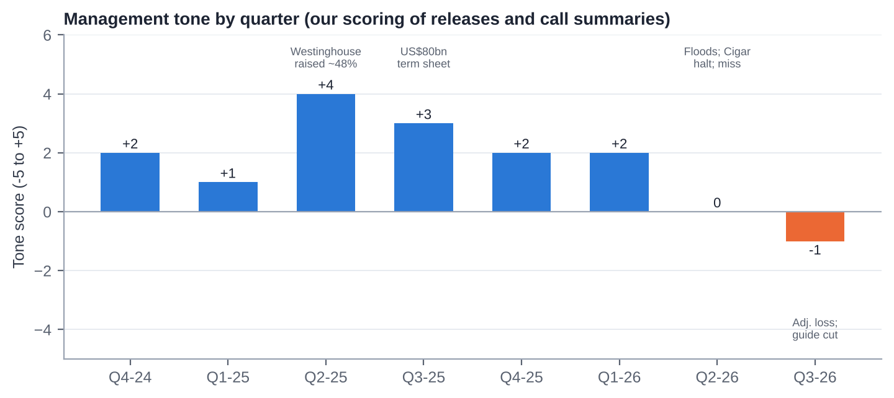

## 10.2 What management is focused on

1. **Restoring operating reliability in Saskatchewan.** Completing the Key Lake modernisation outage, recovering McArthur River, and keeping McClean Lake (Orano) running.
2. **Contracting discipline.** Holding out for replacement-rate volumes on escalated, market-related terms with floors; signing base-escalated volumes only at "three-digit" prices; holding back supply rather than chasing volume.
3. **Westinghouse.** Turning the October-2025 term sheet into definitive agreements and a government FID on ≥US$80bn of AP1000s; managing lumpy new-build income; keeping the IPO option open.
4. **Balance-sheet conservatism.** Near-zero net debt, the revolver extended to 2030, the dividend held, and capacity for Westinghouse equity calls and the Cigar Lake step-up.
5. **Leadership transition and credibility.** CFO succession by Q1-27, implicit CEO succession (Isaac), and rebuilding guidance credibility.

## 10.3 How sentiment has shifted

- **The strategic message has been almost word-for-word unchanged for two years:** contracting below replacement rate, the largest-ever uncovered-requirements "wedge", supply discipline, and Westinghouse as the growth engine.
- **The operational tone has deteriorated.** It moved from "production above guidance" (Feb-26) to defensive phrasing ("year-to-date performance as expected", "contracting is rarely linear") and two cost-guidance raises.
- **Peak confidence came in Q2-Q3 2025** (the Dukovany windfall and the US-government deal). The tone has since fallen from +4 to −1.
- **The risk now is credibility.** Management asks investors to treat 2026 as a one-year problem. That works only if Key Lake returns cleanly by early 2027.

# 11. Latest Result: Q3-2026 (released 30-Oct-2026)

## 11.1 Revenue and profit vs expectations

| C$m | Q3-26 | Q3-25 | y/y | Consensus | vs consensus |
|---|---|---|---|---|---|
| Revenue | 619 | 615 | +1% | ~725 [u] | **−15% (miss)** |
| Adjusted EBITDA | 267 | 310 | −14% | n/a | n/a |
| – of which Westinghouse share | 143 | 124 | +15% | n/a | n/a |
| Adjusted net earnings | (2) | 32 | n.m. | ~140 [d] | **miss** |
| Adjusted EPS (C$) | 0.00 | 0.07 | n.m. | ~0.32 [u] | **−C$0.32 (≈−100%)** |
| Net earnings (EPS) | 43 (C$0.10) | ~0 (C$0.00) | n.m. | n/a | n/a |
| 9M adjusted net earnings | 279 | 410 | −32% | | |
| 9M adjusted EBITDA | ~1,167 | 1,336 | −13% | | |

*Consensus conflicts reconciled: MarketBeat's "US$0.23" equals ~C$0.32 at 1.38 and was compared with GAAP EPS, which produced a misleading "miss by $0.13" headline. Chartmill's C$0.32 / C$725m is the best like-for-like reference [u].*

## 11.2 Segment drivers

- **Uranium:**
  - Adjusted EBITDA fell to C$179m from C$220m.
  - Deliveries fell to 5.6 Mlb from 6.1, and unit cost rose ~21% to C$72.17/lb. The extended Key Lake outage cut McArthur River/Key Lake output to 1.6 Mlb (100%) from 3.2.
  - The realised price rose to US$65.78 from US$62.12 (C$91.76 vs C$85.22).
- **Fuel services:** adjusted EBITDA was C$24m vs C$25m; 9M was C$120m vs C$158m, on product-mix variation.
- **Westinghouse:** Cameco's share of adjusted EBITDA rose 15% to C$143m on higher fuel volumes in the core business. Equity earnings were lower, and the 9M share was C$427m vs C$569m because 2025 included Dukovany construction revenue.

## 11.3 Margin trends

- Gross margin fell to ~19.7% from ~27.7% [u]. Uranium gross margin per pound fell to ~C$19.6 from ~C$25 [d].
- The causes were fixed costs spread over fewer pounds while Key Lake was down, and inflation in labour, reagents and supplies. Ore grade was unchanged.
- Higher realised prices did not offset this, because contract ceilings capped the upside (9M realised +10% vs spot +22%).

## 11.4 Guidance and outlook

| Item | Q2-26 guide | Q3-26 guide | Change |
|---|---|---|---|
| Production, Cameco share | 19.5-21.5 Mlb | **19.5-20.5 Mlb** | Top end cut by 1 Mlb |
| McArthur River/Key Lake, Cameco share | 10.0-11.5 Mlb | **10.0-10.5 Mlb** | Cut |
| Deliveries | 29-32 Mlb | **29.5-30.5 Mlb** | Narrowed |
| Unit cost of sales | C$63.00-67.50/lb | **C$67.00-70.00/lb** | Raised a second time |
| Revenue | C$3.32-3.57bn | Not changed [u] | Low end now more likely (Q4 needs C$1.04-1.29bn) |
| Capex | C$490-540m | **C$440-490m** | Cut (deferrals) |
| Direct administration | C$245-260m | Raised [u] | Higher |
| 2027-30 price-sensitivity table | n/a | Lowered ("methodology correction") | Negative disclosure flag |
| Dividend | C$0.24 | C$0.24 declared | Held |

**Tone:** defensive ("year-to-date performance as expected") but firm on the long-term view ("customer requirements do not disappear"). CFO Heidi Shockey will retire at the end of Q1-27, about 18 months after taking the role.

## 11.5 Balance-sheet flags

- **Operating cash flow ~C$3m in Q3 (C$156m a year earlier) [u].** This points to a working-capital build (inventory of 8.5 Mlb at 30-Sep [u]; Inkai pounds in transit) and lower deliveries.
- **Cash fell to C$0.86bn from ~C$1.2bn at YE-25.** The drivers were the TEPCO Cigar Lake purchase (Jul-26), capex, dividends and working capital. Net debt is ~C$0.14bn.
- **Debt is unchanged at C$1.0bn**, and the revolver was extended to Oct-2030. The first maturity is C$400m in Oct-2027 (Series H).
- **Receivables:** no flag found (n/a). Inventory and receivables detail should be checked in the Q3 MD&A.

## 11.6 Market reaction and what was priced in

- CCJ fell **7.9% to US$76.91** (intraday −9.9%), the worst earnings-day move in eight quarters. It had already fallen ~38% from the January high.
- The muted size of the move, given a ~100% EPS miss, suggests the market had largely priced in the Key Lake outage and is looking through to 2027.
- **Signal:** the narrative has shifted from "price optionality" to "execution risk". FY27 consensus (~C$2.6-3.0) has not yet been cut materially, so further estimate risk remains.

## 11.7 Unusual vs recent history

1. The first adjusted net loss in at least eight quarters.
2. A production-guidance cut one quarter after the company said disruptions had not changed guidance.
3. Two consecutive unit-cost guidance raises.
4. A downward "methodology correction" to the contract price-sensitivity table.
5. Near-zero quarterly operating cash flow.
6. CFO retirement announced ~14 months into the role, after 2025-26 departures of the COO, CLO, Chief Corporate Officer and CMO.

# 12. Earnings Estimates, FY2026E-FY2028E

## 12.1 Our forecasts vs consensus

| C$m (adjusted) | FY2025A | FY2026E | FY2027E | FY2028E |
|---|---|---|---|---|
| Uranium deliveries (Mlb) | 33.0 | 30.0 | 31.5 | 31.0 |
| Realised price (US$/lb) | 62.1 | 66.5 | 72.0 | 77.0 |
| USD/CAD | ~1.40 | 1.38 | 1.37 | 1.36 |
| Realised price (C$/lb) | 87.1 | 91.5 | 98.6 | 104.7 |
| Unit cost of sales (C$/lb) | ~63 | 68.5 | 65.0 | 65.5 |
| Uranium revenue | 2,874 | ~2,760 | 3,106 | 3,246 |
| Fuel services revenue | 562 | ~570 | 630 | 650 |
| **Revenue** | **3,482** | **3,330** | **3,740** | **3,900** |
| Adj. EBITDA ex-Westinghouse | 1,149 | 1,018 | 1,417 | 1,570 |
| Westinghouse share of adj. EBITDA | 780 | 577 | 620 | 680 |
| **Adjusted EBITDA** | **1,929** | **1,595** | **2,037** | **2,250** |
| EBIT ex equity earnings | ~755 | ~600 | ~1,057 | ~1,210 |
| EBIT margin | ~22% | ~18% | ~28% | ~31% |
| Net finance costs | n/a | ~(35) | ~(30) | ~(30) |
| Tax rate (on Cameco earnings) | n/a | ~24% | ~24% | ~24% |
| Westinghouse contribution to adj. net earnings | ~120 (incl. Dukovany) | ~(10) | ~60 | ~100 |
| **Adjusted net earnings** | **627** | **~440** | **~895** | **~1,050** |
| Diluted shares (m) | 435 | 436 | 436 | 437 |
| **Adjusted EPS (C$)** | **1.44** | **1.01** | **2.05** | **2.40** |
| Consensus adj. EPS (C$) | | ~1.10 post-Q3 (1.52 pre-Q3) [u/d] | 2.57-2.98 (median ~2.66) [u] | n/a |
| Ours vs consensus | | ~−8% | ~−20-25% | n/a |
| Consensus revenue (C$bn) | | 3.48-3.57 | 3.97-4.08 | 4.38 |

## 12.2 Key assumptions and rationale

- **Industry growth:** reactor requirements grow ~3-5% a year (WNA reference case). This supports term prices but feeds through to Cameco's realised price only through the contract lag.
- **Price:** spot ~US$90 and term ~US$95 flat in real terms. The realised price follows the company's sensitivity table at ~US$90-95 spot (US$72 in 2027, US$77 in 2028).
- **Market share:** deliveries ~31 Mlb a year, in line with the ~28 Mlb/yr committed plus discretionary sales. There are no share gains: Cameco is choosing price over volume.
- **Price increases:** new base-escalated contracts at "three-digit" prices start to flow through from 2028 onwards; they add little before then.
- **Cost pressures:** unit cost falls to ~C$65/lb as Key Lake normalises and production recovers to ~22 Mlb (Cameco share including ~57.4% of Cigar Lake). Inflation stays at ~3-4% a year. Purchased pounds at ~US$90 keep the blended cost high.
- **Operating leverage:** each US$1/lb on the realised price is worth ~C$43m of EBITDA (31 Mlb × 1.38) [d]. Each US$10/lb move in spot is worth ~US$3-5/lb on 2027-28 realised prices (table slope), or ~C$130-210m of EBITDA.
- **Westinghouse:** core growth of ~6-10% a year off a normalised ~C$575m base (2026), plus modest new-build engineering income. We exclude large AP1000 construction EBITDA until projects reach FID; that is upside.
- **Financing costs:** C$1.0bn of debentures (weighted coupon ~4.2%) refinanced at maturity (Series H, Oct-27, at ~4.5% [e]); interest income on cash.
- **Dilution:** negligible (39k options outstanding; RSUs and PSUs settled in market [m]). No buybacks are assumed.
- **Why we are below consensus for FY27:** we assume a slower Key Lake recovery, unit costs above C$60, and no step-change in Westinghouse earnings. The ~C$0.6 gap to consensus is worth ~C$260m of after-tax earnings. That equals ~US$6/lb of realised price or ~C$8/lb of unit cost, so modest operating outperformance could close it.

# 13. Capital Structure, Debt, Covenants and Liquidity

## 13.1 Summary (30-Sep-2026)

| Item | C$m | Comment |
|---|---|---|
| Cash and equivalents | 860 | Down from ~1,200 at YE-25 |
| Senior unsecured debentures | 1,000 | Three series (below) |
| Westinghouse acquisition term loan | 0 | US$600m drawn Nov-23; fully repaid by 13-Jan-2025 |
| **Net debt** | **~140** | ~0.1x LTM adjusted EBITDA |
| Undrawn revolver | 1,000 | Unsecured; maturity extended to 1-Oct-2030 |
| Total unsecured credit lines | ~2,900 | Mostly letters of credit for financial assurances |
| Financial assurances (letters of credit) outstanding | ~1,600 | Decommissioning and reclamation guarantees |
| Market cap / EV | 46,200 / ~46,400 | Debt is ~2% of EV |

## 13.2 Debt maturities

| Series | Coupon | Maturity | Principal (C$m) |
|---|---|---|---|
| H | 2.95% | Oct-2027 | 400 |
| I | 4.94% | 24-May-2031 | 500 |
| F | 5.09% | 14-Nov-2042 | 100 |
| (G) | 4.19% | Redeemed 24-Jun-2024 | (500) |
| **Total** | **~4.2% weighted** | | **1,000** |

## 13.3 Interest costs, covenants and ratings

- **Interest:** coupons are ~C$42m a year, partly offset by interest income on cash. Net finance costs are modest (~C$30-40m [e]).
- **Covenants:** the revolver carries customary covenants, historically a total-debt-to-capitalisation test [m]. The test was not retrieved. With net debt at ~0.1x EBITDA and equity above C$7bn [e], headroom is very large.
- **Ratings:** DBRS BBB (Stable), commercial paper R-2 (middle). S&P is believed to be BBB- [m]; verify.
- **Liquidity:** ~C$1.86bn (C$0.86bn cash plus the C$1.0bn undrawn revolver). That is ample against 2026-27 needs: capex ~C$0.45-0.5bn a year, dividends ~C$0.1bn, Series H C$0.4bn in 2027, and possible Westinghouse equity contributions.

## 13.4 Off-balance-sheet and contingent items

- **Westinghouse:** the debt (~US$3.4bn at acquisition [v], likely refinanced) is non-recourse to Cameco. The DOE-backed new-build programme needs ~US$500m of Westinghouse equity per two-unit project. Cameco's look-through share could reach ~US$1.2bn if all five DOE projects proceed and are funded pro rata [e].
- **CRA transfer-pricing dispute:** largely won. The Supreme Court denied the CRA leave in 2021 (2003, 2005 and 2006), and Cameco received a ~C$300m refund in 2023 (2007-13). The CRA still held ~C$480m in cash and letters of credit as of Mar-2023, and the later status was not found. This is upside rather than downside.
- **Decommissioning and reclamation provisions** are backed by ~C$1.6bn of letters of credit.

## 13.5 Assessment

The balance sheet is conservative and well-matched. There is no refinancing risk, and the investment-grade rating is secure. The real call on capital is Westinghouse new build. If the AP1000 programme proceeds, Cameco may need to fund several hundred million US dollars over 2027-30. That is manageable from free cash flow and the revolver, but it competes with any return of capital.

# 14. Valuation vs Peers and vs History

## 14.1 Headline valuation (US$76.91 / ≈C$106; USD/CAD 1.38 [e])

| Metric | LTM Sep-26 | FY2026E | FY2027E | FY2028E |
|---|---|---|---|---|
| EV/Sales | 13.3x | 13.9x | 12.4x | 11.9x |
| EV/EBITDA (adjusted, incl. Westinghouse share) | 26.4x | 29.1x | 22.8x | 20.6x |
| EV/EBIT (EBIT ex equity earnings) | ~63x | ~77x | ~44x | ~38x |
| EV/EBIT, EV less Westinghouse & GLE stakes (C$14.5bn) | ~43x | ~53x | ~30x | ~26x |
| P/E (adjusted) | ~93x | ~105x | ~52x | ~44x |
| Net debt / EBITDA | 0.1x | 0.1x | net cash | net cash |
| EBITDA margin ex-Westinghouse (on revenue) | 32% | 31% | 38% | 40% |
| EBIT margin | ~21% | ~18% | ~28% | ~31% |
| Sales growth | −0.1% | −4% | +12% | +4% |
| FCF yield (FCF / market cap) | n/a | ~1.2% [e] | ~2.0% [e] | ~2.5% [e] |
| Dividend yield | 0.2% | 0.2% | 0.2% | 0.2% |

*EV/EBIT on the headline EV overstates the multiple: EV includes the value of Westinghouse, but EBIT excludes Westinghouse's earnings. The "EV less stakes" row is the cleaner measure.*

## 14.2 Listed peer comparison

*Market data are from different dates (Feb-Oct 2026) and mostly single secondary sources [u]; [e] marks our estimates. Re-pull on one date before trading on these numbers.*

| Company (ticker) | Listing | Mkt cap (US$bn) | EV/Sales | EV/EBITDA | EV/EBIT | P/E (FY26E) | EBITDA margin | EBIT margin | Sales growth | Net debt/EBITDA | Notes |
|---|---|---|---|---|---|---|---|---|---|---|---|
| **Cameco (CCJ / CCO)** | NYSE, TSX | 33.5 | 13.9x | 29.1x (FY27E 22.8x) | ~77x (ex-stakes ~53x) | ~105x (FY27E 52x) | 31% ex-WEC | ~18% | −4% | 0.1x | P/NAV ~1.3x now vs 2.3x Feb-26 [d] |
| Kazatomprom (KAP) | LSE, AIX, KASE | ~19.2 (Jun) | ~5.7x [e] | ~8.8x (FY25A) | ~13x [e] | 13.6x | 63% (adj.) | 43% | −1% (FY25) | ~0x [e] | ~1.0x NAV; Kazakh sovereign/tax risk |
| Paladin Energy (PDN) | ASX, TSX | ~3.0 (Aug) | ~9.2x | ~50x TTM [u] | n.m. | n.m. | ~18% [e] | ~6% [e] | +71% (FY26) | net cash | Langer Heinrich ramp-up; Athabasca PLS |
| CGN Mining (1164) | HKEX | ~2.3 (Jul) | ~2.9x [e] | n/a | n/a | 21.0x (FY27E 15.3x) | n/a | ~9% [e] | −20% (FY25) | n/a | Kazakh JVs; trading |
| Boss Energy (BOE) | ASX | ~0.3 (Jun) | ~2.0x [e] | n/a | n.m. | n.m. | n/a | ~3% [e] | >+100% (FY26) | net cash | Honeymoon ramp-up issues |
| enCore Energy (EU) | NASDAQ, TSXV | ~0.3 (Jun) | ~7.7x [e] | n.m. | n.m. | n.m. | negative | ~−35% [e] | n/a | n/a | US ISR; turned profitable in Q1-26 [u] |
| Uranium Energy (UEC) | NYSE American | ~5.5 (Aug) | >50x [e] | n.m. | n.m. | n.m. | negative | negative | n/a | net cash ~0.5bn | Inventory strategy; P/NAV 1.3-1.6x |
| Energy Fuels (UUUU) | NYSE American, TSX | ~3.8 | ~40x [e] | n.m. | n.m. | n.m. | negative | negative | n/a | n/a | Uranium, rare earths, mineral sands |
| Centrus Energy (LEU) | NYSE American | ~3.5 (Sep) | ~6.1x [e] | ~41x (trailing) | n/a | ~97x (trailing) | n/a | ~9% [e] | 2026 guide US$450-500m | net cash | US$900m DOE HALEU award |
| BWX Technologies (BWXT) | NYSE | ~16.0 (Aug) | ~4.6x [e] | ~26x [d] | ~35x [e] | ~37x [d] | 17.6% | ~13% | ~+HSD | ~2x [e] | Naval, nuclear components; Kinectrics |
| GE Vernova (GEV) | NYSE | ~236 (30-Oct) | ~4.9x [e] | ~32x [e] | ~45x [e] | n/a | ~15% (Q3) | ~11% [e] | orders +96% | net cash | GE Hitachi BWRX-300; grid and gas |
| Doosan Enerbility (034020) | KRX | ~36 [e] | n/a | n/a | n/a | n.m. | n/a | n/a | n/a | n/a | AP1000 and APR1400 components |
| NexGen Energy (NXE) | TSX, NYSE, ASX | ~8.1 (Apr) | n.m. | n.m. | n.m. | n.m. | – | – | – | – | Developer; P/NAV 1.3-1.6x |
| Denison Mines (DNN) | TSX, NYSE American | ~3.4 (Apr) | n.m. | n.m. | n.m. | n.m. | – | – | – | – | Developer; 22.5% of McClean Lake [m] |
| Sprott Physical Uranium Trust (U.UN) | TSX | NAV ~7.0 | – | – | – | – | – | – | – | – | ~81.4 Mlb; ~2-3% discount to NAV |

**Read-across:**

- **Against uranium producers,** Cameco trades at roughly 2.5x the peer median EV/Sales (~5.3x) and at ~3x Kazatomprom's EV/EBITDA. Kazatomprom earns 2.5x Cameco's EBIT margin.
- **Against nuclear technology and services names** (BWXT ~26x, GE Vernova ~32x, Centrus ~41x EV/EBITDA), Cameco's ~23x FY27E is in line. This is the market's implicit argument: Cameco is valued as a "nuclear platform", not as a miner.

## 14.3 Private and unlisted competitors

| Company | Ownership | Segment overlap | Listed? |
|---|---|---|---|
| Orano | French state ~90%; JNFL and MHI ~5% each [m] | Mining (Canada, Kazakhstan; Niger lost), conversion, enrichment, recycling | Unlisted |
| Rosatom / TVEL / TENEX / Uranium One / ARMZ | Russian state | Mining, conversion, enrichment (~40% of world SWU [m]), fuel, VVER reactors | Unlisted |
| CNNC / China National Uranium; SPIC / SNURDC | Chinese state | Mining (Rössing, Kazakhstan JVs), full fuel cycle, Hualong One | Unlisted parents (CNNC International 2302 HK listed) |
| Navoiyuran | Uzbek state | Mining | Unlisted |
| Urenco | UK and Dutch governments, RWE and E.ON (one-third each) [m] | Enrichment | Unlisted |
| ConverDyn | Honeywell / General Atomics [m] | Conversion (Metropolis) | Unlisted |
| Framatome | EDF ~80.5%, MHI ~19.5% [m] | Fuel, services, EPR | Unlisted (EDF 100% state-owned) |
| KHNP / KEPCO Nuclear Fuel | KEPCO (listed 015760 KS) | APR1400, fuel | Unlisted subsidiaries |
| Holtec International | Founder-controlled [m] | SMR-300, decommissioning, storage | Unlisted |
| General Matter | Venture-backed | HALEU enrichment | Unlisted |
| Global Laser Enrichment | Silex 51% / Cameco 49% | Laser enrichment | Unlisted (Silex is listed: SLX AU) |
| Westinghouse | Brookfield 51% / Cameco 49% | Reactors, fuel, services | Unlisted; draft S-1 filed confidentially Jul-2026 |

## 14.4 Regression: EV/Sales (x-axis) vs EBIT margin (y-axis)

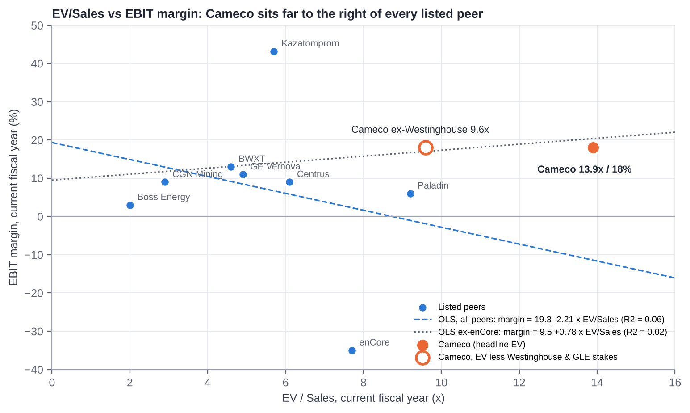

| Statistic | Value |
|---|---|
| Sample | 8 listed peers: Kazatomprom, Paladin, CGN Mining, Boss, enCore, Centrus, BWXT, GE Vernova. UEC and Energy Fuels excluded (EV/Sales >40x; losses) |
| OLS, all 8: EBIT margin = 19.3% − 2.21 × EV/Sales | R² = 0.06 |
| OLS ex-enCore (7): EBIT margin = 9.5% + 0.78 × EV/Sales | R² = 0.02 |
| Cameco (headline EV): EV/Sales 13.9x, EBIT margin ~18% | 50% above the highest peer (Paladin 9.2x) |
| Cameco, EV less Westinghouse and GLE stakes (C$14.5bn) | 9.6x, still at the top of the range |
| Peer median EV/Sales | ~5.3x |

**How to read it:**

1. **There is no statistically meaningful relationship in this peer set** (R² ≈ 0.0-0.1). Uranium names are priced on reserves, contract books and spot-price torque. Nuclear-technology names are priced on growth and backlog. Current-year EBIT margin explains almost none of the dispersion.
2. **Cameco is an outlier on both specifications.** At its ~18% current-year EBIT margin, peers would justify ~5-8x EV/Sales, against 13.9x paid (9.6x after taking out Westinghouse at US$10bn).
3. **The premium is a bet on 2028-30 margins.** If the contract book reprices as the sensitivity table implies, EBIT margins rise to ~30% (FY28E) and EV/Sales falls to ~12x. That is still a premium, but a defensible one for scarce tier-one assets.

## 14.5 Against its own history

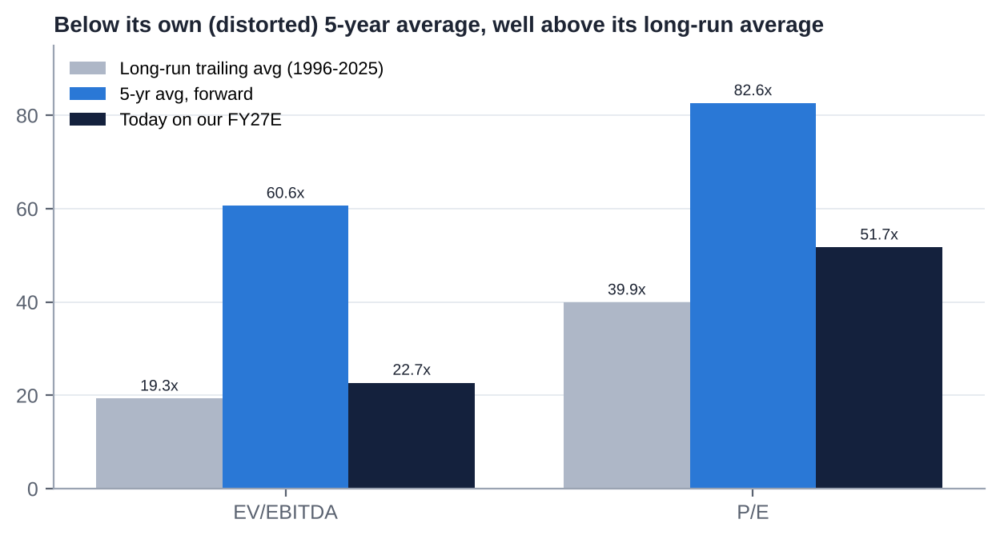

| Metric | Current (on our FY27E) | 5-yr avg (forward) | 3-yr avg | Long-run trailing avg (1996-2025) | Source |
|---|---|---|---|---|---|
| EV/EBITDA | 22.8x | 60.6x | 53.3x | 19.3x | Seeking Alpha, Alphaspread, VCP Scanner [u] |
| P/E | 52x | 82.6x | n/a | 39.9x | Seeking Alpha, VCP Scanner [u] |
| P/NAV (S&P NAV US$25.5bn) | ~1.3x [d] | n/a | n/a | n/a | S&P Global MI (Feb-26: 2.3x) [u] |

- **The 5-year averages are inflated** by trough earnings in 2021-23, when McArthur River was shut and before Westinghouse was included. On those numbers Cameco looks "cheap" (~60% below average).
- **Against its long-run average** (1996-2025, which spans the 2007 and 2011 uranium cycles), the stock trades ~20-30% above on both EV/EBITDA and P/E.
- **On P/NAV,** the de-rating from ~2.3x (Feb-26) to ~1.3x [d] puts Cameco at the level of the developers (1.3-1.6x), which is unusual for the sector's premium producer. This assumes S&P's NAV is unchanged; it is the most constructive data point for value investors.

## 14.6 Verdict: cheap, fair or expensive?

| Lens | Verdict |
|---|---|
| vs uranium producers (EV/Sales, EV/EBITDA, P/E) | **Expensive** (2-3x peer multiples) |
| vs nuclear technology and services peers | **Fair** (EV/EBITDA in line) |
| vs own 5-year average | **Cheap** (but that average is distorted) |
| vs own long-run average | **Modestly expensive** |
| P/NAV vs Feb-2026 and vs developers | **Cheap to fair** |
| Our SOTP (US$76) | **Fair** |

**Overall: FAIR, with no margin of safety.** The current price embeds a successful 2027-30 contract repricing and a Westinghouse value of ~US$10bn.

# 15. M&A: Industry Transactions, Takeover Potential and Takeout Multiples

## 15.1 Recent industry M&A themes (2021-2026)

1. **Western vertical integration.** Brookfield and Cameco bought Westinghouse (US$7.875bn EV, Nov-23). Westinghouse is now heading for an IPO (draft S-1, Jul-26), with the US government holding a 20% participation interest above US$17.5bn of distributions.
2. **Chinese state buyers in Kazakhstan.** Rosatom/Uranium One sold Zarechnoye (49.979%) to SNURDC, and 30% of Khorasan-U and Kyzylkum to a CGN vehicle (Dec-24). Prices were undisclosed.
3. **Athabasca consolidation.** Paladin bought Fission Uranium (C$1.14bn, completed Dec-24). NexGen (C$11bn) and Denison (C$4.7bn) remain independent.
4. **US ISR roll-ups.** UEC bought Uranium One Americas (2021 [m]), UEX (2022 [m]) and Rio Tinto's Sweetwater (US$175m, Dec-24). enCore bought Azarga (2022 [m]); Boss bought 30% of Alta Mesa (2023 [m]).
5. **Nuclear services.** BWXT bought Kinectrics (US$525m, ~14x EBITDA, May-25). Westinghouse bought BHI Energy (2023 [m]).
6. **Power and offtake.** Constellation bought Calpine (US$26.6bn, closed early 2026). Nuclear M&A totalled US$7.0bn across 44 deals in H1-26 [u].
7. **Sovereign takings.** Niger nationalised SOMAÏR, taking Orano's 63.4% (Jun-25).

## 15.2 Comparable transactions (last five years)

| Target | Acquirer | Announced / closed | Value | EV/EBITDA | EV/Sales | EV per lb / note |
|---|---|---|---|---|---|---|
| Westinghouse (100%) | Brookfield 51% / Cameco 49% | Oct-22 / Nov-23 | US$7.875bn EV (incl. ~US$3.4bn debt) | ~11.2x LTM [d] | ~2.4x [d] | Services/fuel platform |
| Kinectrics | BWX Technologies | Jan-25 / May-25 | US$525m (C$712m) | ~14x 2024E [u] | ~1.75x [d] | CANDU services |
| Fission Uranium (PLS) | Paladin Energy | Jun-24 [m] / Dec-24 | C$1.14bn (US$0.79bn) equity | n.m. | n.m. | ~C$12/lb reserve (~US$8.7/lb) [d/m] |
| Rio Tinto Wyoming / Sweetwater | Uranium Energy Corp | Sep-24 / Dec-24 | US$175.4m | n.m. | n.m. | ~US$1.0/lb historic resource [d] |
| Base Resources | Energy Fuels | Apr-24 / Oct-24 | US$178m final (A$375m announced) | n/a | n/a | Mineral sands / rare earths |
| Zarechnoye JV 49.979% | SNURDC (SPIC) from Uranium One | Dec-24 | Undisclosed | n/a | n/a | Kazakh ISR |
| Khorasan-U 30%, Kyzylkum 30% | CGN vehicle from Uranium One | Dec-24 | Undisclosed | n/a | n/a | Kazakh ISR |
| Cigar Lake 7.875% (Idemitsu) | Cameco (4.522%) / Orano | May-22 | C$107m (Cameco share) | n/a | n/a | ~C$23.7m per percentage point [d] |
| Cigar Lake 5% (TEPCO) | Cameco / Orano (pro rata) [u] | Jul-26 | Undisclosed | n/a | n/a | Cameco to ~57.4% |
| Alta Mesa 30% | Boss Energy | Dec-23 [m] | ~US$60m [m] | n.m. | n.m. | US ISR |
| UEX Corp | UEC | 2022 [m] | All-share [m] | n.m. | n.m. | Athabasca exploration |
| Calpine | Constellation Energy | Jan-25 / early 2026 | US$26.6bn | n/a | n/a | Power generation (context) |
| Westinghouse IPO (pending) | Public markets | Draft S-1 Jul-26 | Desjardins: Cameco's 49% ≈ US$10.8bn [u] | implied ~29x [e] | n/a | Value-crystallisation event |

## 15.3 Is Cameco a takeover target?

**Short answer: no, not without an Act of Parliament.**

**Pros (why a buyer might want it):**

- A unique portfolio of tier-one Western assets.
- Strategic value to the US and allied governments (security of supply after the Russian ban).
- 49% of Westinghouse and the GLE option.
- A clean balance sheet.
- A depressed share price (−43% from the high).
- An existing partnership with Brookfield.

**Impediments:**

1. **Eldorado Nuclear Limited Reorganization and Divestiture Act (ENL Act), implemented in Cameco's articles:**
   - No non-resident may hold more than **15%** of the votes for directors.
   - No resident may hold more than **25%**.
   - Aggregate non-resident votes are **pro-rated down to 25%** of votes cast. Cameco has applied this cap in practice, including in 2017.
   - Cameco must refuse share issues or transfers that would breach the caps, and may suspend votes or force sales.
   - A majority of directors must be Canadian residents [u]; the head office must be in Saskatchewan [m].
2. **Investment Canada Act:** national-security review, plus the 2022 policy that SOE acquisitions in critical minerals are approved only "on an exceptional basis" [m].
3. **The 1987 Non-Resident Ownership Policy in the uranium sector** (49% cap on foreign ownership of a mine at first production unless Canadian-controlled) [m].
4. **CNSC approval** for any change of control of licensed facilities.
5. **Saskatchewan politics and Indigenous impact-benefit agreements.**
6. **Size:** ~US$34bn of equity.
7. **Westinghouse shareholder agreement:** likely change-of-control and pre-emption provisions in Brookfield's favour [m].

**Plausible acquirers screen:** Kazatomprom, Chinese SOEs, BHP and Glencore are capped or blocked (rated very low to nil). Brookfield is a Canadian resident but still capped at 25%; a Westinghouse-level transaction is more plausible. Canadian pension funds could take minority stakes only.

**Conclusion:** no takeover premium belongs in the valuation. Cameco is more likely to be the acquirer, for example:

- Athabasca consolidation (NexGen, Denison, Paladin's PLS);
- remaining minority interests (Orano's stakes);
- the GLE option to 75%;
- more of Westinghouse, or alternatively selling part of the stake in the IPO.

## 15.4 Potential takeout multiples and values (theoretical: only if the ENL Act were amended)

| Basis | Multiple | Implied value per share | Comment |
|---|---|---|---|
| Control premium of 25-40% on the undisturbed price (US$76.91) | n/a | US$96-108 | Market convention [m] |
| EV/EBITDA at US$100 | ~30x FY27E; ~27x FY28E | n/a | Far above services precedents (11-14x) |
| P/NAV at US$100 | ~1.7x on S&P's US$25.5bn NAV [d] | n/a | Below the Feb-26 trading level (2.3x) |
| SOTP bull case | n/a | ~US$111 | Westinghouse at ~40x EBITDA; uranium at 24x |

A buyer would pay mainly for long-dated pounds and the Westinghouse option. Precedent uranium deals (US$1-9/lb of resource) are not meaningful for a producer of Cameco's scale.

## 15.5 Acquisitions and disposals by Cameco (last 10 years)

| Target | Date | Cost | Multiple | Assessment |
|---|---|---|---|---|
| **Westinghouse Electric, 49%** (with Brookfield) | Announced 11-Oct-22; closed 7-Nov-23 | ~US$2.2bn equity [d] (49% of ~US$4.5bn cash equity) plus look-through of ~US$3.4bn debt. Funded by the US$747.6m equity raise, a US$600m term loan (repaid by Jan-25) and cash | ~11x LTM EBITDA (100%) [d] | **Value-creating so far:** Desjardins puts the stake at ~US$10.8bn (~4.9x cost) [u]. The US-government framework and IPO option were not in the 2022 case |
| **Cigar Lake, +4.522%** (from Idemitsu) | May-22 | C$107m | ~C$23.7m per percentage point [d] | Well-timed (bought near the bottom) |
| **Cigar Lake, TEPCO's 5%** (pro rata with Orano) | Jul-26 | Undisclosed [u] | n/a | Raises Cameco to ~57.4%; ~+0.5 Mlb/yr attributable [d] |
| **Global Laser Enrichment, 24% → 49%** (with Silex, from GE Hitachi) | Jan-21 (CFIUS cleared 18-Jan-21) | Not disclosed (Cameco paid US$123.8m for 24% in 2008) [u] | n/a | A low-cost option; carried at nil; option to 75% |
| **JV Inkai restructuring** | Effective Jan-18 [m] | n/a (Cameco's interest cut from 60% to 40% for an expanded licence and production entitlement) | n/a | Secured a longer-life asset; added sovereign dependence |
| Disposals | 2016-26 | None material found; care and maintenance at Rabbit Lake and US ISR rather than sales | n/a | Kept optionality |

# 16. Management Assessment

## 16.1 Archetype

Cameco is a **professionally managed, widely held former Crown corporation.** It was formed in 1988 by merging Saskatchewan Mining Development Corp and Eldorado Nuclear, and privatised from 1991 [m]. It has no founder or controlling shareholder, and the statutory caps rule one out. CEOs have been internal or industry-insider successions: Bernard Michel (~1993-2003 [m]), Jerry Grandey (2003-Jun-2011), Tim Gitzel (Jul-2011 to date).

**Implications:**

- **Positives:** institutional continuity and a consistent "contract-first, tier-one" philosophy.
- **Negatives:** a long-tenured, insulated management team protected from takeover. Pay has risen with the company's scope rather than with owner economics. Succession is only partly executed.

## 16.2 Key executives

| Executive | Role (since) | Track record | Tenure | Skin in the game |
|---|---|---|---|---|
| **Tim Gitzel** | CEO (since 1-Jul-2011; President and CEO until 31-Aug-2025) | Steered supply discipline (2016-22), won the CRA tax case, bought Westinghouse, and positioned Cameco for the nuclear revival; TSR +255% over 5 years. Earlier: AREVA/COGEMA Canada executive [m]; past chair of the WNA and the Mining Association of Canada [m] | 15+ years as CEO | ~C$44.8m of shares and units at end-2023 (shares ~C$26.3m) [v]; 582,011 shares in May-24 [u] |
| **Grant Isaac** | President and COO (since 1-Sep-2025); previously EVP and CFO (~2011-2025 [m]) | Architect of the contracting and capital strategy and the Westinghouse financing; public face on markets. Heir-apparent [d] | ~15 years in senior roles | Not found |
| **Heidi Shockey** | EVP and CFO (since 1-Sep-2025); previously Deputy CFO | Long-time finance executive [m]. **Retiring at the end of Q1-2027** [u] | ~14 months as CFO | Not found |
| **Lisa Aitken** | SVP and Chief Marketing Officer (since 1-Jan-2026) | Succeeded David Doerksen (Oct-24 to Dec-25) | <1 year | Not found |
| **Rachelle Girard** | SVP and Chief Corporate Officer | Former investor-relations lead [m] | n/a | Not found |
| **Liam Mooney** | Chief Legal Officer (successor to Sean Quinn) [u] | n/a | <1 year | Not found |

## 16.3 Capital allocation and returns under current management

| Decision | Verdict |
|---|---|
| Supply discipline (Rabbit Lake and US ISR 2016; McArthur River 2018-22; buying in the market) | **Good:** protected the term price and preserved reserves. It cost earnings in 2018-21 |
| 2018 dividend cut from C$0.40 to C$0.08, then rebuilt to C$0.24 | **Prudent** |
| Westinghouse 49% (2022-23) | **Good to date:** bought at ~11x EBITDA; the stake is now valued at ~4-5x cost by brokers [u]. Funding diluted shareholders ~8.5% at US$21.95 |
| Cigar Lake step-ups (2022, 2026) | **Good:** cheap attributable growth |
| GLE (2021) | **Option-like:** small cost; Paducah licence near |
| No buybacks in 10 years; no special dividends | **Conservative:** the right choice through the trough, but returns of capital are minimal at peak cash flow |
| **ROIC (third party)** | −0.7% (2016) → −1.9% (2021) → 2.3% (2023) → 3.8% (2024) → 4.8% (2025) [u]; ROE ~8.5-9% (2025) [u]. Still below the cost of capital on a book-capital basis, because of the large equity base and PPA-inflated Westinghouse book value |

## 16.4 Red flags

1. **Promotional framing of a term sheet.** The Oct-25 US-government deal was announced as "transformational". A year later there were still no definitive agreements. The stock rose 23% on the day.
2. **Pay ratcheting.** The CEO's long-term-incentive target rose from 370% to 470% of salary for 2025, and 2025 total compensation was ~C$11.0m [u] vs C$7.6m total direct compensation in 2024 [v]. Say-on-pay support was nonetheless 98.1% (2024).
3. **Executive turnover.** The COO and CLO retired (Mar-26), the Chief Corporate Officer retired, the CMO changed twice in 15 months, and the CFO is retiring after ~18 months in the role. Meanwhile the CEO has served 15+ years with no announced end date.
4. **Guidance credibility.** "Have not changed our production guidance" (Jul-26) was reversed in Oct-26. The price-sensitivity table needed a "methodology correction".
5. **Related parties (structural, not abusive):** Westinghouse is both a 49% joint venture and a fuel-services customer; Orano is a JV partner and the mill operator; Kazatomprom is the JV operator; one director is Chief of a First Nation whose business arm may supply northern mining [m]. We found no evidence of abusive related-party dealing.
6. **Strategy pivots:** none. The strategy has been very consistent.

## 16.5 Recent senior management changes

- **31-Jul-2025** (effective 1-Sep-2025): Gitzel gives up the President title; Isaac becomes President and COO; Shockey becomes CFO. COO Brian Reilly and CLO Sean Quinn move to advisory roles and retire in Mar-2026.
- **7-Oct-2024:** David Doerksen appointed CMO. **1-Jan-2026:** Lisa Aitken appointed CMO.
- **~2025:** Alice Wong (Chief Corporate Officer) retires; Rachelle Girard takes the title.
- **30-Oct-2026:** CFO Shockey to retire at the end of Q1-2027; no successor named [u].
- **Implication:** Isaac is the obvious CEO successor. A Gitzel retirement announcement in 2027 is plausible [e].

# 17. Board of Directors

| Director | Role | Joined | Independent | Professional background | Other affiliations |
|---|---|---|---|---|---|
| **Catherine Gignac** | Chair (since 1-Dec-2023) | 2014 | Yes | Geologist; former mining equity research analyst; 30+ years in capital markets and mining | Other public boards not verified [m] |
| **Tim Gitzel** | President and CEO until Aug-25; CEO | 2011 | No | Cameco CEO; former AREVA Canada executive [m] | Past chair of WNA and MAC [m] |
| **Tammy Cook-Searson** | Director (SH&E; Technical) | 1-Sep-2023 | Presumed (verify) | Chief of the Lac La Ronge Indian Band since 2005 | President, Kitsaki Management LP |
| **Marie Inkster** | Director | 9-May-2025 | Yes | Finance/audit executive; former CEO and CFO of Lundin Mining [m] | n/a |
| **Kathryn Jackson** | Director | ~2019 [m] | Yes (verify) | Nuclear/energy technology executive; ex-Westinghouse SVP and CTO; ex-TVA [m] | Portland General Electric board [m] |
| **Don Kayne** | Director | ~2017 [m] | Yes | Former President and CEO of Canfor [m] | n/a |
| **Peter Kukielski** | Director | 9-May-2025 | Yes | Former President and CEO of Hudbay Minerals; Nyrstar, Anglo American, Teck [m] | n/a |
| **Dominique Minière** | Director (HR and Comp; SH&E; Technical) | 1-Sep-2023 | Yes | Retired EVP, New Nuclear and International Development, OPG; ex-EDF nuclear executive [m] | n/a |
| **Leontine van Leeuwen-Atkins** | Director | ~2021 [m] | Yes | Accounting/audit; former KPMG Canada partner [m] | n/a |

- **Composition:** 9 directors; 8 presumed independent (89%); at least 5 women (~56%), including the Chair; one Indigenous director.
- **2026 AGM support:** 98-99.8% for all directors [u].

## 17.1 Board changes in the last five years

| Date | Change |
|---|---|
| 1-Sep-2023 | **Joined:** Tammy Cook-Searson, Dominique Minière |
| 15-Oct-2023 | Chair Ian Bruce (Chair since May-2018) died |
| 1-Dec-2023 | **Catherine Gignac appointed Chair** |
| 9-May-2024 | **Retired:** Don Deranger and Jim Gowans (15 years each); board cut to 8 |
| 9-May-2025 | **Joined:** Marie Inkster, Peter Kukielski; board of 10 |
| 7-May-2026 | **Left:** Daniel Camus (former EDF Group CFO [m]); board of 9 |

**Assessment:** heavy refreshment (four new directors in three years), and the skills mix has shifted towards nuclear new build (Minière, Jackson) and mining operations (Kukielski). The board is lean, so committee loads are concentrated. Two independence checks are pending (Cook-Searson/Kitsaki supply links; Jackson's former Westinghouse role).

# 18. Shareholders, Activism and Short Interest

## 18.1 Largest shareholders (13F and trackers, Q1-Q3 2026)

| # | Holder | Approx. shares (m) | % of 435.5m | Type |
|---|---|---|---|---|
| 1 | BlackRock | ~21.8 [d] | ~5.0% [u] | Index / passive |
| 2 | Mirae Asset Global ETFs (Global X Uranium ETF, URA) | 15.4 | ~3.5% [v] | Thematic ETF |
| 3 | Vanguard | ~12-16 | ~2.8-3.6% [u] | Index |
| 4 | Capital Group (Capital World Investors / CRMC) | ~13-14 [d] | ~3.1-3.2% [u] | Active institutional |
| 5 | Royal Bank of Canada (RBC GAM) | ~9.6 | ~2.2% [u] | Bank / active |
| 6 | FMR (Fidelity) | ~9.2 | ~2.1% [u] | Active institutional |
| 7-10 | Not verified. Likely candidates from tracker data: Sprott Asset Management (URNM), TD Asset Management, 1832 (Scotiabank), Norges Bank, State Street, Geode, Mackenzie, Jarislowsky Fraser [m] | ~1-2% each [e] | | Institutional / index |
| | **Directors and officers (aggregate)** | <1% (~0.24% [u]); directors hold 244,975 DSUs [v] | | Insiders |

- Institutions hold ~63-73% of the shares [u]. No holder is near the 15%/25% caps.
- The register is index-heavy and ETF-heavy (BlackRock, Vanguard, URA, URNM). That amplifies flow-driven volatility around nuclear and AI themes.

## 18.2 Activism

- **No activist campaign, proxy fight, 13D, public letter or dissident shareholder proposal has been found against Cameco.**
- Say-on-pay support has been 92-98% (2010-24), and directors receive 98-99.8%.
- **Structural deterrent:** the ENL Act caps make a control-seeking stake impossible. A non-resident activist would also see its votes pro-rated down if non-residents together exceeded 25% of votes cast.
- **Window for 2027 shareholder proposals:** 8-Dec-2026 to 5-Feb-2027 [v].

## 18.3 Short interest

- **CCJ (NYSE):** 7.9m shares short (30-Sep-2026), ~1.8% of float, 2.5 days to cover [u]. The figure rose from 5.8m (Apr-26) to 8.7m (mid-Sep), then eased.
- CCO (TSX) short position: not found.
- **No published short-seller reports** on Cameco and no named short sellers. Short interest is low and largely reflects hedging and pair positioning against uranium ETFs and SPUT [e].

# 19. Strategic Initiatives (2016-2026)

| Initiative | Key events | Success / status |
|---|---|---|
| **Tier-one strategy and supply discipline** | Rabbit Lake and US ISR curtailed (2016); McArthur River/Key Lake suspended (2018-22); market purchases to meet contracts | **Success:** preserved reserves and contract pricing; vindicated by the 2022-26 price recovery |
| **McArthur River/Key Lake restart** | Restart decided Feb-22, production from late-22; 2024 record (20.3 Mlb); 2025 missed (15.1 vs 18); 2026 flood and outage; NI 43-101 update in progress | **Mixed:** restart achieved, reliability poor in 2025-26. Expansion towards 25 Mlb (100%) not yet formalised |
| **Cigar Lake** | Stake raised to 54.547% (2022) and ~57.4% (2026); 19.1 Mlb in 2025; Jul-26 halt (McClean Lake) | **Success**, with Orano mill dependence |
| **JV Inkai** | 2018 restructuring (40%); Jan-25 paperwork suspension; 2026 acid and logistics risks; US$87m dividend (2025) | **Mixed:** valuable, but sovereign and logistics risk |
| **Westinghouse acquisition** | Closed Nov-23; Dukovany windfall 2025; US$80bn US-government term sheet (Oct-25); DOE US$17.5bn conditional loans (Jun-26); confidential S-1 (Jul-26); US-Korea US$120bn framework (Oct-26); Poland EPC terms (Sep-26) | **Success to date**; definitive agreements and FIDs pending |
| **Global Laser Enrichment** | 49% (2021); NRC application accepted (Aug-25); final EIS recommends licence (Oct-26); licence expected early 2027 [u]; only US$28m of DOE awards (vs US$900m sought) | **In progress:** a licensing win, but funding is a gap |
| **Fuel services / conversion** | Port Hope record UF6 (2025); prices +14% (2025); Slovenské elektrárne contract; India DAE contract | **Success:** the niche is tightening |
| **Contracting strategy** | ~230 Mlb book; India ~22 Mlb (Mar-26); market-related pricing with floors; holding out for "three-digit" base prices | **Ongoing:** disciplined, but realised prices lag |
| **CRA tax dispute** | Won (2018 Tax Court; 2020 FCA; 2021 SCC leave denied); C$300m refund (2023) | **Success** |
| **Dividend policy** | Doubling plan (C$0.12 → C$0.24) achieved a year early (2025) | **Success, but small** |
| **SMRs and advanced reactors** | Exposure mainly via Westinghouse (AP300, eVinci); BWRX-300 fuel MoU with GE Hitachi [m] | **Early stage** |
| **Indigenous partnerships** | Collaboration agreements with Athabasca communities [m]; Indigenous director | **Ongoing; supportive of licence to operate** |

# 20. Stakes in Other Companies

| Asset / entity | Cameco interest | Partners | Accounting / carrying value | Strategic and financial relevance |
|---|---|---|---|---|
| **Westinghouse Electric** | **49%** | Brookfield 51% | Equity-accounted (joint control); C$2,932m at end-2024 [v]; distributions US$49m and US$171.5m (2025) | **Highly material.** Worth ~US$5-15bn (≈15-45% of Cameco's market cap) depending on IPO valuation. Brings reactor, fuel and new-build exposure; US-government participation of 20% above US$17.5bn; IPO optionality to Jan-2029 |
| **Global Laser Enrichment** | **49%** (option to 75% at fair value) | Silex Systems 51% (SLX AU, listed) | Equity-accounted; **nil** carrying value | Strategic Western enrichment option; Paducah licence early 2027. Financially small today; we value it at ~C$0.7bn [e] |
| **JV Inkai** | **40%** | Kazatomprom 60% | Equity-accounted (no joint control); C$287m (2024) [v] | Supplies ~4.2 Mlb/yr at a discount to market; US$87m dividend (2025); sovereign and logistics risk |
| **Cigar Lake** | ~57.4% (from 54.547%) | Orano ~42.6% | Joint operation (proportionate) | Highest-grade producing mine; ore milled by Orano |
| **McArthur River / Key Lake** | 69.805% / 83.33% [m] | Orano | Joint operations | Flagship; expansion optionality |
| **Millennium, Waterbury Lake and other exploration JVs** | Various [m] | JCU; Denison [m] | Small | Long-dated pipeline |
| **US ISR (Crow Butte, Smith Ranch-Highland)**; **Rabbit Lake** | 100% | – | Care and maintenance (~US$15-16m/yr in C&M costs [u]) | Restart options on US policy or price support |
| **Listed equity stakes** | None material found | – | – | Not relevant |

Total equity-accounted investees were C$3.22bn at end-2024 (Westinghouse plus Inkai; GLE at nil) [v].

# 21. Dividends, Buybacks and Treasury Shares (Five-Year Timeline)

| Year | DPS (C$) | Record / pay date | Cash cost (C$m) | Buybacks / NCIB | Equity issued / (cancelled) | Treasury shares | Shares outstanding (m) |
|---|---|---|---|---|---|---|---|
| 2021 | 0.08 | ex 29-Nov-21; paid ~15-Dec-21 | ~32 [d] | None | Options exercised (minor) | None held [m] | ~398 [d] |
| 2022 | 0.12 | rec 30-Nov-22; paid 15-Dec-22 | ~52 [d] | None | **+34.06m shares** (bought deal at US$21.95, US$747.6m, closed 17-Oct-22) | None | ~433 [d] |
| 2023 | 0.12 | ex 29-Nov-23; paid ~15-Dec-23 | ~52 [d] | None | Minor | None | ~434 [d] |
| 2024 | 0.16 | ex 27-Nov-24; paid 13-Dec-24 | 69.6 [u] | None | Minor | None | ~435 |
| 2025 | 0.24 | ex 1-Dec-25; paid ~16-Dec-25 | 104.5 [u] | None | Minor | None | ~435.4 |
| 2026 | 0.24 (declared 30-Oct-26) | rec 30-Nov-26; pay 15-Dec-26 [u] | ~105 [d] | None | Minor | None | 435.5 (Mar-26) |

- **No normal-course issuer bid (buyback) in at least 10 years** and no share cancellations [m; none found]. Cameco holds no treasury shares as a policy matter [m]; PSUs have historically been settled with shares bought in the market [m].
- **Equity compensation dilution is negligible:** 39,063 options outstanding (Mar-26); 244,975 director DSUs (Sep-26).
- **Payout:** the 2025 dividend was ~10% of free cash flow and ~17% of adjusted earnings [d]. Capital is retained for Westinghouse equity calls, McArthur River and Key Lake, and optionality.

# 22. Adversarial Analysis I: The Bull Case

**1. Competitive advantages that are getting more valuable, not less.**

- After Russia's invasion, the Niger coup and Kazakhstan's tax and acid problems, Western utilities need suppliers that are licensed, politically safe and able to deliver at scale. That list is short: Cameco, Orano and a few mid-tiers.
- Cameco is the only one that is listed, of scale, and integrated from mine to conversion, with a stake in the leading Western reactor vendor.
- Russian enriched uranium is barred from the US from 2028. That raises the value of Western conversion (Port Hope) and enrichment (GLE) capacity.

**2. Moat sustainability.**

- McArthur River and Cigar Lake are generational, high-grade deposits. The next comparable Western supply (NexGen's Arrow) is ~2030 at the earliest and has taken more than a decade to permit.
- Conversion is an oligopoly of three outside Russia and China.
- Westinghouse's installed base (fuel and services for roughly half the world's reactors [m]) has high switching costs.

**3. Growth levers:**

- **Contract repricing.** The 2026 realised price is ~US$67. The company's own table implies US$87-93 by 2030 at US$100-120 spot. Every US$10/lb on 31 Mlb is worth ~C$430m of EBITDA [d].
- **Volumes.** Production can recover from ~20 to ~24-25 Mlb (Cameco share) once Key Lake is fixed and McArthur River development catches up. US ISR restarts and McArthur River expansion are further options.
- **Westinghouse.**
  - Core fuel and services are growing ~6-10% a year.
  - New build could transform it: the US$80bn US programme, DOE US$17.5bn for long-lead items on up to 10 AP1000s, the US-Korea US$120bn framework (six AP1000s), Poland's three AP1000s, Bulgaria and the 91-unit pipeline.
  - At ~US$400-600m of Westinghouse EBITDA per AP1000 during construction [u], ten units add ~US$2-3bn of Cameco-share EBITDA over a decade [d].
- **Enrichment.** GLE's Paducah licence (early 2027) plus record SWU prices.
- **Possible earnings surprises:**
  - A replacement-rate contracting year (≥150-180 Mlb) would push the term price above US$100.
  - Firm US AP1000 orders.
  - A Westinghouse IPO valuation above US$30bn.
  - A strong Key Lake restart that brings 2027 costs below C$62/lb.

**4. Capital allocation.**

- Supply discipline protected value through the trough.
- Westinghouse was bought at ~11x EBITDA and may be worth 4-5x its cost [u].
- The Cigar Lake step-ups were cheap, and the balance sheet is nearly debt-free.
- With ~C$1bn of potential annual FCF from 2027-28, Cameco can fund Westinghouse new-build equity and still raise returns.

**5. The valuation reset.** At ~1.3x S&P's NAV (vs 2.3x in Feb-26), Cameco trades at developer multiples for producer-quality assets. A 43% drawdown has removed much of the 2025-26 froth.

# 23. Adversarial Analysis II: The Bear Case, Pre-Mortem and Contrarian View

## 23.1 Two to three risks that could permanently impair the business

1. **Uranium never gets its "replacement-rate" moment.**
   - Utilities have kept deferring for three years (~116 Mlb/yr vs ~179 Mlb of needs).
   - Inventories, enrichment overfeeding and underfeeding swings, Kazakh downflex reversal, new supply from NexGen and Denison around 2030, and US ISR restarts could cap term prices at ~US$85-95.
   - Cameco's contract book would then reprice only to ~US$75-80 by 2030, and today's multiple would not be earned.
2. **A tier-one asset failure.**
   - Cigar Lake flooded in 2006 and 2008, which delayed production by ~7 years [m]. McArthur River has a history of water inflows (2003 [m]).
   - A major inflow or ground failure, or a prolonged McClean Lake (Orano) outage, would remove ~10 Mlb/yr of attributable output for years. Cameco would have to buy at market to meet contracts.
3. **Westinghouse repeats Vogtle.**
   - First-of-a-kind cost overruns on the new US fleet, a failed or deferred IPO, or US-government terms that capture more value than expected (20% above US$17.5bn) could turn the "free option" into a cash drain.
   - Cameco's share of equity calls could reach ~US$1.2bn.

## 23.2 Margin compression and revenue deceleration risks

- **Unit costs** have risen from ~C$63 (2025) to C$67-70 (2026 guide), and Q3 reached C$72. Labour, reagent and contractor inflation in remote Saskatchewan is structural.
- **Purchased pounds.** The gap between deliveries (~30 Mlb) and production (~20 Mlb) is bought at ~US$90 spot and sold at ~US$67-72 realised. That is negative margin on purchased pounds until the contract book catches up [d].
- **Contract ceilings** in legacy market-related contracts limit upside, and the sensitivity table has just been lowered.
- **Revenue deceleration.** Deliveries are down ~9% in 2026, revenue is flat LTM, and Westinghouse's 2026 EBITDA share is down ~25% after Dukovany.

## 23.3 Are expectations too high?

Yes, for 2027:

- Consensus FY27 EPS of ~C$2.6-3.0 implies a 2.5-3x jump from 2026. That needs both a clean Key Lake recovery and higher realised prices.
- Our C$2.05 already assumes a recovery.
- Sell-side targets (US$133-150 before Q3) look stale and should be cut further.

## 23.4 Are valuation multiples too high?

On earnings, yes: ~52x FY27E P/E and ~23x FY27E EV/EBITDA, against ~9x for Kazatomprom and ~13x the industry median for producers [u]. Only the "nuclear platform" framing (BWXT ~26x, GE Vernova ~32x) makes today's multiples look ordinary, and Westinghouse is still a minority, unlisted, cash-light asset.

## 23.5 Pre-mortem: "It is November 2027 and the position lost 35%. What happened?"

1. **Key Lake took until mid-2027 to normalise.** 2027 production guidance (issued Feb-27) was ~21 Mlb with unit costs of ~C$68, and FY27 EPS consensus fell from C$2.7 to C$1.8.
2. **Spot drifted to ~US$75.** Kazatomprom reversed part of its downflex, SPUT stopped buying (it had hit its 9 Mlb/yr cap), and utilities stayed patient. The term price stalled at ~US$90.
3. **Westinghouse slipped.** The US-government definitive agreements slipped into 2028, the Westinghouse S-1 stayed confidential, and two of the five DOE-funded projects lost partners.
4. **Sentiment turned.** The AI-power trade cooled, nuclear SMR names fell 50%+, and thematic ETFs (URA, URNM) saw outflows. CCJ, as the largest holding, was sold mechanically.
5. **Management turnover added to doubt.** A new CFO (from outside) took a conservative first-year stance. Gitzel announced his retirement and Isaac's appointment, but the market read it as "end of an era".

**What would have warned us:** Q4-26 deliveries below 9 Mlb; 2027 cost guidance above C$66/lb; no US-government definitive agreement by mid-2027; UxC term contracting below 100 Mlb for 2026.

## 23.6 Contrarian view: what the market is refusing to see

**1. The market is treating a temporary mill outage as a permanent impairment of the platform.**

- On S&P's NAV the stock has de-rated from 2.3x to ~1.3x.
- The Key Lake outage is a planned modernisation that overran. It is not a geological problem: grades are unchanged.
- The contract book (~230 Mlb, 39 customers) has not changed, and the term price has risen in the meantime.

**2. Westinghouse may be worth far more than US$10bn, and the market cannot see it yet.**

- The S-1 is confidential, so investors are pricing Westinghouse off Cameco's equity-accounted line, which shows a 9M-26 loss of C$80m after purchase-accounting amortisation.
- On a pure services multiple (BWXT ~26x; GE Vernova ~32x), Westinghouse's ~US$0.9bn normalised EBITDA supports US$20-25bn of EV before any new build.
- If the IPO lands at ≥US$30bn of equity, Cameco's stake alone is ~US$13-15bn, or 40-45% of its market cap.

**3. The bear case on "contracting never comes" ignores that the deferral itself compounds the shortage.**

- Every year of under-contracting (~60 Mlb/yr below replacement) adds to uncovered requirements that utilities must eventually fill.
- They must fill them in a market where Russia is gone from US supply after 2027, Kazakhstan is cutting, and Niger's output is stranded.

**Our view.** The contrarian view is credible, but it is a 2027-28 story. At US$77 it is roughly priced on a probability-weighted basis. At ~US$60 it would be compelling.

# 24. Scenario Analysis (12-Month View)

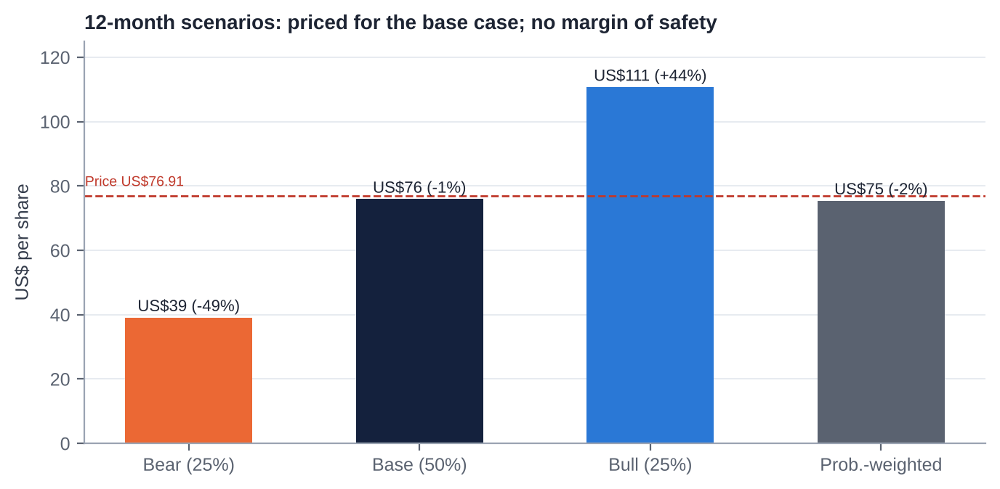

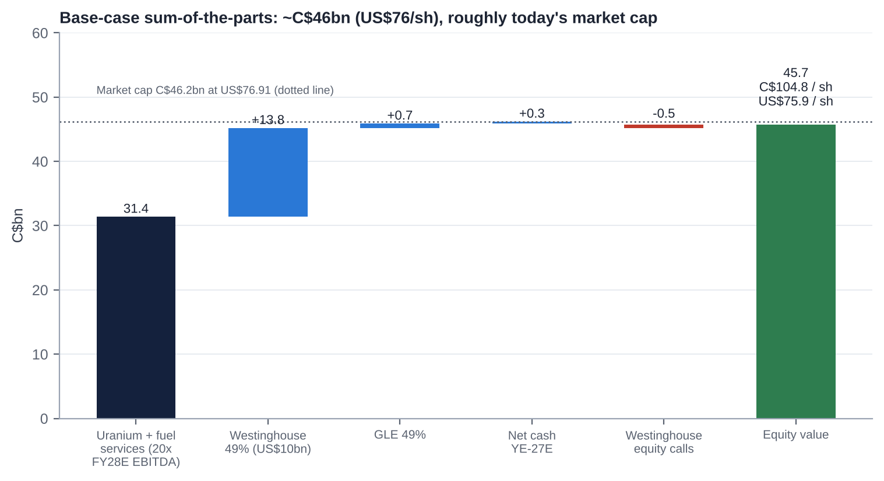

| Assumption | Bear (25%) | Base (50%) | Bull (25%) |
|---|---|---|---|
| Uranium spot / term (US$/lb, 2027-28) | 70 / 80 | 90 / 95 | 120 / 115 |
| Industry term contracting | ~100 Mlb/yr | ~140 Mlb/yr | ≥180 Mlb/yr |
| Realised price FY28E (US$/lb) | ~70 | ~77 | ~84 |
| Cameco production FY28E (Mlb) | ~20 (operating issues persist) | ~22-23 | ~24-25 |
| Unit cost (C$/lb) | ~70 | ~65 | ~62 |
| FY28E EBITDA ex-Westinghouse (C$bn) | 1.18 | 1.57 | 1.87 |
| Revenue growth FY26-28 (CAGR) | ~0% | ~8% | ~13% |
| EBIT margin FY28E | ~20% | ~31% | ~37% |
| Multiple on uranium + fuel services (EV/EBITDA) | 14x | 20x | 24x |
| Uranium + fuel services EV (C$bn) | 16.5 | 31.4 | 44.9 |
| Westinghouse 100% equity (US$bn, after US-government share) / Cameco 49% (US$bn) | ~10 / 4.9 | ~20 / 10.0 | ~31 / 15.0 |
| Westinghouse multiple (EV/FY27E EBITDA) | ~15x | ~27x | ~40x |
| Westinghouse 49% (C$bn) | 6.8 | 13.8 | 20.7 |
| GLE 49% (C$bn) | 0.2 | 0.7 | 1.5 |
| Net cash YE-27 less Westinghouse equity calls (C$bn) | 0.0 | (0.2) | (0.5) |
| **Equity value (C$bn)** | **23.5** | **45.7** | **66.6** |
| **Per share (C$ / US$)** | **C$54 / US$39** | **C$105 / US$76** | **C$153 / US$111** |
| **vs US$76.91** | **−49%** | **−1%** | **+44%** |

**Probability-weighted:** ~US$75 (−2%).

**Westinghouse stake sensitivity (FY27E Westinghouse EBITDA ~US$0.92bn at 100%; net debt ~US$4bn [e]; US-government warrant 20% of equity above US$17.5bn):**

| IPO EV/EBITDA | 15x | 20x | 25x | 30x | 40x |
|---|---|---|---|---|---|
| Westinghouse equity, 100% (US$bn) | 9.8 | 14.3 | 18.9 | 23.5 | 32.7 |
| US-government share (US$bn) | 0 | 0 | 0.3 | 1.2 | 3.0 |
| Cameco 49% (US$bn) | 4.8 | 7.0 | 9.1 | 10.9 | 14.5 |
| % of Cameco market cap | 14% | 21% | 27% | 33% | 43% |
| Implied EV/EBITDA FY28E paid for uranium + fuel services today | 26x | 25x | 23x | 22x | 19x |

# 25. The Short-Seller's Case and Forensic Accounting Review

*Written from the perspective of a sceptical short-seller and forensic analyst.*

## 25.1 What could structurally break how Cameco makes money?

- **The model depends on utilities paying a security premium for long-term contracts.** If utilities conclude that inventories, secondary supply and new projects (NexGen ~2030; Kazakh flex; US ISR) are sufficient, the term premium disappears. Cameco would then be a mid-cost producer selling at a lag to a flat market.
- **The integrated model has a structural weakness.** Cameco sells ~30 Mlb but mines ~20 Mlb, so it is short ~10 Mlb a year that must be bought at market (spot ~US$90) and delivered at realised prices of ~US$67-72. Rising spot with a lagging book squeezes margins. That is visible in the 2026 unit-cost guidance.

## 25.2 Where is revenue concentrated, and what if that shifts?

- **Product:** uranium is ~83% of revenue. Fuel services (16%) is too small to offset a uranium downturn.
- **Assets:** two Saskatchewan mines produce ~80% of Cameco-share output, and one third-party mill (Orano's McClean Lake) processes all of Cigar Lake's ore.
- **Customers:** 39 customers, and Cameco does not disclose its largest. US utilities dominate. A US policy shift (e.g. tariffs on Canadian uranium after Section 232 talks, or a US strategic reserve sourcing domestically) would hit the largest customer group.
- **Partners:** Kazatomprom controls Inkai's output, acid and logistics. Brookfield controls Westinghouse and its IPO timing.

## 25.3 Why the moat is weaker than bulls think

- **Cameco is a price-taker.** Its realised price lags spot by >US$20/lb because of ceilings and older contracts.
- **Its cost position is mid-curve, not low-cost.** High grade is offset by frozen-ground underground mining.
- **Westinghouse's moat is contestable.** KHNP won Dukovany; China builds its own AP1000 derivative (CAP1000/1400); Rosatom wins in the Global South.
- **"Security of supply" pricing only works while Kazakhstan and Russia are constrained.**

## 25.4 The most dangerous competitor bulls are underestimating

- **NexGen Energy (Rook I / Arrow), in Cameco's own basin.**
  - It is licensed for construction (Mar-26) and targets ~30 Mlb/yr [m] at very low operating cost from ~2030.
  - It can sign long-term contracts with US utilities now, at prices Cameco has refused.
  - It brings a new tier-one Canadian supplier that removes Cameco's "only safe Western scale supplier" premium, at exactly the point (2029-30) when Cameco's book is meant to reprice.
- **Kazatomprom's downflex is a choice, not a constraint.** Reversing it would add ~3,000 tU (~8 Mlb) quickly.

## 25.5 The worst capital-allocation decisions

1. **The Oct-2022 equity raise** at US$21.95 (34m shares, ~8.5% dilution) was near the bottom of the cycle. Those shares were worth ~US$4.6bn at the Jan-26 peak.
2. **The 2018 Inkai restructuring** cut Cameco's interest from 60% to 40% [m] and increased its dependence on Kazatomprom.
3. **Accepting US-government participation in Westinghouse** gives away 20% of distributions above US$17.5bn, and a possible warrant, in exchange for financing that is still conditional.
4. **No buybacks at any point,** even with ~C$1.1bn of FCF in 2025 and net cash at YE-25. Capital was instead kept for a "platform" whose returns (ROIC ~4-5%) remain below the cost of capital.

## 25.6 Related-party transactions, accounting and incentives

- **Related parties are structural, not abusive:**
  - Westinghouse (49% JV) is also a customer.
  - Inkai (an equity investee) sells pounds to Cameco at a discount to market [m].
  - Orano is a joint-operation partner and the mill operator.
  - A director leads a First Nation whose business arm may supply Cameco [m].
- **Incentives:** the CEO's long-term-incentive target rose to 470% of salary. PSUs are tied to TSR and operating measures [m]. Pay rose ~40% in 2025 [u] despite the 2025 McArthur River miss.

## 25.7 What must hold for the current price to be justified, and what if growth disappoints by 20-30%?

**For US$77 to be justified, all of the following must hold:**

1. Uranium and fuel services are worth ~C$31bn: ~20x FY28E EBITDA of C$1.57bn, which needs a realised price of ~US$77 and unit cost of ~C$65.
2. Westinghouse is worth ~US$10bn to Cameco.
3. Equity calls stay moderate.

**If growth disappoints by 20-30%:**

- FY28E ex-Westinghouse EBITDA falls to C$1.10-1.26bn, giving C$22-25bn at 20x. With Westinghouse at US$7-8bn, equity is ~C$33-37bn, or **US$55-62 (−20% to −28%)**.
- If the multiple also compresses to 15x, equity is ~C$26-29bn, or **US$43-48 (−37% to −44%)**.

## 25.8 The single scenario that would permanently impair the business

**A major water inflow or ground failure at McArthur River, or a prolonged failure of the McClean Lake mill, combined with a weak contracting market.**

- Cameco would lose ~10 Mlb/yr of attributable supply for 2-5 years and would have to buy ~20 Mlb/yr at market to meet contracts, at negative margins.
- **Plausibility: low (~5% over five years) but not remote.** Cigar Lake's 2006-08 floods are the precedent [m].
- A Westinghouse new-build disaster is the second candidate (~5-10%). Cameco's exposure is limited to its equity and committed contributions.

## 25.9 Forensic accounting review: red flags and risks

| Area | Finding | Risk level |
|---|---|---|
| **Revenue recognition** | Recognised on transfer of title (book transfer at converters) [m]. Lumpy delivery timing (Q4-heavy) allows some quarter-to-quarter discretion. No evidence of channel stuffing; 9M-26 deliveries were down by design | Low |
| **Non-GAAP: adjusted EBITDA** | Includes 49% of Westinghouse's adjusted EBITDA (C$780m in FY25; 40% of the total) even though Cameco does not control Westinghouse or its cash. **Leverage and margin ratios built on it are flattered.** Look-through net debt including 49% of Westinghouse debt is ~C$2.8bn [e] (~1.5x LTM adjusted EBITDA), not ~0.1x | **Medium** |
| **Non-GAAP: adjusted net earnings** | Excludes Westinghouse purchase-accounting amortisation, derivative gains and losses (FX hedges), impairments and other items. Gaps between adjusted and reported earnings: FY24 C$292m vs C$172m; 9M-26 C$279m vs C$199m | Medium |
| **Reporting changes / restatements** | 2024 redefinition of adjusted measures (FY23 adjusted net earnings 339 → 383; adjusted EBITDA 831 → 884). Five-year Westinghouse outlook dropped (Feb-26). Price-sensitivity table "methodology correction" (Q3-26). No restatement of IFRS accounts found | Medium |
| **Segment reporting** | Westinghouse is presented as a segment although it is equity-accounted. Uranium segment EBITDA in extracts was sparse. Customer concentration not disclosed | Low to medium |
| **Leases** | Immaterial lease liabilities [m] | Low |
| **Related parties** | Westinghouse (customer and JV), Inkai purchases, Orano milling: disclosed as joint arrangements. Pricing of Westinghouse fuel-services sales not found | Low to medium |
| **Contingencies** | CRA residual (~C$480m held in 2023, an asset rather than a liability); decommissioning and reclamation (C$1.6bn of financial assurances); Port Hope legacy waste [m]; Kazakh tax | Low to medium |
| **Stock-based comp** | Small; PSUs and RSUs largely market- or cash-settled [m]; 39k options outstanding | Low |
| **Goodwill / intangibles** | Westinghouse carrying value (C$2.93bn at YE-24) embeds purchase-price goodwill and intangibles. Impairment risk is low while the IPO value is far higher | Low |
| **Inventory** | 8.5 Mlb at Sep-26 [u]. Purchased pounds at market prices carry a lower-of-cost-or-NRV risk if spot falls sharply | Low to medium |
| **Cash flow** | FY25 CFO (C$1.41bn) exceeded adjusted net earnings (good conversion). **Q3-26 CFO of ~C$3m is a flag** (working capital and in-transit Inkai pounds); check whether it reverses in Q4 | Medium |

## 25.10 The thirteen-point checklist

| # | Test | Assessment |
|---|---|---|
| 1 | **Quality of earnings** | **Moderate.** Strong cash conversion in FY25, but adjusted measures rely on Westinghouse add-backs; Q3-26 CFO near zero |
| 2 | **Constant reporting changes and restatements** | **Some:** the 2024 redefinition, dropped Westinghouse targets, the sensitivity-table correction. No IFRS restatements |
| 3 | **Opaque or misleading reporting** | **Partly opaque:** no 100% Westinghouse statements or backlog in Cameco's filings; contract mix and largest customer undisclosed |
| 4 | **Organic growth transparency** | **Good** for uranium (volumes and prices disclosed quarterly). Westinghouse one-offs (Dukovany) were called out |
| 5 | **Selective disclosure (8-K vs press release)** | **No evidence.** As a foreign private issuer Cameco files 6-K/40-F, and its releases match the exhibits. The confidential Westinghouse S-1 means investors lack data Brookfield and Cameco hold |
| 6 | **Adversarial towards criticism** | **No evidence.** Management engages, though messaging was defensive in Q3-26 |
| 7 | **Dividend emphasis over free cash flow** | **No.** The dividend is ~10% of FY25 FCF |
| 8 | **Management quality** | **Competent strategists, weaker operators in 2025-26.** High turnover; long CEO tenure |
| 9 | **Nomadic financiers chasing fads** | **Shareholder base is thematic and ETF-heavy** (URA, URNM, AI-power money), which brings flow risk. Brookfield is a long-term partner. Management has not chased fads (it called AI demand "upside, not core") |
| 10 | **Related-party transactions** | **Structural only** (Westinghouse, Inkai, Orano); no abuse found |
| 11 | **Regulatory risk** | **Moderate:** CNSC licensing, Kazakh tax and exports, US trade (Section 232), Saskatchewan royalty changes, US-government participation in Westinghouse |
| 12 | **Hidden liabilities** | **Westinghouse look-through debt (~US$2bn share), new-build equity calls (up to ~US$1.2bn), decommissioning, Westinghouse pensions and legacy liabilities [m]**, and the US-government warrant |
| 13 | **Terminally challenged balance sheet** | **No.** Net debt ~C$0.14bn, undrawn revolver to 2030, BBB rating |

**Short-seller's conclusion:** there is no fraud or accounting-driven short here. The short case is about **valuation plus execution plus a contract-lag squeeze**, with a non-GAAP presentation that makes the company look less leveraged and more profitable than its consolidated cash flows. It works as a pair (short Cameco vs long Kazatomprom or a physical-uranium vehicle) more than as an outright short. Low short interest (1.8%) means it is not crowded.

# 26. Is There an Activist Angle? What an Activist Would Push For

**Fit with an activist value strategy: low.** Cameco is widely held, statutorily protected, conservatively financed and not obviously undervalued. Activism does not require control, though, and a constructive shareholder could push for five things:

1. **A capital-return framework.** From 2027-28 FCF could approach ~C$1bn a year. An activist would push for a buyback programme (none in 10 years) when the shares trade below SOTP, and for a payout policy tied to FCF rather than a fixed DPS.
2. **Crystallising Westinghouse.** Commit to selling part of the stake in the IPO and returning proceeds, or to distributing shares. Push for 100% Westinghouse financials and backlog in Cameco's disclosures now.
3. **Operational accountability.** Tie the CEO's long-term incentive (now 470% of salary) to production and unit-cost delivery at McArthur River/Key Lake, not just TSR. Seek an independent review of the 2025-26 Saskatchewan disruptions.
4. **Succession clarity.** Publish a CEO and CFO succession timetable, and recruit an external CFO with capital-markets experience ahead of the Westinghouse IPO.
5. **Disclosure.** Report the contract-book mix (base-escalated vs market-related; ceilings), customer concentration and a reconciled look-through leverage measure including Westinghouse debt.

**Feasibility:**

- The ENL Act caps non-resident votes in aggregate, which dilutes any foreign activist.
- Retail and ETF-heavy ownership makes a proxy fight hard.
- The more realistic route is engagement plus a Canadian-resident co-investor. The economic payoff (a buyback at a fair price) is modest.
- **For an event-driven fund, the cleaner exposure to this name is the Westinghouse IPO event, not activism.**

# 27. Fifteen Questions for the CEO and Chair (Ordered by Information Value)

1. **Key Lake:** What exactly overran in the 2026 modernisation outage, when will the mill run at nameplate, and what 2027 unit cost (C$/lb) do you consider achievable once it does?
2. **Contract book:** What share of 2027-30 committed volumes is base-escalated vs market-related, what are the average floors and ceilings, and how much did the Q3 "methodology correction" lower expected realised prices?
3. **Westinghouse IPO:** What valuation range and timing would lead Cameco to sell part of its 49%, and would you commit to returning the proceeds to shareholders?
4. **US-government agreements:** What is still unresolved between the term sheet and definitive agreements, and what happens to the participation interest if they are not signed before January 2029?
5. **New-build funding:** If all five DOE-financed AP1000 projects proceed, what is Cameco's maximum equity commitment, over what period, and will it be funded from cash flow or new debt?
6. **Contracting:** Which volumes are you refusing to sign at today's prices, and at what term price would you sign replacement-rate volumes or restart US ISR?
7. **Purchased pounds:** How many pounds will you need to buy in 2027-28 to meet deliveries, at what assumed price, and what is the margin on them?
8. **NexGen:** How do you plan to compete for utility contracts against a licensed, lower-cost Athabasca entrant from ~2030? Would you consider a combination?
9. **McArthur River expansion:** What does the new NI 43-101 imply for reserves, mine life and the case for 25 Mlb/yr (100%), and what is the capex?
10. **Kazakhstan:** How does the tiered mineral extraction tax change Inkai's economics and dividend capacity, and how secure is the Trans-Caspian logistics route?
11. **Capital allocation:** Why has Cameco not bought back stock in a decade, and under what conditions would the board authorise one?
12. **Succession (Chair):** What is the timetable for CEO succession, and will the next CFO be internal or external?
13. **Westinghouse disclosure (Chair):** Will the board publish Westinghouse's full financial statements and backlog before the IPO, given that it is ~40% of adjusted EBITDA?
14. **GLE:** Under what conditions will you exercise the option to go to 75%, and how will Paducah be funded given the small DOE award?
15. **Risks on the horizon:** Which risk worries you most for 2027-30 (Orano's McClean Lake mill, AP1000 cost overruns, Section 232 tariffs, a demand shock from AI or rates), and how are you mitigating it?

# 28. Timeline of Key Past Events and Upcoming Catalyst Calendar

## 28.1 Timeline of key past events

| Date | Event |
|---|---|
| 1988 | Cameco formed from Saskatchewan Mining Development Corp and Eldorado Nuclear [m] |
| 1991-2002 | IPO and government sell-down; ENL Act ownership caps (raised to 15%/25% in 2001-02) |
| 2006 / 2008 | Cigar Lake floods; first production only in 2014 [m] |
| 2011 | Tim Gitzel becomes CEO |
| 2016 | Rabbit Lake and US ISR curtailed |
| Jan-2018 | Inkai restructuring (60% → 40%) [m]; McArthur River/Key Lake suspended (Jan-18; indefinite from Jul-18) [m]; dividend cut to C$0.08 |
| Jan-2021 | GLE stake raised to 49% |
| Feb-2021 | Supreme Court denies CRA leave: tax dispute won |
| Feb-2022 | McArthur River restart decision; Russia invades Ukraine |
| May-2022 | Cigar Lake stake raised to 54.547% (C$107m) |
| Oct-2022 | Westinghouse acquisition agreed; US$747.6m equity raise |
| Mar-2023 | C$300m CRA refund |
| Jul-2023 | Niger coup |
| Nov-2023 | Westinghouse acquisition closes; Gignac becomes Chair (Dec) |
| Jan-2024 | Spot passes US$100/lb |
| Jun-2024 | Series G redeemed; Series I issued (May-24) |
| Jan-2025 | Term loan fully repaid; DeepSeek sell-off (−15%) |
| May-2025 | US nuclear executive orders (+10%) |
| Jun-Jul 2025 | Dukovany boost to Westinghouse; management reshuffle announced |
| Oct-2025 | US-government Westinghouse partnership (≥US$80bn): +23% |
| Nov-2025 | Dividend raised to C$0.24 |
| Jan-2026 | Spot >US$100; all-time high US$134.10 (28-Jan); Section 232 (no tariff) |
| Mar-2026 | India DAE contract (~22 Mlb); NexGen construction licence |
| May-2026 | Northern Saskatchewan flood; Key Lake halted (10-27 May) |
| Jun-2026 | DOE US$17.5bn conditional commitment for up to 10 AP1000s |
| Jul-2026 | Cigar Lake suspended (McClean Lake acid plant); TEPCO Cigar Lake stake purchase; Westinghouse confidential S-1; Q2 miss |
| Sep-Oct 2026 | Poland EPC terms (23-Sep); US-Korea US$120bn framework (~1-Oct); GLE final EIS; Q3 miss and guidance cut (30-Oct) |

## 28.2 Upcoming catalyst calendar

| Date | Event | What to watch | Importance |
|---|---|---|---|
| Nov-2026 | Centrus Q3 (~5-Nov); Kazatomprom updates; UxC contracting data | Enrichment and SWU tone; term-contracting volumes | Medium |
| Q4-2026 | Key Lake restart | Restart date; any further production cut | **High** |
| 30-Nov / 15-Dec-2026 | Dividend record and payment (C$0.24) | No change expected | Low |
| By YE-2026 | Poland AP1000 EPC signing (Westinghouse-Bechtel) | First European AP1000 EPC since Vogtle | Medium |
| H2-2026 to H1-2027 | US-Korea first-phase construction contracts (two AP1000s) | "Reasonable efforts within six months" | High |
| Early 2027 | GLE Paducah NRC licence | Licence issued; funding plan | Medium |
| ~12-Feb-2027 | Q4/FY2026 results and 2027 guidance | 2027 production (~22-24 Mlb?), unit cost, Westinghouse 2027 guide, contracting | **Critical** |
| By end-Q1-2027 | New CFO named (Shockey retires) | Internal vs external; capital-markets profile | Medium |
| 2027 (timing open) | Westinghouse public S-1 flip / IPO | Westinghouse 100% financials, backlog, valuation, Cameco sell-down intent | **Critical** |
| 2027 | US-government definitive agreements; DOE loan closings; named AP1000 sites and partners | Participation-interest vesting; Westinghouse equity calls | **Critical** |
| ~May-2027 | Q1-27 results; AGM (shareholder proposals window 8-Dec-26 to 5-Feb-27) | Key Lake run-rate; say-on-pay; possible CEO succession | High |
| Mid-2027 | Section 232 follow-up; DOE decision on Russian LEU waivers | Tariff risk for Canadian supply | Medium |
| Aug-2027 | Kazatomprom 2028 production plan | Downflex continued or reversed | High |
| Sep-2027 | WNA Symposium; WNA Fuel Report | Demand outlook; contracting momentum | Medium |
| Oct-2027 | Series H C$400m maturity | Refinancing (no risk expected) | Low |
| 1-Jan-2028 | US waivers for Russian enriched uranium expire | Western conversion and SWU tightness | Medium |
| Jan-2029 | Deadline for the US-government participation interest to vest / IPO trigger | Westinghouse IPO requirement if valued ≥US$30bn | Medium (long-dated) |

# Appendix A: Sources, Methodology and Data Notes

## A.1 Data sources

- **Cameco primary documents (via search extracts):**
  - Q3-2026 news release and MD&A (SEC 6-K, 30-Oct-2026: d106072dex991/992).
  - Q2-2026 and Q1-2026 MD&As.
  - FY2025 results (6-K Feb-2026) and Form 40-F (Mar-2026).
  - 2025 and 2026 Management Proxy Circulars; 2025 AIF (ownership restrictions).
  - Releases: Westinghouse/US-government partnership (28-Oct-2025); Westinghouse confidential S-1 (31-Jul-2026); DOE conditional commitment (23-Jun-2026); Cigar Lake and McArthur River operations updates (May-Jul 2026); election of directors (2024-26); senior management changes (Jul-2025); bought deal (Oct-2022); GLE (Jan-2021); CRA (Feb-2021, Mar-2023).
- **Regulators and government:** NRC and Federal Register (GLE Paducah EIS); CNSC (NexGen licence); US DOE (Russian uranium waivers; enrichment awards); Federal Register (Section 232 Proclamation, Jan-2026); House of Commons Hansard (2001 ENL Act amendment).
- **Industry:** WNA World Nuclear Fuel Report 2025; UxC and TradeTech prices (via Cameco and secondary sources); EIA Uranium Marketing Annual Report 2025; Kazatomprom FY2025 results (RNS, 20-Mar-2026); S&P Global Market Intelligence (P/NAV, Feb-2026); Sprott (SPUT holdings).
- **Peers:** BWXT 8-K and 10-Q (Q3-26); GE Vernova 10-Q (Q3-26); Paladin FY26 results overview; Centrus 8-Ks; CGN Mining, Boss, enCore, UEC and Energy Fuels via aggregators (stockanalysis, MarketScreener, PitchBook, roic.ai).
- **Market data and consensus:** Investing.com, MarketBeat, Chartmill, Yahoo Finance, Simply Wall St, StockAnalysis, Macrotrends (dividend-adjusted closes), FINRA short interest (via Curved Trading and Fintel), 13F trackers.
- **News:** Canadian Press/BNN Bloomberg, Reuters/Mining Weekly, World Nuclear News, ANS Nuclear Newswire, Northern Miner, TIKR, The Deep Dive, Motley Fool, Korea Times.

## A.2 Key definitions

- **Adjusted EBITDA (Cameco):** EBITDA adjusted for non-cash and non-recurring items, including 49% of Westinghouse's adjusted EBITDA (since the 2024 redefinition).
- **Adjusted net earnings:** excludes Westinghouse purchase-price amortisation, derivative mark-to-market, impairments and other items.
- **EV:** market capitalisation plus Cameco's consolidated net debt. It does **not** include Westinghouse's debt, which is non-recourse.
- **Realised price:** average contract price on deliveries (US$/lb or C$/lb).
- **Unit cost of sales:** cost of sales including D&A divided by pounds delivered.

## A.3 Model notes

- FY2026E uses 9M actuals plus Q4 deliveries of 9.5 Mlb at C$93/lb and unit cost of C$70/lb.
- FY2027-28E realised prices follow Cameco's 31-Dec-2025 sensitivity table at ~US$90-95 spot (slightly lowered for the Q3 correction).
- Westinghouse values are on FY27E EBITDA of ~US$0.92bn (100%), net debt of ~US$4bn [e], and the US-government warrant (20% of equity above US$17.5bn).
- USD/CAD 1.38 [e]. Share count 436m.

## A.4 Important caveats

1. **Data access.** The S&P Global (Adaptive and Deterministic Retrieval) and ProntoNLP connectors were not authorised in this session, and the Financial Datasets API had no credits and does not cover CCJ. Direct downloads from sec.gov, cameco.com and price vendors were blocked by the session's network policy. All figures therefore come from search-engine extracts of primary and secondary sources.
2. **Verification.** Items tagged [u], [e] or [m] should be checked against the Q3-2026 MD&A, the 2025 annual report and AIF, the 2026 circular and a market-data terminal before any trade.
3. **Prices.** The reference price is the 30-Oct-2026 close (US$76.91); no later close was retrievable. Peer market data are from different dates (Feb-Oct 2026).
4. **This report is for internal investment discussion. It is not investment advice.**
