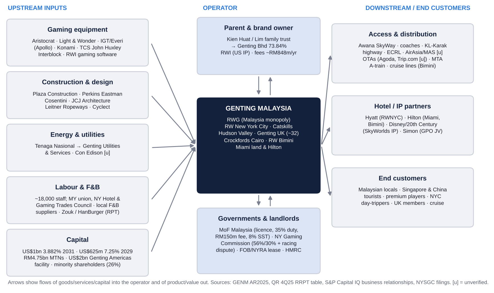
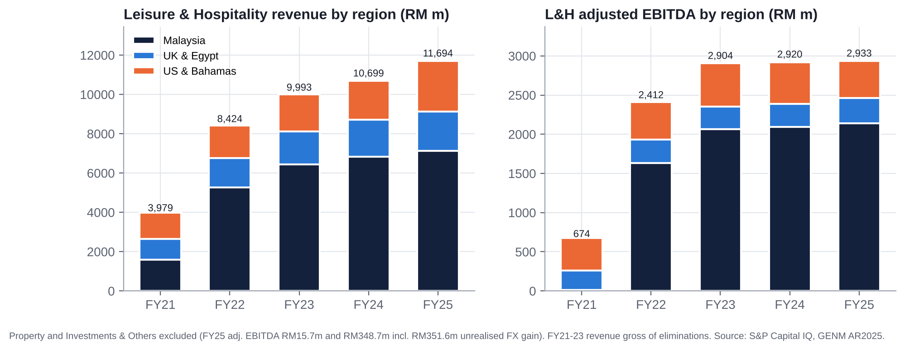
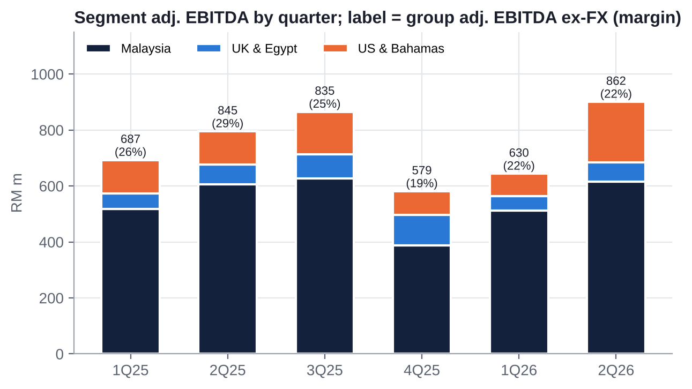
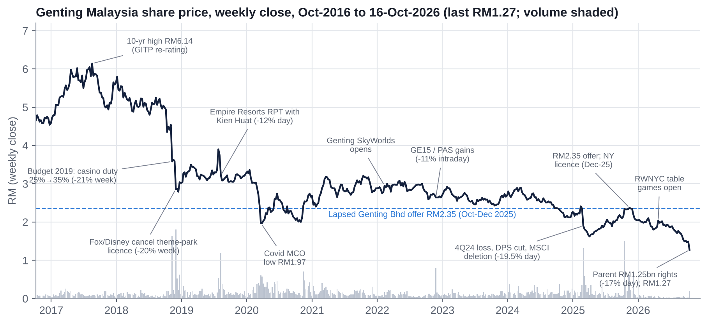
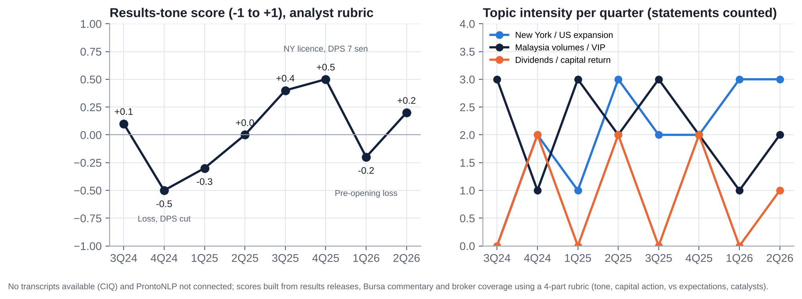
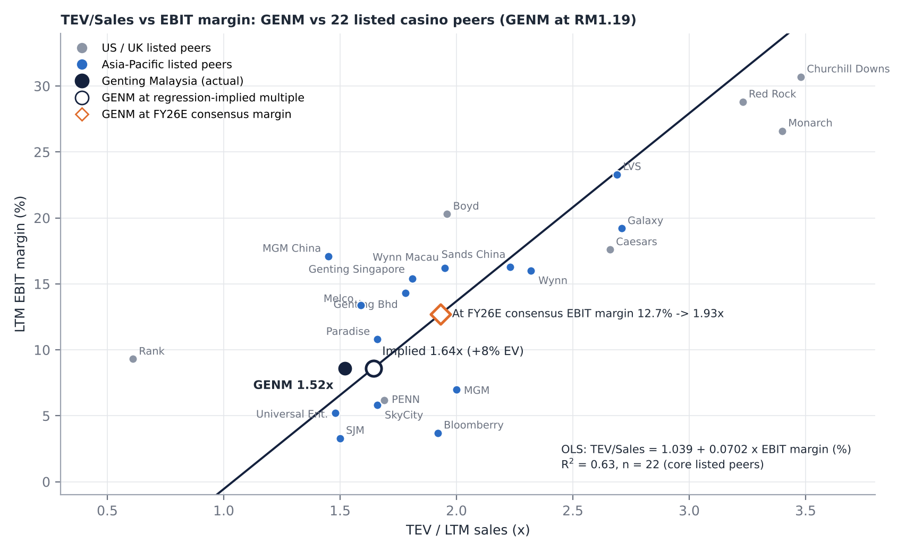
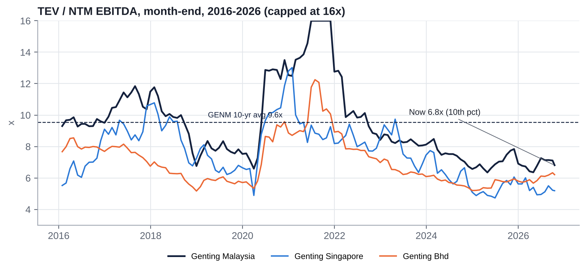
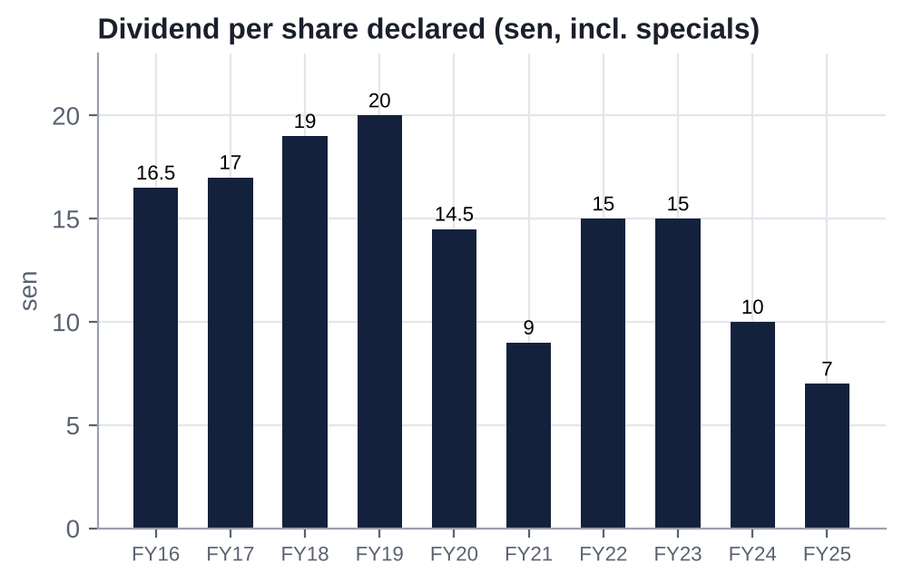
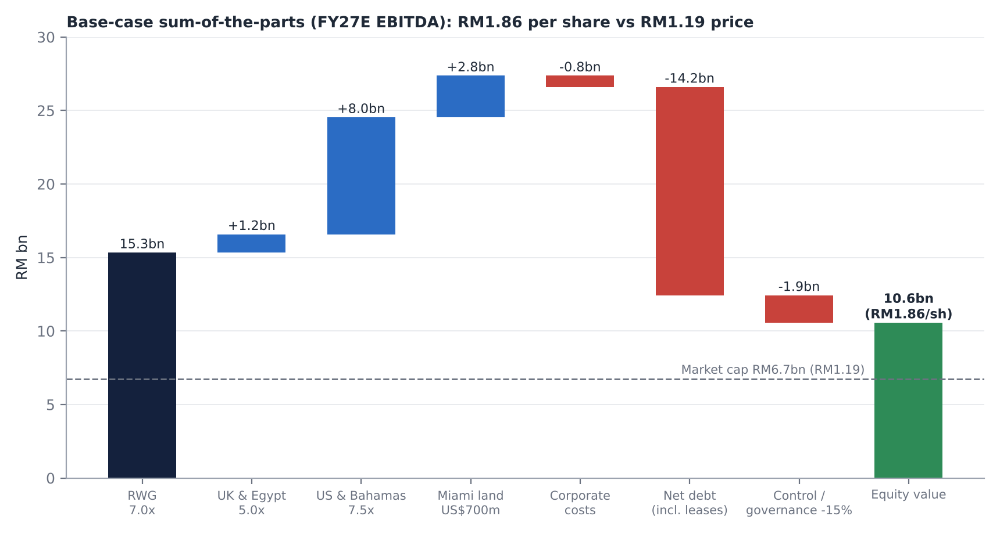
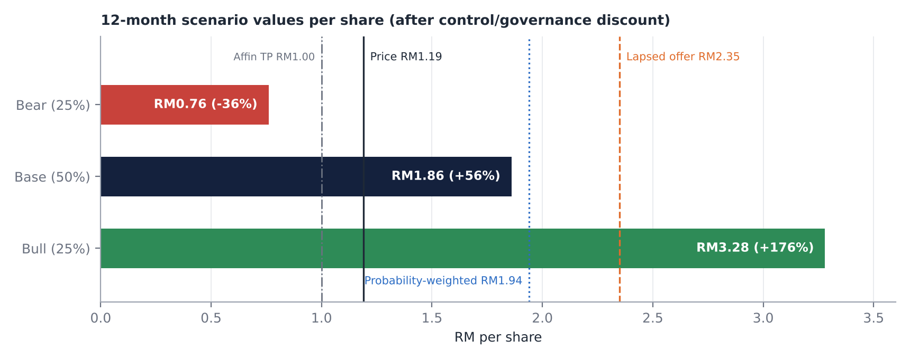

# Genting Malaysia Berhad (GENM MK / Bursa 4715): Equity Research Deep-Dive

**Event-driven / special situation | Leisure & Gaming | Malaysia, United States, United Kingdom | 24 October 2026 (update of our 18-Oct-2026 note)**

> **Recommendation: SPECULATIVE BUY (event-driven, half position). 12-month target RM1.85 (+55%, unchanged); probability-weighted value RM1.94 (+63%); bear case RM0.76 (−36%).** Malaysia's only casino and New York City's only full casino, owned through a levered equity stub that the market has priced for its parent's problems. At RM1.19, a record low and 49% below the lapsed RM2.35 offer, the market pays ~US$0.56bn for the whole US business (roughly the US$500m licence fee) if RWG is valued at 7x. Minorities' >10% veto over any delisting makes this a blocking-stake event rather than a pure value bet.

| Key data (21-Oct-2026 close) | | Key data | |
|---|---|---|---|
| Share price | RM1.19 (record low; RM1.18 intraday) | Largest shareholder | Genting Bhd 73.84% (Lim family via Kien Huat) |
| 52-week range | RM1.18-2.39 | Free float | ~26.2% |
| Market cap | RM6.7bn / US$1.65bn | Lapsed parent offer | RM2.35 (Oct-Dec 2025; closed at 73.13%) |
| EV (incl. leases) | RM20.9bn (CIQ-basis TEV ~RM19.9bn) | Independent adviser SOTP (Nov-25) | RM3.48-3.77 |
| Net debt incl. leases (Jun-26) | RM14.2bn (4.9x LTM adj. EBITDA ex-FX) | Consensus target | RM2.19 mean (stale); Affin cut to Sell, TP RM1.00 (Oct-26); ~4 Buy / 7 Hold / 1 Sell [e] |
| EV / FY26E-FY27E EBITDA (ours) | 6.7x / 6.1x | Credit ratings | Fitch BBB- (Sep-26); RAM AA1 |
| P/E FY26E-FY27E (our EPS 4.3 / 8.6 sen) | 27.7x / 13.8x | Dividend | FY25 7 sen (5.9%); FY26E 5 sen (ours, 4.2%) |
| P/B | 0.60x (record low) | Next catalysts | UK Budget (28-Oct); 3Q26 results (~19-26 Nov-2026) |

# 0. What Has Changed Since Our 18-October Note

**Bottom line: no change to the thesis, target (RM1.85) or rating (Speculative Buy, half position). The share price is 6% lower with no GENM-specific news, so the upside to our target widens from +46% to +55%. New data from New York shows a modest fade from the July run-rate rather than a break.**

| # | Development (not reflected in our 18-Oct note) | Read-across for GENM |
|---|---|---|
| 1 | **Share price −6% to RM1.19 (21-Oct close), a record low** (RM1.18 intraday per TradingView); −20% since the parent's rights issue was announced on 9-Oct | Still parent-driven; FBM KLCI rose four sessions in a row to 1,611.56 (23-Oct), so GENM is diverging from the market |
| 2 | **Affin Hwang downgraded GENM to Sell, TP RM1.00 (from Hold, RM1.80)**, and Genting Bhd to Sell, TP RM1.10, arguing the RM1.25bn rights issue gives limited debt relief while New York costs loom | First Sell call on GENM; it sits close to our bear case (RM0.76). The RM2.19 consensus mean is stale and will fall |
| 3 | **NY September data: RWNYC GGR US$126.7m** (slots/ETGs US$85.2m, tables US$41.5m, an average of 242 tables a day); 69% of New York's US$184.3m commercial casino GGR (+220% YoY). The August statewide total was US$198.9m [u] | ~US$1.5bn annualised vs ~US$1.6bn implied by the July weekly peak: a 4-5% fade (hold, seasonality, novelty). 3Q26 RWNYC GGR ~US$0.40bn [e]; no change to our FY27E US&B EBITDA (US$262m) |
| 4 | **GENM bought back 550,000 shares at ~RM1.27 on 12-Oct** (RM0.70m); treasury shares 271,052,915 (4.56% of issued) | First executions under the June mandate; symbolic in size |
| 5 | **Insiders bought the parent, not GENM:** Kien Huat (Lim family) bought 422,500 Genting Bhd shares on 14-15 Oct (LKT deemed 45.24%); Genting Bhd CEO Tan Kong Han bought on 12-13 Oct and again on 19-21 Oct at ~RM1.42. Genting Bhd said RM280m of the rights proceeds will fund interest costs | The family is committing to the rights issue (45.1% irrevocable); parent cash needs remain the overhang |
| 6 | **Genting Malaysia-Alibaba Cloud MoU (13-Oct)** on AI and cloud across GENM's operations | Immaterial |
| 7 | **3Q26 results date:** market calendars show ~19-Nov-2026 [u] (our previous estimate was ~26-Nov) | First full quarter of NY live tables |
| 8 | **Overlooked option (from the Nov-2025 offer document):** had the offer reached the delisting threshold, Genting Bhd intended to combine its US gaming assets (principally Resorts World Las Vegas [e]) with GENM's US operations and pursue a US listing [u: GGRAsia]. In Jun-2026 Genting Bhd's CEO described the offer as about control and balance-sheet needs, not privatisation | A US listing of a combined "Genting Americas" is a plausible route to crystallise US value; we add it to the bull case and the M&A section |

**Positioning after the update:** hold the half position. We would not add before the UK Budget (28-Oct) and 3Q26 (~19-26 Nov), which are the next two tests. Price-dependent figures throughout this note have been updated to RM1.19; peer multiples and company financials are unchanged from the 18-Oct note (S&P Capital IQ, 16-Oct-2026).

# 1. Executive Summary and Investment Conclusion

## 1.1 The set-up in one paragraph

Genting Malaysia owns **Resorts World Genting**, Malaysia's sole licensed casino (since 1969; ~RM2.1bn EBITDA, 30% margin, 28.6m visitors), and **Resorts World New York City**, which on 28-Apr-2026 became the first and, until ~2030, only full casino in New York City. It also owns ~32 UK casinos, loss-making upstate NY and Bahamas assets, and 30 acres of Miami waterfront. Its parent, Genting Bhd, bid RM2.35 a share for the minority in Oct-2025. The independent adviser called that "not fair and not reasonable" (SOTP RM3.48-3.77), and the offer lapsed at 73.13%. Since then GENM has paid a US$500m NY licence fee, lifted debt by RM3.8bn, skipped its interim dividend, been cut to BBB- by Fitch, and missed on net profit (2Q26 −89%). On 9-Oct-2026 the parent launched a RM1.25bn rights issue to repay its own debt. **GENM fell 17% on parent news alone, to RM1.23, and has since drifted to a record low of RM1.19 (21-Oct) as Affin cut it to Sell (TP RM1.00).**

## 1.2 Investment thesis: four forces converging

1. **A monopoly at a trough multiple.** ~6.5x NTM EV/EBITDA (bottom decile of 10 years [e]; peers 7.5x; deals 9.2x); 0.60x book (record low); premium to its parent at a 2nd-percentile 0.6x. If RWG is worth 7x, the market values the US business at ~2.1x EBITDA (~US$0.56bn).
2. **New York is ramping fast.** US revenue +166% in 2Q26; September GGR US$126.7m (~US$1.5bn annualised; tables US$41.5m), 69% of the state's commercial casino GGR; slot tax down from ~68% to 56%; 1,400 more slots from July. 3Q26 (~19-26 Nov) is the first full quarter with tables.
3. **Event optionality with a minority veto.** The parent is 1.16pp from 75% and does not intend to keep GENM listed, but cannot fund a fair cash offer today. Minorities with >10% can block a low-ball delisting [u: rule]. RM2.35 is the anchor; our fair takeout range is RM1.96-2.75 (8.5-10x FY26E EBITDA).
4. **Self-help levers exist:** Miami land (US$1.225bn bid in 2023), NY real-estate sale-leaseback (REIT precedents at US$0.7-1.2bn), related-party fee benchmarking (~RM848m a year), and the end of debt-funded dividends.

## 1.3 Why it is cheap: what the bears are right about

- **Earnings are weak and consensus is too high below EBITDA.** Our EPS is 4.3 / 8.6 / 9.6 sen for FY26-28E, 27-42% below consensus, because of interest, D&A and a high tax rate.
- **Leverage is 5x and rising** through 2027. Every 1x change in the EV multiple moves the equity by ~RM0.60 a share.
- **Governance is poor:** ~RM848m a year of related-party fees to the parent (26% of EBITDA), serial Kien Huat RPTs on Empire Resorts, RM54.7m CEO pay, 3 of 8 directors independent.
- **NY tax risk:** the State says ~US$150m a year of racing support is owed on top of the 56% tax, and two rivals open ~2030 at half RW's tax rate.

## 1.4 Valuation and scenarios

| | Bear (25%) | Base (50%) | Bull (25%) |
|---|---|---|---|
| Key assumption | Racing support charged; RWG 6x; phase-2 value destruction | Partial racing support; RWG 7x; US 7.5x; 15% governance discount | Tax equalisation path; RWG 8x; US 9x; or privatisation at ~9.5x |
| Value per share | **RM0.76 (−36%)** | **RM1.86 (+56%)** | **RM3.28 (+176%)** |

**Probability-weighted value: RM1.94 (+63%)**, plus a ~4% dividend yield. **12-month target: RM1.85 (unchanged; +55%).**

## 1.5 What has to go right

- RWNYC sustains ≥US$60m of quarterly EBITDA from 3Q26 (US&B segment).
- The racing-support dispute is resolved at ≤US$50m a year, or offset by tax equalisation.
- Malaysia EBITDA holds ≥RM2.1bn through the Jun-2027 minimum-wage step-up.
- No GENM equity issuance; non-core asset sales fund part of phase 2.
- Any future privatisation is priced at ≥RM2.35.

## 1.6 Positioning

**Event-driven, low-to-medium conviction. Hold a half position** (liquidity is ~2-4m shares a day; 30m traded on 12-Oct). Do not add before the UK Budget (28-Oct) and 3Q26 (~19-26 Nov). Add on:
- 3Q26 confirmation of the NY run-rate;
- completion of Genting Bhd's rights issue (1Q27);
- any asset-monetisation announcement.

An optional pair, long GENM / short Genting Bhd (subject to borrow; intraday short selling was suspended in Oct-2026), isolates GENM's minority value from parent and Malaysian-policy beta.

**Hard review triggers:**
- racing support enforced in full with no tax offset;
- a GENM rights issue or perpetuals at a punitive coupon;
- Fitch below BBB-;
- Genting Bhd pledging or selling GENM shares;
- a privatisation proposal below RM1.80.

# 2. Layman's Guide: What Genting Malaysia Does and How It Makes Money

**In one sentence:** Genting Malaysia runs large "cities of entertainment" built around a casino: Malaysia's only legal casino resort on a mountaintop outside Kuala Lumpur, New York City's only full casino, about 30 casinos in the UK, and smaller resorts in upstate New York, the Bahamas and Egypt.

**How the money is made.** GENM does not "sell" gambling. It keeps the net amount customers lose over time (gross gaming revenue, GGR, or "win"). The house edge on each bet is small, but across millions of bets the result is predictable, apart from week-to-week luck in the high-roller (VIP) segment. Hotels, theme parks, restaurants, a shopping mall and a cable car are the bait: they bring families and day-trippers up the mountain, keep them there longer, and give the casino more time to earn. Governments are silent partners. Malaysia takes 35% of mass-market casino win before GENM pays any wages, plus an RM150m annual licence fee and 8% service tax. New York takes 56% of slot win and 30% of table win. The UK takes 15-50%. That is why tax changes move GENM's profit more than almost anything else.

**How each division contributes (FY2025):**

| Division | What it is | Revenue RM m | % of group | Adj. EBITDA RM m | % of segment EBITDA | Margin |
|---|---|---|---|---|---|---|
| Malaysia (Resorts World Genting, Kijal, Langkawi) | Casino monopoly plus ~10,500 hotel rooms, SkyWorlds theme park, SkyAvenue mall, Awana SkyWay cable car | 7,133.5 | 60.0% | 2,138.7 | 72.9% | 30.0% |
| UK & Egypt | ~32 UK casinos incl. Resorts World Birmingham and Genting Casino Stratford; Crockfords Cairo | 1,994.2 | 16.8% | 322.1 | 11.0% | 16.2% |
| US & Bahamas | Resorts World NYC (Queens), RW Catskills, RW Hudson Valley (Empire Resorts, 100% since May-25), RW Bimini, Hilton Miami Downtown | 2,566.0 | 21.6% | 472.4 | 16.1% | 18.4% |
| Property | Miami land and other property rentals | 94.1 | 0.8% | 15.7 | 0.5% | n.m. |
| Investments & Others | Treasury, corporate; includes unrealised FX on USD debt | 96.5 | 0.8% | 348.7 | n.m. | n.m. |
| **Group** | | **11,884.3** | **100%** | **3,297.6** | | **27.7%** |

Source: GENM Annual Report 2025 (segment note), S&P Capital IQ. Segment EBITDA share excludes Investments & Others (which held RM351.6m of unrealised FX gains).

**What has changed in 2026:** On 28-Apr-2026 Resorts World New York City converted from a video-lottery "racino" (where the State kept roughly two-thirds of net win) into a full commercial casino with live table games. US & Bahamas jumped to **40% of group revenue in 2Q26** (RM1,534m of RM3,853m). Malaysia is still the profit engine, but New York is now the growth engine and the main use of capital.

**Revenue by type (FY2025):** gaming RM8,693m (73%), hotel rooms RM1,374m (12%), F&B RM634m (5%), attractions RM293m (2.5%), mall rents RM220m (2%), transport (cable cars, coaches) RM185m (1.6%), other RM391m.

# 3. Business Model, Products, Customers, Suppliers and Competitors

## 3.1 Business model in simple terms

GENM is a capital-intensive, regulated, mass-market gaming operator. It owns or leases the real estate, holds the gaming licences, builds the non-gaming "reasons to visit", and monetises footfall through gaming. Its economics rest on four things:

- **Scarcity of licences.** Malaysia has one casino licence (granted 1969 to founder Lim Goh Tong; renewable every three months). New York City has three downstate licences, and RWNYC's two rivals are not expected to open until about 2030.
- **Volume x spend x hold.** Visitation (28.6m at RWG in 2025), spend per visitor (~RM249 at RWG [e]) and win rate (hold) drive gaming revenue. Mass play is the profit core; VIP is volatile and lower-margin.
- **Fixed-cost operating leverage.** Payroll, energy and maintenance on a 24/7 mountaintop resort are largely fixed, so margins swing hard with volume (FY21, with RWG closed ~5 months, made a Malaysian EBITDA of RM15.5m against RM2.1bn in FY25).
- **The tax and fee "stack".** Governments take 35-72% of gaming win, and the parent Genting Bhd takes about RM848m a year (7% of revenue, 26% of adjusted EBITDA) in management, technical know-how, brand and IP fees [e from QR 4Q25 RRPT table].

## 3.2 Key products and services

| Asset | Products / capacity | Notes |
|---|---|---|
| Resorts World Genting (Pahang) | SkyCasino and the new "Genting Casino" mass floor (opened Dec-2024); 7 hotels / ~10,500 rooms incl. First World Hotel (7,351 rooms, the world's largest); Genting SkyWorlds outdoor theme park (opened Feb-2022); Skytropolis indoor park; SkyAvenue mall; Awana SkyWay cable car (3,600 passengers/hr) | Two of three legacy casino floors closed for renovation in Feb-2024; reopening timetable not disclosed [u] |
| RW Kijal, RW Langkawi | Beach resorts | Occupancy 42% / 56% (FY25) |
| Resorts World New York City (Queens, Aqueduct) | ~3,900 slots (2,500 at conversion + 1,400 added Jul-26), 242 live tables, Hyatt Regency JFK hotel; US$5.5bn masterplan for ~6,000 slots, 800 tables, ~2,000 rooms and a 7,000-seat arena | Only full casino in NYC until ~2030; weekly GGR ~US$30.8m in Jul-26; US$126.7m in Sep-26 (~US$1.5bn annualised) |
| Empire Resorts: RW Catskills, RW Hudson Valley | Commercial casino and resort (Catskills); 1,200-VGM facility (Newburgh) | Loss-making; 100% owned since May-2025 |
| Genting UK | ~32 casinos incl. RW Birmingham, Genting Casino Stratford (bought Apr-25 for £27.8m) | Coventry closing Oct-26; 13 casinos at risk if machine games duty doubles |
| Crockfords Cairo | Hotel casino in the Nile Ritz-Carlton | Immaterial |
| RW Bimini (Bahamas) | Casino, Hilton hotel, marina, cruise pier | Loss-making; RM631.8m carrying value is an audit key matter |
| Miami | Hilton Miami Downtown (527 rooms) and ~30 acres of freehold Omni waterfront land | US$1.225bn land sale collapsed Jun-2023 |

## 3.3 Main customers

No customer exceeds 10% of revenue (AR2025, Note 5). The customer base is:

- **Malaysian non-Muslim locals** (the core mass market; ~1 hour from the Klang Valley by road plus cable car). Muslims are barred from the casino.
- **Singaporeans** (largest foreign source market; 21.1m arrivals to Malaysia in 2025) and **Chinese tourists** (4.7m arrivals, +25%; mutual 30-day visa exemption since 17-Jul-2025), plus other ASEAN, India and the Middle East.
- **Premium/VIP players** marketed directly (not junket-driven like Macau). The VIP/mass split is not disclosed.
- **New York metro day-trippers** (subway A-train to Aqueduct; large Asian-American base in Queens), **Catskills/Hudson Valley** drive-in visitors, **UK members** and international premium players in London, and **cruise passengers** at Bimini.

## 3.4 Main suppliers and counterparties

| Category | Named counterparties |
|---|---|
| Parent / related party | Genting Bhd (management & know-how fee RM497.8m; brand licence RM233.0m in FY25); Resorts World Inc Pte Ltd (RWI, Genting Bhd JV: US/Bahamas IP RM90.2m, gaming software RM16.1m); LKH-linked Zouk IP companies |
| Gaming equipment | Aristocrat (incl. a 114-unit "Dragon Den" at RWNYC), Light & Wonder, IGT (now Apollo-owned with Everi), Konami; TCS John Huxley (300+ tables at RWNYC); Interblock (electronic table games at RWG and RWNYC) |
| Construction / design | Plaza Construction (RWNYC phase I), Perkins Eastman (architect), Cosentini (engineering), JCJ Architecture (Catskills), Leitner Ropeways (Awana SkyWay), Cyclect (SkyWorlds E&I) |
| Hotel / IP brands | Hyatt (RWNYC), Hilton (Miami, Bimini), Disney/20th Century Studios (limited Fox IP at SkyWorlds) |
| Utilities | Tenaga Nasional (via GENM's own Genting Utilities & Services), Con Edison (Queens) [u] |
| Lenders | Bondholders of US$1bn 3.882% 2031 notes and US$625m 7.25% 2029 notes; RM4.75bn MTN holders; KeyBanc-arranged US$925m facility (refinanced); US$2.0bn Genting Americas secured facility (Jun-26) |
| Landlords / grantors | New York State via the Franchise Oversight Board (Aqueduct ground lease, runs to 60 years after licence expiry); NYRA; Malaysian Ministry of Finance (casino licence) |

## 3.5 Competitors

| Market | Competitors | Listed? |
|---|---|---|
| Malaysia | No domestic licensed casino. Regional: Marina Bay Sands (Las Vegas Sands), Resorts World Sentosa (Genting Singapore, a sister company), NagaCorp (Cambodia), Philippine IRs (Bloomberry/Solaire, Okada, City of Dreams Manila), Vietnam, Macau; illegal/online gambling (~RM18bn a year [u]); Thailand's proposed casino complexes (bill withdrawn Jul-25, revival framework May-26 [u]) | Mostly listed |
| New York City | Metropolitan Park/Hard Rock (Steve Cohen; Queens; ~2030), Bally's Bronx (~2030), Empire City (MGM, Yonkers VGM racino), Jake's 58 (Delaware North), Atlantic City, Mohegan Sun and Foxwoods (CT), Pennsylvania casinos | Mixed |
| Upstate NY | Rivers Schenectady, Tioga Downs, del Lago, Seneca Nation, Turning Stone (Oneida) | Mostly private/tribal |
| UK | Rank Group (Grosvenor), Aspers, The Hippodrome, Les Ambassadeurs, online operators | Rank listed |
| Bahamas | Baha Mar, Atlantis, Seminole Hard Rock (Florida) | Private |

## 3.6 Key markets and geographies

Revenue by customer location FY2025: **Malaysia 61%, US & Bahamas 22%, UK & Egypt 17%**. In 1H26 the US & Bahamas share rose to 33% (40% in 2Q26). Non-current assets FY2025: Malaysia RM10.9bn, US & Bahamas RM9.6bn (RM12.4bn of segment assets by Jun-26), UK & Egypt RM4.0bn.

## 3.7 Contracts and key payment terms

| Contract | Key terms |
|---|---|
| Malaysian casino licence (Common Gaming Houses Act 1953, Minister of Finance) | Sole licence since 1969; **renewable every three months**; annual fee RM150m (since 2019); casino duty 35% on mass GGR (from 25% in 2019), ~20% on VIP [u]; gaming-machine duty 30%; 8% service tax absorbed by GENM |
| NY downstate commercial casino licence (NY State Gaming Commission, 15-Dec-2025) | US$500m fee paid Jan-2026; tax bid 56% slots / 30% tables; term reported as 15 years [u]; clause seeking tax equalisation once rivals open; **disputed racing-support payments (~US$150m a year)** that the State says are owed on top (effective ~72%) |
| Aqueduct ground lease (NY State/FOB; NYRA sublease) | ~72.6 acres; term extended to 60 years after the gaming licence ends (Amendment Two, Jun-2025); rent terms not disclosed [u] |
| Brand, management and IP agreements with Genting Bhd and RWI | FY25: technical know-how & management fee RM497.8m; Genting/Resorts World/Awana licence RM233.0m; US/Bahamas IP RM90.2m; software and support RM16.1m; recurrent related-party transactions renewed annually at the AGM |
| Casino credit (Malaysia) | Mostly cash/chip play; credit extended to selected premium players; receivables under simplified ECL model. Receivables stable at ~RM0.7bn |
| Hotels | Prepayment via OTAs and cards; loyalty-point redemptions (Genting Rewards) |

Source: GENM AR2025 (Notes 4-6, 18, 40, 44), QR 4Q25 RRPT table, NY Gaming Commission, NY Focus, nycasinos.ny.gov. [u] = unverified.

# 4. Key Business Drivers

| Driver | Mechanism | Latest reading | Sensitivity / direction |
|---|---|---|---|
| **Volume (visitation)** | Base for every revenue line at RWG | 28.6m visitors in 2025 (+2%); "softer visitation" in 2Q26 as the Middle East war lifted airfares | 1% visitation ≈ RM70m revenue [e] |
| **Pricing / hold / mix** | Mass is the profit core; VIP is volatile; hold swings quarters | 1Q25 VIP GGR −18%; 3Q25 VIP +21% QoQ on high hold; 2Q26 helped by VIP win rate | Hold can move a quarter's Malaysia EBITDA ±10-20% [e] |
| **Capacity** | Hilltop rooms are the bottleneck; gaming floors under renovation | Hotel occupancy 98-99%; 2 of 3 legacy casino floors closed since Feb-2024 | Floor reopenings are upside |
| **Regulation & tax** | Duty on GGR, licence fees, service tax; NY tax rate; UK duty | NY slot tax fell from ~68% (VLT) to 56% on 28-Apr-26 (Maybank: up to +US$100m a year); racing-support dispute; UK MGD decision 28-Oct-26 | TA Securities: +1ppt Malaysian gaming tax ≈ −4.6% net profit |
| **Capex cycle** | RWNYC US$5.5bn build; RWG refurbishment | Consensus capex RM3.9bn (FY26E), RM3.4bn (FY27E), RM3.1bn (FY28E) vs ~RM0.9bn historical | FCF negative in FY26E; leverage 4.7x |
| **FX** | USD and GBP earnings translated into RM; USD debt revaluation runs through adj. EBITDA | MYR ~9% stronger vs USD in 1H26 | Strong MYR cuts translated US/UK EBITDA but shrinks USD debt |
| **Labour** | ~18,000 staff; minimum wages; unions | Malaysia minimum wage RM1,700 → RM2,000 from Jun-2027; EPF 2% for foreign workers (Oct-25); UK NLW £12.71; NY union contracts | Payroll is the largest controllable cost |
| **Interest rates** | Floating-rate US facilities | Finance costs +39% YoY in 1H26 to RM528m | +100bp on ~US$2bn floating ≈ US$20m a year [e] |
| **Related-party fees** | ~RM848m a year to Genting Bhd/RWI | Grows with revenue/EBITDA | A 50% cut would add ~RM420m EBITDA [e] |

# 5. Macro and Micro Factors; Tailwinds and Headwinds

## 5.1 Macro

- **Malaysia:** GDP +5.5% in 9M26 (2Q26 +6.0%, 3Q26 +5.3%); OPR 2.75% with a hold expected; MYR ~4.05/USD (Sep-26), forecast 3.95-4.02. Tourist arrivals 42.2m in 2025 (+11%), Visit Malaysia Year 2026 under way. Budget 2027 (9-Oct-2026): no gaming-tax change identified [u], but the minimum wage rises 17.6% from Jun-2027.
- **Energy and geopolitics:** the Middle East (Iran) war took Brent to ~US$102 (Oct-26), raising airfares and diesel costs; GENM cited softer RWG visitation in 2Q26 and weaker premium play in London and Cairo.
- **United States:** 2025 US commercial GGR a record US$78.7bn (+9.2%); land-based +2.3%. Regional gaming is soft, but NYC is a supply-starved metro market (CBRE: three NYC licensees could generate US$4.7-5.6bn of GGR a year). NY iGaming remains illegal (positive for land-based).
- **United Kingdom:** land-based casino GGY flat at £934m; costs rising (NLW +4.1%, employer NIC); machine games duty doubling under consideration for the 28-Oct-2026 Budget.

## 5.2 Micro

- RWNYC ramp: slots ~US$20-22m a week, tables from US$4.9m (first week) to US$10.4-11.1m (July). September: slots/ETGs US$85.2m and tables US$41.5m for the month (~US$19.9m and ~US$9.7m a week), a modest fade from July.
- RWG: hotel occupancy 98%, two legacy floors still closed, new mass floor since Dec-2024, attractions revenue down YoY.
- Parent: Genting Bhd's RM1.25bn rights issue (9-Oct-2026; RM800m to repay debt, RM280m for interest costs), group gross debt ~RM45-47bn; S&P BBB-/negative "fallen angel" risk; Maybank and Affin cut Genting Bhd to Sell; Kien Huat and the CEO bought Genting Bhd shares on the slide.

## 5.3 Tailwinds and headwinds

| Tailwinds | Headwinds |
|---|---|
| RWNYC conversion: live tables plus a 12ppt lower slot tax; NYC exclusivity until ~2030; Fitch sees NY EBITDA ~US$450m by 2028 | Racing-support dispute (State: ~US$150m a year on top; >US$500m over four years); 2030 rivals pay 25-30% slot tax vs RW's 56% |
| Malaysia GDP >5%; China visa-free regime; Singapore drive-in market; illegal-gambling crackdown | Middle East war: oil >US$100, airfares, softer visitation |
| Strong MYR shrinks ringgit value of USD debt | Strong MYR shrinks translated US/UK profit |
| New attractions (Eufloria, golf, Genting Premium Outlets phase 2 by 4Q27), casino-floor reopenings, ECRL rail (Dec-26/Jan-27) | Labour inflation (RM2,000 minimum wage, EPF for foreign workers, UK NLW/NIC) |
| UK land-based reforms (more machines per casino) | UK MGD doubling risk; casino closures (Coventry) |
| Budget 2027 neutral for gaming [u] | Political tail risk (PAS vow to close RWG if it wins Pahang; GE16 due by early 2028); quarterly licence renewal |
| | Heavy capex (US$3.7bn left), Fitch BBB-, parent cash needs and fee leakage |

# 6. Competitive Position and Economic Moats

## 6.1 Product strength vs competitors

- **Perceived value.** RWG is the cheap, cool-climate, family-plus-casino day trip for 8m Klang Valley residents and a drive from Singapore; there is no legal alternative in Malaysia. RWNYC is the only casino reachable by NYC subway until ~2030 and, since April, the only one with live tables in the five boroughs.
- **Branding.** "Resorts World" and "Genting" are the default casino brands in Malaysia and increasingly in NYC. But **GENM does not own them**: it licenses them from Genting Bhd and RWI for ~RM325m a year. The premium Crockfords brand lost its London flagship (closed 2023).
- **Marketing.** Genting Rewards (four tiers, digital card, cross-property earn/burn) gives a large first-party database. Rebates and comps are constrained by high Malaysian taxes (35% duty makes it hard to match lower-tax jurisdictions on VIP rebates).
- **Versus regional IRs.** Marina Bay Sands and RWS offer a superior premium product, with exclusivity to 2030 and ~S$9bn of reinvestment. RWG competes on access and price rather than luxury.

## 6.2 Moat scorecard

| Moat category | Rating | Evidence for | Evidence against |
|---|---|---|---|
| **Brand** | Moderate | Default casino brand in Malaysia/ASEAN for 55+ years; 28.6m RWG visitors; first NYC table casino; Genting Rewards database | Brand owned by parent (~RM325m a year licence); Crockfords London closed; gaming loyalty follows comps and price |
| **Hard assets** | Strong | Mountaintop resort with ~10,500 rooms, two cable cars, theme parks, own roads/utilities; RWNYC 72.6-acre site beside JFK and the subway with a lease running 60 years past licence expiry; 30 acres of freehold Miami waterfront | Ageing assets need constant refurbishment; Bimini and UK impairments |
| **Long-term contracts** | Moderate | Malaysian licence held continuously since 1969; NY licence plus long ground lease | **Malaysian licence renewable every 3 months**; NY tax terms contested; UK licences routine |
| **Network effect** | Weak | Agglomeration (more attractions → more visitors → more tenants); loyalty scheme | No user-to-user network effect; customers multi-home |
| **Regulatory and switching costs** | Strong (regulatory) / Weak (switching) | Statutory monopoly in Malaysia; PM and Johor government publicly denied a second (Forest City) licence in 2024; only 3 NYC licences and US$500m fee + US$5bn capex entry ticket (MGM withdrew) | Customers switch cheaply between venues, online and illegal channels; Thai legalisation could create a nearby rival |
| **Oligopolistic / monopolistic industry** | Strong (Malaysia), Moderate (NY), Weak (UK) | Sole casino in Malaysia; RW alone in NYC until ~2030 | 2030 NYC entrants pay roughly half RW's slot tax; UK fragmented and declining |
| **Cash-flow predictability** | Moderate | Malaysian mass market steady (RM2.1bn EBITDA, 30% margin); NY slot base ~US$21m a week | VIP hold; tax shocks (2019, 2024); Covid closures; FX through adj. EBITDA; FCF negative during NY build |
| **Scalability** | Moderate | RWNYC can grow to 6,000 slots, 800 tables, 2,000 rooms | RWG mature and room-constrained; growth requires large capex at high tax rates |
| **Risk / history of government interference** | Weak (high risk) | Government defended the monopoly (1969-2026) and cut VIP duty in 2003 | Duty hikes (1998, 2019), service tax (2024), PAS closure vow (2024), quarterly licence, NY racing-support dispute, UK duty rises |
| **Bargaining power over stakeholders** | Moderate | Strong over Malaysian customers (only casino); large buyer of EGMs/tables | Weak vs governments (tax price-taker), weak vs parent (~RM848m a year of fees), moderate vs labour and a concentrated EGM supplier base |

**Verdict: Moderate (narrow) moat.** It is wide on supply (regulatory exclusivity plus irreplaceable assets) but thin on value capture: governments take 35-72% of GGR and the parent takes ~7% of revenue before minorities see anything. In New York the moat is temporary (exclusive until ~2030) and comes with a structural tax disadvantage unless the equalisation clause is honoured.

# 7. Supply Chain Map: From Upstream Inputs to the End Customer

| Stage | Role | Named counterparties |
|---|---|---|
| 1. Owners and parent | Control, strategy, brand and IP | Kien Huat Realty / Lim family trust (Parkview Management → Kien Huat International → KHR; LKT deemed 45.24% of Genting Bhd after Oct-2026 purchases) → **Genting Bhd (73.84% of GENM)**; Resorts World Inc (RWI, Genting Bhd JV, US/Bahamas IP, gaming software); sister companies Genting Singapore (also a competitor), Genting Plantations (Genting Premium Outlets JV with Simon Property) |
| 2. Capital providers | Debt and equity | Holders of GENM Capital Labuan US$1bn 3.882% 2031 notes; Genting NY/GENNY Capital US$625m 7.25% 2029 notes; GENM Capital RM4.75bn MTNs; US$2.0bn Genting Americas secured facility (Jun-26; refinanced the KeyBanc-arranged US$925m facility and Empire's US$300m notes); minority shareholders (UBS, Vanguard, Dimensional, iShares, Norges, Prudential, Great Eastern) |
| 3. Land and concessions | Sites, licences | Malaysian Ministry of Finance (casino licence); NY State Gaming Commission, NY Lottery, Franchise Oversight Board (Aqueduct lease), NYRA; UK Gambling Commission and local authorities; Bahamas Gaming Board; Egyptian authorities / Nile Ritz-Carlton |
| 4. Construction and design | Capex delivery | Plaza Construction, Perkins Eastman, Cosentini (RWNYC); JCJ Architecture (Catskills); Leitner Ropeways (Awana SkyWay); Cyclect (SkyWorlds); RWNYC phase-2 contractor not disclosed [u] |
| 5. Gaming equipment and systems | Slots, ETGs, tables, systems | Aristocrat, Light & Wonder, IGT/Everi (Apollo), Konami; TCS John Huxley; Interblock; DEQ Systems (previous); RWI gaming software |
| 6. Utilities and energy | Power, water, LPG | Tenaga Nasional → Genting Utilities & Services (GENM); Con Edison (Queens) [u]; NYSEG/Central Hudson [u] |
| 7. F&B, retail, consumables | Food, beverage, franchises | Local suppliers (Nature Base, Possible Wealth, Netyield, NWE Resources); director-connected HanBurger and Sky Pie; Motorino Pizza (franchisor); Zouk (LKH-linked IP) |
| 8. Hotel and IP brands | Flags, IP | Genting Bhd (Genting/Resorts World/Awana marks), RWI, Hyatt, Hilton, Disney/20th Century Studios, Crockfords (own) |
| 9. Labour | ~18,000 staff | Malaysian workers' union; NY Hotel & Gaming Trades Council; UK staff (>3,000) |
| 10. Distribution and access | Getting visitors in | Own cable cars, coaches, Resorts World Tours, Orient Wonder (aviation); KL-Karak Expressway; ECRL; airlines into KUL (AirAsia, Malaysia Airlines, Batik Air, Scoot [u]); OTAs (Agoda, Trip.com, Booking.com [u]); Tourism Malaysia; MTA A-train (Aqueduct station); cruise lines (Bimini) |
| 11. Tax collectors | Gaming duty, service tax | Royal Malaysian Customs; NY State; HMRC; Bahamas Treasury |
| 12. End customers | Gaming and leisure spend | Malaysian locals, Singapore/China/ASEAN tourists, premium players, NYC metro day-trippers, Catskills/Hudson Valley drive-ins, UK members, cruise passengers |

**Where GENM sits:** GENM is the operator in the middle of the chain. It buys equipment, construction, energy and labour, pays the State its tax share and the parent its fee share, and keeps the residual. Its strongest bargaining position is with Malaysian customers; its weakest are with governments and with its own parent.

# 8. Five-Year Financial Analysis by Division and Geography

All figures RM m, fiscal years to 31 December. "Adj. EBITDA" is the company definition. It excludes impairments, pre-opening costs, disposal gains/losses and write-offs, but **includes unrealised FX translation on USD borrowings** (booked in Investments & Others). We therefore also show it ex-FX.

## 8.1 Group income statement, FY2021-FY2025 and LTM to Jun-2026

| RM m | FY2021 | FY2022 | FY2023 | FY2024 | FY2025 | LTM Jun-26 |
|---|---|---|---|---|---|---|
| Revenue | 4,156.7 | 8,603.0 | 10,189.4 | 10,911.8 | 11,884.3 | 13,090.8 |
| YoY growth | -8.2% | 107.0% | 18.4% | 7.1% | 8.9% | 19.1% [e] |
| Adj. EBITDA (company) | 727.0 | 2,116.6 | 2,632.2 | 2,910.4 | 3,297.6 | 3,019.5 |
| Adj. EBITDA margin | 17.5% | 24.6% | 25.8% | 26.7% | 27.7% | 23.1% |
| of which unrealised FX gain | n/d | n/d | n/d | 115.4 | 351.6 | 113.1 |
| Adj. EBITDA ex-FX [e] | n/d | n/d | n/d | 2,795.0 | 2,946.0 | 2,906.4 |
| Adj. EBITDA ex-FX margin [e] | | | | 25.6% | 24.8% | 22.2% |
| D&A | (1,104.2) | (1,238.8) | (1,241.1) | (1,240.3) | (1,314.5) | (1,393.1) |
| EBIT (adj. EBITDA less D&A) [e] | (377.2) | 877.8 | 1,391.1 | 1,670.1 | 1,983.1 | 1,626.4 |
| EBIT margin [e] | -9.1% | 10.2% | 13.7% | 15.3% | 16.7% | 12.4% |
| Operating income (S&P CIQ basis) | (543.5) | 1,041.7 | 1,536.6 | 1,329.5 | 1,588.0 | 1,132.8 |
| Finance costs | (321.9) | (522.9) | (599.5) | (691.0) | (828.2) | (975.7) |
| PBT | (1,147.7) | (342.2) | 674.2 | 486.7 | 985.0 | 484.6 |
| Tax | 96.7 | (325.2) | (313.3) | (324.6) | (314.3) | (262.2) |
| **Net income attributable** | **(946.8)** | **(520.0)** | **436.8** | **251.2** | **754.8** | **309.1** |
| Net margin | -22.8% | -6.0% | 4.3% | 2.3% | 6.4% | 2.4% |
| EPS (sen) | (16.75) | (9.18) | 7.71 | 4.43 | 13.32 | 5.45 |
| DPS (sen) | 9.0 | 15.0 | 15.0 | 10.0 | 7.0 | n/a |

Source: GENM AR2025 five-year summary, quarterly reports, S&P Capital IQ. [e] = derived. FY2025 net income includes a RM129.1m bargain-purchase gain (Empire) and RM351.6m of unrealised FX gains; FY2021 reflects ~5 months of RWG closure.

## 8.2 Revenue and adj. EBITDA by division

| Revenue (RM m) | FY2021 | FY2022 | FY2023 | FY2024 | FY2025 | CAGR FY22-25 |
|---|---|---|---|---|---|---|
| L&H Malaysia | 1,590.3 | 5,258.8 | 6,450.2 | 6,823.0 | 7,133.5 | 10.7% |
| L&H UK & Egypt | 1,064.7 | 1,505.5 | 1,667.4 | 1,895.6 | 1,994.2 | 9.8% |
| L&H US & Bahamas | 1,324.1 | 1,659.7 | 1,875.6 | 1,980.1 | 2,566.0 | 15.6% |
| Property | 187.3 | 95.6 | 106.3 | 93.6 | 94.1 | -0.5% |
| Investments & Others | 158.0 | 282.7 | 289.1 | 119.5 | 96.5 | n.m. |
| Eliminations (FY21-23 gross basis) | (167.7) | (199.3) | (199.2) | - | - | |
| **Group** | **4,156.7** | **8,603.0** | **10,189.4** | **10,911.8** | **11,884.3** | **11.4%** |

| Adj. EBITDA (RM m) and margin | FY2021 | FY2022 | FY2023 | FY2024 | FY2025 |
|---|---|---|---|---|---|
| L&H Malaysia | 15.5 | 1,634.3 | 2,062.2 | 2,092.2 | 2,138.7 |
| *margin* | 1.0% | 31.1% | 32.0% | 30.7% | 30.0% |
| L&H UK & Egypt | 243.5 | 300.2 | 291.2 | 297.9 | 322.1 |
| *margin* | 22.9% | 19.9% | 17.5% | 15.7% | 16.2% |
| L&H US & Bahamas | 415.0 | 477.6 | 550.4 | 530.2 | 472.4 |
| *margin* | 31.3% | 28.8% | 29.3% | 26.8% | 18.4% |
| Property | 113.0 | 14.9 | 5.7 | 8.2 | 15.7 |
| Investments & Others (incl. FX) | (60.0) | (310.4) | (277.3) | (18.1) | 348.7 |
| **Group** | **727.0** | **2,116.6** | **2,632.2** | **2,910.4** | **3,297.6** |

| Segment EBIT [e] (adj. EBITDA less segment D&A) | FY2021 | FY2022 | FY2023 | FY2024 | FY2025 [e] |
|---|---|---|---|---|---|
| L&H Malaysia | (545.8) | 971.6 | 1,377.5 | 1,408.9 | ~1,440 |
| L&H UK & Egypt | 45.9 | 126.4 | 111.6 | 120.3 | ~135 |
| L&H US & Bahamas | 138.7 | 152.1 | 217.7 | 184.9 | ~70 |
| Property | 91.1 | (10.3) | (18.6) | (20.7) | ~(15) |
| *Malaysia EBIT margin* | n.m. | 18.5% | 21.4% | 20.6% | ~20% |

Source: S&P Capital IQ segments, GENM AR2025. GENM does not disclose segment D&A for FY2025 or **segment PBT/net income**; FY2025 segment EBIT is our estimate using FY2024 D&A shares. Net income is reported only at group level (see 8.1). On an indicative basis, Malaysia generates more than 100% of group net income [e]: the overseas segments' EBIT is roughly absorbed by group finance costs, which largely fund the US.

## 8.3 Geography

| Revenue by customer location (RM m) | FY2024 | FY2025 | FY2025 share | 1H2026 | 1H2026 share |
|---|---|---|---|---|---|
| Malaysia | 6,950.1 | 7,245.1 | 61% | ~3,525 [e] | 52% |
| UK & Egypt | 1,895.6 | 1,994.2 | 17% | 966.9 | 14% |
| US & Bahamas | 2,066.1 | 2,645.0 | 22% | 2,228.0 | 33% |
| **Total** | **10,911.8** | **11,884.3** | | **6,720.2** | |

## 8.4 Trends in growth and margins: what changed and why

- **FY2021-22: Covid and reopening.** RWG was shut for ~5 months in 2021 (Malaysia EBITDA RM15.5m). Revenue doubled in FY2022 as Malaysia reopened (1-Apr-2022) and Genting SkyWorlds opened (Feb-2022). Group net losses persisted on D&A, interest and Empire associate losses.
- **FY2023-24: recovery stalls at the margin line.** Malaysia revenue grew 23% then 6%, with visitation recovering to 98% of 2019 (28.1m in 2024), but the Malaysia margin peaked at 32% in FY2023. Payroll inflation, the service-tax rise to 8% (Mar-2024) and the closure of two of RWG's three legacy casino floors (Feb-2024) all weighed. US margins slipped as RWNYC payroll rose. FY2024 net income fell 42%, and the dividend (payout 226%) was cut.
- **FY2025: record revenue, thinner underlying margin.** Revenue +9% to RM11.9bn. Adj. EBITDA +13%, but ex-FX it was +5% and the ex-FX margin fell to 24.8%. Malaysia EBITDA was +2% (mass-led; 4Q25 −21% on lower volumes and win rate). UK & Egypt +8%. US & Bahamas −11% as Empire's losses were consolidated from June 2025 and RWNYC prepared for conversion. Net income +200% to RM754.8m, but ~RM480m of it came from FX gains and the Empire bargain-purchase gain.
- **1H2026: New York changes the mix.** Revenue +22%, with US & Bahamas revenue doubling (+107%). But adj. EBITDA fell 16% (−3% ex-FX). Pre-opening costs rose to RM93.8m and finance costs +39%, so PBT fell 73% and net income 91% to RM43.6m. The US mix dilutes margins: NY gaming tax is 56% on slots against 35% in Malaysia, and the ramp-up carried 2,200+ new hires.
- **Structural conclusion:** GENM is moving from a ~30%-margin Malaysian monopoly with modest leverage to a ~22-25%-margin, two-engine group with 4.7x net debt/EBITDA and peak capex. Earnings quality is noisy (FX, one-offs, hold), so we anchor on ex-FX EBITDA and cash flow.

## 8.5 Quarterly trend (1Q25-2Q26)

| RM m | 1Q25 | 2Q25 | 3Q25 | 4Q25 | 1Q26 | 2Q26 |
|---|---|---|---|---|---|---|
| Revenue | 2,595.2 | 2,918.5 | 3,357.8 | 3,012.8 | 2,866.9 | 3,853.3 |
| YoY | -6.1% | 9.3% | 22.1% | 10.4% | 10.5% | 32.0% |
| Adj. EBITDA | 737.2 | 1,029.6 | 838.1 | 692.7 | 644.7 | 844.0 |
| of which FX | 50.4 | 184.6 | 2.8 | 113.8 | 14.6 | (18.1) |
| Adj. EBITDA ex-FX | 686.8 | 845.0 | 835.3 | 578.9 | 630.1 | 862.1 |
| Malaysia adj. EBITDA | 518.2 | 606.3 | 627.4 | 386.8 | 512.1 | 615.0 |
| UK & Egypt adj. EBITDA | 55.5 | 70.2 | 86.3 | 110.1 | 50.9 | 68.8 |
| US & Bahamas adj. EBITDA | 119.0 | 118.4 | 151.2 | 83.8 | 80.5 | 216.6 |
| Pre-opening costs | (29.0) | (31.2) | (41.7) | (72.5) | (26.8) | (67.0) |
| Finance costs | (184.2) | (196.0) | (219.9) | (228.1) | (246.7) | (281.0) |
| PBT | 184.0 | 503.3 | 256.8 | 40.9 | 43.1 | 143.8 |
| Net income attributable | 72.7 | 416.6 | 119.7 | 145.9 | (3.8) | 47.4 |

## 8.6 Most relevant operational KPIs

| KPI | 2022 | 2023 | 2024 | 2025 | Latest / trend |
|---|---|---|---|---|---|
| RWG visitor arrivals (m) | 22.2 | 24.9 | 28.1 | 28.6 | "Softer" in 2Q26 (airfares, Middle East) |
| RWG hilltop hotel occupancy | 95% | ≥97% | 99% | 98% | Capacity-constrained |
| RWG room-nights sold (k) | 2,372 | 3,527 | 3,625 | 3,537 | −2.4% in 2025 on refurbishment |
| Gaming share of L&H revenue | 76% | 74% | n/d | 74% | 77% in 1H26 (US mix) |
| Malaysia adj. EBITDA margin | 31.1% | 32.0% | 30.7% | 30.0% | 32.8% in 1H26 (cost control + VIP hold) |
| RWNYC capacity | VGMs only | VGMs only | VGMs only | VGMs only | 242 tables + ~3,900 slots after Jul-26 |
| RWNYC weekly GGR (US$m) | n/a | n/a | n/a | n/a | ~30.8 (wk to 12-Jul-26); Sep-26 month US$126.7m (~29.6 a week) = ~US$1.5bn annualised |
| US visitors (m) | n/d | n/d | 7.9 | 7.4 | Ramp under way |
| Capex / revenue (cash PPE) | 7.6% | 6.8% | 5.2% | 7.6% | ~29% FY26E (consensus RM3.9bn) |
| Net debt incl. leases / adj. EBITDA | 4.6x | 3.4x | 3.4x | 3.1x | 4.7x (Jun-26) |
| Adj. EBITDA / finance costs | 4.0x | 4.4x | 4.2x | 4.0x | 3.1x (LTM) |
| Dividend payout (DPS/EPS) | n.m. | 195% | 226% | 53% | No interim in FY25 or FY26 |
| UK casinos | ~32 | ~31 | ~31 | ~32 | Coventry closing; 13 at risk if MGD doubles |

**KPI read-across:** Malaysia volumes have plateaued near 2019 levels with full hotels, so growth there depends on price, mix and reopening the two closed floors. New York is the only real volume growth, and it is capital-hungry. Capex intensity has quadrupled, and leverage and interest cover have both deteriorated since FY2025.

# 9. Historical Share Price Catalysts (Moves of More Than 10%)

**Performance (price only, to 21-Oct-2026, RM1.19):** −49% over 1 year, −52% over 3 years, −63% over 5 years [e], against the FBM KLCI −0.3%, +12% and +1.5% (to 16-Oct). YTD 2026: −42% vs KLCI −4.3% (to 16-Oct). GENM has underperformed in 7 of the last 9 full years. It is at a record low (RM1.18 intraday on 21-Oct-2026), 49% below Genting Bhd's lapsed RM2.35 offer and at 0.60x book value.

## 9.1 Single-day moves of 10% or more (last five years)

| Date | Move | Volume | Cause |
|---|---|---|---|
| 28-Feb-2025 | **−19.5%** (RM2.36 → 1.90) | 356.8m | 4Q24 net loss (RM458m: Empire associate losses, NY bid costs, D&A, interest); **final dividend cut from 9 to 4 sen**; MSCI Malaysia (standard) deletion effective at the close |
| 12-Oct-2026 | **−17.4%** (RM1.49 → 1.23) | 30.0m (~10-20x normal) | Parent Genting Bhd's **RM1.25bn rights issue** (announced after the close on 9-Oct); Genting Bhd −22.9%. Read-across: parent cannot fund a second privatisation, and GENM must self-fund New York |

Near misses: 21-Nov-2022 (GE15 hung parliament; −10.7% at the open, −5.5% close); 14-Oct-2025 (+8.4% on the RM2.35 offer); 9-Jun-2025 (+8.7%, unexplained [u]); 7-Apr-2025 (−8.0%, US tariff shock).

## 9.2 Multi-week swings of 10% or more since Oct-2021

| Period | Move | Drivers |
|---|---|---|
| Oct-21 → Jan-22 | −14% | Omicron; Budget 2022 one-off "Cukai Makmur" (33% on income above RM100m) |
| Jan-22 → May-22 | +12% | Genting SkyWorlds opened (8-Feb-22); Malaysian borders reopened (1-Apr-22) |
| May-22 → Oct-22 | −16% | Global rate shock; Parliament dissolved (GE15, PAS risk) |
| Oct-22 → Jan-23 | +13% | Post-GE15 relief (Anwar PM); China reopening |
| Jan-23 → Oct-23 | −17% | Slow China recovery, cost inflation, Empire related-party cash calls |
| Oct-23 → Mar-24 | +19% | China/India visa-free entry (Dec-23); NY licence optionality |
| Mar-24 → Nov-24 | **−27%** | Weaker RWG margins (3Q24 RWG EBITDA −13%), Empire losses, FBM KLCI deletion (Dec-24) |
| Nov-24 → Feb-25 | +14% | Year-end / CNY recovery |
| Feb-25 → Apr-25 | **−38%** | 28-Feb crash (loss, dividend cut, MSCI deletion), then US tariff shock |
| Apr-25 → Nov-25 | **+60%** | Tariff-pause rebound; 2Q25 FX-driven profit; NY bid; **Genting Bhd RM2.35 offer (13-Oct-25)** pinned the price |
| 1-Dec-25 → 10-Dec-25 | −14% | **Offer closed at 73.13%** (below 75% delisting / 90% squeeze-out); bid floor removed despite the NY licence the same day |
| Feb-26 → Mar-26 | −16% | Ex-dividend 7 sen; group-wide weakness (Genting Bhd at a 23-year low); President Lee Choong Yan stepped down |
| Mar-26 → Apr-26 | +16% | RWNYC live tables announced and opened (28-Apr-26) |
| Apr-26 → Sep-26 | **−28%** | 1Q26 miss (pre-opening loss), 2Q26 net profit −89%, no interim dividend, debt +RM3.8bn, Fitch downgrade to BBB- (Sep-26), parent-leverage worries |
| 9-Oct-26 → 12-Oct-26 | −17% | Genting Bhd rights issue |
| 9-Oct-26 → 21-Oct-26 | **−20%** (RM1.49 → 1.19) | Rights issue, then Affin's Sell call (TP RM1.00); record low with no GENM-specific news |

## 9.3 Ten-year context

The 10-year high (RM6.14 close, Aug-2017) reflected the GITP re-rating and net cash. The de-rating since has come in discrete steps, each tied to **government or related-party decisions rather than operations**: the Budget 2019 casino-duty hike (−21% in a week), Fox/Disney's termination of the theme-park licence (−20% in a week, Nov-2018), the Empire Resorts related-party deal with Kien Huat (−12% in a day, Aug-2019), Covid, the 2025 dividend cut, and the 2026 parent rights issue. **Lesson for positioning: GENM's large moves are policy- and parent-driven. Operations explain the drift; governance explains the gaps.**

# 10. Earnings Calls, Management Focus and Sentiment

**Method note.** GENM does not publish call transcripts on S&P Capital IQ, and the ProntoNLP connector is not authorised in this session. We therefore built a transparent sentiment score from results press releases, Bursa quarterly-report commentary, analyst-briefing coverage and broker notes. Each quarter's score (−1 to +1) is the average of four sub-scores: (a) management tone and outlook, (b) capital-return action, (c) result vs expectations, (d) emphasis on forward catalysts. Topic intensity counts distinct statements per theme across the evidence set.

## 10.1 Quarter-by-quarter summary

| Quarter (release) | Headline numbers | What management focused on | vs expectations | Capital action | Share reaction | Score |
|---|---|---|---|---|---|---|
| 3Q24 (28-Nov-24) | Rev RM2,749m; NP RM569m incl. RM602m FX gain; RWG EBITDA −13% | Visitation +12%, occupancy 99%, China visitors doubled; payroll and casino opex up; "cautiously optimistic" | Headline beat, underlying weaker | Interim 6 sen (paid) | +1.4% (week) | +0.1 |
| 4Q24 (27-Feb-25) | Net loss RM458m | Empire losses, NY bid costs, D&A and interest; cash preserved for expansion | Miss | **Final cut to 4 sen** | **−19.5%** | −0.5 |
| 1Q25 (29-May-25) | Rev −6%; VIP GGR −18%; core NP −78% | Premium softness; mass floor reopening; Empire losses | Miss; forecasts cut | - | Flat | −0.3 |
| 2Q25 (28-Aug-25) | Rev +9%; NP +407% (FX); RWG EBITDA +16% | Volumes and margins up, but 2H margin "will not hold" on tax and marketing; NY bid submitted | In line | **No interim dividend** | +2.5% (week) | 0.0 |
| 3Q25 (27-Nov-25) | Rev +22%; ex-FX EBITDA +19%; RWG EBITDA +27% | RWG gaming recovery; NY licence decision imminent | Beat (ex-FX) | Offer period | Pinned at RM2.35 | +0.4 |
| 4Q25 (26-Feb-26) | Rev +10%; ex-FX EBITDA +8%; Malaysia EBITDA −21% | NY licence won; "rewarding shareholders while deleveraging" | Mixed | **Final 7 sen** | +3.4% | +0.5 |
| 1Q26 (21-May-26) | Rev +10%; net loss RM3.8m | RWNYC pre-opening and conversion costs; lower NY tax ahead | Miss | - | −3.0% | −0.2 |
| 2Q26 (20-Aug-26) | Rev +32% (record); adj. EBITDA −18% (+13% ex-FX per UOBKH); NP −89% | RWNYC ramp (US revenue +166%); RWG VIP hold; FX loss | EBITDA in line; NP miss | **No interim** | −0.6%, then −13.5% in Sep | +0.2 |

Source: S&P Capital IQ key developments; GENM press releases; ASGAM, GGRAsia, The Edge, The Star, NST, Bernama, AGBrief; UOB Kay Hian, Maybank IB, HLIB, Kenanga, TA notes.

## 10.2 What management is focused on

1. **New York execution.** Ramping RWNYC (242 tables, ~3,900 slots), phase 2 (hotel tower, arena; groundbreaking Jul-2026), staffing (2,200+ hires), and the tax fight (racing-support payments). NY now dominates every briefing.
2. **Protecting Malaysian margins.** Cost control, payroll, the mass-market floor, refurbishment, new attractions (Eufloria, golf), and managing VIP volatility.
3. **Funding and the balance sheet.** The US$2.0bn Genting Americas facility (Jun-2026), the Empire note take-out, perpetual securities (Fitch said these alone would not prevent a downgrade), and preserving the BBB- rating.
4. **Capital returns de-prioritised.** No interim dividend in either FY25 or FY26; final 7 sen for FY25 framed as "rewarding shareholders while maintaining deleveraging"; buyback "commenced" 17-Sep-2026 under the AGM mandate; the first disclosed purchase was 550,000 shares at ~RM1.27 on 12-Oct-2026 (RM0.7m), a token amount.

## 10.3 How sentiment has shifted

- **Late 2024 to mid-2025: defensive.** Cost inflation, VIP softness and Empire losses; cash hoarding (dividend cut, skipped interim). FX gains masked weak trends.
- **3Q25-4Q25: expansion optimism.** RWG recovered and the NY licence was won. The tone was the most constructive of the period, but the share price was pinned by the offer and then lost its support.
- **1H26: "temporary earnings dilution".** Pre-opening costs, interest, D&A and FX losses; the group P&L and dividend are subordinated to the NY build.
- **Market read:** the market has stopped crediting the "jam tomorrow" narrative. The stock fell 13.5% in September with no company news, 17% on the parent's rights issue, and a further 3% to a record low after Affin's Sell call. Sentiment is now driven by balance-sheet risk at both GENM and its parent.

# 11. Latest Result: 2Q26 / 1H26 (released 20-Aug-2026)

## 11.1 Revenue and profit vs expectations

| RM m | 2Q26 | 2Q25 | YoY | 1Q26 | QoQ | 1H26 | 1H25 | YoY |
|---|---|---|---|---|---|---|---|---|
| Revenue | 3,853.3 | 2,918.5 | +32% | 2,866.9 | +34% | 6,720.2 | 5,513.7 | +22% |
| Adj. EBITDA | 844.0 | 1,029.6 | −18% | 644.7 | +31% | 1,488.7 | 1,766.8 | −16% |
| Adj. EBITDA ex-FX | 862.1 | 845.0 | +2% | 630.1 | +37% | 1,492.2 | 1,531.8 | −3% |
| PBT | 143.8 | 503.3 | −71% | 43.1 | +234% | 186.9 | 687.3 | −73% |
| Net income attributable | 47.4 | 416.6 | −89% | (3.8) | n.m. | 43.6 | 489.3 | −91% |
| EPS (sen) | 0.84 | 7.35 | −89% | (0.07) | n.m. | 0.77 | 8.63 | −91% |

**Beat or miss?** S&P holds no quarterly consensus for GENM, so the surprise is measured against full-year run-rates and broker commentary:
- **EBITDA: in line.** 1H26 EBITDA was 52% of FY26 consensus (UOBKH).
- **Net profit: a clear miss.** Kenanga put 1H26 core net profit at **29% of FY26 consensus**. HLIB cut FY26-28 forecasts by 40%, 30% and 18%. Consensus FY26 net profit fell from ~RM687m (August, as cited by UOBKH) to RM432m (October), about −37%.

## 11.2 Segment drivers

| Segment adj. EBITDA (RM m) | 2Q26 | 2Q25 | YoY | Driver |
|---|---|---|---|---|
| Malaysia | 615.0 | 606.3 | +1% | Cost management; higher VIP win rate (press); visitation softer. QoQ +20% |
| UK & Egypt | 68.8 | 70.2 | −2% | Middle East conflict hit premium play in London and Cairo; higher minimum wages |
| US & Bahamas | 216.6 | 118.4 | **+83%** | RWNYC commercial casino from 28-Apr-26 (tables + lower 56% slot tax); US revenue +166% to RM1,534m |
| Investments & Others | (55.1) | 230.2 | n.m. | FX translation loss vs large gain a year earlier |

**Acceleration / deceleration:** US is accelerating sharply (revenue 2.7x). Malaysia is flat YoY, with QoQ improvement partly luck-driven. UK is decelerating.

## 11.3 Margin trends

- Reported adj. EBITDA margin **21.9%** vs ~35% in 2Q25. Ex-FX: 22.4% vs 29.0%.
- Causes: (1) **mix**, as NY slots are taxed at 56% (and tables at 30%) against Malaysian duty of 35%; (2) **ramp-up payroll** and pre-opening costs (RM67.0m in 2Q26); (3) **FX** swinging from a +RM184.6m gain to a −RM18.1m loss.
- Below EBITDA, finance costs rose 43% YoY to RM281m and D&A rose 12%.

## 11.4 Guidance and outlook

GENM does not give numeric guidance. The prospects statement points to continued RWNYC ramp-up ("thousands more slot machines" added in July 2026), phase-2 construction and full completion in 2029, and a cautious Malaysian outlook given travel costs and softer visitation [paraphrased; u]. Brokers read the tone as "**better 2H26 ahead**" (UOBKH), with the lower NY tax rate a FY26-27 tailwind (Maybank: up to +US$100m a year). The tone change is more caution on Malaysia and on dividends, and more confidence on NY volumes.

## 11.5 Balance sheet flags

| RM m | Jun-25 | Sep-25 | Dec-25 | Mar-26 | Jun-26 |
|---|---|---|---|---|---|
| Total debt incl. leases | 14,641 | 14,695 | 14,219 | 17,146 | **17,988** |
| Cash & ST investments | 3,903 | 4,259 | 3,919 | 4,344 | 3,822 |
| Net debt incl. leases | 10,738 | 10,436 | 10,300 | 12,802 | **14,166** |
| Receivables | 739 | 686 | 287 [u] | 684 | 672 |
| Capex (quarter) | 221 | 245 | 213 | 413 | **721** |
| Cash from operations (quarter) | 666 | 708 | 232 | 139 | 1,038 |

Flags:
- **Debt +RM3.8bn (+26.5%) in six months**, driven by the US$500m licence fee (RM2,044m) and capex of RM1.13bn in 1H26.
- **Lease liabilities +RM0.78bn** (right-of-use assets +RM1.03bn), probably the Aqueduct lease re-set on conversion [e].
- **Short-term debt RM2.47bn**: Empire's US$300m notes (repaid 2-Jul-26 via the new facility) and the RM1.1bn MTN due Mar-2027.
- Receivables are stable, so there is no sign of VIP credit stretch. Inventory is immaterial.
- 1Q26 CFO of only RM139m is unusually weak (working-capital timing, tax).

## 11.6 Market reaction and what was priced in

The stock slipped 0.6% the next day and 1.7% the next week: "in line" EBITDA had been expected. It then fell 13.5% in September without company news, before the parent's rights issue knocked it down another 17% and Affin's downgrade took it to a record low of RM1.19. The muted initial reaction shows that the NY revenue ramp was priced in. The later slide shows that the market is pricing **the balance sheet, the dividend and the parent**, not the NY top line.

## 11.7 Unusual vs recent history

1. Record revenue alongside a near-record-low margin (adj. EBITDA margin ~22% vs a 30-35% history).
2. Two consecutive years without an interim dividend, against a decade of 6-sen interims.
3. A 26% jump in gross debt in six months.
4. Net profit swings of hundreds of millions of ringgit from unrealised FX on USD debt.
5. The President (Lee Choong Yan, in role since 2006) stepped down on 1-Mar-2026, mid-ramp.

## 11.8 3Q26 preview (results ~19-26 Nov-2026) [e]

| RM m | 3Q25A | 3Q26E (ours) | What to watch |
|---|---|---|---|
| RWNYC GGR (US$m) | VLT only | ~400 (Jul ~135 [e], Aug ~133 [e], Sep 126.7) | First full quarter of tables; free-play intensity |
| Malaysia adj. EBITDA | 627.4 | ~580-620 | VIP hold normalising after a lucky 2Q; visitation vs Middle East airfares |
| UK & Egypt adj. EBITDA | 86.3 | ~70-85 | Coventry closure costs; Budget (28-Oct) commentary |
| US & Bahamas adj. EBITDA | 151.2 | ~240-270 | **Key number: ≥RM250m (≈US$62m) supports our FY26-27E** |
| Group adj. EBITDA ex-FX | 835.3 | ~880-920 | Margin ~23-24% vs 22.4% in 2Q26 |
| Net income (before FX) | 119.7 | ~90-140 | Interest (~RM270m), D&A, tax rate |
| Interim dividend | none | none expected | A surprise interim would be a strong signal |

A US&B print below ~RM220m, or any provision for racing support, would be the first fundamental crack in the NY leg of the thesis.

# 12. Earnings Estimates, FY2026E-FY2028E

## 12.1 Our forecasts vs consensus

| RM m | FY2025A | FY2026E | FY2027E | FY2028E |
|---|---|---|---|---|
| Revenue | 11,884 | 13,720 | 15,200 | 16,300 |
| *Consensus revenue* | | *13,541* | *14,859* | *16,600* |
| Adj. EBITDA ex-FX | 2,946 | 3,139 | 3,415 | 3,680 |
| - Malaysia | 2,139 | 2,157 | 2,190 | 2,260 |
| - UK & Egypt | 322 | 285 | 250 | 260 |
| - US & Bahamas | 472 | 797 | 1,060 | 1,250 |
| - Property, corporate & other | 13 | (100) | (85) | (90) |
| *Consensus EBITDA* | | *2,974* | *3,455* | *3,765* |
| Pre-opening and one-offs | (161) | (174) | (110) | (100) |
| D&A | (1,315) | (1,433) | (1,520) | (1,620) |
| Finance costs (net of interest income) | (726) | (1,029) | (1,045) | (1,110) |
| PBT | 985 | 491 | 735 | 845 |
| Tax | (314) | (335) | (330) | (380) |
| Non-controlling interests | 84 | 87 | 80 | 80 |
| **Net income attributable** | **755** | **243** | **485** | **545** |
| Shares (m) | 5,667.7 | 5,667.7 | 5,667.7 | 5,667.7 |
| **EPS (sen)** | **13.3** | **4.3** | **8.6** | **9.6** |
| *Consensus EPS (sen)* | | *7.5* | *11.8* | *14.8* |
| Our EPS vs consensus | | **−42%** | **−27%** | **−35%** |
| DPS (sen) | 7.0 | 5.0 | 5.0 | 6.0 |
| Net debt incl. leases (year-end) | 10,300 | 15,716 | 16,796 | 17,386 |
| Net debt / adj. EBITDA | 3.5x | 5.0x | 4.9x | 4.7x |

[e] Our estimates; consensus is S&P Capital IQ (Oct-2026). FY2025 one-offs reconcile reported EBITDA (RM3,136.8m) to adjusted EBITDA (RM3,297.6m).

## 12.2 Key assumptions

- **Industry growth.** Malaysian visitation flat to +2% a year; RWG mature and room-constrained. NYC metro GGR grows with RWNYC's capacity until rivals open (~2030); CBRE sizes the three-licence market at US$4.7-5.6bn.
- **Market share gains.** RWNYC takes share from Atlantic City, Connecticut and Pennsylvania as NYC's only table casino. Annualised GGR ~US$1.6bn in July 2026; we assume US&B EBITDA of ~US$62m a quarter in 2H26, rising to ~US$262m in FY27 and ~US$310m in FY28. **Net of a ~US$40m a year racing-support compromise** [e].
- **Price increases.** Hotel ADR growth at RWG (98% occupancy) ~3%; gaming pricing via rebates and comps is flat.
- **Cost pressures.** Malaysian minimum wage +17.6% from Jun-2027 (~RM30-40m a year [e]); UK NLW/NIC; NY union wages; energy (Brent >US$100). UK EBITDA falls to RM250m in FY27 on cost and duty risk.
- **Operating leverage.** Positive in NY (fixed payroll over rising GGR); negative in Malaysia from wage inflation; the group margin recovers to ~22-23% ex-FX.
- **Financing costs.** Gross debt rises to ~RM20bn by FY28 as capex (consensus RM3.1-3.9bn a year) exceeds cash flow. We assume ~RM100m a year of interest capitalised on phase-2 work in progress.
- **Share count.** We assume no dilution. Risks are skewed towards dilution (a 10% general mandate or a GENM rights issue) if NY capex overruns; a buyback is immaterial.
- **Tax.** Malaysian profits taxed at 24%; US losses and the NCI deficit give little shelter, so the effective tax rate stays at 45-68% [e].

**Why we are below consensus:** our EBITDA is close to consensus (+6% FY26, −1% FY27, −2% FY28). The gap is below the line: brokers' FY27 interest expense (RM910m) looks too low given gross debt of RM18bn at Jun-26 and rising, their net debt forecasts look stale (FY26E RM10.0bn vs RM14.2bn actual at Jun-26), and the tax rate on a Malaysia-heavy profit base stays high.

# 13. Capital Structure, Debt, Covenants and Liquidity

## 13.1 Summary (30-Jun-2026)

| RM m | Amount |
|---|---|
| Ringgit MTNs (GENM Capital Bhd, 13 tranches, 4.92-5.58%) | 4,802 |
| US$1bn 3.882% senior notes due 2031 (GENM Capital Labuan) | ~4,080 |
| US$625m 7.25% senior notes due 2029 (Genting NY / GENNY Capital) | ~2,550 |
| US$2.0bn Genting Americas secured facility (Jun-26; ~US$737.5m drawn at Jun-26) | 3,009 |
| Empire US$300m 7.75% notes (redeemed 2-Jul-26 via the GAI facility) | 1,235 |
| Other | ~27 |
| **Gross borrowings** | **15,703** |
| Lease liabilities | 2,231 |
| **Total debt incl. leases** | **17,988** |
| Cash 2,674 + money-market funds 1,148 | (3,822) |
| **Net debt incl. leases** | **14,166** |
| Net debt excl. leases | 11,881 |
| Net debt incl. leases / LTM adj. EBITDA ex-FX | 4.9x |
| Equity (attributable) | 11,269 |

Currency mix: USD ~69% of borrowings (secured USD RM4.2bn, unsecured USD RM6.7bn), RM ~31%. Fair value of borrowings at Dec-25: RM12.49bn vs book RM12.72bn.

## 13.2 Maturity profile (nominal, RM m) [e]

| Year | RM MTNs | USD bonds | Total | Comment |
|---|---|---|---|---|
| 2026 (remaining) | - | Empire US$300m (repaid Jul-26) | 0 | Refinanced into the GAI facility |
| 2027 | 1,100 (Mar) | - | 1,100 | First refinancing test |
| 2028 | 1,000 | - | 1,000 | |
| 2029 | 800 | US$625m (~2,550) | 3,350 | Wall year |
| 2030 | 150 | - | 150 | |
| 2031 | - | US$1bn (~4,080) | 4,080 | Wall year |
| 2032-2038 | 1,700 | - | 1,700 | |
| GAI facility | - | ~US$1.0bn+ drawn after Jul-26 | ~4,200+ | Tenor and pricing not disclosed [u] |

## 13.3 Cost of debt, covenants and ratings

- **Interest cost:** 1H26 interest on borrowings RM413.8m (~5.8% annualised on average borrowings) plus RM117m of other finance costs (mainly lease interest). LTM finance costs RM976m; adj. EBITDA/finance costs **3.1x** (4.0x in FY25).
- **Covenants:** not disclosed in the annual report or quarterly filings [u]. The GAI facility is secured on the US restricted group (GENNY, Empire, RW Omni), so leverage and coverage covenants are likely at that level [e]. The USD notes are senior unsecured with standard change-of-control and negative-pledge clauses [e].
- **Ratings:** Fitch BBB-/Stable (cut from BBB, Sep-26). RAM AA1/Stable (domestic). S&P rates the Genting NY notes BB+ (negative outlook). The parent is Moody's Baa3 (cut Dec-25), Fitch BBB- (cut Sep-26) and S&P BBB-/Negative ("fallen angel" risk).
- **Liquidity:** ~RM3.9bn of cash and money-market funds, plus undrawn GAI capacity of ~US$0.9-1.0bn [e], against near-term maturities of RM1.1bn (Mar-27) and 2H26-FY27 capex of ~RM6.2bn. Liquidity is adequate for 12-18 months, but the FY29 and FY31 bond walls and phase-2 capex need refinancing, asset sales or equity.

## 13.4 Assessment

The balance sheet has moved from "comfortable" (3.1x in FY25) to **"stretched but financeable"** (~5x through FY27E). The key vulnerabilities:

1. The structural subordination of GENM's ringgit and Labuan bonds to the secured US facility.
2. USD exposure: ~69% of debt is in USD against ~33% of revenue (a natural hedge only once NY matures).
3. A parent that is itself stretched and may extract cash through fees and dividends.

Covenant headroom cannot be assessed from public data, and we flag this as a diligence item.

# 14. Valuation vs Peers and vs History

**Bottom line: cheap on EV/EBITDA, sales and book, expensive on earnings, and roughly fair against peers at today's margins.** At RM1.19, GENM trades at ~6.5x NTM EBITDA (CIQ basis; peers 7.5x; own 10-year median 8.8x; bottom decile [e]), 1.52x sales (near its 10-year low of 1.50x) and 0.60x book (record low). But it trades at 14.0x NTM P/E (peers 10.1x) because leverage (5.6x net debt/EBITDA vs a 4.3x peer median), D&A and finance costs absorb most of the EBITDA. **The stock screens cheap only if the EBITDA converts into equity value, which depends on New York.**

## 14.1 Headline valuation (GENM at RM1.19, 21-Oct-2026; peers 16-Oct-2026)

| Metric | GENM | Peer median (31) | Asia-Pac median | GENM 10-yr median | GENM percentile (10-yr) | Signal |
|---|---|---|---|---|---|---|
| TEV/Sales (LTM) | 1.52x | 1.86x | 1.66x | 2.65x | ~1st | Cheap |
| TEV/EBITDA (LTM) | 7.9x | 7.9x | 7.6x | 9.4x (ex-Covid) | ~35th [e] | Fair |
| TEV/EBITDA (NTM) | 6.5x | 7.5x | 7.4x | 8.8x | ~7th [e] | **Cheap** |
| TEV/EBIT (LTM) | 17.8x | 12.8x | 13.2x | n/a | n/a | Expensive |
| P/E (LTM / NTM) | 21.6x / 14.0x | 13.4x / 10.1x | 11.2x / 9.5x | 19.8x (LTM) | ~70th [e] | **Expensive** |
| P/E on our FY27E EPS (8.6 sen) | 13.8x | | | | | Expensive |
| Net debt / EBITDA | 5.6x (CIQ) / 4.9x (ex-FX adj.) | 4.3x | 3.9x | ~3.4x (FY23-25) | high | **Stretched** |
| EBITDA margin (CIQ basis) | 19.2% | 24.7% | 23.5% | | | Below peers |
| EBIT margin (CIQ basis) | 8.6% | 13.0% | 12.6% | | | Below peers |
| Sales growth (LTM) | 19.1% | 5.9% | 7.9% | | | Above peers (NY, Empire consolidation) |
| Dividend yield | 5.9% (FY25 DPS) | 0.8% | 3.3% | 3.5% | ~85th [e] | High, but at risk |
| FCF yield (CFO − capex) | 7.8% (−22% incl. NY licence fee) | 10.0% | 10.6% | | | Weak |
| P/B | 0.60x | 1.16x | 0.64x | 1.15x | <1st (record low) | Cheap |

Source: S&P Capital IQ (peer multiples as of 16-Oct-2026; financials LTM to 30-Jun-2026); GENM multiples re-based to RM1.19 by us (CIQ TEV less RM0.45bn of market cap). TEV includes leases. The CIQ LTM EBITDA (~RM2.5bn) is below company adj. EBITDA (RM3.0bn) because of classification; on the company basis, TEV/LTM adj. EBITDA is 6.6x (6.9x ex-FX; 7.2x on market cap plus net debt incl. leases).

## 14.2 Listed peer comparison (multiples)

| Company | Ticker | Listed | Mkt cap US$m | TEV/Sales | TEV/EBITDA LTM | TEV/EBITDA NTM | TEV/EBIT | P/E LTM | P/E NTM |
|---|---|---|---|---|---|---|---|---|---|
| **Genting Malaysia** | KLSE:GENM | Yes | 1,652 | 1.52x | 7.9x | 6.5x | 17.8x | 21.6x | 14.0x |
| Genting Bhd | KLSE:GENTING | Yes | 1,368 | 1.78x | 6.4x | 6.1x | 12.4x | n/a | 8.8x |
| Genting Singapore | SGX:G13 | Yes | 5,750 | 1.81x | 5.6x | 5.1x | 11.7x | 23.5x | 17.0x |
| Las Vegas Sands | NYSE:LVS | Yes | 24,618 | 2.69x | 7.8x | 6.9x | 11.6x | 14.7x | 11.7x |
| Sands China | SEHK:1928 | Yes | 11,849 | 2.23x | 8.5x | 7.8x | 13.7x | 13.4x | 11.3x |
| Galaxy Entertainment | SEHK:27 | Yes | 18,714 | 2.71x | 10.1x | 9.2x | 14.1x | 13.7x | 13.2x |
| Wynn Resorts | NasdaqGS:WYNN | Yes | 7,670 | 2.32x | 9.2x | 7.6x | 14.5x | 18.1x | 17.8x |
| Wynn Macau | SEHK:1128 | Yes | 3,391 | 1.95x | 7.9x | 7.5x | 12.0x | 9.5x | 10.1x |
| MGM Resorts | NYSE:MGM | Yes | 7,196 | 2.00x | 7.8x | 7.8x | 28.4x | 17.9x | 18.5x |
| MGM China | SEHK:2282 | Yes | 4,770 | 1.45x | 6.2x | 5.2x | 8.5x | 8.2x | 8.3x |
| Melco Resorts & Ent. | NasdaqGS:MLCO | Yes | 1,578 | 1.59x | 6.4x | 6.2x | 11.8x | 6.9x | 7.7x |
| Melco International Dev. | SEHK:200 | Yes | 757 | 1.59x | 6.8x | 6.5x | 12.6x | 6.1x | 7.5x |
| SJM Holdings | SEHK:880 | Yes | 1,081 | 1.50x | 12.4x | 10.3x | 44.9x | n/a | n.m. |
| Studio City Intl | NYSE:MSC | Yes | 188 | 3.08x | 7.2x | n/a | 27.5x | n/a | n/a |
| NagaCorp | SEHK:3918 | Yes | 1,367 | 1.64x | 2.6x | 3.1x | 3.5x | 4.5x | 5.1x |
| Bloomberry Resorts | PSE:BLOOM | Yes | 347 | 1.92x | 10.7x | 7.4x | 52.5x | n/a | n/a |
| Paradise Co | KOSE:A034230 | Yes | 644 | 1.66x | 9.6x | 7.5x | 15.4x | 11.6x | 9.8x |
| Kangwon Land | KOSE:A035250 | Yes | 2,117 | n.m. | n/a | n/a | n/a | 8.7x | 10.1x |
| Grand Korea Leisure | KOSE:A114090 | Yes | 394 | 0.33x | 1.7x | 1.6x | 2.7x | 11.2x | 9.3x |
| Universal Entertainment (Okada Manila) | TSE:6425 | Yes | 330 | 1.48x | 9.2x | n/a | 28.7x | n/a | n/a |
| Star Entertainment | ASX:SGR | Yes | 553 | 0.84x | n/a | 43.8x | n/a | n/a | n/a |
| SkyCity Entertainment | NZSE:SKC | Yes | 424 | 1.66x | 9.7x | 7.7x | 28.7x | 37.8x | 44.8x |
| Caesars Entertainment | NasdaqGS:CZR | Yes | 5,867 | 2.66x | 8.4x | 8.3x | 15.1x | n/a | n/a |
| PENN Entertainment | NasdaqGS:PENN | Yes | 1,903 | 1.69x | 7.2x | 6.4x | 27.2x | n/a | 9.4x |
| Boyd Gaming | NYSE:BYD | Yes | 5,089 | 1.96x | 6.0x | 6.6x | 9.7x | 3.0x | 9.7x |
| Red Rock Resorts | NasdaqGS:RRR | Yes | 2,854 | 3.23x | 7.9x | 7.5x | 11.2x | 17.4x | 20.2x |
| Monarch Casino & Resort | NasdaqGS:MCRI | Yes | 2,036 | 3.40x | 9.6x | 8.9x | 12.8x | 18.2x | 16.6x |
| Churchill Downs | NasdaqGS:CHDN | Yes | 5,694 | 3.48x | 8.9x | 8.3x | 11.3x | 13.9x | 11.6x |
| Bally's Corp | NYSE:BALY | Yes | 657 | 2.94x | 13.4x | 17.6x | n/a | n/a | n/a |
| Century Casinos | NasdaqCM:CNTY | Yes | 22 | 1.93x | 9.5x | 9.3x | 19.6x | n/a | n/a |
| Full House Resorts | NasdaqCM:FLL | Yes | 40 | 1.74x | 9.0x | 8.6x | n.m. | n/a | n/a |
| Rank Group | LSE:RNK | Yes | 470 | 0.61x | 4.0x | 3.9x | 6.6x | 12.0x | 8.4x |
| Golden Entertainment | NasdaqGM:GDEN | No* | 754 | 1.92x | 7.5x | n/a | 38.3x | n/a | n/a |
| **Peer median (ex-GENM)** | | | | **1.86x** | **7.9x** | **7.5x** | **12.8x** | **13.4x** | **10.1x** |

Source: S&P Capital IQ, 16-Oct-2026 (GENM re-based to RM1.19, 21-Oct-2026); financials LTM to 30-Jun-2026. *Golden Entertainment was taken private in Apr-2026 (VICI/Sartini) and is shown at its last multiples, excluded from medians. n.m. = negative or >60x.

## 14.3 Listed peer comparison (operating and balance-sheet metrics)

| Company | Country | EBITDA margin | EBIT margin | Sales growth (LTM) | Net debt/EBITDA | Div. yield | FCF yield |
|---|---|---|---|---|---|---|---|
| **Genting Malaysia** | Malaysia | 19.2% | 8.6% | 19.1% | 5.6x | 5.9% | 7.8% |
| Genting Bhd | Malaysia | 28.0% | 14.3% | 7.9% | 3.6x | 3.5% | 4.6% |
| Genting Singapore | Singapore | 32.4% | 15.4% | 2.2% | -3.7x | 6.6% | 2.3% |
| Las Vegas Sands | USA/Macau/Singapore | 34.6% | 23.3% | 18.1% | 2.5x | 2.7% | 11.0% |
| Sands China | Macau | 26.3% | 16.3% | 11.5% | 2.7x | 6.5% | 14.4% |
| Galaxy Entertainment | Macau | 26.9% | 19.2% | 11.1% | -0.8x | 4.5% | 7.6% |
| Wynn Resorts | USA/Macau | 25.2% | 16.0% | 6.4% | 5.5x | 2.4% | 10.3% |
| Wynn Macau | Macau | 24.6% | 16.2% | 12.0% | 4.4x | 8.0% | 19.8% |
| MGM Resorts | USA/Macau | 25.8% | 7.0% | 3.2% | 6.0x | 0.0% | 20.8% |
| MGM China | Macau | 23.5% | 17.1% | 11.6% | 1.7x | 6.8% | 17.7% |
| Melco Resorts & Ent. | Macau/Philippines/Cyprus | 24.9% | 13.4% | 6.0% | 4.9x | 0.0% | 31.4% |
| Melco International Dev. | Macau (holdco) | 23.5% | 12.6% | 6.3% | 5.4x | 0.0% | n.m. |
| SJM Holdings | Macau | 12.1% | 3.3% | -15.2% | 9.5x | 0.0% | 10.6% |
| Studio City Intl | Macau | 42.9% | 11.2% | 0.7% | 6.4x | 0.0% | n.m. |
| NagaCorp | Cambodia | 61.9% | 46.5% | 11.4% | -0.8x | 3.3% | 22.4% |
| Bloomberry Resorts | Philippines | 18.0% | 3.7% | -4.9% | 8.3x | 0.0% | 22.4% |
| Paradise Co | South Korea | 17.4% | 10.8% | 8.4% | 3.0x | 1.5% | -19.8% |
| Kangwon Land | South Korea | 20.7% | 14.6% | 1.8% | -9.6x | 6.7% | 4.3% |
| Grand Korea Leisure | South Korea | 19.8% | 12.4% | 8.0% | -4.3x | 4.9% | 19.3% |
| Universal Entertainment (Okada Manila) | Japan/Philippines | 16.1% | 5.2% | 9.2% | 6.9x | 4.5% | 6.8% |
| Star Entertainment | Australia | -3.4% | -7.1% | 0.5% | n/a | 0.0% | -9.7% |
| SkyCity Entertainment | New Zealand/Australia | 17.1% | 5.8% | -0.9% | 4.3x | 0.0% | 2.5% |
| Caesars Entertainment | USA | 31.6% | 17.6% | 2.4% | 6.8x | 0.0% | 10.4% |
| PENN Entertainment | USA | 23.5% | 6.2% | 6.1% | 6.1x | 0.0% | 5.1% |
| Boyd Gaming | USA | 32.6% | 20.3% | 1.8% | 2.2x | 1.1% | 0.7% |
| Red Rock Resorts | USA | 41.1% | 28.8% | 0.9% | 4.2x | 0.0% | 6.8% |
| Monarch Casino & Resort | USA | 35.5% | 26.6% | 5.1% | -0.6x | 1.1% | 7.6% |
| Churchill Downs | USA | 39.1% | 30.7% | 5.7% | 4.0x | 0.6% | 10.0% |
| Bally's Corp | USA/UK | 21.9% | -0.3% | 20.4% | 10.1x | 0.0% | n.m. |
| Century Casinos | USA/Canada/Poland | 20.2% | 9.8% | 1.1% | 8.6x | 0.0% | -35.7% |
| Full House Resorts | USA | 19.2% | 2.4% | 2.8% | 8.4x | 0.0% | 9.9% |
| Rank Group | UK | 15.2% | 9.3% | 5.0% | 1.3x | 3.9% | 20.1% |
| Golden Entertainment | USA | 25.5% | 5.0% | -4.8% | 2.9x | n/a | n.m. |
| **Peer median (ex-GENM)** | | **24.7%** | **13.0%** | **5.9%** | **4.3x** | **0.8%** | **10.0%** |

Source: S&P Capital IQ. FCF yield = (LTM CFO − capex) / market cap; GENM's excludes the US$500m NY licence fee.

## 14.4 Private and unlisted competitors

| Competitor | Owner | Listed? | Where it competes |
|---|---|---|---|
| Marina Bay Sands (Singapore) | Las Vegas Sands (LVS) | Via parent | Premium/VIP from Malaysia and the region |
| Resorts World Sentosa (Singapore) | Genting Singapore (G13 SP) | Via parent | Same; also a related party |
| Crown Resorts (Melbourne, Perth, Sydney) | Blackstone (private since Jun-2022) | No | Regional premium players |
| Okada Manila | Tiger Resort / Universal Entertainment (6425 JP) | Via parent | Philippine VIP |
| City of Dreams Manila | Melco Resorts (MLCO US) | Via parent | Philippine VIP |
| Newport World Resorts | Travellers International / Alliance Global | Parent listed (AGI PM) | Philippines |
| Hoiana, Ho Tram, Corona Phu Quoc (Vietnam) | Private | No | Regional VIP and premium mass |
| MGM Osaka IR (2030); Wynn Al Marjan (UAE, 2027) | MGM/ORIX JV; Wynn JV | Via parents | New regional supply |
| **Metropolitan Park / Hard Rock (Queens, NY)** | Steve Cohen + Hard Rock (Seminole Tribe) | **No** | **RWNYC from ~2030; 25% slot tax** |
| Bally's Bronx (Ferry Point) | Bally's Corp (BALY; Standard General-controlled) | Via parent | RWNYC from ~2030; 30% slot tax |
| Empire City (Yonkers) | MGM Resorts (MGM) | Via parent | RWNYC (slots only) |
| Jake's 58 (Long Island) | Delaware North | No | NY VGMs |
| Mohegan Sun, Foxwoods (CT); Seneca; Turning Stone | Tribal authorities | No (Mohegan has public bonds) | NYC drive-in and upstate |
| Rivers Schenectady, del Lago, Tioga Downs | Rush Street / private | Rush Street listed (RSI) | RW Catskills |
| Aspers, The Hippodrome, Les Ambassadeurs (London) | Private | No | Genting UK |
| Baha Mar, Atlantis (Bahamas) | Chow Tai Fook; Brookfield [u] | No | RW Bimini |

## 14.5 Regression: TEV/Sales vs EBIT margin

| Regression (core sample, n = 22) | Intercept | Slope | R² | t-stat (slope) |
|---|---|---|---|---|
| TEV/Sales = a + b × EBIT margin (%) | 1.039 | 0.0702 | **0.63** | 5.87 |
| TEV/Sales = a + b × EBITDA margin (%) (cross-check) | 0.204 | 0.0723 | 0.66 | 6.29 |
| Full sample (n = 28; incl. NagaCorp, GKL, micro-caps, holdco double counts) | 1.487 | 0.0343 | 0.20 | 2.56 |

Exclusions from the core sample: Kangwon Land (negative TEV), Star Entertainment and Bally's (negative EBIT), Golden Entertainment (delisted), NagaCorp (46% margin outlier), GKL (net-cash outlier), Century and Full House (micro-caps), Melco International and Studio City (double counts of Melco).

| What the line implies for GENM | Implied TEV/Sales | Implied TEV | vs current | Per share |
|---|---|---|---|---|
| LTM EBIT margin 8.6% (CIQ basis) | **1.64x** | RM21.5bn | +8% | **RM1.30-1.47** (+9% to +24%) |
| FY26E consensus EBIT margin 12.7% | 1.93x | RM25.3bn | +27% | RM1.96-2.13 (+65% to +79%) |
| Company adj. EBIT margin 12.4% (LTM) | 1.91x | RM25.0bn | +25% | RM1.91-2.08 (+61% to +75%) |

**Interpretation.** On today's margins GENM now sits slightly below the line (1.52x actual vs 1.64x implied): the market prices it at a modest discount to peers. The re-rating case still rests on **margin recovery** as NY ramps and pre-opening costs roll off. With net debt at ~2.1x market cap, the 8% EV gap is worth +9-24% to the equity, while a 25-27% EV gap (margin recovery to ~12.5%) is worth +61-79%. The per-share range reflects two TEV-to-equity bridges: CIQ's (RM13.2bn of claims) and net debt including leases (RM14.2bn). The reverse fit (EBIT margin on TEV/Sales, as plotted) is EBIT margin = −3.9% + 9.0% × TEV/Sales, with the same R² of 0.63.

## 14.6 Against its own history

| Series (month-end, CIQ) | Window | Average | Median | Min | Max | Current (30-Sep) | Percentile |
|---|---|---|---|---|---|---|---|
| TEV/NTM EBITDA | 10-yr | 9.55x | 8.78x | 6.35x | 19.80x | 6.81x | 11th |
| TEV/NTM EBITDA | 5-yr | 8.42x | 7.80x | 6.35x | 19.80x | 6.81x | 20th |
| TEV/LTM EBITDA (ex-Covid) | 10-yr | 10.48x | 9.43x | 5.67x | 17.25x | 8.37x | 39th |
| TEV/LTM Sales | 10-yr | 3.03x | 2.65x | 1.50x | 7.67x | 1.61x | 2nd |
| P/LTM EPS | 10-yr | 22.6x | 19.8x | 8.9x | 77.9x | 25.1x | 76th |
| P/B | 10-yr | 1.16x | 1.15x | 0.67x | 1.73x | 0.70x | 3rd |
| Dividend yield (prior FY DPS) | 10-yr | 3.6% | 3.5% | 1.5% | 6.9% | 5.5% | 80th |
| GENM premium to Genting Bhd (NTM EV/EBITDA, x pts) | 10-yr | 2.54 | 1.96 | 0.53 | 9.41 | 0.60 | 2nd |

At RM1.19 (21-Oct) the equivalents are ~6.5x NTM EV/EBITDA, ~1.52x TEV/Sales, 0.60x P/B (a record low) and a 5.9% trailing dividend yield [e].

**Relative to direct listed peers over time.** GENM historically traded at a **1.5-2.5 turn premium** to Genting Bhd and Genting Singapore on NTM EV/EBITDA, a premium for its domestic monopoly and net-cash balance sheet. That premium to the parent has collapsed to 0.6x (2nd percentile), while the gap to Genting Singapore (1.6x) is at its norm. The whole Genting complex is de-rating, and GENM has lost its monopoly premium as it has taken on NY capex and leverage.

## 14.7 Verdict: cheap, fair or expensive?

| Lens | Verdict |
|---|---|
| EV/EBITDA vs peers and history | **Cheap** (−14% vs peers NTM; bottom decile of its own history) |
| EV/Sales vs margin (regression) | **Fair to slightly cheap** today (−8% vs the line); cheap if margins recover to consensus |
| P/E and EV/EBIT | **Expensive** (leverage, D&A, interest) |
| P/B and vs the lapsed RM2.35 offer | **Cheap** (0.60x book; −49% vs offer) |
| Sum-of-the-parts (Section 24) | **Cheap**: base RM1.86 (+56%) |
| Market-implied | At RM1.19, if RWG is valued at 7x EBITDA, the market pays **~US$0.56bn (~2.1x FY27E EBITDA) for the entire US business**, roughly the US$500m licence fee paid in January. Alternatively, valuing the US at 7.5x implies RWG at ~4.4x EBITDA |

# 15. M&A: Industry Transactions, Takeover Potential and Takeout Multiples

## 15.1 Recent industry M&A themes (2021-2026)

1. **Take-privates of listed casino operators at 9-11x EBITDA:** Crown/Blackstone (2022), Golden Entertainment/VICI-Sartini (2026), Caesars/Fertitta (pending, May-2026, 9.1x), SkyCity/Oaktree (cancelled, ~10.8x).
2. **OpCo/PropCo separation and REIT capital:** VICI-MGP (2022), Apollo/VICI-Venetian (2022), GLPI-Bally's Lincoln (US$700m, Feb-2026), VICI-Golden (2026). This is the clearest precedent for monetising RWNYC or RWG real estate.
3. **Distressed recapitalisations:** Bally's into Star Entertainment (2025), Standard General's Bally's take-private (2025).
4. **Supplier and online consolidation:** Apollo-IGT/Everi (2025), Lottomatica-Cirsa (2026), Bally's Intralot-Evoke (2026), FDJ-Kindred (2024).
5. **Family-holdco minority squeeze-outs in Asia:** Genting Bhd's RM2.35 offer for GENM (2025) at 8.1x LTM EBITDA and only a 9.8% premium.

## 15.2 Comparable transactions (last five years)

| Announced | Target | Acquirer | Status | EV | EV/EBITDA | EV/Sales | Premium |
|---|---|---|---|---|---|---|---|
| 13-Oct-2025 | **Genting Malaysia (50.6% minority)** | Genting Bhd | Lapsed at 73.13% (1-Dec-2025) | RM22.9bn | **8.1x LTM** (8.2x FY25) | 2.08x | 9.8% |
| 28-May-2026 | Caesars Entertainment | Fertitta Entertainment | Pending | US$31.7bn | 9.1x | 2.76x | n/a |
| 12-Aug-2026 | Caesars (competing approach) | Icahn Enterprises | Cancelled | US$32.9bn | 9.4x | 2.87x | n/a |
| 2-Sep-2026 | Cirsa Enterprises | Lottomatica | Announced | €4.7bn | 7.1x | 2.00x | n/a |
| 18-May-2026 | Evoke plc | Bally's Intralot | Announced | £2.2bn | 9.3x | 1.22x | n/a |
| 25-Aug-2026 | SkyCity Entertainment | Oaktree | Cancelled | NZ$1.5bn | ~10.8x [e] | ~1.84x | n/a |
| 6-Nov-2025 | Golden Entertainment | VICI (real estate) / Sartini (operations) | Closed Apr-2026 | US$1.2bn | 9.8x | 1.88x | n/a |
| 13-Oct-2025 | OPAP | Allwyn | Closed Mar-2026 | €6.6bn | 8.4x | 4.02x | n/a |
| 26-Jul-2024 | Everi + IGT Gaming & Digital | Apollo | Closed Jul-2025 | US$2.2bn (Everi) | 6.7x | 2.77x | n/a |
| 21-Jan-2024 | Kindred Group | FDJ | Closed | ~£2.0bn | ~13.0x | 1.69x | n/a |
| 11-Mar-2024 | Bally's Corp (remaining) | Standard General | Closed Feb-2025 | US$5.6bn | 18.0x (post-rent; distorted) | 2.28x | n/a |
| Feb-2022 | Crown Resorts | Blackstone | Closed Jun-2022 | A$9.8bn | 11.2x (FY19) | 3.35x | n/a |
| 2022-2026 | Peninsula Pacific → Churchill Downs (US$2.75bn); The Mirage → Seminole Hard Rock (US$1.075bn); Gold Strike → Cherokee Nation (US$450m); Northfield Park → Clairvest (US$546m); Bally's Lincoln real estate → GLPI (US$700m) | | Closed | | n/a | | |

Source: S&P Capital IQ Transactions; company releases. **Median EV/EBITDA 9.2x (n=10); land-based casino control deals cluster at 9-11x.** Premiums were largely unavailable [gap].

## 15.3 Is GENM a takeover target?

**Yes, but only by one buyer.** Genting Bhd owns 73.84% and has said it "does not intend to maintain" GENM's listing. Its CEO framed the 2025 offer as about "balance-sheet requirements and control ahead of RWNYC becoming the group's main earnings driver". A third-party bid is effectively impossible without the Lim family's consent.

| Pros (why a renewed privatisation is likely, eventually) | Impediments |
|---|---|
| Genting Bhd is 1.16pp (≈66m shares, ~RM78m) from 75%, which reopens a delisting route once the post-offer restrictions lapse (~Dec-2026 [u]) | **Parent funding:** RM1.25bn rights issue to repay debt; ~RM45bn gross debt; S&P negative outlook; CreditSights expects no debt-funded GENM purchases for 12-18 months |
| Full ownership gives the parent 100% of NY cash flows and ends minority scrutiny of related-party transactions | **Price anchoring:** minorities will treat RM2.35 (and the independent adviser's RM3.48-3.77) as the reference, not RM1.19 |
| Minority buy-out is cheap in absolute terms: ~RM1.8bn at spot, ~RM3.5bn at RM2.35 | **Minority veto:** a delisting resolution typically fails if >10% of holders object [u]; minorities own ~26% |
| GENM's monopoly cash flows would help service parent debt | Ratings: a debt-funded offer risks a parent downgrade to junk (S&P BBB-/Negative) |
| A share-swap (no cash) structure is possible | A share swap dilutes the Lim family's ~45% of Genting Bhd and is unattractive at Genting Bhd's depressed price (~RM1.42) |
| Low liquidity and index exclusions depress the minority price | Malaysian Take-overs Code and SC scrutiny of a second low-ball attempt; reputational cost |

**Most likely sequence [e]:** (1) Genting Bhd completes its rights issue (1Q27); (2) creeping purchases resume and it crosses 75% (2027); (3) a delisting proposal with an exit offer once RWNYC earnings are visible (2027-28), priced off a then-higher EBITDA but at a "control already held" discount. Alternatively, (4) asset-level deals (RWNYC PropCo sale-leaseback, Miami sale) happen first to fund NY, or (5) the US route flagged in the Nov-2025 offer document: Genting Bhd combines Resorts World Las Vegas with GENM's US operations and lists the combined US business in the US [u], which would put a market price on New York without a cash bid for GENM's minorities.

## 15.4 Potential takeout multiples and values

| TEV / FY26E EBITDA (consensus RM2,974m) | 7.0x | 8.0x | 9.0x | 9.2x (deal median) | 10.0x | 11.0x | 12.0x |
|---|---|---|---|---|---|---|---|
| Value per share (RM) | 1.17 | 1.70 | 2.22 | 2.33 | 2.75 | 3.27 | 3.80 |
| Premium to RM1.19 | −2% | +43% | +87% | +96% | +131% | +175% | +219% |
| On our FY27E EBITDA (RM3,415m), per share | 1.72 | 2.32 | 2.92 | 3.04 | 3.53 | 4.13 | 4.73 |

Net debt RM14,166m (Jun-26, incl. leases) held flat; 5,667.7m shares. The RM2.35 offer equals ~9.2x FY26E EBITDA today; Kenanga's RM3.48-3.77 equals 11.4-11.9x.

**Our view of a realistic takeout:** 8.5-10x FY26E EBITDA, or **RM1.96-2.75 per share**. The lapsed RM2.35 is the psychological anchor. A controlling holder under financial strain is likely to bid at the low end, so a minority blocking stake (Section 26) is what moves the price towards the top.

## 15.5 Acquisitions and disposals by GENM (last 10 years)

| Date | Target / asset | Role | Consideration | Multiple / outcome |
|---|---|---|---|---|
| Oct-2016 | Genting Hong Kong stake → Golden Hope (Lim family) | Seller (jointly with Genting Bhd) | US$420.8m (joint); GENM gain ~RM1.27bn | Related-party disposal; below GENM's US$604m cost |
| 2012-2018 (+2025) | Mashpee Wampanoag tribal-casino notes | Lender | US$426m incl. interest | **RM1.83bn impairment (2018)**; topped up in 2025 |
| Mar-2019 | Coastbright Ltd (Genting UK) → Sonco UK | Seller | £34.6m | n/a |
| Aug-Nov 2019 | 38.36% of Empire Resorts from Kien Huat, then take-private (49% GENM / 51% KH JV) at US$9.74/share | Buyer | US$128.6m (tranche 1); implied equity US$361m; implied EV US$968m | Empire EBITDA negative → n.m.; −12% share price day |
| Oct-2019 | Authentic Gaming (live casino) from LeoVegas | Buyer (Genting UK) | €15.2m | n/a |
| 2020-2024 | Empire preferred stock (Series G/H/L, F from KH, M) | Investor | ~US$390m | Each below the 5% minority-vote threshold |
| Jun-2021 | Park Lane Mews Hotel + Mayfair units | Seller (Genting UK) | Undisclosed | n/a |
| Jun-2023 | Miami Omni/Herald land → Smart Miami City | Seller | US$1.225bn (expected gain RM4.29bn) | **Collapsed** |
| Apr-2025 | Aspers Stratford casino (UK) | Buyer | £27.8m | n/a |
| Apr-2025 | 20% of Avanti Dynamic Studios (Sweden) | Buyer | SEK38.1m | Associate |
| May-2025 | Kien Huat's 51% of Genting Empire Resorts LLC (+ US$39.7m loan) | Buyer | US$41.0m (CIQ TV US$161.4m incl. claims [u]) | RM129.1m bargain-purchase gain; ~20 Bursa queries |
| Aug-2025 | RW Catskills non-gaming assets → Sullivan County LDC (sale-leaseback) | Seller | US$525m | Abandoned |
| Dec-2025 / Jan-2026 | NY downstate commercial casino licence | Licence | US$500m fee | Awarded 15-Dec-2025 |

**Assessment:** a decade of M&A has been dominated by related-party transactions with the controlling family and by impairments. The NY licence is the only acquisition with a credible path to earning its cost of capital.

# 16. Management Assessment

## 16.1 Archetype

**A founder-family dynasty with long-serving in-house operators underneath.** Tan Sri Lim Kok Thay (LKT) succeeded his father, founder Lim Goh Tong, and his son Lim Keong Hui (LKH) is the third generation. Day-to-day operations sit with career Genting professionals. At the parent, a non-family CEO (Tan Kong Han) took over in Mar-2025 as part of a multi-year succession plan.

**Implication for this stage:** the business needs disciplined capital allocation through a US$5.5bn construction cycle and a heavily indebted parent. The family's incentives (control of the Genting complex and cash up-streamed to Genting Bhd) are not aligned with GENM minority holders, who own ~26%.

## 16.2 Key executives

| Executive | Role | Tenure | Track record | Skin in the game |
|---|---|---|---|---|
| **Tan Sri Lim Kok Thay** (~75) | Deputy Chairman & Chief Executive, GENM; Executive Chairman, Genting Bhd and Genting Singapore | GENM board since 1988; CEO ~30 years | **Built:** Resorts World Sentosa (Singapore IR), NCLH (chaired 2003-15), RWNYC (top US VGM facility, now a full casino), Resorts World Las Vegas (parent). **Value-destructive:** Genting Hong Kong (collapsed 2022), Mashpee notes (RM1.83bn impairment, 2018), Fox World theme park dispute, Empire Resorts (~US$765m invested; still loss-making), Bimini, collapsed Miami sale | Deemed **73.86%** via the Lim family trust (Kien Huat); no material direct holding. GENM pay RM54.7m (FY25), plus ~RM54.0m reported by Genting Bhd [u overlap] |
| **Dato' Indera Lim Keong Hui** | Deputy Chief Executive & ED (GENM and Genting Bhd); CEO of Genting Plantations since Mar-2025 | GENM board since 2012 | HSBC investment banking; Genting HK Deputy CEO 2013-20 | Deemed 73.86%; substantial interests in Zouk-related companies that supply GENM (related-party). GENM pay RM12.3m (FY25) |
| **Lee Thiam Kit** (56) | President (since 1-Mar-2026) | Genting since 2004; RWG President & COO 2023-24 | Career RWG operator | Not disclosed |
| **Loh Wai Yee** (53) | CFO (since 1-Apr-2025) | Joined Jun-2023 | Tenaga Nasional, Khazanah investments, PwC | Not disclosed |
| **Robert DeSalvio** | President, Genting Americas East (RWNYC, Empire) | Long-serving RWNYC head [u] | Delivered NYC licence and table-games launch | Not disclosed |
| **Paul Willcock** | President & COO, Genting UK | n/d | Crockfords Mayfair closure (2023); Stratford acquisition | Not disclosed |
| Dato' Sri Lee Choong Yan (65) | Former President & COO (2006-Feb-26); now non-executive director | Group since 1997 | Ran UK, US and Bahamas | Spouse holds 2.0m shares (0.035%) |

## 16.3 Capital allocation and returns under current management

| FY | ROE | Return on capital | Capex (RM m) | Dividends paid (RM m) | Total debt (RM m) |
|---|---|---|---|---|---|
| 2015 | 7.0% | 3.7% | 2,531 | 357 | 4,630 |
| 2017 | 5.5% | 4.6% | 2,659 | 578 | 6,974 |
| 2019 | 7.4% | 4.8% | 2,518 | 622 | 10,882 |
| 2021 | (7.6%) | (2.0%) | 865 | 480 | 13,788 |
| 2023 | 3.0% | 5.9% | 696 | 850 | 13,001 |
| 2024 | 1.4% | 5.3% | 567 | 850 | 13,323 |
| 2025 | 6.2% | 6.1% | 908 | 227 | 14,219 |

Source: S&P Capital IQ. Over FY2015-25, average ROE was ~1.6% and return on capital ~3.6% [e], **below any plausible cost of capital** (8-10% for a casino operator). Equity attributable fell from RM19.7bn (FY16) to RM11.6bn (FY25) while debt rose ~3x. Dividends paid since 2015 (≥RM5.5bn) exceed cumulative attributable profit (RM4.4bn): dividends were effectively debt-funded in FY23-24 (payout 195-226%).

**Verdict on capital allocation: poor.** The core Malaysian reinvestment (GITP, RM10.4bn) delivered volume but low incremental returns. The international expansion has been the main value destroyer: Mashpee, Empire, Bimini, the Fox World dispute, the UK and Miami. Several deals have been with, or have benefited, the controlling family. The NY downstate licence is the first large bet that could earn its cost of capital, but it is being funded at a time of peak leverage at both GENM and its parent.

## 16.4 Red flags

| # | Red flag | Evidence |
|---|---|---|
| 1 | **Fee leakage to the parent** | FY25 related-party fees ~**RM848m** (technical know-how & management fee RM497.8m; brand licence RM233.0m; RWI US/Bahamas IP RM90.2m; software/support RM16.1m; other RM11.2m) = ~7% of revenue, 26% of adj. EBITDA, ~112% of FY25 net income [e] |
| 2 | **Serial related-party deals with Kien Huat** | Empire Resorts transactions in 2019, 2020, 2022, 2024 and 2025, each sized below the 5% threshold that would require a minority vote; May-2025 buyout of KH's 51% of GERL for US$41m booked a RM129.1m "bargain" gain and drew ~20 Bursa queries |
| 3 | **Executive pay** | LKT RM54.7m (GENM FY25), RM93.5m in loss-making FY2018; board pay RM80.2m = 10.6% of FY25 net income; LKT pay "similar to his father's" by design |
| 4 | **Other family-linked suppliers** | Zouk IP/management (LKH interests); HanBurger, Sky Pie (director-connected); Warisan Timah rental (LKT's brother) |
| 5 | **Board independence** | 3 of 8 independent (37.5%), below MCCG's majority for large companies; three long-serving independents redesignated non-independent instead of retiring; non-independent chairman with 21 years' tenure |
| 6 | **Offer timing** | Interim dividend skipped (Aug-25) two months before the parent's RM2.35 offer (~1.15x book), which the independent adviser called "not fair and not reasonable" (SOTP RM3.48-3.77); parent then bought on-market at ~RM1.97 |
| 7 | **Strategy pivots** | Theme-park IP (Fox → generic), Empire (associate → loan → preferred → 100%), Miami (develop → sell → re-market), NY online betting (entered 2022, exited 2025), Catskills sale-leaseback (announced Aug-25, abandoned) |
| 8 | **Promotional behaviour** | Limited; management is not promotional, but disclosure is thin (no VIP/mass split, no hold-adjusted numbers, no NY project IRR) |

## 16.5 Recent senior management changes

- Mar-2025: LKT hands the Genting Bhd CEO role to Tan Kong Han; LKH becomes CEO of Genting Plantations; Lee Thiam Kit becomes GENM Deputy President.
- Apr-2025: CFO Koh Poy Yong (CFO since 2010) retires; Loh Wai Yee appointed.
- Dec-2025: Chief Corporate Development Officer Andrew Tan retires.
- **Mar-2026: President & COO Lee Choong Yan steps down** (no succession rationale given); Lee Thiam Kit appointed President.
- May-2026: Lee Choong Yan becomes a non-executive director and joins the Remuneration Committee.

# 17. Board of Directors

| Director | Role | Appointed / tenure | Professional background | Other affiliations |
|---|---|---|---|---|
| Gen (R) Tan Sri (Dr) Mohd Zahidi bin Hj Zainuddin (~78) | Non-independent non-executive Chairman (since Jun-2024) | Aug-2005 (~21 yrs); independent until Jun-2023 | Chief of Defence Forces 1999-2005; Army Chief | Chairman of Genting Plantations; Group Chairman of Cahya Mata Sarawak (CMS holds 18.8% of Kenanga IB, the 2025 independent adviser; he abstained); Chairman of AHAM Asset Management; Only World Group |
| Tan Sri Lim Kok Thay | Deputy Chairman & Chief Executive | Oct-1988 (~38 yrs) | Founder-family CEO | Executive Chairman of Genting Bhd and Genting Singapore; Deputy Chairman of Genting Plantations; biotech boards (TauRx, DNAe) |
| Dato' Indera Lim Keong Hui | Deputy Chief Executive & Executive Director | Jul-2012 (~14 yrs) | HSBC IB; Genting HK | Deputy CE of Genting Bhd; CEO of Genting Plantations |
| Dato' Sri Lee Choong Yan | Non-independent non-executive director | Jan-2020 (exec since 1997) | Chartered accountant; former President & COO | GENM subsidiaries; Remuneration Committee |
| Quah Chek Tin (~74) | Non-independent non-executive director (Nomination Chair) | Jan-2003 (~23 yrs) | Former GENM COO / Genting Bhd ED (to 2006); ICAEW | Chairman of Paramount Corp |
| Chong Kwai Ying (~66) | Independent non-executive director | Dec-2018 (~8 yrs) | 30+ years at Bank Negara Malaysia (banking supervision) | China Construction Bank (Malaysia) |
| Ho Heng Chuan (~69) | Independent; Audit and Risk Committee Chair | Feb-2022 (~5 yrs) | Citigroup Malaysia 2000-20 (Head of Corporate Finance) | Hong Leong Financial Group |
| Norazilla binti Md Tahir (60) | Independent; Remuneration Committee Chair | Jan-2024 (~3 yrs) | Former CFO of Cagamas; RHB Islamic; FCA | Citibank Bhd; Kenanga Investors Bhd; Berjaya Sompo |

**Composition:** 8 directors, 3 independent (37.5%), 2 women (25%). Directors' fees FY25 RM1.92m.

## 17.1 Board changes in the last five years

| Date | Change |
|---|---|
| 18-Feb-2022 | Ho Heng Chuan appointed independent director |
| 1-Jul-2022 | Dato' Dr Lee Bee Phang appointed independent director |
| 6-Apr-2023 | Lee Bee Phang resigns (appointed to the Election Commission) |
| 6-May-2023 | Tan Sri Clifford Francis Herbert (independent, Audit Chair, on board since 2002) dies |
| 1-Jun-2023 | Zahidi, Quah Chek Tin and Teo Eng Siong redesignated independent → non-independent (12-year rule) |
| 19-Jan-2024 | Norazilla Md Tahir appointed independent director |
| 12-Jun-2024 | Chairman Tan Sri Alwi Jantan (89) and Dato' Koh Hong Sun (independent) retire; Zahidi becomes Chairman |
| 1-May-2026 | Lee Choong Yan redesignated non-executive director |
| 10-Jun-2026 | Teo Eng Siong (ex-Kien Huat GM) retires at the 46th AGM |

# 18. Shareholders, Activism and Short Interest

## 18.1 Top 10 shareholders (beneficial, aggregated from the 30 largest accounts, 16-Mar-2026)

| Rank | Holder | % | Type |
|---|---|---|---|
| 1 | Genting Berhad | **73.84** | Parent / insider (Lim family via Kien Huat) |
| 2 | UBS AG (Citigroup Nominees Asing) | 1.00 | Foreign custody/broker (underlying owner unknown) |
| 3 | Vanguard funds | 0.98 | Foreign passive |
| 4 | Ta Kin Yan | 0.43 | Local individual (pledged/margin accounts) |
| 5 | Prudential Assurance Malaysia | 0.41 | Local insurer |
| 6 | Dimensional Fund Advisors | 0.34 | Foreign quant/passive |
| 7 | iShares Core MSCI EM ETF | 0.33 | Foreign passive |
| 8 | Great Eastern Life | 0.32 | Local insurer |
| 9 | WisdomTree | 0.31 | Foreign passive |
| 10 | Norges Bank | 0.19 | Foreign sovereign wealth fund |

Shares in issue 5,938.0m less 271.1m treasury (after the Oct-2026 buyback) = 5,667.0m outstanding; 72,243 holders. **EPF, KWAP and PNB/ASB no longer appear in the top 30** (each <0.11%), which implies they tendered into the RM2.35 offer or sold [e]. Public spread ≈ **26.1%**, only ~1.1pp (≈64m shares, ~RM76m at RM1.19) above Bursa's 25% minimum.

## 18.2 Activism

**No activist fund campaign, requisitioned EGM or board-seat demand has ever been launched at GENM.** We searched S&P key developments (2015-2026), The Edge, The Star, Malay Mail, GGRAsia, ASGAM and MSWG. Opposition has been passive:

| Episode | Who | Demands | Outcome |
|---|---|---|---|
| Aug-2010 purchase of Genting UK from Genting Singapore (£351.5m) | Minority shareholders | Objected to related-party price | Approved by only 60.39% |
| Aug-2019 Empire Resorts related-party deal | MSWG; The Edge columns urging independent directors to call an EGM; analysts | Disclosure; minority vote in spirit | Went ahead (structured below the 5% threshold); RM2.6bn of market value lost in a day |
| Oct-2019 Empire take-private | David Mullen (Empire minority holder) US lawsuit vs GENM, KH and Empire board | Alleged unfair price and conflicted process | Deal closed Nov-2019; lawsuit outcome not found [u] |
| Oct-Dec 2025 Genting Bhd RM2.35 offer | No activist; independent adviser (Kenanga IB) and most brokers recommended rejection | Reject; SOTP RM3.48-3.77 | Offer lapsed at 73.13%; no price revision; GENM stays listed |

**Assessment:** a proxy fight is impossible against a 73.84% holder. Minorities do hold real veto points, however:
1. Recurrent related-party transaction (RRPT) mandates, where interested parties must abstain.
2. Any future delisting resolution, which typically fails if more than 10% of votes object [u: exact rule].
3. Major related-party acquisitions above 5%.

A coordinated minority holding ~10% of GENM (~38% of the free float; ~RM675m at RM1.19) would hold a blocking position against a lowball privatisation. That is the activist's real lever (see Section 26).

## 18.3 Short interest

No GENM short-interest data are published. Bursa runs regulated short selling and intraday short selling only in approved securities and does not disclose positions by holder. There are **no disclosed short sellers**. Intraday short selling in the parent (GENTING) was suspended on 12-Oct-2026 after it hit limit-down; an unverified report suggests GENM's IDSS was suspended in early 2025 [u]. Stock-borrow utilisation was not available.

# 19. Strategic Initiatives (2016-2026)

| Initiative | Dates | Status | Assessment |
|---|---|---|---|
| Genting Integrated Tourism Plan (GITP) | 2013-2023+; budget raised to RM10.38bn | Phases complete: Skytropolis, SkyAvenue, new hotels, Awana SkyWay | **Partial success:** visitation up, incremental returns low |
| Outdoor theme park (20th Century Fox World → Genting SkyWorlds) | 2013-2022 | Fox/Disney terminated licence Nov-2018; US$1.75bn suit settled Jul-2019; opened Feb-2022 with limited Fox IP | **Failure on time and IP; operating** (attractions revenue declining) |
| Resorts World Catskills (Empire) | Opened Feb-2018 | Loss-making (Empire lost US$59m in 2024); 100% owned since May-2025 | **Failure to date** |
| Empire take-private with Kien Huat | 2019-2025 | ~US$765m committed through serial RPTs | **Value-destructive; governance red flag** |
| Resorts World Hudson Valley (Newburgh) | Opened Dec-2022 | 1,200 VGMs; loss-making; downstate competition ahead | Weak |
| NY online sports betting (Resorts World Bet) | 2022-Jun-2025 | Exited | **Failure** |
| Catskills non-gaming sale-leaseback to Sullivan County LDC (US$525-585m) | Aug-2025 | Bond deal delayed by the parent offer; abandoned after notes were refinanced | Abandoned |
| **NY downstate commercial casino licence** | Bid Jun-2025; awarded 15-Dec-2025; tables opened 28-Apr-2026 | US$500m fee paid; phase 2 broke ground Jul-2026; US$5.5bn plan to ~2029-30 | **Early success commercially (US revenue +166%); returns at risk from the racing-support dispute and 2030 rivals** |
| Mashpee Wampanoag tribal casino notes (Massachusetts) | 2012-2025 | RM1.83bn impaired 2018; more notes subscribed in FY2025 | **Failure; option value only** |
| Miami (Omni land) | 2011-; sale to Smart Miami City for US$1.225bn collapsed Jun-2023 | Held as investment property; re-marketed [u] | **Value unrealised** |
| RW Bimini | 2013- | Loss-making; cruise-led strategy; audit key matter | Failure to date |
| UK restructuring | 2020-2026 | Crockfords Mayfair closed (2023); Stratford bought (2025); Coventry closing (2026); Birmingham impaired RM122.8m | Shrinking |
| Digital / iGaming | 2025 | 16.5-20% of Avanti Dynamic Studios (Sweden) | Immaterial |
| Forest City / second Malaysian casino | Apr-2024 rumour | Denied by GENM, the PM and Johor | Monopoly intact |

# 20. Stakes in Other Companies

| Holding | Stake | Book / size | Strategic relevance | Financial relevance |
|---|---|---|---|---|
| Genting New York LLC (RWNYC; licence holder) | 100% | NY licence intangibles RM1,565m; segment assets RM12.4bn (US & Bahamas, Jun-26) | **Core growth asset** | High |
| Empire Resorts / Genting Empire Resorts LLC (Catskills, Hudson Valley) | 100% (from May-2025) | Consolidated | Upstate NY footprint; cannibalisation risk from downstate | Negative (loss-making) |
| Miami: Resorts World Miami / Genting Florida (Omni land, Hilton Miami Downtown) | 100% | Within investment properties of RM2,061m | Non-core | **High: disposal candidate (US$1.2bn bid in 2023)** |
| RW Bimini (BBEL) | Majority; NCI deficit | RM631.8m of PP&E and licences | Non-core | Negative |
| Genting UK | 100% | RM2.9bn of PP&E, licences and ROU assets; RM459m goodwill and trademarks | Mature | Low-moderate |
| Avanti Dynamic Studios AB (Sweden) | 16.5% → 20% | ~RM12.5m | iGaming optionality | Immaterial |
| Mashpee Wampanoag promissory notes | Creditor | Largely impaired | Optionality if the Taunton casino is ever built | Low |
| FVOCI unquoted equities; joint venture | n/d | RM64.4m; RM36.2m | Minor | Immaterial |
| Money-market funds (FVTPL) | n/a | RM1,148m (Jun-26) | Liquidity | Treated as cash |
| **Listed equity stakes** | **None** | - | - | - |

**GENM's place in the group:** Lim family trust → Kien Huat Realty (LKT deemed 45.24% of Genting Bhd, Oct-2026) → **Genting Bhd** (73.84% of GENM; ~52.6% of Genting Singapore; ~55.4% of Genting Plantations; 100% of Resorts World Las Vegas; Genting Energy). GENM holds no stake in its sister companies. Sister Genting Singapore (RWS) is both a related party and a regional competitor.

# 21. Dividends, Buybacks and Treasury Shares (Five-Year Timeline)

| FY | Interim (sen) | Final (sen) | Special (sen) | Total DPS (sen) | Payout | Cash dividends paid in calendar year (RM m) | Buyback (RM m) | Treasury shares held (m) | Cancellations |
|---|---|---|---|---|---|---|---|---|---|
| 2021 | - | 9.0 | - | 9.0 | n.m. (loss) | 480.3 | 21.3 | ~270-285 [u] | None |
| 2022 | 6.0 | 9.0 | - | 15.0 | n.m. (loss) | 848.7 | - | ~270 [u] | None |
| 2023 | 6.0 | 9.0 | - | 15.0 | 195% | 850.2 | - | 270.3 | None |
| 2024 | 6.0 | 4.0 | - | 10.0 | 226% | 850.2 | - | 270.3 | None |
| 2025 | **none** | 7.0 | - | 7.0 | 53% | 226.7 | - | 270.3 | None |
| 2026 YTD | **none** | - | - | - | - | 396.7 (FY25 final, Apr-26) | Mandate renewed 10-Jun-26; "commenced" 17-Sep-26; 550,000 shares at ~RM1.27 on 12-Oct-26 (RM0.70m); ~0.75m shares in total [e] | 271.1 | None |

Earlier years: FY2016 16.5 sen; FY2017 17 sen (incl. 8 sen special); FY2018 19 sen (incl. 8 sen special); FY2019 20 sen (incl. 9 sen special); FY2020 14.5 sen (incl. 8.5 sen special).

Notes:
- Treasury shares: 270,302,915 held against 5,938,044,648 issued (Dec-25); 271,052,915 (4.565% of issued) after the 12-Oct-2026 purchase. Treasury cost fell from RM985.9m (FY21) to RM935.7m (FY23-25), consistent with re-issuance under an employee scheme [e]. **No cancellations** in the period.
- Source: GENM AR2025, S&P Capital IQ.

**Read-across:** dividends were maintained through FY2023-24 at ~2x earnings, funded by debt. They have since been cut to protect the NY build. With FY26E EPS of ~4 sen (ours), a 7 sen final is at risk; Kenanga already models 5 sen.

# 22. Adversarial Analysis I: The Bull Case

1. **A licence monopoly at a trough multiple.** RWG is Malaysia's only casino, with ~RM2.1bn of EBITDA at a ~30% margin, 28.6m visitors and 98% hotel occupancy. Comparable regional casino monopolies trade at 7-9x and change hands at 9-11x. At RM1.19, if the US business is valued at 7.5x, RWG is implicitly valued at **~4.4x EBITDA**.
2. **New York is a scarce, appreciating licence.** RWNYC is the only full casino in NYC until ~2030, adjacent to JFK and on the subway. It ran ~US$30.8m of weekly GGR within 11 weeks of opening tables and US$126.7m in September (~US$1.5bn annualised; 69% of the state's commercial casino GGR). The slot tax fell from ~68% to 56%. Fitch sees ~US$450m of NY EBITDA by 2028 and S&P a run-rate above US$400m; the market pays ~US$0.56bn for the whole US business.
3. **Moat sustainability.** Malaysia's government has repeatedly and publicly defended the single-licence model (Forest City denial, 2024). The NYC licence came with a ground lease running 60 years past licence expiry, and MGM's withdrawal shows the barrier to entry.
4. **Growth levers and potential earnings surprises:**
   - a full quarter of NY tables in 3Q26 (late Nov);
   - reopening of RWG's two closed casino floors;
   - Genting Premium Outlets phase 2 and new attractions;
   - ECRL rail access;
   - China visa-free flows;
   - a negotiated racing-support settlement or tax equalisation;
   - margin recovery as pre-opening costs roll off.
   - if the FY26E consensus EBIT margin (12.7%) is reached, the peer regression implies RM1.96-2.13.
5. **Hidden and under-appreciated assets:** ~30 acres of freehold Miami waterfront (a US$1.225bn bid in 2023 vs book of ~US$0.5bn), the NY real estate (sale-leaseback potential at REIT cap rates), and the UK estate.
6. **Event optionality.** The parent is 1.16pp from 75% and has said it does not intend to keep GENM listed. The lapsed RM2.35 offer and the independent adviser's RM3.48-3.77 SOTP anchor any future bid. **Holders get paid to wait**: the dividend yield is ~4-6%.
7. **Capital allocation can only get better from here:** the NY capex peak is 2026-27, the buyback mandate is active (first purchases on 12-Oct-2026), and the dividend payout reset is done.
8. **A US listing route.** The Nov-2025 offer document flagged the intention to combine Genting Bhd's US gaming assets with GENM's US operations and seek a US listing [u]. US regional peers trade at 7.5-9x EBITDA, so a listed "Genting Americas" would put a market value on New York that GENM's share price currently ignores.

# 23. Adversarial Analysis II: The Bear Case, Pre-Mortem and Contrarian View

## 23.1 Two to three risks that could permanently impair the business

1. **Policy at both ends.** In Malaysia, a quarterly licence, a 35% duty that has been raised before, and PAS's vow to close RWG if it wins Pahang (GE16 by early 2028). In New York, a State that says ~US$150m a year of racing support is owed on top of the 56% tax (effective ~72%), and two rivals arriving ~2030 at half the tax rate.
2. **Over-investment at sub-par returns.** US$3.7bn of remaining NY capex at a time of 5x leverage, against a decade of ROIC of 3-6%. Phase 2 (US$3.3bn) may never earn its cost of capital once rivals open.
3. **The parent.** A cash-strapped Genting Bhd extracts ~RM848m a year in fees, needs dividends, and may squeeze out minorities cheaply. Alternatively, it may be unable to support a GENM rights issue if one is needed.

## 23.2 Margin compression and revenue deceleration risks

- US mix dilutes the group margin: the NY tax take is 56% vs 35% in Malaysia. The 2Q26 adj. EBITDA margin was ~22% vs 30-35% historically.
- Malaysian costs are rising: the minimum wage goes up 17.6% from Jun-2027, plus EPF for foreign workers and energy costs (Brent >US$100).
- UK machine-games duty could double (28-Oct-2026), putting 13 of 32 casinos at risk.
- RWG visitation is flat at ~28-29m (room-constrained), so growth depends on price and hold.

## 23.3 Are expectations too high?

**Yes, below EBITDA.** Our FY26-28E EPS is 27-42% below consensus because brokers under-model interest (FY27E RM910m consensus vs our ~RM1.05bn) and use stale net debt (FY26E RM10.0bn vs RM14.2bn actual at Jun-26). Consensus EBITDA is reasonable. The equity is not cheap on earnings: 14.8x our FY27E P/E against 10.1x for peers.

## 23.4 Are valuation multiples too high?

On EV/EBITDA, no: ~6.5x NTM vs 7.5x for peers and an 8.8x 10-year median. On P/E and EV/EBIT, yes: 14.0x and 17.8x vs 10.1x and 12.8x for peers. The right frame is that the EV multiple is low because the market discounts (a) NY returns, (b) parent extraction and (c) the probability of dilution.

## 23.5 Pre-mortem: "It is October 2027 and the position lost 40%. What happened?"

1. **NY racing support enforced** in the 2027 legislative session. RWNYC's effective slot tax went to ~72%; NY EBITDA came in at ~US$180m vs our ~US$262m. Management paused phase 2 but had already spent ~US$1.5bn.
2. **Malaysia softened:** the Middle East war kept airfares high, visitation fell 5%, VIP hold normalised, and the minimum-wage rise hit 2H27. Malaysia EBITDA fell to ~RM2.0bn.
3. **Funding stress:** Fitch cut GENM to BB+, refinancing costs rose, and the board declared no FY26 final dividend.
4. **The parent's rights issue under-delivered,** and Genting Bhd sold GENM shares or pledged them. Alternatively, it proposed a share-swap privatisation at RM1.40 that minorities could not block because the free float had dispersed among retail.
5. **Index deletion** (MSCI small cap) forced passive selling.

**Early-warning indicators to monitor:**
- NY weekly GGR trend and racing-support legislation;
- RWG visitation and hold commentary;
- Fitch/S&P actions;
- dividend declarations;
- Genting Bhd's rights-issue subscription and any GENM share pledges;
- Bursa 2% creep filings.

## 23.6 Contrarian view: what the market refuses to see

**The market is pricing GENM as if its parent's problems were its own, and as if New York were a liability.**

1. **Most of the decline is the parent, not GENM.** The 17% drop on 12-Oct-2026 came on Genting Bhd's rights issue, with no GENM news, and the slide to a record RM1.19 came on a broker downgrade, also without GENM news. GENM's premium to its parent has collapsed to a 2nd-percentile 0.6x even though GENM holds the group's two best licences (Malaysia, NYC).
2. **NY is already worth more than the market implies.** Annualised GGR of ~US$1.5-1.6bn at a 56% slot tax is a business worth US$2bn+ at maturity. The market implies ~US$0.56bn for all US assets (about the licence fee).
3. **The parent's weakness strengthens the minority's hand.** A cash-strapped Genting Bhd cannot afford a fair cash offer. To get to 100% (which it has said it wants), it needs minority consent, and **minorities holding >10% can block a low-ball delisting** [u: rule]. A cheap stock with a hard veto attached is an event-driven asset, not a value trap.
4. **Dividend cuts are a feature, not a bug.** Payouts of 195-226% in FY23-24 were the real value destruction (debt-funded dividends up-streamed to the parent). Retaining cash for NY at the capex peak is rational.
5. **Asset monetisation is the obvious, under-discussed catalyst.** A RWNYC PropCo sale-leaseback (GLPI and VICI are active buyers; GLPI paid US$700m for Bally's Lincoln real estate in Feb-2026) or a Miami land sale could release US$1-2bn and remove the funding overhang without equity dilution.

# 24. Scenario Analysis (12-Month View)

| Assumption | Bear (25%) | Base (50%) | Bull (25%) |
|---|---|---|---|
| Malaysia FY27E EBITDA / multiple | RM2,100m / 6.0x | RM2,190m / 7.0x | RM2,300m / 8.0x |
| UK & Egypt FY27E EBITDA / multiple | RM200m / 4.0x | RM250m / 5.0x | RM280m / 5.5x |
| US & Bahamas FY27E EBITDA / multiple | RM800m (US$198m; racing support fully charged) / 6.5x | RM1,060m (US$262m; partial racing support) / 7.5x | RM1,300m (US$321m; tax equalisation path) / 9.0x |
| Miami land | US$500m | US$700m | US$1,000m |
| Corporate costs (RM110m) | 6x | 7x | 8x |
| NY phase-2 NPV | −RM1.0bn (value destruction) | Neutral | Neutral |
| Revenue growth FY26-28E CAGR [e] | ~3% | ~11% | ~14% |
| Group adj. EBITDA margin FY27E [e] | ~20% | ~22.5% | ~24.5% |
| Implied EV / FY27E EBITDA | 5.6x | 7.8x | 10.2x (8.2x ex-Miami) |
| Net debt (Jun-26, incl. leases) | RM14.2bn | RM14.2bn | RM14.2bn |
| Control / governance discount | 10% | 15% | 10% |
| **Value per share** | **RM0.76 (−36%)** | **RM1.86 (+56%)** | **RM3.28 (+176%)** |

**Probability-weighted value: RM1.94 (+63%)**, plus a ~4% dividend yield (5 sen FY26E). The base case equals ~7.2x FY27E EBITDA after the discount, below the 9.2x precedent median and GENM's 8.8x 10-year median. **Implied valuation range: RM0.76-3.28.** The distribution is **asymmetric but fat-tailed on both sides**, because net debt is 2x market cap: every 1x change in the EBITDA multiple moves the equity by ~RM0.60 per share.

**Sensitivity of the base case (RM/share, after the 15% discount):**

| Malaysia multiple → / US multiple ↓ | 6.0x | 7.0x | 8.0x |
|---|---|---|---|
| 6.5x | 1.38 | 1.71 | 2.03 |
| 7.5x | 1.54 | 1.86 | 2.19 |
| 9.0x | 1.77 | 2.10 | 2.43 |

# 25. The Short-Seller's Case and Forensic Accounting Review

*Written from the perspective of a sceptical short-seller whose job is to dismantle the bull case.*

## 25.1 What could structurally break how GENM makes money?

1. **The Malaysian licence is a quarterly privilege, not a property right.** It is renewable every three months at the Finance Minister's discretion. PAS has vowed to close RWG if it wins Pahang, and GE16 is due by early 2028. Even short of closure, Malaysia has raised duty twice (1998, 2019) and service tax once (2024) since the founder's era. Each ppt of duty costs ~4.6% of net profit (TA).
2. **New York may be a "winner's curse".** RWNYC bid the **highest slot tax of the three licensees (56% vs 25-30%)** and now faces a State that says ~US$150m a year of racing support is owed **on top**, for an effective ~72%. Rivals with half the tax burden open ~2030 within a few miles. GENM is committing US$3.7bn more capex into a market where its tax disadvantage becomes permanent unless Albany honours a "tax equalisation" clause it has no legal obligation to grant.
3. **The parent's balance sheet is the real counterparty.** Genting Bhd has ~RM45bn of gross debt, a negative outlook at S&P and needed a RM1.25bn rights issue to repay borrowings due within 12 months. GENM is its largest cash generator. The ~RM848m a year of fees and any dividends flow up; the risk of a re-priced squeeze-out flows down.

## 25.2 Where is revenue concentrated, and what if that shifts?

- **Asset concentration:** RWG produced ~73% of FY25 segment EBITDA and >100% of net income [e]. Lose 10% of Malaysian EBITDA (one bad VIP year or a tax tweak) and group PBT falls ~40% [e].
- **Customer concentration:** no customer is >10% of revenue, but VIP play is concentrated among a small number of premium players whose hold swings quarters by ±10-20%.
- **The shift under way:** the mix is moving to New York (40% of 2Q26 revenue), where margins are lower, taxes higher, capex heavier and competition dated (2030). If NY under-earns, the group becomes a lower-margin, more indebted version of the old GENM.

## 25.3 Why the moat is weaker than bulls think

- The brand belongs to the parent, so GENM pays ~RM325m a year to use its own name.
- The Malaysian monopoly is real but **taxed at the margin by the State and the parent**: ~35% duty plus ~7% of revenue in parent fees before minorities.
- Thailand's casino legalisation (withdrawn Jul-2025, revived May-2026 [u]) would put a modern IR within driving distance of northern Malaysia and Singaporean/Chinese tourists.
- Illegal and online gambling (~RM18bn a year [u]) is a growing substitute for younger customers; RWG attractions revenue is falling.

## 25.4 The most dangerous competitor bulls underestimate

**Metropolitan Park (Steve Cohen / Hard Rock), Flushing, Queens.** About US$8bn of investment next to Citi Field, 5,000 slots and 375 tables, a slot tax of **25% vs RWNYC's 56%**, a billionaire owner with a baseball fan base and a subway/LIRR hub, targeted ~2030. With less than half RW's tax take, it can out-spend RW on free play and marketing indefinitely. Bulls model RWNYC's 2028-30 ramp; they rarely model the share loss from 2030.

## 25.5 The worst capital-allocation decisions

| Decision | Cost | Who benefited |
|---|---|---|
| Mashpee tribal-casino notes (2012-2018; topped up 2025) | RM1.83bn impairment | Tribe; no benefit to GENM |
| Empire Resorts (2019-2025) | ~US$765m invested; still loss-making | Kien Huat (family) exited at multiple points |
| Genting UK bought from Genting Singapore (2010) | £351.5m; repeated impairments since | Sister company |
| Fox World theme park | Years of delay; IP downgraded | - |
| Debt-funded dividends FY23-24 (payout ~200%) | ~RM1.7bn paid vs ~RM0.7bn earned | Parent (73.8% of dividends) |
| Genting HK stake sold to a Lim-family vehicle (2016) | Sold below cost (US$420.8m total vs US$604m GENM cost) | Golden Hope (family) |

## 25.6 Related-party transactions, accounting and incentives

- **Related-party fees of ~RM848m a year** (management/know-how RM497.8m, brand licence RM233.0m, US IP RM90.2m, software RM16.1m). **These are expenses inside EBITDA**: every sell-side multiple already capitalises a perpetual transfer to the parent.
- **Misaligned incentives:** the controlling shareholder earns fees on revenue (not returns), so it benefits from expansion even at sub-cost-of-capital returns. Executive pay is not tied to ROIC or TSR.
- **"Below the 5% threshold" structuring** has repeatedly avoided minority votes.

## 25.7 What must hold for the current price to be justified, and what if growth disappoints by 20-30%?

At RM1.19 the market prices GENM at an EV of ~RM20.9bn (incl. leases), ~7.2x LTM adj. EBITDA ex-FX and ~6.1x our FY27E. For that to be fair value, RWG must hold ~RM2.2bn of EBITDA and NY must reach ~RM1bn of EBITDA (~US$260m) without further dilution. **If FY27E EBITDA is 20-30% below our RM3.4bn** (e.g., racing support fully charged and Malaysia −10%), EBITDA falls to RM2.4-2.7bn. At the same 6.1x multiple, EV falls to RM14.6-16.7bn. Against today's net debt of RM14.2bn (treating future phase-2 spend as value-neutral work in progress), **equity falls to RM0.5-2.6bn, or RM0.08-0.45 a share (−62% to −93%)**. This is the leverage trap: with net debt at ~2.1x market cap, a 25% EBITDA miss removes ~75% of the equity.

## 25.8 The single scenario that would permanently impair the business

**A combination of (i) a Malaysian policy shock and (ii) a NY cost overrun at a time when the parent cannot support GENM.** For example: a PAS-led Pahang government or a fiscal squeeze raises duty or restricts operations; NY racing support is enforced on top of 56%; phase-2 capex overruns. The result would be a GENM rights issue at a deep discount, which Genting Bhd could not take up, or a forced sale of NY/Miami at distressed prices. **Plausibility: low (~10-15% over three years) but not remote** [e]. Each leg has a precedent (2019 tax hike; 2025-26 NY tax dispute; 2026 parent rights issue).

## 25.9 Forensic accounting review: red flags and risks

| Area | Observation | Risk |
|---|---|---|
| **Revenue recognition** | Gaming revenue is reported net of rebates and comps; NY revenue switched from VLT commission (net) to gross GGR with gaming tax as an expense from 28-Apr-26, which mechanically inflates revenue growth and depresses margin | Medium: distorts YoY comparisons (US revenue +166%) |
| **Segment reporting** | Unrealised FX on USD borrowings sits inside **adjusted EBITDA** ("Investments & Others"): +RM351.6m in FY25, −RM18.1m in 2Q26; no VIP/mass split; no hold-adjusted figures; no RWNYC standalone P&L; no segment PBT | **High**: headline EBITDA flattered by FX in FY24-25 |
| **One-offs in net income** | FY25 NI included the RM129.1m Empire bargain-purchase gain, RM77.1m disposal gain and RM56.3m ECL reversal (~35% of NI) | Medium-High |
| **Leases** | Lease liabilities up from RM0.75bn (FY21) to RM2.23bn (Jun-26); Aqueduct lease amended Jun-2025 and remeasured on conversion; rent terms undisclosed | Medium: leases keep moving into debt |
| **Related parties** | ~RM848m a year of fees; serial Empire RPTs; family-linked suppliers | **High** |
| **Contingencies** | NY racing-support dispute (>US$500m over four years) not provided for [u]; Mashpee note recoverability; Bimini impairment testing relies on a cruise strategy | **High** (NY) / Medium |
| **Goodwill and intangibles** | NY licence intangible RM1.57bn (amortisation over licence term [u]); UK goodwill and trademarks RM459m (impairments FY24-25); Bimini RM632m | Medium: further UK/Bimini impairments likely if MGD doubles |
| **Bargain-purchase gain** | Buying 51% of GERL from the controlling family for US$41m and booking a RM129m gain implies the family sold below fair value or the fair values are aggressive; Bursa asked ~20 questions | Medium-High |
| **Interest capitalisation** | Phase-2 construction allows capitalising interest (IAS 23), flattering P&L finance costs during the build [e] | Medium |
| **Stock-based compensation** | No material SBC; cash pay is the issue (LKT RM54.7m) | Low (accounting) / High (governance) |
| **Cash flow** | FY25 CFO RM2.03bn (−13% YoY) while EBITDA rose; 1Q26 CFO only RM139m; licence fee booked in investing (intangibles) | Medium: FCF-to-EBITDA conversion is declining |
| **Tax** | Effective tax rate 32% (FY25) and ~99% (1H26): Malaysian profits fully taxed while US losses give little shelter | Medium: earnings drag persists |
| **Auditor** | PwC; key audit matters on UK impairment, Bimini, GERL purchase-price allocation; no modified opinion found [u] | Low |

**Short-seller's conclusion:** "GENM is a levered, policy-dependent, related-party-taxed equity stub sitting on a construction project, with a parent that needs its cash. Cheap on book is not cheap on risk."

# 26. Is There an Activist Angle? What an Activist Would Push For

**A proxy fight is impossible against a 73.84% holder, but minorities hold three real veto points.** That makes GENM a "blocking-stake" situation rather than a classic board campaign.

| Lever | Mechanism | Why it matters |
|---|---|---|
| **1. Delisting veto** | A voluntary delisting with an exit offer typically fails if more than 10% of holders object [u: confirm rule with counsel] | ~10% of GENM (~567m shares, ~RM675m / US$165m at RM1.19; ~38% of the free float) is a blocking position against a low-ball privatisation |
| **2. RRPT mandate** | Recurrent related-party transaction mandates require shareholder approval with interested parties abstaining (Bursa Main Market Listing Requirements) | The ~RM848m a year of fees to Genting Bhd and RWI are renewed at each AGM. Minorities can withhold approval and force individual approvals, benchmarking and disclosure |
| **3. Major related-party deals (>5%)** | Require independent shareholder approval | Historically avoided by sizing deals below 5%. A future Miami sale to a related party, or parent support arrangements, would come to a vote |

## 26.1 What an activist would ask for

1. **Benchmark and cut related-party fees.** The technical know-how and management fee (RM497.8m) and brand licence (RM233m) total ~6% of revenue. Halving total related-party fees (~RM848m) adds ~RM420m of EBITDA, worth ~RM0.50 a share at 7x [e].
2. **Monetise non-core and real-estate assets to fund New York without equity dilution:** sell the Miami land (US$1.225bn bid in 2023); run a RWNYC PropCo sale-leaseback with VICI or GLPI; sell or close Empire's upstate assets and Bimini.
3. **A capital-allocation framework:** published hurdle rates for NY phase 2, and pay for executives (and LKT's RM54.7m) linked to ROIC and TSR.
4. **Board independence:** an independent majority and an independent chair, plus directors with US gaming and project-finance expertise.
5. **A fair-value floor for any privatisation:** publicly anchor on the lapsed RM2.35 offer and the independent adviser's RM3.48-3.77 SOTP.

## 26.2 Feasibility and limits

| Supports activism | Limits |
|---|---|
| Quantifiable value leakage (fees ~RM848m a year; pay) and an independent adviser on record that RM2.35 was "not fair" | Controller at 73.84%; no history of successful activism in the Genting group |
| A low share price makes a 10% blocking stake affordable (~US$165m) | Liquidity: ~1-5m shares a day in 2026 (~RM2-6m), so building 10% takes months and moves the price |
| Government-linked funds (EPF, KWAP, PNB) have exited; the remaining float is foreign institutions and retail, so it can be aggregated | Foreign/retail dispersion makes coordination hard; Malaysian institutions rarely oppose the Lim family publicly |
| MSWG has historically criticised GENM's related-party transactions | The exact delisting-objection rule and any creeping-acquisition restrictions need legal confirmation [u] |

**Activist conclusion:** the realistic play is a **quiet blocking stake (5-10%)**, engagement on related-party fees and asset monetisation, and a credible "no" on any privatisation below RM2.35. It is not a public campaign.

# 27. Fifteen Questions for the CEO and Chairman (Ordered by Information Value)

1. **Racing support:** If New York enforces the ~US$150m a year racing-support payments on top of the 56% slot tax, will you proceed with the US$3.3bn next phase? What is the walk-away IRR, and will you disclose the project hurdle rate?
2. **Funding plan:** How will the remaining ~US$3.7bn of NY capex be funded: secured US debt, perpetuals, asset sales (Miami, Catskills, a RWNYC property sale-leaseback) or GENM equity? Will Genting Bhd commit in writing to take up its pro-rata share of any GENM equity raise?
3. **Parent cash needs:** Given Genting Bhd's RM1.25bn rights issue and ~RM45bn of debt, will GENM's dividend policy, fees or intra-group lending change to support the parent? Can you rule out GENM lending to, or guaranteeing, Genting Bhd entities?
4. **Privatisation intent:** Genting Bhd said it does not intend to maintain GENM's listing. Is a renewed offer, share swap or delisting via an exit offer under consideration once the 12-month post-offer period ends (~Dec-2026)? Would the board treat RM2.35 as a floor?
5. **Related-party fees:** What is the economic basis of the ~RM498m technical know-how and management fee and the RM233m brand licence? Will the independent directors commission an external benchmarking and put the RRPT mandate to a separate minority vote?
6. **RWNYC economics:** What are RWNYC's current EBITDA run-rate, hold-adjusted table win and marketing (free play) as a share of GGR, and the targeted steady-state margin before and after rivals open around 2030?
7. **Tax equalisation:** What legal or contractual basis supports the clause seeking the same tax rate as Metropolitan Park and Bally's (25-30%) once they open? What is your downside plan if Albany refuses?
8. **Malaysian capacity:** When will the two closed RWG casino floors reopen? What incremental mass GGR and EBITDA do you expect, and at what capex?
9. **Malaysian policy risk:** Has the government signalled any change to casino duty, the licence fee or the three-month renewal mechanism? What contingency exists for a PAS-led Pahang state government after GE16?
10. **Miami:** What is the current marketing status and price expectation for the Omni land after the collapsed US$1.225bn sale? Will proceeds be ring-fenced for deleveraging or NY capex?
11. **Empire Resorts:** Total investment is ~US$765m. What is the path to positive EBITDA at Catskills and Hudson Valley once downstate casinos open, and would you sell or close them?
12. **UK:** If machine games duty doubles on 28-Oct-2026, which of the 13 at-risk casinos will close, and what impairments and redundancy costs should we expect? Is the UK business non-core?
13. **Capital allocation framework:** Will the board adopt explicit ROIC targets (above WACC) for growth capex and link executive pay to ROIC/TSR rather than revenue-linked metrics?
14. **Board independence:** Will the board move to an independent majority with an independent chair, in line with MCCG for large companies, and add directors with US gaming and project-finance expertise?
15. **Succession:** Following Lee Choong Yan's departure, who is accountable for the NY build, and what is the CEO succession plan at GENM (as opposed to Genting Bhd)?

# 28. Timeline of Key Past Events and Upcoming Catalyst Calendar

## 28.1 Timeline of key past events

| Date | Event |
|---|---|
| 28-Apr-1969 | Lim Goh Tong granted Malaysia's sole casino licence |
| 1989 | GENM (then Resorts World Bhd) listed on Bursa |
| Aug-2010 | Buys Genting UK from Genting Singapore (£351.5m; 60.39% approval) |
| 2011 | Buys Miami Omni/Herald land (~US$236m [u]) |
| 2013 | Launches Genting Integrated Tourism Plan (later RM10.38bn) |
| Oct-2016 | Genting HK stake sold to Lim-family vehicle (Golden Hope) |
| Feb-2018 | Resorts World Catskills opens |
| Q3-2018 | RM1.83bn Mashpee impairment |
| 2-Nov-2018 | Budget 2019: casino duty 25%→35%, licence fee RM150m (−21% in a week) |
| 26-Nov-2018 | Fox/Disney terminate theme-park licence; GENM sues (−20% in a week) |
| 25-Jul-2019 | Fox/Disney settlement |
| Aug-Nov 2019 | Empire Resorts RPT and take-private with Kien Huat (−12% in a day) |
| Mar-2020 to Oct-2021 | Covid closures of RWG |
| Feb-2022 | Genting SkyWorlds opens |
| Dec-2022 | RW Hudson Valley opens |
| Jun-2023 | US$1.225bn Miami land sale collapses |
| Oct-2023 | Crockfords Mayfair closes |
| Feb-2024 | Two of RWG's three legacy casino floors closed for renovation |
| Mar-2024 | Service tax on gaming 6%→8% |
| Dec-2024 | GENM removed from the FBM KLCI |
| 28-Feb-2025 | 4Q24 loss, DPS cut to 4 sen, MSCI Malaysia deletion (−19.5% day) |
| May-2025 | Buys Kien Huat's 51% of Empire for US$41m (RM129m bargain gain) |
| Aug-2025 | No interim dividend |
| 13-Oct-2025 | Genting Bhd RM2.35 cash offer |
| 1-Dec-2025 | Offer closes at 73.13%; NY board selects RWNYC |
| 15-Dec-2025 | NY Gaming Commission awards the downstate licence |
| Jan-2026 | US$500m licence fee paid |
| 1-Mar-2026 | Lee Choong Yan steps down as President; Lee Thiam Kit appointed |
| 28-Apr-2026 | RWNYC opens live table games (first in NYC) |
| Jun-2026 | US$2.0bn Genting Americas facility; one-year NY racing-support legislative fix |
| 2-Jul-2026 | Empire US$300m 7.75% notes redeemed |
| Jul-2026 | +1,400 slots at RWNYC; phase-2 groundbreaking |
| 20-Aug-2026 | 2Q26: revenue +32%, NP −89%, no interim dividend |
| Sep-2026 | Fitch cuts GENM and Genting Bhd to BBB- |
| 17-Sep-2026 | Buyback "commenced" under AGM mandate |
| 9-Oct-2026 | Malaysia Budget 2027 (no gaming change identified [u]); Genting Bhd RM1.25bn rights issue |
| 12-Oct-2026 | GENM −17.4% to RM1.23; GENM buys back 550,000 shares at ~RM1.27 (first disclosed purchases) |
| 13-Oct-2026 | MoU with Alibaba Cloud (AI and cloud) |
| 14-21 Oct-2026 | Kien Huat and Genting Bhd's CEO buy Genting Bhd shares; Genting Bhd says RM280m of rights proceeds will fund interest; Affin downgrades GENM to Sell (TP RM1.00) |
| Mid-Oct-2026 | NY data: RWNYC September GGR US$126.7m (tables US$41.5m) |
| 21-Oct-2026 | GENM closes at a record-low RM1.19 (RM1.18 intraday) |

## 28.2 Upcoming catalyst calendar

| Date (est.) | Event | Why it matters | Importance |
|---|---|---|---|
| 28-Oct-2026 | UK Autumn Budget | Machine games duty doubling would put 13 of 32 UK casinos at risk; impairments | Medium |
| Weekly, ongoing | NY Gaming Commission weekly RWNYC GGR data | Real-time test of the ramp (~US$30.8m a week in Jul-26; ~US$29.6m in Sep-26) | High |
| Mid-Nov-2026 | NY Gaming Commission October monthly report | Whether the Jul-Sep fade stabilises at ≥US$125m a month | High |
| Mid-Nov-2026 | MSCI semi-annual review (GENM in Malaysia Small Cap) | Possible small-cap deletion or weight cut given 26% float | Medium |
| ~19-26 Nov-2026 [u] | **3Q26 results** | First full quarter of NY table games; FX; any dividend signal; NY EBITDA run-rate | **High** |
| ~1-Dec-2026 [u] | End of the 12-month post-offer window | Genting Bhd can resume buying; 75% threshold (~66m shares, ~RM78m at RM1.19) reopens a delisting route | **High** |
| Dec-2026 | FBM KLCI semi-annual review | Re-entry unlikely | Low |
| Dec-2026 / Jan-2027 | ECRL rail opens | Access to Genting Highlands | Low |
| 4Q26-1Q27 | Genting Bhd rights issue (EGM, books close, completion 1Q27) | Removes parent overhang; shows parent's funding capacity | **High** |
| Jan-Jun 2027 | NY legislative session: racing-support fix expires; tax equalisation debate | ~US$150m a year swing in EBITDA | **Critical** |
| ~25-Feb-2027 | FY26 results and final dividend | Consensus DPS 7.3 sen; we expect 5 sen; risk of a cut | High |
| 31-Mar-2027 | RM1.1bn 4.98% MTN maturity | First refinancing test at BBB- | Medium |
| ~late May-2027 | 1Q27 results | Clean YoY comparison vs pre-opening 1Q26 | Medium |
| Jun-2027 | AGM (RRPT mandate, buyback mandate, director elections); Malaysian minimum wage rises to RM2,000 | **Minority vote on the RRPT mandate**; cost pressure | Medium-High |
| 2027 | Possible Miami land sale, Catskills restructuring, RWNYC property monetisation | Value crystallisation and deleveraging | High (optional) |
| By early 2028 | Malaysian GE16 (PAS/Pahang risk) | Licence and policy tail risk | High (tail) |
| 2029 | RWNYC phase-2 completion; US$625m notes mature | Earnings step-up; refinancing | High |
| ~2030 | Metropolitan Park and Bally's Bronx open | End of NYC exclusivity; tax-disadvantage test | Critical (long term) |

# Appendix A: Sources, Methodology and Data Notes

## A.1 Data sources

- **S&P Capital IQ** (Deterministic and Adaptive Retrieval): financial statements, segments, estimates, multiples, market data, key developments, transactions, professionals and compensation, business relationships. Per the analyst's tool routing, S&P Adaptive Retrieval was used for cross-company screens (peers, transactions) and S&P drill-down for GENM-specific data.
- **Company filings:** GENM Integrated Annual Report 2025; quarterly reports and press releases 1Q25-2Q26 (via S&P machine-readable filings); Bursa Malaysia announcements.
- **Regulators and government:** New York State Gaming Commission, nycasinos.ny.gov, Franchise Oversight Board; Malaysian Budget 2026/2027 documents (via summaries); UK HMRC/gov.uk.
- **News and research (via search-result summaries):** The Edge Malaysia, The Star, New Straits Times, Malay Mail, Bernama, BusinessToday, Free Malaysia Today, GGRAsia, Asia Gaming Brief, Inside Asian Gaming/ASGAM, CDC Gaming, NY Focus, iGaming Business, Yogonet, Bloomberg, Fitch, S&P, RAM, UOB Kay Hian, Maybank IB, Kenanga, HLIB, Affin Hwang, TA Securities, Nomura, CreditSights.
- **Not available:** ProntoNLP is not authorised in this session, so sentiment uses a disclosed analyst rubric. S&P holds no GENM call transcripts.
- **24-Oct-2026 update:** the S&P Global connectors were not authorised for this refresh. Price-dependent figures were re-based to the 21-Oct-2026 close (RM1.19; Investing.com, Morningstar, Yahoo Finance and TradingView quote pages via search) and new developments come from news searches (The Edge, The Star, BusinessToday, CDC Gaming, gambling.com, GGRAsia). Peer multiples, consensus and company financials are carried from S&P Capital IQ as of 16-Oct-2026. The 22-23 Oct closes could not be verified.

## A.2 Key definitions

- **Adj. EBITDA (company):** EBITDA excluding impairments, pre-opening costs, disposal gains/losses and write-offs. **It includes unrealised FX translation on USD borrowings**; we show ex-FX figures alongside.
- **EV / TEV:** market cap plus total debt including leases, less cash and money-market funds. CIQ TEV also deducts the negative non-controlling interest (Bimini), hence ~RM19.9bn vs RM20.9bn on our basis at RM1.19 (RM20.4bn vs RM21.4bn at RM1.27 in the 18-Oct note).
- **Segment EBIT:** segment adj. EBITDA less segment D&A (our derivation; GENM does not report segment EBIT, PBT or net income).
- **[u]** = unverified or single secondary source; **[e]** = our estimate or derivation.

## A.3 Model notes

- **Our FY26-28E forecasts** build up segment EBITDA:
  - RWNYC ramp: ~US$62m a quarter for the US&B segment in 2H26, then US$262m in FY27E and US$310m in FY28E, net of ~US$40m a year assumed racing support.
  - Interest rising with debt, with ~RM100m a year capitalised from FY27; Malaysian tax at 24% with limited US shelter; no change in share count.
- **SOTP** on FY27E segment EBITDA, Jun-26 net debt including leases, NY phase 2 treated as NPV-neutral in the base case, and a 15% control/governance discount (10% in bear and bull).
- **Regression:** OLS of TEV/Sales on LTM EBIT margin across 22 core listed peers (R² 0.63). The chart plots TEV/Sales on the x-axis and EBIT margin on the y-axis, as requested.

## A.4 Important caveats

- Direct access to news websites was blocked in this environment. Press-sourced facts rest on search-engine summaries and should be verified against primary documents before external use. Items marked [u] in particular: the Bursa delisting-objection threshold and post-offer acquisition restrictions, the NY licence term and racing-support status, the VIP casino duty rate, and the Budget 2027 tax annex.
- Consensus target prices predate the 12-Oct-2026 sell-off and Affin's mid-October Sell call; expect the mean to fall.
- This document is for internal investment-committee discussion only and is not investment advice.
