# Recommendation and key data

**Recommendation: BUY (value / income with an event overlay, medium conviction).**

- **12-month target: US$38.0 per GDR (+14%).** With about US$4.3 of dividends over the next 12 months, the expected total return is about **+27%**.
- **Probability-weighted value: US$38.9.** Bear US$23.5 (−29%, 25% weight), base US$38.0 (+14%, 50%), bull US$56.2 (+69%, 25%).
- **How to own it.** Start at a third of target size now and add into two near-term events: 9M26 results (mid-November) and the expiry of ALMEX's 365-day lock-up (around 25 November 2026). A second placement at a discount is the most likely route to a better entry.

| Item | Value | Item | Value |
|---|---|---|---|
| Price (21-Oct-2026) | US$33.30 per GDR (1 GDR = 40 shares); KASE KZT368–376 (early Oct) | 52-week range (LSE) | US$22.90–36.45 |
| Shares outstanding | 10,909m (13,448m issued; ~2,538m treasury) | GDR equivalents | 272.7m |
| Market cap | US$9.08bn / KZT4.08trn (KZT449/US$) | Free float | ~38% (ALMEX ~62%) |
| P/E: LTM / 2026E / 2027E | 4.2x / 4.5x / 4.1x | P/B (30-Jun-26) / 2026E | 1.12x / 1.08x |
| ROAE: FY25 / 1H26 annualised / 2026E | 32.6% / ~25% / 24.7% | Dividend yield: FY25 paid / FY26E | 15.6% / 13.2% |
| Capital (k1-1 = k2, 30-Jun-26) | 19.0% (minimum 9.5% / 12.0%) | Loans / deposits (FY25) | 96% |
| Share of sector assets | 28.5% (#1; Kaspi #2 at 14.2%) | Corporate-loan share | ~48% |
| Ratings (bank) | Moody's Baa1 / Fitch BBB- (stable); S&P BBB- (positive) | Index weight | ~28% of MSCI Kazakhstan |
| Next events | 9M26 results ~13–19 Nov [e]; ALMEX lock-up expiry ~25 Nov; NBK decision 4 Dec | Consensus target | Avg ~US$32–41 (two to three brokers) [u] |

**Sources and conventions.** Company releases, RNS and KASE notices, results-call summaries, Edison and Freedom Broker notes, ARDFM and National Bank of Kazakhstan (NBK) data, and press (Interfax-Kazakhstan, Kursiv, Forbes.kz, Orda.kz, Reuters via aggregators). **[u]** = unverified (single secondary source or search summary). **[e]** = our estimate. **[d]** = derived by us from reported figures. Halyk reports under IFRS in tenge (KZT) on a calendar year.

**Data limitations (important).** The S&P Global (Capital IQ) and ProntoNLP tools named in our routing preferences were not available in this session, and direct page fetching was blocked by the environment's network policy. All facts therefore come from web-search extracts of primary documents (press releases, RNS, KASE filings), cross-checked where possible. The IFRS segment note, the related-party note and named GDR holders could not be retrieved. Where we fill those gaps, the figures are marked [e] and the method is shown. Peer multiples are snapshots taken between June and October 2026, so treat them as indicative.

## Investment summary

- **The franchise is unmatched in Kazakhstan.**
  - Halyk is the old State Savings Bank. Through the 2017 rescue-merger with Kazkommertsbank it became the country's largest bank, with 28.5% of sector assets.
  - It holds about 48% of corporate loans, 27% of retail deposits and 30% of corporate deposits. It also runs the second-largest consumer super-app (8.6m monthly users), behind Kaspi.
  - Its funding costs are the lowest of any large bank, and its cost-to-income ratio (17–20%) is among the lowest of any listed bank globally.
  - The result was five straight years of 30%+ ROE (2021–25), with net income tripling from KZT353bn (2020) to KZT1,058bn (2025).
- **2026 is the trough year, and the market already knows it.**
  - Net income fell 15.3% in 1H26 (to KZT447.6bn), and 2Q26 missed company-compiled consensus by ~14%.
  - Four things are squeezing earnings at once:
    - higher unremunerated reserve requirements (−40bp of NIM);
    - a regulatory clampdown on unsecured and buy-now-pay-later (BNPL) lending;
    - a 25% bank income-tax rate and VAT on some bank fees under the new Tax Code;
    - NPL 90+ doubling to 5.3% (retail 9.2%), partly because collector sales were paused.
  - Management still guides to ~KZT1.0trn net income and 29% ROE. We are below at **KZT900bn (−15%)**, which requires a 2H only modestly better than 1H.
- **Valuation is cheap against peers, not against Halyk's own history.**
  - At 4.5x 2026E P/E and 1.08x 2026E P/B for a ~25% ROE, Halyk trades ~40% below the peer median P/E (7.5x) and below the P/B its ROE "deserves" on the peer regression (1.9x).
  - Against its own five-year range, however, it already sits at the top on P/B (average 0.95x), after a +45% run from the November 2025 placement.
  - Our US$38 target uses a blend:
    - 5.0x 2027E P/E;
    - 1.2x 2027E P/B;
    - a residual-income value at a 19.5% KZT cost of equity.
  - The target implies only modest re-rating. Most of the return is the dividend.
- **The dividend is the anchor.**
  - Payout has risen from 30% (FY21) to ~60% (FY23–25), paid in two tranches. FY25 DPS was KZT58.19 (+15%).
  - Organic capital generation (ROE ~24.5% × 40% retained ≈ 10% book growth) supports ~10% loan growth at a 60% payout without diluting the 19% capital ratio. That leaves 700bp of headroom over the 12% minimum.
  - We forecast DPS of KZT49.5, 54.1 and 59.4 for FY26E–FY28E.
- **The event angle: ALMEX's exit path.**
  - The Kulibayev family's ALMEX sold 7.6% at US$23 in November 2025 (upsized from 4%). It has said it wants to keep at least 51%, which leaves ~11pp (~US$1.0bn at today's price) that could come to market.
  - The 365-day lock-up ends around 25 November 2026. Each placement has been absorbed at a discount and then re-rated, and has added free float and index weight.
  - We would use any placement to build the position.
- **What could make us wrong:**
  1. A deeper earnings reset: NIM falls below 6.3% as rate cuts reprice assets faster than deposits, and retail NPLs crystallise.
  2. Politically driven measures against bank profits: windfall taxes, rate caps or forced lending.
  3. Political tail risk around a controlling family related to the former president.
  4. Tenge devaluation, which falls 1:1 on GDR holders.

## Our estimates vs guidance and consensus

| KZT bn | FY2025A | FY2026E ours | FY2026 guidance | FY2026 consensus [u] | FY2027E ours | FY2027 consensus [u] | FY2028E ours |
|---|---|---|---|---|---|---|---|
| Net interest income | 1,287.7 | 1,322 | NIM ~6.8% | n/a | 1,401 | n/a | 1,524 |
| Total operating income [d/e] | 1,760 | 1,638 | n/a | n/a | 1,805 | n/a | 1,964 |
| Net income | 1,058.4 | **900** | **~1,000** | ~950–1,000 | **984** | ~1,000–1,100 | **1,081** |
| EPS (KZT/share) | 97.1 | 82.5 | ~92 | ~87–91 | 90.2 | ~92–101 | 99.0 |
| EPS (US$/GDR) | 7.66 | 7.17 | n/a | 7.31 (Edison) | 7.68 | 8.23 (Edison) | 8.08 |
| DPS (KZT/share) | 58.19 | 49.5 | 50%+ payout | n/a | 54.1 | n/a | 59.4 |
| ROAE | 32.6% | 24.7% | ~29% | ~27% | 24.5% | n/a | 24.1% |
| Cost of risk | 1.4% | 1.5% | 1.4–1.5% | n/a | 1.5% | n/a | 1.4% |
| Cost / income | 17.5% | 19.9% | 18–20% | n/a | 19.7% | n/a | 19.7% |

- **Consensus sources:** Halyk's own company-compiled consensus page (quarterly only), Edison (paid research, May 2026), Stockopedia and MarketScreener aggregates, and Freedom Broker. These conflict. FY2026 consensus clusters around KZT950–1,000bn; Freedom's target was cut to KZT440 per share after 1H26, and Investor Club Research is at ~KZT900bn.
- **FX assumptions behind the US$ per-GDR figures:** KZT460 (2026), 470 (2027), 490 (2028).

# A short layman's guide to Halyk Bank

**What it is.**
- Halyk ("People's") Bank is Kazakhstan's biggest bank. In Soviet times it was the State Savings Bank.
- Today roughly one in three tenge deposited, lent or paid in the country passes through it.
- About 62% is owned by the family holding company of Timur Kulibayev and Dinara Kulibayeva (daughter of former President Nazarbayev). The rest trades in London (as GDRs), Almaty (KASE) and Astana (AIX).

**How it makes money.**
- Halyk takes in deposits from more than 11 million active retail clients and from companies. It pays them interest (deposit rates average ~10% in tenge) and lends the money out at higher rates: roughly 16–25% to consumers and SMEs, lower to big companies.
- The gap between what it earns and what it pays is net interest income. That is ~73% of revenue, with a net interest margin of ~7% of interest-earning assets.
- On top of this it earns:
  - fees for payments, cards, cash and transfers (~8% of revenue);
  - insurance premiums net of claims (~4%);
  - foreign-exchange and securities trading profits and other income (~15%).
- Costs are very low for a bank: about 18–20 tiyn of expenses for every tenge of revenue. Loan losses have run at 1.0–1.5% of loans a year.

**How each division contributes** (our estimates of FY2025 revenue and profit shares; Halyk does not publish this split in its press releases):

| Division | What it does | Share of loans (1H26) | Est. share of revenue [e] | Est. share of pre-tax profit [e] |
|---|---|---|---|---|
| Corporate banking | Loans, deposits, payments, FX and trade finance for large Kazakh companies (state-linked and private) | ~49% | ~35% | ~40% |
| Retail banking | Deposits, cards, consumer, auto and mortgage loans, payments via the Super App, salary projects | ~34% | ~40% | ~35% |
| SME banking | Loans and transaction banking for small and mid-sized firms, much of it via the Onlinebank app | ~17% | ~15% | ~15% |
| Investment banking, insurance, other | Halyk Finance (brokerage/IB), Halyk-Life and Halyk Insurance, leasing, treasury, foreign subsidiaries (Georgia, Uzbekistan) | n/a | ~10% | ~10% |

- **Method for the estimates [e].** We allocate NII by segment loan and deposit balances, assuming retail lending spreads ~2x corporate spreads, and put most fees in retail and transaction banking. Pre-tax shares reflect higher retail credit costs (retail NPL 90+ 9.2% vs corporate 2.6%).
- **Verify against the IFRS 8 note.** Halyk reports four operating segments (corporate, SME, retail, investment banking); insurance sits within the group. These estimates should be checked against the segment note in the FY25 audited statements.

# Business model, products, customers, suppliers and competitors

## Business model in simple terms

Halyk is a universal, deposit-funded commercial bank with an attached insurance and capital-markets group. Five features define it.

1. **Funding advantage.**
   - Deposits are ~81% of liabilities: KZT14.9trn at 30-Jun-26, of which retail KZT8.3trn and business ~KZT6.4trn.
   - Halyk is the default bank for payrolls, pensions and social payments. Salary cards cover 39% of Kazakhstan's employed population.
   - Its current-account and low-cost deposit base gives it the lowest cost of funds among large Kazakh banks.
2. **Corporate dominance.**
   - Roughly half of all corporate lending in Kazakhstan sits on Halyk's balance sheet, including the large state-linked groups and project finance.
   - Recent public examples: a KZT26bn grid-rebuild loan to Batys Transit (October 2026), and co-financing with the Development Bank of Kazakhstan of a 150MW wind farm for Kazakhstani Communal Systems (October 2026).
3. **Retail ecosystem.**
   - The Halyk Super App (formerly Homebank) has 8.6m monthly active users (MAU), 2.8m daily active users and 6.1m monthly transacting users. The group counts 11.5m active retail ecosystem clients.
   - 91% of loans by number and 94% of new deposits were sold digitally in 1Q26.
4. **Insurance and capital markets.**
   - Halyk-Life was the #1 life insurer by premiums in 2024 and #2 by profit in 2025. Halyk Insurance writes non-life, including OSAGO (motor third-party liability).
   - Halyk Finance is a leading domestic broker and investment bank; it ran the domestic leg of the November 2025 placement.
5. **Efficiency.**
   - The bank runs 531 branches and outlets with ~16.7k staff. The cost-to-income ratio fell from 26.8% (2020) to 17.5% (2025) after the Kazkommertsbank integration.

## Key products and services

| Area | Products | Pricing / economics |
|---|---|---|
| Corporate | Working-capital and investment loans, project finance, trade finance, guarantees, cash management, FX, payroll | Lower spread; low credit cost (corporate NPL 90+ 2.6%, coverage 123%) |
| SME | Loans (incl. state-subsidised Damu programmes), Onlinebank digital accounts, acquiring | Mid spread; fastest growth (+25% y/y in 1H26) |
| Retail lending | Consumer cash loans, card credit, auto loans, mortgages (incl. state programmes), BNPL (paused) | Highest spread; GEIR (effective-rate) cap cut from 56% to 46%; retail NPL 90+ 9.2% |
| Retail deposits and payments | Term and savings deposits, cards (Visa, Mastercard, UnionPay), QR payments, P2P | Deposits insured by KDIF; rising tenge deposit costs |
| Insurance | Life (annuities, savings, credit life) and non-life (OSAGO, property, corporate) | 2025 net insurance income KZT63bn; 2Q26 loss on OSAGO pricing and a model change |
| Investment banking | Brokerage, DCM/ECM, asset management, custody (Halyk Finance, Halyk Global Markets) | Small but strategic |

## Customers, suppliers and competitors

- **Customers.**
  - Large corporates and quasi-state groups. Halyk does not disclose its largest borrowers; its ~48% corporate-loan share implies exposure to most of the country's large corporate sector.
  - About 1.83m retail borrowers and ~8m active depositors and app users.
  - SMEs, including ~317k monthly active Onlinebank users.
  - Government (social and pension flows) and cross-border clients in Georgia and Uzbekistan.
- **"Suppliers" (funding and infrastructure).**
  - Retail and corporate depositors; the Kazakhstan Deposit Insurance Fund (KDIF).
  - The National Bank of Kazakhstan (liquidity, reserve requirements) and ARDFM (prudential rules).
  - Card schemes (Visa, Mastercard, UnionPay) and the NBK interbank clearing system.
  - Credit bureaus (First Credit Bureau, State Credit Bureau) and collection agencies.
  - Auditor: EY from the 9M26 review.
  - Capital-markets investors: KZT bonds on KASE (a KZT100bn programme was approved in September 2026) and a planned US$200m two-year bond on AIX at 3.5% [u].
- **Competitors.**
  - Kaspi.kz (Nasdaq: KSPI): payments, marketplace and consumer-lending super-app; #2 by assets at 14.2%.
  - Bank CenterCredit (KASE: CCBN): 11.8%.
  - Otbasy Bank: state housing bank, 8.0%.
  - ForteBank: 7.3%, plus Home Credit Bank, acquired in 2025.
  - Alatau City Bank (ex-Jusan): 4.3%, owned by Kaspi co-founder Vyacheslav Kim since July 2025.
  - Freedom Bank (Nasdaq parent FRHC): ~4%, the fastest-growing.
  - Bereke Bank: ex-Sberbank, now Qatari-owned.
  - State development institutions in subsidised segments: Baiterek, DBK, Damu.

## Markets and geographies

- **Kazakhstan** generates ~98% of group profit [e].
- **Foreign subsidiaries** (Halyk Bank Georgia; Tenge Bank, Uzbekistan) earned ~KZT11bn in 2023, ~1.6% of group profit.
- **Exits:**
  - Tajikistan and Russia (Moskommertsbank) in December 2022;
  - Kyrgyzstan in April 2024;
  - 60% of Altyn Bank (to China CITIC) in 2018, with 40% retained.
- **Uzbekistan expansion.** In July 2025 Halyk agreed to buy 49% of the payments company Click for US$176.4m, alongside the sale of 49% of Tenge Bank to Click's owners for US$60.76m. The documents lapsed on 31-Dec-2025 without completion; talks continue.

## Contracts and payment terms

Banks do not have supply contracts in the industrial sense; the economics are set by product terms and regulation.

- **Loans.**
  - Corporate loans are mostly floating or repriceable, with tenors of 1–7 years.
  - Unsecured consumer loans are capped at KZT9.5m per borrower and 5 years' tenor under the 2026 rules, with a 46% maximum effective rate.
  - Mortgage refinancing and transfer between banks is now offered (October 2026).
- **Deposits.** Term deposits are early-withdrawable at a penalty rate. KDIF sets maximum recommended rates and premiums by deposit type.
- **Payments.** Card scheme fees are paid to Visa, Mastercard and UnionPay. Merchant acquiring and VAT now apply to some bank commissions (2026).

# Key business drivers

| Driver | Mechanism | Current direction | Sensitivity [e] |
|---|---|---|---|
| **Policy rate / NIM** | Roughly half of assets reprice within a year [e] (corporate floaters, NBK notes, government bonds). Deposit costs lag. | Base rate cut 225bp since June to 15.75% (23-Oct-26). NIM 6.8% in 1H26. | ±10bp NIM ≈ ±KZT20bn NII ≈ ±2% net income |
| **Reserve requirements (MRR)** | Unremunerated reserves at the NBK, raised in three stages (Sep-25, Apr-26, Sep-26); system total ~KZT4.3trn | Final step taken in Sep-26; full-year drag in 2027 | ~40bp NIM in 1H26 (company) |
| **Loan volume** | Corporate capex cycle (energy, utilities, grid), SME programmes, mortgage subsidies | Guidance 9–12% net loan growth for 2026; +1.8% YTD at 1H | +1pp growth ≈ +KZT13bn NII |
| **Retail regulation** | Debt-burden caps, GEIR cap 46%, 350% risk weights on long unsecured loans, BNPL rules, 2% sectoral buffer | Tightening; unsecured lending +3.1% in 6M26 (sector) | Mix shift to secured, lower yield but lower CoR |
| **Credit cost** | Retail delinquencies, collector-sale moratorium (to 1-May-26), personal bankruptcy law (2023) | NPL 90+ 5.3% (from 3.0%); CoR 1.4–1.5% | +10bp CoR ≈ −KZT14bn |
| **Fees and VAT** | Transaction volumes (+14% y/y), BNPL fee loss, VAT on some commissions | Net fees guided to −10% in 2026, then +10% | Fees ~8% of revenue |
| **Tax** | Bank CIT raised from 20% to 25% (business-loan income may stay at 20% [u]); 2025 one-off 10% excess-profit tax ended | ETR 16.6% in 1Q26 vs 15.6% | +1pp ETR ≈ −1.2% net income |
| **FX (tenge)** | Translates KZT earnings into US$ for GDR holders; affects FX income and asset quality | Tenge ~449/US$ (strong) vs 505.7 at end-25 and 525 at end-24 | 10% KZT depreciation ≈ −9% on US$ value |
| **Capex cycle** | Large state infrastructure (grid, power, transport) supports corporate loan demand | Supportive; oil windfall (Brent ~US$110) funds the budget | Positive for corporate volumes |

# Macro and micro factors: tailwinds and headwinds

## Macro backdrop (Kazakhstan)

| Indicator | 2022 | 2023 | 2024 | 2025 | 2026 YTD / forecast | 2027F |
|---|---|---|---|---|---|---|
| Real GDP growth | 3.2% | 5.1% | 5.0% | 6.5% | 4.2% (9M26); IMF 4.4% | IMF 4.9% |
| CPI, year-end | 20.3% | 9.8% | 8.6% | 12.3% | 9.3% (Sep-26); NBK target 9–11% | NBK 6.5–8.5% |
| NBK base rate, year-end | 16.75% | 15.75% | 15.25% | 18.00% | 15.75% (23-Oct-26) | Easing bias [e] |
| USD/KZT, year-end | 462.7 | 454.6 | 525.1 | 505.7 | ~449 (22-Oct-26) | 470 [e] |
| Brent, average (US$/bbl) | ~100 | ~83 | ~81 | 69 | ~91–95 YTD (NBK assumes 89) | NBK 75 |
| Sovereign rating | BBB-/Baa2/BBB | | Moody's Baa1 | S&P outlook positive | S&P BBB (upgraded 21-Aug-26); Moody's Baa1; Fitch BBB | |

Sources: Bureau of National Statistics, NBK, IMF WEO (October 2026), ADB, rating agencies. Pre-2024 values are background data [u].

**What matters for Halyk:**

1. **Oil windfall, volume constraint.**
   - The Middle East war (from 28-Feb-26) and the closure of the Strait of Hormuz pushed Brent to ~US$138 in April. It is ~US$110 now.
   - Kazakhstan's output is down 8.3% in 9M26, because Ukrainian drone strikes hit the CPC terminal at Novorossiysk (Nov-25 and Jul-26) and Tengiz had outages.
   - Net effect: strong fiscal and external positions, a strong tenge, and a sovereign upgrade. This is supportive for bank funding costs and corporate credit.
2. **Easing cycle.**
   - The NBK has cut 225bp since June (18.00% → 15.75%) as inflation fell for 12 straight months to 9.3%. It signals no further cut before year-end; the next meeting is 4 December.
   - For Halyk this is negative for NIM in the near term (assets reprice first) and positive for loan demand and asset quality later.
3. **Fiscal tightening via tax.** The 2026 Tax Code raised VAT from 12% to 16% and bank CIT to 25%, as part of consolidating the deficit (−2.5% of GDP in 2026 to −0.9% by 2028).

## Micro and regulatory backdrop

- **A regulator leaning against consumer credit.** ARDFM and the NBK have layered:
  - debt-burden limits (50% of income);
  - a cut in the GEIR cap from 56% to 46%;
  - caps on unsecured loan size and tenor (KZT9.5m, 5 years);
  - risk weights up to 350% on long unsecured loans;
  - a 2% sectoral countercyclical buffer on retail exposures (from 1-Apr-26, 12-month phase-in);
  - a Pillar 2 add-on of 0–4.5% and a stress-test buffer of 0–3%;
  - a proposed total-debt cap of 8x income from 2027 [u].
  - Result: sector unsecured lending grew only 3.1% in 6M26, a six-year low.
- **Reserve requirements as a quasi-tax.** The three-stage MRR increase sterilises ~KZT4.3trn of system liquidity at zero yield.
- **Competition.**
  - Kaspi dominates retail payments and e-commerce lending, with a 29% standalone ROE in 2026 YTD.
  - Freedom Bank buys deposit share with high rates.
  - Mid-tier consolidation is happening under Kaspi- and Forte-linked owners (Alatau City Bank, Home Credit).
  - State programmes (Otbasy mortgages at 7–9%) crowd out part of the mortgage market.
- **Sector profitability is falling.**
  - Sector profit fell 11.6% y/y in 9M26 (KZT1.81trn), as interest expense rose from KZT3.2trn to KZT4.2trn (Jan–Aug) and net fees fell ~25%.
  - September 2026 was the first month of y/y profit growth.

## Summary: tailwinds and headwinds

| Tailwinds | Headwinds |
|---|---|
| Sovereign upgrade (S&P BBB) and oil windfall; strong tenge (KZT449/US$) | Bank CIT 25% and VAT on fees; 2025's 10% excess-profit tax set a precedent for ad hoc levies |
| Easing cycle revives loan demand and eases borrower stress (2027+) | Near-term NIM compression from rate cuts plus full-year MRR drag |
| Low credit penetration (loans ~26% of GDP) leaves a long growth runway | Retail macroprudential tightening: lower yields, slower volumes, higher capital use |
| State infrastructure capex (grid, power, renewables) suits Halyk's corporate franchise | Retail NPL 90+ at 9.2%; collector-sale moratorium distorted collections |
| Tough rules hurt MFOs and smaller lenders more; Halyk's capital lets it take share | Kaspi's engagement lead in retail; Freedom's deposit pricing |
| More free float after the ALMEX sell-down; MSCI weight ~28% of the Kazakhstan index | ALMEX overhang (~11pp saleable) after the late-November lock-up expiry |
| Digital cost advantage (CIR <20%) | Political and sanctions tail risks (Nazarbayev-linked owners; Russia-related compliance) |

# Competitive position and economic moats

**Perceived value, brand and marketing.**

- **Brand.**
  - Halyk is Kazakhstan's "people's bank": the default for salaries, pensions and state flows, with the widest branch network.
  - Its brand signals safety rather than innovation. In consumer surveys and the Forbes.kz/Baker Tilly bank ranking, **Kaspi** has been ranked #1 for five years running and wins on user experience and engagement. Kaspi's DAU/MAU ratio is far higher than Halyk's (Halyk 2.8m/8.6m = 33%).
  - Halyk wins on trust, corporate relationships, deposit pricing power and product breadth (insurance, brokerage, FX, trade finance).
- **Marketing.** Halyk markets the Super App, payroll projects and secured lending (auto, mortgages). It has deliberately pulled back from BNPL and unsecured credit, where Kaspi is strongest.

**Moat assessment**

| Moat category | Strength | Assessment |
|---|---|---|
| **Brand** | Strong | Heritage savings bank; largest retail deposit share (27%); trusted by the state and corporates. Weaker than Kaspi with younger, digital-first consumers. |
| **Hard assets** | Moderate | 531 branches/outlets, cash and ATM network, data centres. Branches matter for corporate, SME and older retail clients, but are not an insurmountable barrier. |
| **Long-term contracts** | Moderate | Payroll and cash-management mandates, multi-year corporate loans and project finance; sticky but rebid periodically. |
| **Network effects** | Moderate | Payments and P2P within the Super App (6.1m monthly transacting users), merchant acquiring and SME Onlinebank. Kaspi's two-sided marketplace network is stronger in retail. |
| **Regulatory barriers and switching costs** | Strong | Banking licences, ARDFM approval for 10%+ holders, D-SIB capital rules and KDIF. Corporate switching costs are high (credit lines, collateral, cash management). Retail switching is lower (app-based, and mortgage transfers are now enabled). |
| **Oligopolistic / monopolistic industry** | Strong | Top 5 banks hold ~70% of assets and top 10 ~89%. Halyk has ~48% of corporate loans: near-monopoly scale in large-ticket corporate lending. |
| **Cash-flow predictability** | Moderate | NII is ~73% of revenue and deposits are stable, but earnings swing with the NBK rate, the MRR and regulation (2026 −15%). |
| **Scalability** | Strong | CIR fell from 26.8% to 17.5% (2020–25); 91% of retail loans and 94% of deposits originate digitally, so incremental volume costs little. |
| **Risk / history of government interference** | **High risk (negative)** | 2019 consumer-debt write-off; FX-mortgage conversions (2015–22); 2025-only 10% excess-profit tax; 2026 bank CIT 25%; GEIR caps; MRR increases; 2023 law on return of illegally acquired assets (owners are Nazarbayev relatives). No action against Halyk has been observed. |
| **Bargaining power over stakeholders** | Strong | Price-setter on corporate deposits and loans. Its systemic size gives it a voice with the NBK and ARDFM, but also makes it the obvious target for quasi-fiscal demands. |

**Overall:** a wide moat in corporate and funding, and a narrow moat in retail. The returns are sustainable at 20%+ ROE, but not at the 30%+ of 2021–25, which were flattered by an 18% policy rate and a light tax regime.

# Supply chain and Halyk's position in it

Halyk sits in the middle of Kazakhstan's money chain. Upstream it gathers deposits (retail, corporate, state-linked) and capital (shareholders, bond investors, state on-lending programmes). It operates on regulated rails: NBK liquidity and reserve rules, ARDFM prudential rules, Visa/Mastercard/UnionPay schemes and credit bureaus. Downstream it distributes credit, payments and insurance to corporates, SMEs and households, through branches, the Super App and payroll channels.

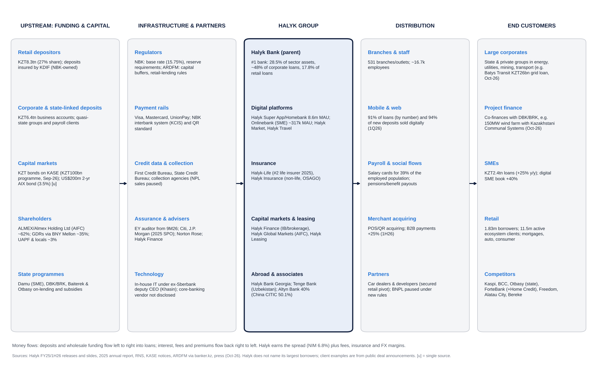{ width=100% }

# Financial analysis: five years by division and geography

## Group P&L (bank equivalents of revenue, EBITDA and EBIT)

For a bank, "sales" is total operating income (net interest, net fee, insurance and other income), "EBITDA" is approximated by pre-provision operating profit (PPOP), and "EBIT" by profit before tax (PBT), since interest is the cost of goods sold.

| KZT bn | FY2021 | FY2022 | FY2023 | FY2024 | FY2025 | 1H26 | y/y |
|---|---|---|---|---|---|---|---|
| Net interest income | 513.1 | 669.5 | 797.1 | 1,107.9 | 1,287.7 | 657.6 | +2.6% |
| Net fee & commission income | 66.6 | 83.8 | 113.7 | 125.3 | 140.1 | 54.5 | −19.6% |
| Insurance, FX/trading and other income [d] | n/a | n/a | 216 | 263 | 332 | ~93 | n/a |
| **Total operating income ("sales") [d]** | ~705 [e] | ~1,050 [e] | 1,127 | 1,497 | 1,760 | ~805 | ~−6% |
| Operating expenses | ~170 [e] | ~200 [e] | 216.4 | 263.4 | 308.0 | 154.6 | +5.5% |
| **PPOP ("EBITDA") [d]** | ~535 [e] | ~850 [e] | 911 | 1,233 | 1,452 | ~651 | ~−7% |
| Credit loss expense and other [d] | ~10 [e] | ~190 [e] | ~96 | ~131 | ~154 | 104.0 | +69% |
| **Profit before tax ("EBIT")** | 524.6 | 658.8 | 814.8 | 1,101.9 | 1,298.2 [d] | ~546 [d] | n/a |
| Income tax | 62.2 | 105.1 | 121.3 | 180.9 | 239.8 [d] | ~99 [d] | n/a |
| Effective tax rate | 11.9% | 15.9% | 14.9% | 16.4% | 18.5% | ~18% [d] | n/a |
| **Net income (to shareholders)** | **462.4** | **553.8** | **693.4** | **921.0** | **1,058.4** | **447.6** | **−15.3%** |
| PPOP margin | ~76% [e] | ~81% [e] | 80.8% | 82.4% | 82.5% | ~81% | n/a |
| PBT margin ("EBIT margin") | ~74% [e] | ~63% [e] | 72.3% | 73.6% | 73.8% | ~68% | n/a |
| Cost / income | 24.1% | 19.0% | 19.2% | 17.6% | 17.5% | 19.2% | +2.0pp |
| NIM | 5.2% | 5.6% | 6.2% | 7.2% | 7.1% | 6.8% | −0.5pp |
| Cost of risk | n/a | 1.2% | 1.0% | 1.2% | 1.4% | 1.4% | flat |
| ROAE | 29.7% | 31.7% | 32.5% | 34.0% | 32.6% | ~25% [d] | −8pp |

**Notes on the table:**

- **Sources and vintages.** Figures come from Halyk results releases. 2022 is shown as originally reported (restated to 569.5 under IFRS 17); 2023 NII is the restated 797.1 (810.5 originally reported). PBT and tax for 2021–24 are aggregator figures that reconcile to reported net income.
- **2025 PBT** is derived from the 18.5% effective tax rate [d].
- **Total operating income for 2023–25 and 1H26** = opex ÷ reported CIR [d]. For 2021–22 we extrapolate FY opex from the reported 9M figures (9M21 KZT121.4bn, 9M22 KZT146.2bn), then divide by the reported CIR (24.1%, 19.0%) [e].
- **One-offs.** 2024 includes the one-off loss on early repayment of the Kazakhstan Sustainability Fund deposit (KZT66.1bn pre-tax in 1Q24; KZT79.3bn in 1H24). 1Q25 included a one-off gain from the stressed-asset SPV workout.

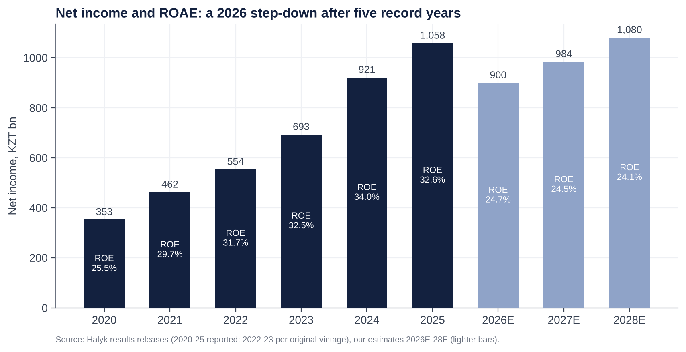{ width=95% }

**Trends and why.**

- **2021–24: compounding.**
  - Net income doubled (+99%) as NIM widened from 5.2% to 7.2%. The base rate rose from 9.75% to 16.75% and stayed high, while the deposit base repriced slowly.
  - Loans grew at mid-teens, and cost/income fell by 6.5pp as Kazkom synergies and digitisation ran through.
- **2025: still a record (+14.9%), but the slowdown began.**
  - NIM slipped to 7.1% (6.9% in 4Q25) as deposit rates rose (average customer rate 9.6% → 9.9% in 4Q25) and the first MRR step arrived (Sep-25).
  - The 10% excess-profit tax lifted the ETR to 18.5%.
  - Loan growth was +13.9% but retail slowed; guidance was cut at 3Q25.
- **2026: the step-down.**
  - Margin: MRR (−40bp), rate cuts and deposit-cost stickiness took NIM to 6.8%.
  - Fees fell 19.6% (BNPL rules, VAT on fees).
  - Insurance swung to a loss in 2Q.
  - Credit costs normalised (ECL +69%).
  - Cost/income rose 2pp despite opex growth of only 5.5%.

## Segment (division) view

Halyk's press releases do not carry segment P&L, and the IFRS 8 note could not be retrieved in this session. The table below combines disclosed volumes with our estimated profit split.

| Segment | Gross loans 1H26 (KZT trn) | Share | Loan growth y/y | NPL 90+ (1H26) | Funding | Est. FY25 revenue share [e] | Est. FY25 PBT share [e] | Trend |
|---|---|---|---|---|---|---|---|---|
| Corporate | ~6.8 [u] | ~49% | +11% | 2.6% (coverage 123%) | Business deposits KZT6.4trn (FY25) | ~35% | ~40% | Steady; infrastructure and energy demand |
| SME | ~2.4 [u] | ~17% | +25% | ~5% | (in business deposits) | ~15% | ~15% | Fastest growth; digital SME book +40% |
| Retail | 4.79 | ~34% | +10.7% | 9.2% | Retail deposits KZT8.3trn (+10.5%) | ~40% | ~35% | Issuance −18% in 1Q26; pivot to secured |
| Investment banking, insurance, other | n/a | n/a | n/a | n/a | n/a | ~10% | ~10% | Insurance loss in 2Q26 |

- **Segment mix over time.**
  - Retail grew faster than corporate in 2021–24 (to ~35% of loans in 9M25), helped by BNPL and digital cash loans.
  - In 2026 that reversed: SME is the growth engine and retail is re-mixing to secured loans.
- **Margin implication.** The retail-to-SME shift lowers NIM but should lower credit cost from 2027.

## Geographic view

| Geography | Status | Contribution |
|---|---|---|
| Kazakhstan | Core (parent bank plus domestic subsidiaries) | ~98% of net income [e] |
| Georgia | Halyk Bank Georgia (100%) | Small (<1%) [e] |
| Uzbekistan | Tenge Bank (100%); 49% sale and Click purchase lapsed Dec-25 | Tenge Bank 2023 NI UZS146.5bn (~KZT5.7bn) |
| Russia | Moskommertsbank sold Dec-22 (~2% of group business; ~RUB1.1bn [u]) | Exited |
| Tajikistan | Halyk Bank Tajikistan sold Dec-22 | Exited |
| Kyrgyzstan | Halyk Bank Kyrgyzstan sold Apr-24 (Visor consortium) | Exited |

- Foreign subsidiaries earned KZT11.2bn in 2023 (~1.6% of group). Halyk's geographic risk is essentially Kazakhstan.
- The deliberate exits from Russia, Tajikistan and Kyrgyzstan cut sanctions and governance exposure. Uzbekistan is the only active foreign growth option.

## Operating KPIs

| KPI | FY2023 | FY2024 | FY2025 | 1H26 | Trend / comment |
|---|---|---|---|---|---|
| Total assets (KZT trn) | 15.49 | 18.55 | 20.91 | 22.04 | +12% y/y |
| Gross loans (KZT trn) | n/a | ~12.04 [d] | 13.71 | 13.96 | +1.8% YTD; guidance +9–12% |
| Customer deposits (KZT trn) | n/a | n/a | 14.34 | ~14.87 | +8.2% y/y; deposits ~81% of liabilities |
| Loans / deposits | n/a | n/a | 96% | 94% | Comfortable |
| NIM | 6.2% | 7.2% | 7.1% | 6.8% (2Q 6.7%) | Peak behind us |
| Cost / income | 19.2% | 17.6% | 17.5% | 19.2% | Guidance 18–20% |
| Cost of risk | 1.0% | 1.2% | 1.4% | 1.4% | Guidance 1.4–1.5% |
| NPL 90+ | n/a | 2.6% | 4.3% | 5.3% (retail 9.2%) | Rising; partly the collector-sale pause |
| Stage 3 ratio / coverage | n/a | n/a | n/a | 8.6% / 58% [u] | Moody's sees 8–9% |
| Capital (k2, unconsolidated) | n/a | n/a | 18.9% | 19.0% | 700bp over minimum |
| Super App MAU / DAU | n/a | n/a | ~8.5m (1Q26) | 8.6m / 2.8m | Engagement rising (DAU +22–26% y/y in 2025) |
| Payments volume | n/a | n/a | n/a | KZT10.5trn (+14% y/y) | 234.7m transactions (+8%) |
| Salary-card penetration | n/a | n/a | n/a | 39% of employed | Payroll moat |
| Market share: assets / corporate loans / retail loans / retail deposits | ~30% / n/a / n/a / n/a | n/a | 28.6% / ~48% / n/a / 27.5% | 28.5% / ~48% / 17.8% / 27.4% | Stable; retail-loan share well below asset share |
| Branches / employees | n/a | n/a | 531 / ~16.7k | n/a | Flat |
| Capex intensity | n/a | n/a | n/a | n/a | IT spend is the main driver of opex growth; not separately disclosed |

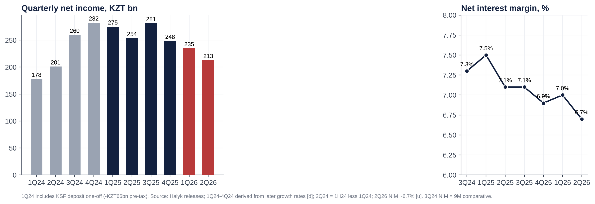{ width=100% }

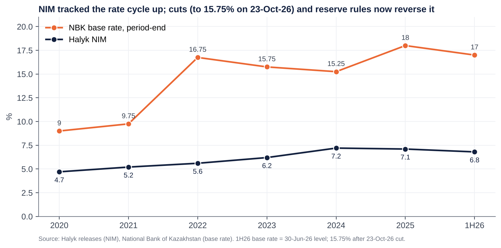{ width=90% }

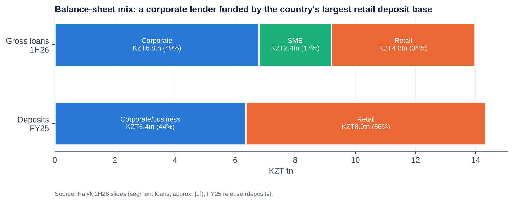{ width=95% }

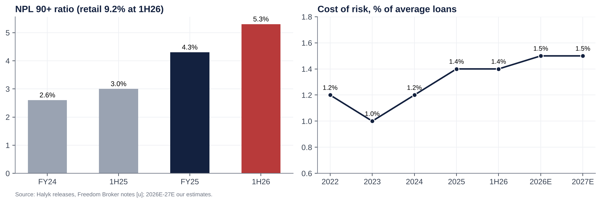{ width=95% }

# Historical catalysts: moves of more than 10% over the last five years

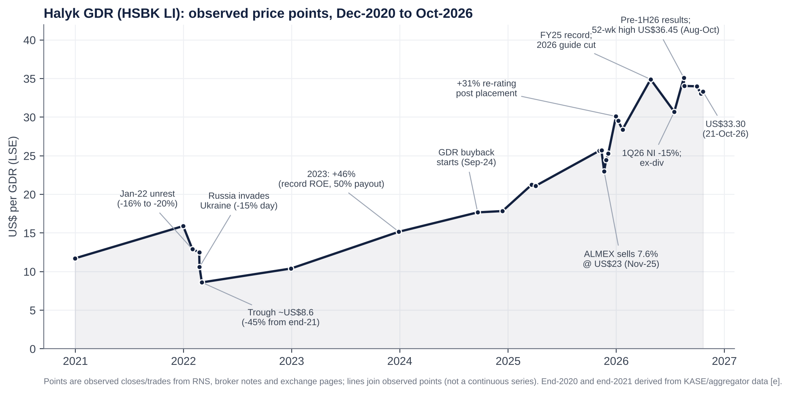{ width=100% }

| # | Date / window | Move | Price (US$/GDR) | Cause |
|---|---|---|---|---|
| 1 | 4–6 Jan 2022 | **−16% to −20%** | ~15.9 → ~12.9 (end-Jan) | "Bloody January" unrest: state of emergency, internet blackout, CSTO deployment. A political shock for the Nazarbayev family, which owns the controlling stake via ALMEX. |
| 2 | 24 Feb 2022 | **−15.3% in one day** (KASE −13%) | 12.50 → 10.59 | Russia's invasion of Ukraine: sanctions-contagion fears, rouble/tenge contagion, and Halyk's Russian subsidiary. |
| 3 | 1–4 Mar 2022 | **−15.7%** (−45% from end-2021) | 10.20 → ~8.60 | Escalating sanctions; CIS-wide sell-off; the AGM later proposed no FY21 dividend. |
| 4 | Mar–Dec 2022 | **+21%** from the trough | 8.60 → 10.40 | FY21 dividend reinstated (KZT12.71, paid Oct-22); exits from Russia and Tajikistan announced (Dec-22). |
| 5 | Calendar 2023 | **+46%** (+66% total return) | 10.40 → 15.16 | Record earnings (ROE 32.5%), payout raised to 50%, high-rate NIM tailwind. |
| 6 | Calendar 2024 | **~+29%** [e] | 15.16 → ~19.5 | Record +33% profit; second dividend tranche introduced (Dec-24); GDR buyback (from Sep-24). |
| 7 | Apr–early Nov 2025 | **~+21%** | 21.1 → 25.7 | 60% payout (FY24 KZT50.64); second tranche (Sep-25); new US$50m buyback (Oct-25); 18% base rate. |
| 8 | 4–21 Nov 2025 | **~−10%** | 25.7 → 23.0 (low 22.90) | ALMEX launches a 4% sale, upsized to 7.6%, priced at US$23. |
| 9 | 21 Nov–31 Dec 2025 | **+31%** | 23.0 → ~30.1 | Overhang cleared; strong book (17.4m GDRs to non-Kazakh institutions); higher free float; one-year lock-up. |
| 10 | Jan–Apr 2026 | **+23%** from the January low | 28.4 → 34.9 | FY25 record (NI +15%); 58.19 DPS signalled; oil windfall. The first-ever guided profit decline (19-Mar) was shrugged off. |
| 11 | late Apr–mid-Jul 2026 | **−12%** | 34.9 → 30.7 | 1Q26 NI −14.6%; ex-dividend (KZT30.10 ≈ US$2.6/GDR); MRR step-up. |
| 12 | mid-Jul–Aug 2026 | **+14%**, then to a high of 36.45 | 30.7 → 35.1 | NBK cutting cycle (from 5-Jun); S&P sovereign upgrade (21-Aug); second dividend pulled forward. |
| 13 | high → mid-Oct 2026 | **−10%** | 36.45 → 32.75 | 1H26 miss (2Q NI −14% vs consensus); ex-dividend 25-Aug (KZT28.09 ≈ US$2.4); NPL rise. |

- **Data caveat.** Daily price files could not be downloaded, so these moves are measured between observed prices in RNS filings, broker notes and exchange pages. Rows 6–7 use year-end estimates from aggregator market caps.
- **The pattern.** Big negative moves have been political and geopolitical (2022) or supply-driven (the ALMEX sale). Big positive moves have been about earnings and capital return. Over three years the GDR has returned ~314% (Yahoo Finance, 17-Oct-26).

# Earnings calls, management focus and sentiment

## What management has been focused on (3Q25 to 1H26 calls)

| Call (date) | Headline | What management stressed | Guidance | Analyst concerns in Q&A |
|---|---|---|---|---|
| **3Q25** (13-Nov-25) | 9M NI +26.8% (+20.6% ex one-offs); 3Q ROE 34.3%; NIM 7.1%; C/I 16.9% | "Strong" profitability. Loan-growth cut blamed on the base rate and consumer-lending rules but "didn't affect profitability". Tax: 2026 CIT 25% offset by the end of the 2025 excess-profit tax ("not materially different"). | FY25 NI >KZT1trn, ROE >30%, CoR 1.4%. Indicative FY26: ROE ~30%, NIM ~7%, CoR 1.5% | Loan growth, MRR, tax |
| **FY25** (19-Mar-26) | FY NI +14.9% to KZT1,058bn; ROE 32.6%; 4Q NI −12% y/y and q/q | All FY25 targets met. Blamed "persistent high rates, regulatory tightening and a slower economic start" for 2026. | **First guided profit decline:** NI ~KZT1trn, NIM 6.8%, ROAE 29%, CoR 1.4–1.5%, C/I 18–20%, loans +10–13% | NPL 90+ up from 2.6% to 4.3%; dividend (~60% payout) |
| **1Q26** (18-May-26) | NI −14.6% to KZT234.8bn; NIM 7.0% (7.3% ex-MRR); fees −26% | "In line with our expectations and supports the full-year guidance". Flagged a further MRR step from April affecting NIM "starting from the second quarter". | Unchanged | Prior-year one-off (SPV workout); retail slowdown (issuance −18%); fees |
| **1H26** (18-Aug-26) | 2Q NI −16.1% y/y to KZT212.8bn; 1H −15.3%; NIM 6.8% | MRR effect "measurable and temporary"; CoR "normalised". NPL rise "partly mechanical" (paused collector sales). "We might see some slowdown in growth in the second half." Pivot to secured retail; BNPL to restart when risk-return improves. Second dividend pulled forward to show confidence. | NI ~KZT1trn and ROAE 29% kept; **fee growth cut to about −10%**; net loans +9–12% (retail 8–10%, corporate/SME 10–13%) | Insurance loss (OSAGO, model change); NIM path; dividend payout vs growth capital; retail recovery |

**Recurring themes:**

1. **Regulation, not competition.** Management explains every shortfall through the NBK and ARDFM: reserve requirements, BNPL rules, VAT on fees. Kaspi is barely mentioned on the calls.
2. **Capital return.** The dividend is the constant: a 50%+ policy and ~60% in practice, now paid in two tranches.
3. **Digital ecosystem.** Super App MAU 8.6m, B2B payments +25%, Onlinebank for SMEs.
4. **Retail re-mix** to auto and mortgages; SME growth; Islamic banking licence (EGM, 25-Sep-26).
5. **Asset quality.** NPL 90+ framed as technical. This is the area to watch.

## Sentiment analysis

The ProntoNLP tool was not available in this session. We therefore scored the calls ourselves on a −5 to +5 scale, from transcripts and call summaries, using four dimensions: tone, outlook, asset quality and capital. For periods before 3Q25, where no call content could be retrieved, we show a results-based proxy only.

| Call | Tone | Outlook | Asset quality | Capital / dividend | Key evidence |
|---|---|---|---|---|---|
| 3Q25 | +3 | +2 | +1 | +1 | "Strong net income forecast"; ROE 34%; loan targets trimmed but "didn't affect profitability" |
| FY25 | 0 | −2 | −1 | +2 | Record year but the first guided decline; NPL 90+ 4.3% |
| 1Q26 | −1 | 0 | −1 | +2 | "In line with expectations"; pre-flagged the April MRR step |
| 1H26 | −2 | −1 | −2 | +2 | Qualifiers: "measurable and temporary", "partly mechanical"; NPL 90+ doubled; dividend pulled forward |

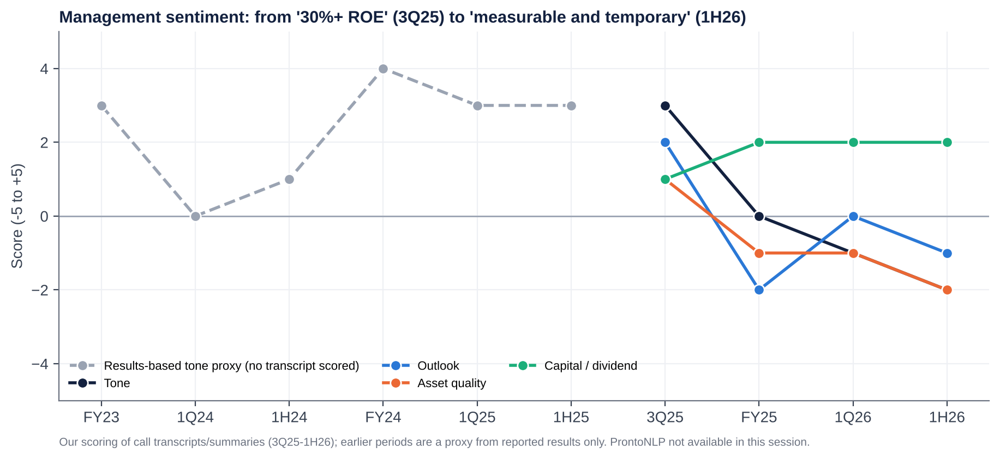{ width=100% }

**How sentiment has shifted.**

- **Late 2025 was the high-water mark.** Management talked of 30%+ ROE and a 7% NIM "sustained into 2026".
- **By March 2026 the vocabulary had moved to external causes** (rates, regulation, economy), and to defending guidance rather than raising it.
- **By August it relied on qualifiers:** "temporary", "normalised", "mechanical". The capital and dividend message became the only consistently positive pillar.
- **The credibility test is 9M26 (mid-November).** Guidance requires 2H26 NI of ~KZT552bn, i.e. ~KZT276bn a quarter, **~30% above the 2Q26 run-rate**. We expect the KZT1trn target to be cut or described as "challenging".

## Latest results (1H/2Q 2026, released 18-Aug-2026): deep dive

**Revenue and profit vs expectations.**

- **Net income:** 2Q26 NI of KZT212.8bn missed the company-compiled consensus average of KZT246.5bn by **13.7%** (KZT34bn). It was also ~10% below the *lowest* estimate (KZT236.1bn).
- **Revenue:** interest income of ~KZT725bn was a smaller miss (−1.4% vs KZT735bn). The miss sat below the NII line: insurance, fees, FX and costs.

**Segment drivers.**

- **Acceleration:**
  - SME loans (+25% y/y; digital SME +40%);
  - corporate loans (+11%);
  - B2B payments (+25%).
- **Deceleration:**
  - retail issuance (−18% in 1Q) as BNPL and unsecured lending were curtailed;
  - fees (−19.6% in 1H);
  - insurance (a 2Q loss from OSAGO tariffs lagging inflation, higher loss ratios and a one-off change in the liability model);
  - FX income (high base).

**Margins.**

- **NIM:** 6.8% vs 7.3% (2Q ~6.7%). About 40bp came from MRR; the rest from deposit costs (interest expense +21.6% vs interest income +12.2%).
- **Cost/income:** 19.2% vs 17.2%. Opex grew only 5.5% (salary indexation, IT, VAT) but revenue fell.

**Guidance and outlook.**

- FY26 NI ~KZT1trn and ROAE 29% were reaffirmed, as were NIM 6.8%, C/I 18–20% and CoR 1.4–1.5%.
- Fee guidance was cut to about −10%, and management flagged a 2H growth slowdown.
- The tone became more defensive: the commitment to guidance remained, but the language hedged.

**Balance-sheet flags.**

- **NPL 90+ doubled y/y to KZT715bn (5.3% from 3.0%); retail 9.2%.**
  - Provisions rose to 5.0% of gross loans from 4.4% at end-2025. Stage 3 is 8.6% with 58% coverage [u].
  - Management blames the moratorium on selling retail NPLs to collectors (to 1-May-26). If so, 2H26 should show write-offs or sales, not further growth.
- **Capital:** k-ratios fell from 21.0% to 19.0% in one quarter after the dividend.
- **Funding:** no stress. Retail deposits rose 10.5% y/y; the issue is cost, not availability.

**Market reaction.**

- **On the day:** the GDR fell ~3% (US$35.10 → 34.05) [u].
- **Afterwards:** within weeks it set a new 52-week high of US$36.45, then gave back ~10% by mid-October, partly through the ex-dividend on 25 August.
- **What it signals:** investors look through 2026 to the dividend and the rate-cut cycle. A guidance cut is partly priced in; a cut to the dividend is not.

**What was unusual vs recent history:**

1. The largest y/y quarterly profit decline in the series.
2. An insurance loss.
3. A doubling of NPL 90+.
4. The dividend calendar brought forward.
5. Within six weeks, a change of auditor to EY (from the 9M26 review) and an Islamic-banking licence application, both at the EGM of 25-Sep-26.

The auditor change is not necessarily a red flag (rotation and Big-4 continuity), but it should be explained.

# Earnings forecasts, 2026E–2028E

| KZT bn | 2025A | 2026E | 2027E | 2028E | Key assumption |
|---|---|---|---|---|---|
| Average interest-earning assets | ~18,140 | 19,590 | 21,550 | 23,810 | +8% / +10% / +10.5% |
| NIM | 7.1% | 6.75% | 6.50% | 6.40% | Rate cuts plus full-year MRR; partial deposit repricing |
| **Net interest income** | 1,287.7 | 1,322 | 1,401 | 1,524 | |
| Net fees | 140.1 | 126 | 139 | 153 | −10% (guidance), then +10% |
| Insurance, FX and other | 332 | 190 | 265 | 287 | 2026 hit by insurance loss and FX base |
| **Total operating income** | 1,760 | 1,638 | 1,805 | 1,964 | |
| Operating expenses | (308) | (326) | (355) | (387) | +6% / +9% / +9% (wage indexation, IT) |
| **PPOP** | 1,452 | 1,313 | 1,450 | 1,577 | |
| Credit losses | (154) | (215) | (234) | (243) | CoR 1.51% / 1.50% / 1.40% |
| **PBT** | 1,298 | 1,097 | 1,215 | 1,334 | |
| Tax rate | 18.5% | 18.0% | 19.0% | 19.0% | CIT 25% with exempt government-securities income and business-loan carve-out |
| **Net income** | 1,058.4 | **900** | **984** | **1,081** | |
| Shares (m, average) | 10,900 | 10,909 | 10,909 | 10,909 | Buybacks (~US$50m/yr) offset by staff allotments (≤1%) |
| **EPS (KZT)** | 97.1 | **82.5** | **90.2** | **99.0** | −15% / +9% / +10% |
| EPS (US$/GDR) | 7.66 | 7.17 | 7.68 | 8.08 | KZT460 / 470 / 490 per US$ |
| DPS (KZT) | 58.19 | 49.5 | 54.1 | 59.4 | 60% payout |
| BVPS (KZT, year-end) | 321 | 347 | 388 | 433 | |
| ROAE | 32.6% | 24.7% | 24.5% | 24.1% | |
| Gross loans (KZT trn) | 13.71 | 14.81 | 16.44 | 18.25 | +8% / +11% / +11% |

**How we get there:**

- **Industry growth and market share.**
  - Sector loans grew 19% in 2025 and are slowing to high single digits in 2026.
  - We assume Halyk grows roughly in line with the system in corporate and SME, and slightly below in retail. Its retail share was 17.8%, well below its 28% asset share, and stays flat.
  - Share gains come from SME (Damu programmes, Onlinebank) and from weaker MFOs and small banks.
- **Price.**
  - Loan yields fall with the base rate (225bp of cuts already, and we assume a further ~150bp in 2027).
  - Deposit costs lag by 2–3 quarters, so NIM troughs in 2027 at ~6.5% before stabilising.
  - Each 10bp of NIM is worth ~KZT20bn of pre-tax income.
- **Cost pressures.** Wage indexation (~10%), IT and VAT on purchases keep opex growth at 6–9%. CIR stays at ~19.7%, at the top of guidance.
- **Operating leverage.** It is limited: revenue grows 10% in 2027 vs opex 9%, so there is no repeat of the 2021–24 CIR compression.
- **Credit cost.** It peaks at ~1.5% in 2026–27 as retail NPLs are provisioned or sold, then eases with lower rates.
- **Financing costs.** These sit inside NIM (deposits are ~81% of liabilities). Wholesale funding is small; the KZT100bn local bond and the US$200m AIX note are immaterial to the cost of funds.
- **Dilution.** Negligible. The December 2024 EGM authorised up to 1% of shares for staff incentives over five years. GDR buybacks (US$50m cap) offset it.

**Versus consensus.** We are ~5–10% below consensus for FY26 and ~5% below for FY27. We assume guidance is missed by ~10% in 2026 and that NIM does not rebound in 2027.

# Capital structure, funding and liquidity

| KZT bn (30-Jun-26 unless stated) | Value | Comment |
|---|---|---|
| Total assets | 22,036 | +12.3% y/y |
| Customer deposits | ~14,870 | ~81% of liabilities; retail 8,279 / business ~6,590 |
| Other liabilities (interbank, repo, debt securities, insurance reserves, other) | ~3,520 [d] | Includes local KZT bonds; a KZT100bn programme approved Sep-26 |
| Total equity | 3,643 | 16.5% of assets (leverage ~6x) |
| Gross loans | ~13,960 | Loans / deposits ~94% |
| Liquid assets | ~23% of assets [u] | Sector: highly liquid assets 30.6% of assets |
| Capital ratios (k1-1 / k1-2 / k2) | 19.0% / 19.0% / 19.0% | Minimums incl. buffers 9.5% / 10.5% / 12.0%; all capital is CET1 |
| Credit ratings | Moody's Baa1/Stable (affirmed 15-Sep-26); Fitch BBB-/Stable (affirmed 14-Sep-26); S&P BBB-/Positive (8-Sep-26) | Capped near the sovereign (BBB/Baa1/BBB) |

- **Debt and maturities.**
  - Halyk is almost entirely deposit-funded. It has repaid its legacy US$ Eurobonds, including the Kazkommertsbank-era issues; the last matured around 2021 [u].
  - The local bond HSBKb19 (KZT131.7bn principal) matured and was repaid on 21-Feb-2025.
  - New wholesale funding is small: a KZT100bn local bond programme approved in September 2026, and a planned US$200m two-year AIX bond at 3.5% [u]. A full maturity ladder could not be retrieved; we see no material refinancing wall.
- **Covenants.** Halyk's material constraints are regulatory, not contractual:
  - k-ratios;
  - liquidity coverage and net stable funding ratios;
  - large-exposure limits (ARDFM limited large loans further in Oct-26 [u]);
  - the new 2% sectoral retail buffer and the Pillar 2 add-on.
- **Interest costs.** Interest expense was KZT788.5bn in 1H26 (+21.6%), ~54.5% of interest income. The average customer deposit rate was ~9.9% in 4Q25 and should start to fall from 1H27 as term deposits reprice.
- **Liquidity.** Strong. The loan/deposit ratio is below 100%, liquid assets are ~23% of the balance sheet, and Halyk holds a large book of NBK notes and government securities.
- **Leverage ratio (the bank equivalent of net debt/EBITDA).** Net debt/EBITDA is not meaningful for a bank. On equity/assets (16.5%) and CET1 (19%), Halyk is one of the most conservatively capitalised large banks in emerging markets.

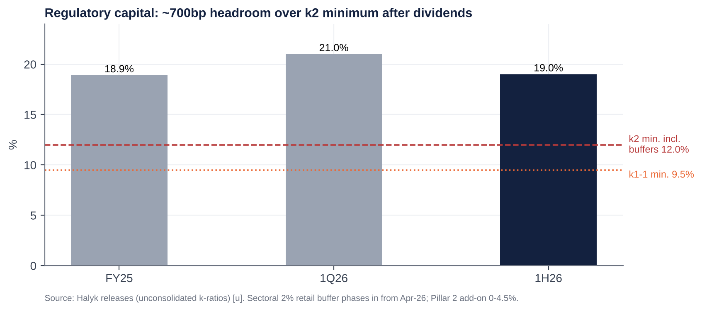{ width=85% }

**Capital generation (the bank's "free cash flow").**

- At a ~24.5% ROE and 60% payout, Halyk retains ~9.8% of equity a year. That funds ~10% risk-weighted asset (RWA) growth at a constant 19% ratio.
- Guidance of 9–12% loan growth is therefore self-funded.
- The 2% retail buffer (phasing in to April 2027) and any Pillar 2 add-on absorb ~50–80bp of the headroom [e].
- The 60% payout is safe. Going above 70% would require slower growth or a lower capital target.

# Valuation: peers, history and regression

## Why bank multiples replace EV-based ones

- **EV is not meaningful for a bank.** Debt is raw material, not financing, so EV/Sales, EV/EBITDA, EV/EBIT and net debt/EBITDA are not meaningful.
- **Substitutes we use:**
  - P/E and P/B (P/TBV is close to P/B; goodwill is negligible);
  - ROE, dividend yield and cost/income;
  - market cap / total operating income ("P/Revenue", the bank analogue of EV/Sales);
  - pre-tax margin (the bank analogue of EBIT margin);
  - PPOP margin (the analogue of EBITDA margin);
  - capital generation (the analogue of free cash flow).

## Listed and private competitors

| Company | Ticker | Listed? | Country | Mkt cap (US$bn) | P/E (LTM) | P/B | ROE | Div. yield | P/Rev (x) | PBT margin |
|---|---|---|---|---|---|---|---|---|---|---|
| **Halyk Bank** | HSBK LI / HSBK KZ | Yes (LSE, KASE, AIX) | Kazakhstan | 9.1 | 4.2x | 1.12x | ~27% (LTM) | 15.6% | 2.3x | 74% |
| Kaspi.kz | KSPI US | Yes (Nasdaq, KASE) | Kazakhstan | ~18.4 | ~7.5x (fwd 7.3x) | ~3.7x | ~55% [u] | ~8.5% | 2.7x | ~42% [e] |
| Bank CenterCredit | CCBN KZ | Yes (KASE, AIX) | Kazakhstan | ~1.9 | ~3.1x | ~1.0x | ~36% | 0% (FY25 skipped) | 1.6x | 63% |
| Freedom Holding (Freedom Bank KZ) | FRHC US | Yes (Nasdaq) | Kazakhstan/US | ~8 | NM | n/a | low | n/a | n/a | n/a |
| ForteBank (incl. Home Credit KZ) | ASBN KZ [u] | KASE (thin float) | Kazakhstan | n/a | n/a | n/a | n/a | n/a | n/a | n/a |
| Otbasy Bank | — | No (state, bonds only) | Kazakhstan | — | — | — | — | — | — | — |
| Alatau City Bank (ex-Jusan) | — | No (private; bonds on KASE) | Kazakhstan | — | — | — | — | — | — | — |
| Bereke Bank (ex-Sberbank KZ) | — | No (Lesha Bank, Qatar) | Kazakhstan | — | — | — | — | — | — | — |
| Altyn Bank (40% Halyk) | — | No (China CITIC 50.1%) | Kazakhstan | — | — | — | — | — | — | — |
| Lion Finance Group (Bank of Georgia, Ameriabank) | BGEO LN | Yes (LSE) | Georgia/Armenia | ~6.5 | ~8.0x | ~1.9x | 27.2% | n/a | 4.1x | 60% |
| TBC Bank Group | TBCG LN | Yes (LSE) | Georgia/Uzbekistan | ~3.3 | 5.9x | 1.4x | ~24% | ~6% | 2.5x | 49% |
| OTP Bank | OTP HB | Yes (Budapest) | Hungary/CEE/CIS | ~38 | ~11.1x | ~2.3x [e] | 21.6% | n/a | 4.4x | 52% |
| PKO Bank Polski | PKO PW | Yes (Warsaw) | Poland | ~41 | ~14.0x | 2.56x | 19.5% | ~5% | 4.8x | 45% |
| Garanti BBVA | GARAN TI | Yes (Istanbul) | Turkey | n/a | ~4.1x | 1.46x | 28.4% | n/a | n/a (IAS 29) | n/a |
| Sberbank | SBER RX | Yes (MOEX; sanctioned) | Russia | n/a | ~3–4x [u] | ~0.3–0.9x [u] | ~22–24% | ~13% [u] | n/a | n/a |

- **Notes on the data.** Peer data are search snapshots between June and October 2026 [u], with FY2025 income statements. P/Rev = market cap ÷ FY25 total operating income; PBT margin = FY25 PBT ÷ total operating income. Kaspi's revenue basis (KZT3.1trn) includes marketplace and fintech revenue.
- **Medians.**
  - All-peer median P/E ≈ 7.5x and P/B ≈ 1.9x (ex-Sberbank and FRHC).
  - The CIS/Caucasus subset (Kaspi, BCC, Lion, TBC) has a median P/E of 6.7x and P/B of 1.65x.
- **Halyk vs peers.** Halyk trades at a **~40% discount on P/E and ~40% on P/B** to the all-peer median, despite an ROE in the top half of the peer set (only Kaspi and BCC are clearly higher).

## Against its own history

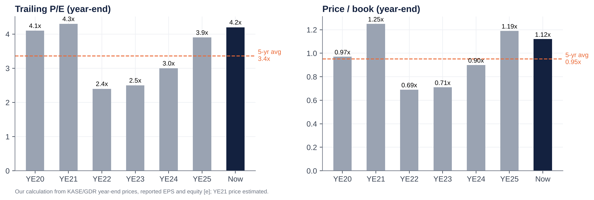{ width=95% }

| Year-end | Price (KZT/share) | Trailing P/E | P/B | Dividend yield (on that FY's DPS) |
|---|---|---|---|---|
| 2020 | 123 | 4.1x | 0.97x | 14.6% |
| 2021 | ~172 [e] | 4.3x | 1.25x | 7.4% |
| 2022 | 121 | 2.4x | 0.69x | 21.0% |
| 2023 | 161 | 2.5x | 0.71x | 21.8% |
| 2024 | ~254 [d] | 3.0x | 0.90x | 19.9% |
| 2025 | ~381 | 3.9x | 1.19x | 15.3% |
| **Now** | **374** | **4.2x (4.5x 2026E)** | **1.12x** | **15.6% (13.2% FY26E)** |
| 5-year average | | 3.4x | 0.95x | 16.7% |

**Verdict.**

- **Cheap vs peers and vs fundamentals.** A justified P/B of ~1.35x for a 23.5% sustainable ROE, a 19.5% KZT cost of equity and 8% growth.
- **Fair-to-full vs its own history.** P/B sits at the top of its 2020–25 range; P/E is above its five-year average.
- **The 2022–23 trough (0.7x P/B)** priced in political and sanctions risk that has since receded: sovereign upgrades, exits from Russia, a larger free float.
- **What drives the discount.** We think part of the historical discount is structural: a controlling family, a regulator willing to tax bank profits, and tenge risk. That caps the re-rating; we do not underwrite a move to peer multiples.

## Regression analysis

**1) "EV/Sales vs EBIT margin" (bank version: market cap / operating income vs pre-tax margin).** As requested, TEV/Sales is on the x-axis and EBIT margin on the y-axis.

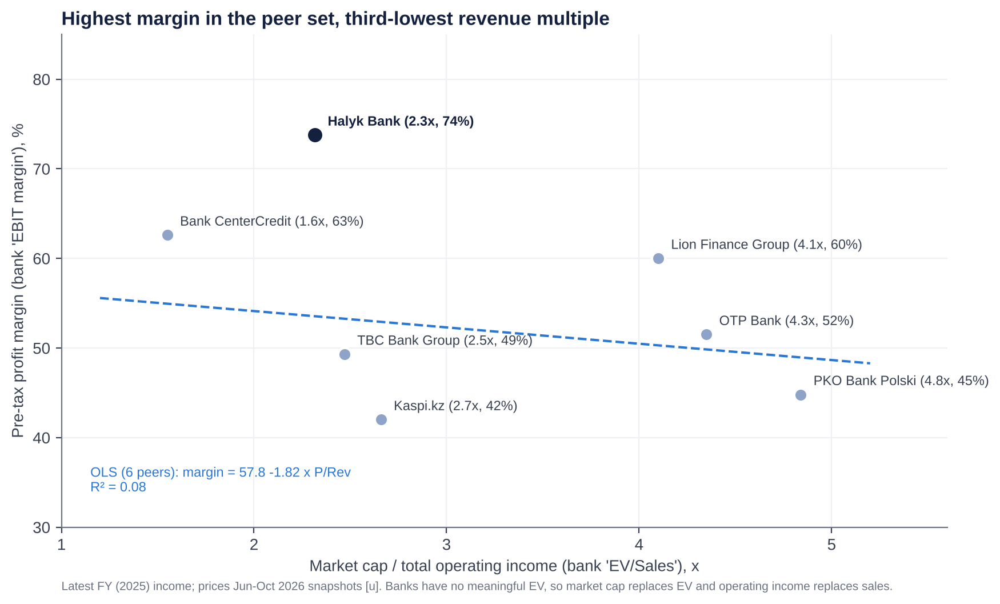{ width=95% }

- **Fit.** OLS across six listed peers gives PBT margin = 57.8 − 1.82 × P/Rev, with R² = 0.08. There is **no meaningful cross-sectional relationship**: country risk, not margin, sets the revenue multiple. PKO and OTP trade at 4.4–4.8x revenue on 45–52% margins; BCC trades at 1.6x on 63%.
- **Halyk is the outlier.**
  - It has the **highest pre-tax margin in the sample (74%)** yet the third-lowest P/Rev (2.3x).
  - At its multiple, the peer line implies a 53% margin. Halyk is **~21pp above the line**: the market pays for its revenue as if it were an average-margin bank.

**2) P/B vs ROE (the bank-standard regression).**

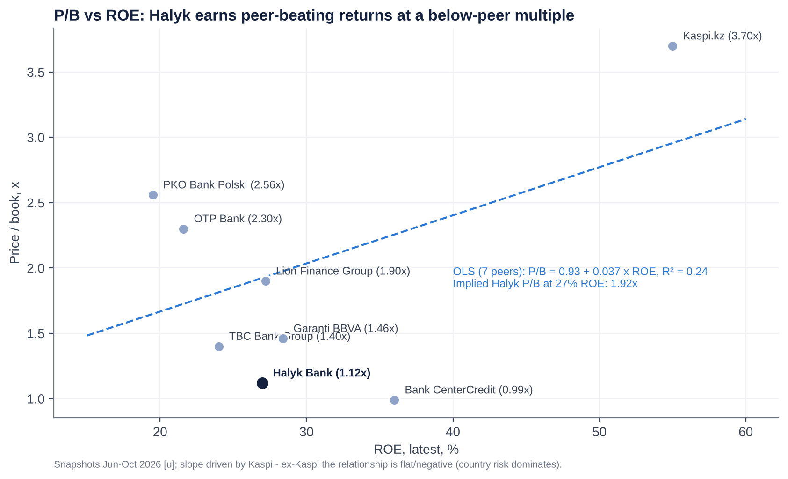{ width=95% }

- **Fit.** Across seven peers, P/B = 0.93 + 0.037 × ROE, with R² = 0.24. At a 27% ROE this implies **1.92x for Halyk vs 1.12x actual (−42%)**.
- **Caveat.** The slope is driven by Kaspi (55% ROE, 3.7x). Without Kaspi, P/B and ROE are *negatively* related across this peer set, because CEE banks with lower ROE trade at higher multiples than CIS banks. **The real driver is the country discount.** On that basis Halyk screens cheap, but the regression gap overstates the upside.

**Screen verdict: CHEAP** on P/E, P/B-vs-ROE and P/Rev-vs-margin relative to peers. **FAIR to slightly EXPENSIVE** relative to Halyk's own five-year history.

## Valuation and target

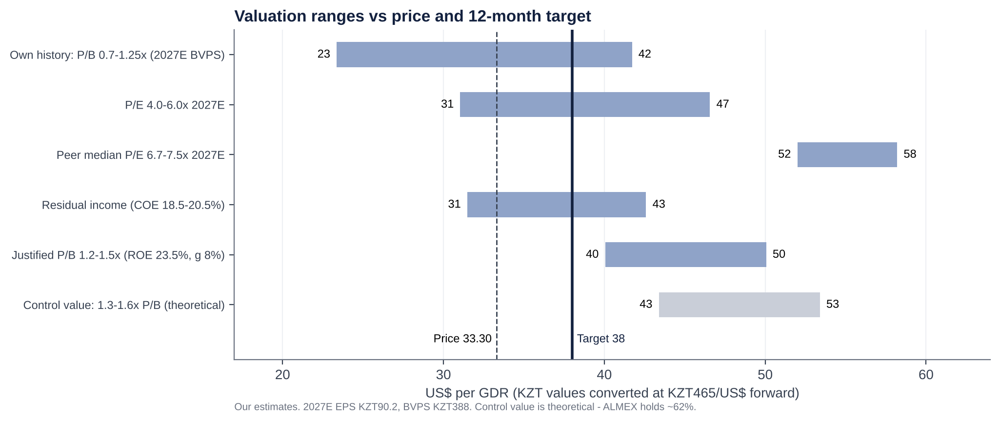{ width=95% }

| Method | Value (KZT/share) | US$/GDR at KZT465 |
|---|---|---|
| P/E 5.0x 2027E EPS (KZT90.2), between own history (3.4x) and CIS peers (6.7x) | 451 | 38.8 |
| P/B 1.2x 2027E BVPS (KZT388), the upper end of the 5-year range | 466 | 40.1 |
| Residual income, 12-month forward (COE 19.5% KZT; ROE 24.7% fading to 21% by 2033; terminal g 8%) | 431 | 37.0 |
| **Blend** | **449** | **38.6 → target US$38.0** (rounded down for the ALMEX overhang) |

- **Cost of equity build-up.** USD risk-free 4.25% + ERP 5% + Kazakhstan premium ~3% = ~12.3% in US$, plus a KZT/US$ inflation differential of ~6.5% = **19.5% in KZT**.
- **Implied multiples at the target:** 4.9x 2027E P/E and 1.14x 2027E P/B.
- **Dividends** of ~US$4.3/GDR over 12 months take the total return to ~27%.

# M&A: industry deals, takeover potential and Halyk's own transactions

## Recent M&A in the industry

| Date | Target | Acquirer | Stake | Consideration | P/B | P/E | Read-across |
|---|---|---|---|---|---|---|---|
| Jun-25 → Dec-25 | Home Credit Bank Kazakhstan (consumer finance) | ForteBank (Bulat Utemuratov) | 100% (staged) | ~KZT172–274bn [d] | ~0.9–1.4x | n/a | Healthy retail franchise valuation; Forte becomes a retail challenger |
| Jun/Jul-25 | Jusan Bank (renamed Alatau City Bank) | Vyacheslav Kim (Kaspi co-founder) | 100% | Undisclosed | n/a | n/a | Kaspi-linked capital enters mid-tier banking |
| Jul-25 (lapsed 31-Dec-25) | Click (Uzbekistan payments, 20m+ users) | Halyk Bank | 49% | US$176.4m | n/a | n/a | Halyk's fintech ambition in Uzbekistan; not completed |
| Jul-25 (lapsed) | Tenge Bank (Uzbekistan) | Click shareholders | 49% | US$60.76m | n/a | n/a | Paired with the above |
| Oct-24 → Jan-25 | Hepsiburada (Turkey e-commerce) | Kaspi.kz | 65.41% | US$1.13bn | n/a | n/a | Kaspi exports its model; diversifies away from KZ |
| Mar-24 → Oct-24 | Bereke Bank (ex-Sberbank KZ) | Lesha Bank (Qatar) | 100% | KZT65bn | ~0.40x | n/a | Distressed or sanctions-driven exit price |
| Feb-24 → 2024 | Ameriabank (Armenia) | Bank of Georgia (now Lion Finance) | 100% (90% retained) | US$303.6m | 0.65x | 2.6x | Healthy regional bank bought cheaply by a strategic buyer |
| Apr-24 | Halyk Bank Kyrgyzstan | Visor International consortium | 100% | Undisclosed | n/a | n/a | Halyk exit |
| 2023 | Jusan Bank (control) | Galimzhan Yesenov | Control | Undisclosed | n/a | n/a | Ownership churn after 2022 |
| Dec-22 | Moskommertsbank (Russia) | Undisclosed | 100% | ~RUB1.1bn [u] | n/a | n/a | Halyk exit (sanctions) |
| Dec-22 | Halyk Bank Tajikistan | International Bank of Tajikistan | 100% | Undisclosed | n/a | n/a | Halyk exit |
| Sep-22 | Sberbank Kazakhstan | Baiterek (state) | 100% | ~KZT130bn [u] | n/a | n/a | Sanctions exit |
| Apr-22 → May-22 | Alfa-Bank Kazakhstan | Bank CenterCredit | 100% | KZT50bn | ~0.37x | n/a | Bargain purchase (KZT84bn gain) |
| Nov-25 | Halyk Bank, 7.6% (secondary) | Institutions (Citi, JPM book) | 7.6% | US$475.4m | ~0.93x [d] | ~3.1x [d] | Minority market-clearing price for Halyk itself |

**What the comparables say.**

- Kazakh bank control deals since 2022 have cleared at **0.4–1.4x book**. The low end reflects forced sales by sanctioned Russian owners.
- The best regional comparable for a healthy, high-ROE bank, Ameriabank, went at **0.65x book and 2.6x earnings**, a strategic bargain.
- No large Kazakh bank has changed hands at a premium multiple.

## Is Halyk a takeover target?

**Pros (why someone might want it):**

- the dominant franchise, with 28% of assets and ~48% of corporate loans;
- a 25–33% ROE;
- a low-cost deposit base;
- a free float that is rising;
- a controlling family that has signalled it will sell down (to 51%).

**Impediments (why it will not happen):**

1. **Control.** ALMEX holds ~62% and states a 51% floor. A sale of control is not on the table.
2. **Systemic importance and politics.** Halyk is a D-SIB holding 28% of system assets. Any change of control needs ARDFM approval and, in practice, presidential-level consent, given the owners' ties to the former president.
3. **Antitrust.** No domestic bank could buy it. Kaspi, the only one big enough, would face concentration objections.
4. **Size.** At ~US$9bn market cap (~US$10bn+ for control), it is beyond most regional strategics. Plausible buyers would be a Gulf sovereign-linked bank (Qatar's Lesha bought Bereke) or a Chinese bank (CITIC owns Altyn). Both are politically sensitive.
5. **Sanctions and compliance.** Western buyers would need comfort on Russia-related flows.

**Potential takeout multiples (theoretical).** A strategic control premium of 25–40% on today's price would mean:

- **1.3–1.6x P/B (2027E BVPS)**, or KZT500–620 per share;
- US$43–53 per GDR;
- **5.5–6.9x 2027E EPS**.

That is above every regional precedent (0.4–1.4x P/B), so it is a ceiling, not a forecast. The realistic "M&A" event is further **ALMEX sell-downs to portfolio investors**, historically priced at a ~10% discount (US$23 in November 2025 vs ~US$25.5 beforehand).

## Halyk's own acquisitions and disposals (last ~10 years)

| Date | Transaction | Stake | Cost / proceeds | Multiple | Outcome |
|---|---|---|---|---|---|
| Dec-2014 (context) | Acquired HSBC Bank Kazakhstan (renamed Altyn Bank) | 100% | US$176m | ~1.1x P/B | Partly sold in 2018 |
| Jul-2017 | Acquired **Kazkommertsbank** (#2 bank) from Kenes Rakishev (86%) and Samruk-Kazyna (10.7%) | 96.81% | KZT2 nominal, plus a KZT185bn capital injection; the state Problem Loans Fund cleared a KZT2.4trn BTA receivable | Nominal (rescue) | **Transformational.** Created the #1 bank; legal merger completed Dec-2018 |
| Apr-2018 | Sold **60% of Altyn Bank** to China CITIC Bank (50.1%) and China Shuangwei (9.9%) | 60% | Undisclosed ("advantageous") | n/a | Belt-and-Road partner; Halyk keeps 40% (3-year lock-up, now expired) |
| c.2019 [u] | Tenge Bank, Uzbekistan (greenfield) | 100% | n/a | n/a | Small; 2023 NI ~KZT5.7bn |
| Dec-2022 | Sold **Halyk Bank Tajikistan** | 100% | Undisclosed | n/a | Exit of a sub-scale unit |
| Dec-2022 | Sold **Moskommertsbank** (Russia) | 100% | ~RUB1.1bn [u] | n/a | Exit; ~2% of group business; cut sanctions exposure |
| Apr-2024 | Sold **Halyk Bank Kyrgyzstan** to the Visor International consortium | 100% | Undisclosed | n/a | Exit |
| Jul-2025 (lapsed) | Agreed to buy 49% of **Click** (Uzbekistan); sell 49% of Tenge Bank | 49% / 49% | US$176.4m / US$60.76m | n/a | Documents expired 31-Dec-25 pending Uzbek approvals; talks continue |

**Assessment.**

- **Kazkom was a once-in-a-generation deal.** Halyk bought a systemically important bank for nothing after the state absorbed the bad assets.
- **Everything since has been portfolio pruning,** sensibly exiting Russia and Central Asian sub-scale units ahead of sanctions risk.
- **The one growth move abroad, Click, is stalled.** Capital allocation on M&A has been disciplined, if opportunistic.

# Management assessment

| Executive | Role | In role since | Background | Halyk holding |
|---|---|---|---|---|
| **Umut Shayakhmetova** | Chairperson of the Management Board (CEO); board member | Jan-2009 (re-elected 2023) | RUDN (1993), Rutgers MBA (1996). ABN AMRO Kazakhstan 1997–2004: head of asset management and deputy chair of the bank. Halyk head of corporate lending 2004–09. | <1% (individual holding not disclosed) |
| **Murat Koshenov** | Deputy CEO, CFO (finance, subsidiaries, compliance, international, ESG) | Sep-2014 [u] | Leads investor relations and guidance | Not disclosed |
| **Dauren Sartayev** | First Deputy CEO, B2B (SME, acquiring, marketing) [u] | n/a | — | Not disclosed |
| **Olga Vuros** | Deputy CEO, corporate banking | Apr-2022 [u] | — | Not disclosed |
| **Roman Maszczyk** | Deputy CEO, Chief Risk Officer | Mar-2024 [u] | Polish; former University of Warsaw professor; PKO group supervisory roles | Bought ~11.4k GDRs at US$28.4–28.7 in Jan-2026 |
| **Mikhail Khasin** | Deputy CEO, IT and digital | Jan-2026 | Ex-Sberbank senior manager [u]; ex-BNP Paribas (Portugal) [u] | n/a |
| **Kiril Bachvarov** | Deputy CEO, B2C (retail) | Apr-2026 | n/a | n/a |
| Yertay Salimov, Nariman Mukushev, Tlegen Matkenov (security) | Deputy CEOs | 2020 / n/a / Mar-2025 | — | — |

1. **Track record.**
   - Shayakhmetova has run Halyk for nearly 18 years, through:
     - the 2009 crisis (Euromoney "Crisis Banker"), with Samruk-Kazyna recapitalising and Halyk buying the stake back in 2011;
     - the 2014–15 devaluation;
     - the 2017 **Kazkommertsbank** rescue-merger and its integration, executed in about 18 months;
     - the 2022 shocks.
   - Under her, the bank went from a mid-sized savings bank to holding a third of the system. Net income rose ~3x (2020–25), cost/income fell from ~27% to 17.5%, and a credible digital ecosystem was built.
2. **Tenure and insider ownership.**
   - Tenure is very long (CEO since 2009). The CFO has been in place since 2014.
   - Skin in the game is small: all directors hold <1%, there is no disclosed LTIP grant, and an employee share allotment of up to 1% was approved in Dec-2024.
   - Aggregate management board pay was KZT2.9bn (2022), 3.2bn (2023), 4.06bn (2024) and **KZT4.5bn (~US$9m) in 2025** for ~10 people. That is +55% over three years, while net income rose +91%.
   - Pay is disclosed only in aggregate.
3. **Capital allocation history.**
   - **Good:**
     - ROE of 25–34% every year since 2020;
     - the Kazkom deal;
     - disciplined exits (Russia, Tajikistan, Kyrgyzstan, 60% of Altyn);
     - a payout raised from 30% to 60%, plus GDR buybacks.
   - **Questionable:**
     - Payout reversals: no FY21 dividend was proposed in April 2022, later reversed.
     - The 2024 KSF deposit one-off (~KZT145bn pre-tax): an IFRS loss on the early-repayment expectation of a state-fund deposit.
     - Fast BNPL/unsecured retail growth into 2025, now being unwound under regulatory pressure.
     - The Click/Uzbekistan deal, which lapsed. Paying US$176m for 49% of a payments app while selling 49% of a bank for US$61m drew criticism of the terms.
   - **ROE/ROIC trend:** 25.5% (2020), 29.7%, 31.7%, 32.5%, 34.0%, 32.6% (2025), and ~25% in 1H26.
4. **Red flags.**
   - Related parties: the controlling family; the IFRS related-party note could not be reviewed.
   - IT leadership churn: Zavarzin left after nine months in Dec-2025 and was replaced by an ex-Sberbank executive, a sensitive optic.
   - An unexplained chairman resignation (Pavlov, May-2025).
   - Shrinking board independence.
   - An auditor change to EY from 9M26.
   - **No promotional behaviour.** Guidance has historically been met (FY25), and management talks down rather than up.
5. **Founder vs professional manager.**
   - **Professional manager in an owner-controlled bank.** Shayakhmetova is not an owner. Strategy and capital return are shaped by ALMEX's priorities: dividends (the holding pays its owners ~KZT462bn), liquidity and keeping at least 51%.
   - At this mature, ex-growth stage, that combination favours **cash return over empire-building**, which suits minorities.
   - The risk is succession. No successor to an 18-year CEO has been identified publicly.

**Recent senior changes:**

- Bodanov (Deputy CEO) left Feb-2025.
- Matkenov and Zavarzin joined Mar-2025; Zavarzin left Dec-2025.
- Khasin (IT) joined Jan-2026.
- Bachvarov (retail) joined Apr-2026.

# Board of Directors

| Director | Role | First appointed | Professional background | Other affiliations |
|---|---|---|---|---|
| **Arman Dunayev** | Chairman (since 1-May-2025; re-elected Apr-2026). Independent 2023–26; **not classified as independent from Apr-2026** | By May-2023 (independent) | First Vice Minister, then **Minister of Finance (2004–06)**; **chairman of the financial regulator (2006–08)** | Chaired Altyn Bank's board (Halyk associate) until Apr-2026 |
| **Umut Shayakhmetova** | Executive director (CEO) | CEO 2009; board n/a | See management | Chair of Halyk-Leasing; Altyn Bank board; President, Kazakhstan Gymnastics Federation |
| **Zhomart Nurabayev** | Non-executive, **ALMEX representative** | Dec-2012; re-elected Dec-2023 | Almaty tax committee (1995–2000); CFO TransOilInvestments; at ALMEX since 2003 (CFO, deputy chair, then chair of the management board) | Chair of the ALMEX management board |
| **Zhaksybek Kulekeyev** | Independent | Dec-2023 | Minister of Economy (1999–2002), Accounts Committee chair, Minister of Education (2003–04), head of Kazakhstan Temir Zholy (2007–08) | Chair, L.N. Gumilyov Eurasian National University; **member of the government commission on the return of illegally acquired assets** (since Oct-2023) [u] |
| **Hermann Tischendorf** | Independent | May-2023 | International banker; biography not retrieved | n/a |
| **Piotr Romanowski** | Independent | 2020 [u] (re-elected 2023, 2026) | Polish banker; biography not retrieved | n/a |
| **Henk Jan Hoogendoorn** | Independent (new) | Apr-2026 | Chief Financial Services Sector Officer, Qatar Financial Centre; ex-CEO Mashreq Qatar; Deutsche Bank; ABN AMRO | Board of Wahed Inc. [u]; board of Qazaqstan Investment Corporation (state) [u] |

**Board changes in the last five years**

| Date | Change |
|---|---|
| May-2023 (AGM) | New three-year board of 7. **Christof Ruehl** (independent, since 2020) left; **Hermann Tischendorf** joined. Alexander Pavlov re-elected Chairman. |
| 1-Dec-2023 (EGM) | **Mazhit Yessenbayev** (ALMEX) resigned "at his own initiative"; **Zhomart Nurabayev** (ALMEX) and **Zhaksybek Kulekeyev** (independent) elected; board 7 → 8. |
| 1-May-2025 | **Alexander Pavlov** (Chairman; ex-First Deputy PM and Finance Minister) resigned early, no reason given. **Arman Dunayev** became Chairman; board 8 → 7. |
| 23-Apr-2026 (AGM) | New three-year board of 7. **Frank Kuijlaars** (independent, on the board since 2009) left; **Henk Jan Hoogendoorn** joined. Dunayev re-elected Chairman but reclassified as non-independent. |

- **Independence trend.** Independent directors went from 6 of 8 (2024) to **4 of 7 (2026)**, and the chair is no longer independent.
- **What helps.** Four internationally experienced non-executives remain, and the owners are represented by a single executive rather than sitting personally.
- **Board as government bridge.** Two successive chairmen were former Finance Ministers, and one independent sits on the asset-recovery commission. The board functions partly as a bridge to government.

# Shareholders, activism and short interest

**Top shareholders.** Halyk discloses only register-level data. GDR holders sit behind the depositary, and no fund-level holdings (13F, N-PORT or Morningstar) above de-minimis levels were retrievable.

| # | Holder | Type | Stake (of outstanding) | Comment |
|---|---|---|---|---|
| 1 | JSC Holding Group ALMEX (owned since Apr-2026 by **Almex Holding Ltd**, AIFC; beneficial owners **Timur Kulibayev and Dinara Kulibayeva**) | Insider / controlling family | **61.99%** (1-Apr-2026) | ~50% held directly plus part via GDRs; sold 7.6% in Nov-2025; 51% floor stated; lock-up to ~25-Nov-2026 |
| 2 | The Bank of New York Mellon (GDR depositary / nominee) | Nominee for foreign institutions | ~35.1% (incl. part of ALMEX's) | Underlying: EM/frontier and Central Asia funds; 17.4m GDRs placed with non-Kazakh institutions in Nov-2025 |
| 3 | Unified Accumulative Pension Fund (UAPF/ENPF) | State pension fund | n/a (6.1% in 2021) | Part of the 2.9% "other" now [u] |
| 4 | Other domestic holders (KASE/AIX retail, Kazakh institutions) | Retail / institutional | ~2.9% | Includes Halyk Finance clients |
| — | Treasury shares (held by the bank) | Bank | 2.54bn (19% of issued; excluded from outstanding) | Never cancelled |
| — | Named US-filer institutions | Institutional | De minimis (e.g. Mirae Asset ~US$1.7m, 13F 1Q26) | Most holders are non-US EM/frontier managers outside 13F |

- **We could not name holders 5–10 with sizes from public sources in this session.** Based on MSCI Kazakhstan (Halyk ~28% weight) and MSCI Frontier membership, index funds and frontier/Central Asia active managers are the natural holders.
- The 2026 annual report's shareholder section and the KASE quarterly register should be checked.

**Activism.**

- **No activist campaign has been launched against Halyk.**
  - There are no proxy fights, public letters or shareholder proposals on record.
  - The Kazakhstan Association of Minority Shareholders comments on market moves but has not campaigned.
- **Why activism is hard:** ALMEX controls ~62%, so any ordinary resolution passes on its vote.
- **What substitutes for activism:**
  - ALMEX itself, whose own need for liquidity drives the payout;
  - the regulator;
  - minority pressure through the dividend.
- **Pressure points for minorities:**
  - the FY21 dividend reversal (2022);
  - a 1% staff allotment without pre-emptive rights (Dec-2024);
  - declining board independence;
  - aggregate-only pay disclosure.
- **Activist demands that would make sense:**
  1. a formal capital-return framework (CET1 target plus a special-dividend trigger);
  2. cancellation of the 2.54bn treasury shares;
  3. per-person pay disclosure and an LTIP tied to ROE and TSR;
  4. a majority-independent board with an independent chair;
  5. full related-party disclosure;
  6. a clear plan for ALMEX's sell-down to 51% via orderly placements.

**Short interest.**

- No FCA net short-position disclosures were found. Halyk may sit outside the UK regime because only its depositary receipts trade in London; the underlying shares trade on KASE/AIX.
- Securities-lending utilisation was not retrievable. Borrow is likely limited and short interest low.
- **No short-seller reports have targeted Halyk.** Peer Kaspi was targeted by Culper Research (September 2024) over alleged Russia links, which is relevant only as sector sentiment.

# Strategic initiatives over the last ten years

| Initiative | Period | Status | Assessment |
|---|---|---|---|
| **Kazkommertsbank acquisition and integration** | 2017–18 | Completed; legal merger Dec-2018 | **Success.** Created the #1 bank; state cleaned up BTA legacy assets; cost synergies |
| **Exit from non-core foreign markets** | 2018–24 | Altyn 60% to CITIC (2018); Tajikistan and Russia (Dec-22); Kyrgyzstan (Apr-24) | **Success.** Removed sanctions and governance risk; small proceeds |
| **Digital ecosystem: Super App (Homebank), Onlinebank, Halyk Market, Halyk Travel** | 2019– | 8.6m MAU, 2.8m DAU; 91% of loans digital; Onlinebank ~317k MAU | **Partial success.** Big cost benefits; still trails Kaspi in engagement and marketplace; Halyk Market sub-scale |
| **Insurance build-out (Halyk-Life, Halyk Insurance)** | 2017– | Halyk-Life #1 by premiums (2024), #2 by profit (2025); 2Q26 loss | **Mixed.** Growth then volatility (OSAGO pricing, model change) |
| **Capital-return policy** | 2017– | From nil dividends (FY15–16) to a 50%+ policy with ~60% paid in two tranches; GDR buybacks since 2024 | **Success** for shareholders |
| **Retail lending push (BNPL, digital cash loans)** | 2021–25 | Reversed in 2026 under ARDFM rules; pivot to auto and mortgage | **Partly failed.** Retail NPL 90+ 9.2%; fees −20% |
| **Uzbekistan: Tenge Bank, Click partnership** | 2019–25 | Click deal (US$176m for 49%) agreed Jul-25; lapsed Dec-25 | **Stalled.** Optionality remains |
| **Islamic banking licence** | Sep-2026 | EGM approved application; Sharia council formed | **Early.** Small, but diversifies deposits and Gulf links |
| **Green / infrastructure finance** | 2025–26 | 150MW wind farm with DBK; grid loans | **On track.** Fits the state capex cycle |
| **Ownership and governance: ALMEX sell-down; AIFC holding** | 2025–26 | 7.6% sold Nov-25; Almex Holding Ltd (AIFC) became ALMEX's sole shareholder Apr-26 | **In progress.** More free float; the AIFC move's rationale is unclear (estate planning? exit flexibility?) |

# Stakes in other companies

| Entity | Country | Halyk stake | Strategic relevance | Financial relevance |
|---|---|---|---|---|
| Altyn Bank (ex-HSBC Kazakhstan) | Kazakhstan | ~40% (associate); China CITIC 50.1%, Shuangwei 9.9% | Belt-and-Road and China trade-finance link; Halyk's CEO sits on its board | Small: assets ~US$1.2bn (2017); equity-accounted income immaterial (<1% of NI) [e] |
| Halyk-Life | Kazakhstan | 100% [u] | Bancassurance; annuities; credit life | Main contributor to net insurance income (KZT63bn in 2025) |
| Halyk Insurance Company | Kazakhstan | 100% [u] | Non-life, OSAGO, corporate | Loss in 2Q26 |
| Halyk Finance; Halyk Global Markets (AIFC) | Kazakhstan | 100% [u] | Brokerage, ECM/DCM, asset management; ran the domestic leg of the 2025 SPO | Small |
| Halyk Leasing | Kazakhstan | 100% [u] | Equipment and auto leasing | Small |
| Halyk Bank Georgia | Georgia | 100% | Small foreign presence | <1% of NI [e] |
| Tenge Bank | Uzbekistan | 100% (49% sale lapsed) | Platform for Uzbekistan | 2023 NI ~KZT5.7bn; assets ~UZS8.1trn (2024) |
| Click (proposed) | Uzbekistan | 0% (49% deal lapsed) | Payments super-app with 20m+ users | US$176m if revived |
| Stressed-asset SPVs (legacy Kazkom/BTA assets) | Kazakhstan | 100% [u] | Workout vehicles | One-off gains (1Q25) |
| Market infrastructure stakes (KASE, First Credit Bureau) | Kazakhstan | Minority [u] | Ecosystem | Immaterial |

Halyk's value is almost entirely the Kazakh parent bank. Unlike our holdco-discount cases, there is **no hidden listed stake** to unlock here.

# Capital returns: dividends, buybacks and treasury shares (last five years)

| Calendar year paid | For fiscal year | DPS (KZT) | Per GDR (US$, approx.) | Total (KZT bn) | Payout | Buybacks | Treasury shares (period-end) | Cancellations |
|---|---|---|---|---|---|---|---|---|
| 2021 | FY2020 | 18.00 | ~1.7 | ~210 [e] | ~60% [e] | None found | ~1.76bn [d] (end-2020) | None |
| 2022 | FY2021 | 12.71 (Oct-22, after the AGM first proposed nil) | ~1.1 | 138 | 30% | None found | Rising (buybacks of ~0.8bn shares between 2020 and 2022 [d]) | None |
| 2023 | FY2022 | 25.38 | ~2.25 | 276 | 50% | None found | ~2.5bn [d] | None |
| 2024 | FY2023 | 25.43 (May/Jun) + 9.57 (Dec) = **35.00** | ~2.3 + 0.75 | 381 | 55% | GDR buyback (up to US$50m) from 18-Sep-24 via Citi; ≥US$18m executed in 85 days | n/a | None |
| 2025 | FY2024 | 29.64 (Jun) + 21.00 (Sep) = **50.64** | ~4.0 | 552 | 60% | 2024 programme continued; new programme of up to **US$50m** (≤1% of shares) from 1-Oct-25 | 2,533.5m (1-Jul-25) | None |
| 2026 | FY2025 | 30.10 (May) + 28.09 (Sep) = **58.19** | 2.56 + ~2.4 | ~635 | ~60% | Ongoing (e.g. ~31k GDRs at US$30.7 in Jul-26); programme term ended 1-Oct-26 (renewal TBC) | ~2,538m (30-Jun-26) | **None.** Issued shares unchanged at 13,447.5m |

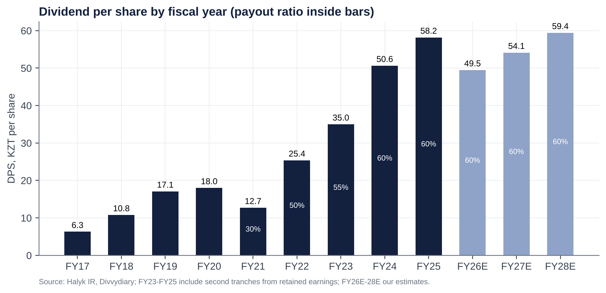{ width=95% }

**Observations.**

1. **Dividends grew ~4.6x (FY21 → FY25),** and now return ~60% of profit.
2. **Buybacks are token.** About US$18–25m was executed against two US$50m caps, under 0.3% of market cap a year. They are a liquidity signal, not a capital tool.
3. **The 2.54bn treasury shares (19% of issued) have never been cancelled.** They accumulated through the 2011 Samruk-Kazyna buyback (213m shares), the 2021–22 repurchases (~0.8bn [d]) and earlier transactions whose origin is not fully disclosed. Cancelling them would not change per-share value, but it would remove a potential re-issuance overhang (management could re-sell treasury stock) and improve transparency.

# Adversarial analysis: bull case, bear case, pre-mortem and contrarian view

## Bull case

1. **The moat is structural.**
   - About half of corporate lending and the largest payroll, pension and deposit franchise give Halyk the lowest funding cost and the most stable client base in the country.
   - A 17–20% cost/income ratio is a cost moat that no competitor except Kaspi matches.
2. **The 2026 trough is regulatory and cyclical, not competitive.**
   - The MRR step-ups are now complete. The 2% retail buffer is phasing in. BNPL and unsecured lending have been re-based.
   - From 2027 the comparisons are easy: fees +10% and insurance normalising. Lower rates cut deposit costs with a lag and revive loan demand.
   - Credit costs should fall as the collector-sale moratorium lifts.
3. **Secular growth.**
   - Loans are only ~26% of GDP.
   - Non-oil GDP is growing ~5%. State infrastructure capex (grid, power, renewables) suits Halyk's corporate franchise.
   - Islamic banking and Uzbekistan add optionality.
4. **Capital return and earnings surprise.**
   - At a 60% payout the yield is 13–15%.
   - If NIM holds at ~6.8% rather than our 6.5%, 2027E EPS is ~5% higher.
   - If management restores the "usual 60%+" and adds special dividends from its 700bp capital buffer, the yield rises further.
5. **Technical re-rating.**
   - Each ALMEX sell-down raises free float, and with it MSCI and FTSE weights.
   - Sovereign upgrades (S&P BBB in Aug-26) lower the cost of equity.
   - A move to 1.5x book (still below the peer median) is worth ~US$50 per GDR.

## Bear case: risks that could permanently impair the business

1. **The state taxes the franchise.**
   - Kazakhstan has shown it will reach into bank profits: the 2025 excess-profit tax, 25% bank CIT, VAT on fees, unremunerated reserves and GEIR caps.
   - With oil revenues at risk (NBK assumes US$75 oil in 2027 and US$65 in 2028) and a fiscal deficit to close, the biggest, most profitable bank is the obvious source. A permanent "bank levy" or forced subsidised lending would compress the sustainable ROE from ~24% toward the high teens.
2. **Retail is lost to Kaspi (and Kim's Alatau City Bank).**
   - Halyk's retail-loan share (17.8%) is far below its asset share. Its Super App engagement (DAU/MAU 33%) trails Kaspi's.
   - The Kaspi co-founder now owns a full bank licence (ex-Jusan). If Kaspi-style execution moves into SME payments and deposits, Halyk's low-cost retail funding, the real moat, erodes.
3. **Asset quality.**
   - Retail NPL 90+ is 9.2%, Stage 3 is 8.6% and Stage 3 coverage has fallen to 58%.
   - If the "mechanical" explanation is wrong, 2026–27 credit costs could reach 2–2.5%, cutting ~KZT100–150bn a year from PBT.
4. **Margin compression and revenue deceleration.**
   - Assets reprice faster than deposits in an easing cycle.
   - A further 150–200bp of cuts in 2027, with sticky deposit rates (Freedom's aggressive pricing), could push NIM toward 6.0–6.2%, about 50bp below our forecast, worth ~KZT100bn of PBT.
5. **High expectations?** Not on P/E (4.5x). But the market already prices a full dividend recovery and ignores the political tail. After a +314% three-year run, the stock sits at the top of its own P/B range.

## Pre-mortem: "It is October 2027, and Halyk GDRs are at US$22. What happened?"

- **Earnings:**
  - 9M26 missed again and the KZT1trn guidance was abandoned. FY26 net income came in at ~KZT870bn.
  - In March 2027 management guided flat 2027 earnings as NIM fell to 6.2%.
  - Retail write-offs after the moratorium ended took CoR to 2%.
- **Supply:** ALMEX sold another 5–7% in December 2026 at a ~12% discount and signalled more.
- **Dividend:** the board cut the payout to 50% to fund the 2% buffer and a new Pillar 2 add-on. FY26 DPS fell ~25% to ~KZT37.
- **Macro:** oil fell to US$70, the tenge weakened to 520, and the government introduced a "temporary solidarity levy" on bank profits.
- **Multiple:** P/B fell back to 0.85x, the 2022–24 average.

**Probability:** ~20–25%. This is our bear case.

**Early warning signs to monitor:**

- 9M26 NIM below 6.6%;
- any dividend-policy language change;
- ALMEX block terms;
- draft budget measures on bank taxation;
- retail NPL formation after May 2026.

## Contrarian view: what the market is refusing to see

- **Consensus frames 2026 as "regulation plus rate cuts = falling earnings".** We think the market underestimates two things.
- **1. Excess capital.**
  - Halyk runs a 19% CET1, all common equity, and a 16.5% equity/assets ratio. That is ~700bp over the regulatory minimum, roughly **KZT800–900bn of surplus capital [e] (~20% of market cap)**, even after the new buffers.
  - Kazakhstan's rules, not economics, keep it on the balance sheet.
  - If ALMEX wants to sell down to 51% at good prices, the best tool is a **special dividend or tender** that returns surplus capital (ALMEX gets 62% of it).
  - The contrarian bull scenario is a capital-return event, not an earnings recovery.
- **2. The market extrapolates the 30%+ ROE era into the cost of equity, not into the earnings.**
  - At 1.08x book the market implies a sustainable ROE of only ~20% at a 19.5% cost of equity.
  - Even our "trough" ROE is 24–25%.
- **The contrarian bear view (also under-discussed).**
  - The real risk is not Kaspi but **policy**. A state that introduced a one-year excess-profit tax in 2025 can introduce a permanent one.
  - The asset-recovery commission includes one of Halyk's own independent directors. The owners' political protection is narrower than in the Nazarbayev era.
  - **That is why we size this as medium conviction and accumulate on overhang events rather than chase.**

# Scenario analysis

| Assumption (12-month view, 2027E basis) | Bear (25%) | Base (50%) | Bull (25%) |
|---|---|---|---|
| Net loan growth 2027 | +5% | +11% | +14% |
| NIM 2027 | 6.1% | 6.5% | 6.9% |
| Cost of risk | 2.1% | 1.5% | 1.2% |
| Net income 2027E (KZT bn) | 800 | 984 | 1,120 |
| EPS 2027E (KZT) | 73 | 90 | 103 |
| ROE | ~20% | 24.5% | ~27% |
| Payout / DPS FY26 | 50% / ~KZT37 | 60% / KZT49.5 | 65% + special / ~KZT60+ |
| Exit multiple | 0.85x P/B (4.2x P/E) | 1.14x P/B (4.9x P/E) | 1.6x P/B (6.2x P/E) |
| USD/KZT | 520 | 465 | 450 |
| **Value per GDR** | **US$23.5 (−29%)** | **US$38.0 (+14%)** | **US$56.2 (+69%)** |
| Plus 12-month dividends (US$) | ~3.0 | ~4.3 | ~5.0+ |

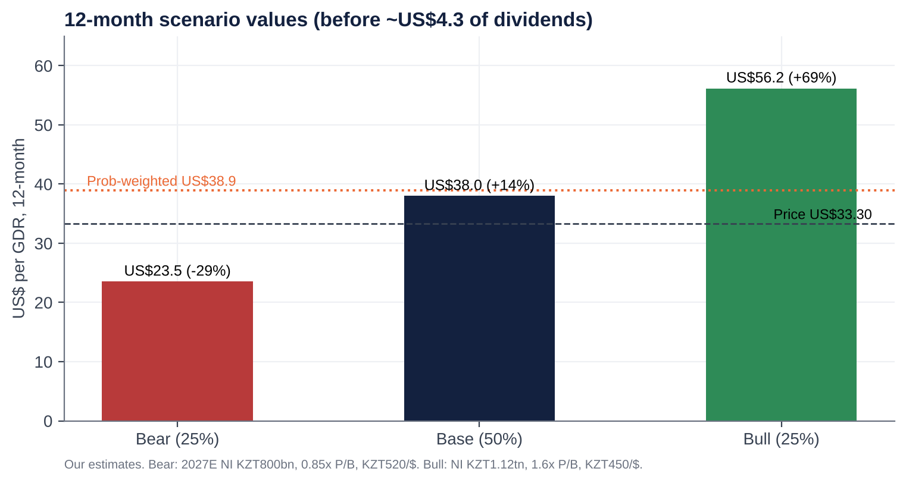{ width=85% }

- **Probability-weighted value:** **US$38.9 (+17%)**, plus ~US$4.2 of dividends.
- **The skew** is about 2.4:1 upside to downside in price terms. The dividend cushions the bear case: even there, a ~9% yield on today's price.

# Fifteen questions for the CEO and Chairman (ordered by information value)

1. With 225bp of rate cuts already, the full-year MRR effect in 2027 and the deposit book repricing with a lag, **where and when does NIM trough?** What share of loans and securities reprices within six months, against deposits?
2. 1H26 annualises to ~KZT900bn of net income. **Is the KZT1.0trn target still achievable?** If not, which line closes the gap: provisions, FX, insurance or fees?
3. **ALMEX's lock-up ends around 25 November.** Do the controlling shareholders intend to sell further, in what size and format? Would the bank participate (a buyback or tender), as it did with Samruk-Kazyna's stake in 2011?
4. Excluding the paused collector sales, **what is the underlying retail NPL formation rate?** How much of the KZT715bn of NPL 90+ will be sold or written off, and at what price relative to carrying value?
5. **What capital level do you run the bank to,** including the 2% retail buffer and the Pillar 2 add-on? Will you commit to returning capital above that level through special dividends or larger buybacks, and to cancelling the 2.54bn treasury shares?
6. Is 60% the floor for the payout? **Would you hold DPS in tenge** if 2027 earnings are flat?
7. What is the 2026–27 **effective tax rate**? What share of profit qualifies for the 20% business-lending rate rather than 25%? How exposed are you to a revival of the excess-profit tax?
8. Where precisely are you **losing to Kaspi**, and to Alatau City Bank under Vyacheslav Kim, in retail, SME and payments? What would take Super App DAU/MAU from 33% toward Kaspi's level?
9. As sovereign upgrades open cheaper Eurobond and DBK/Baiterek funding to large corporates, **how concentrated is your corporate book** (top 20 borrowers, quasi-state share)? How do you defend pricing?
10. Why did the **Click/Uzbekistan** transaction lapse, and on what terms would you revisit it? What is the capital limit for foreign expansion?
11. What caused the **2Q26 insurance loss** (OSAGO tariffs, the model change)? What is normalised insurance profit?
12. Why was the auditor changed to **EY** with effect from the 9M26 review rather than at a year-end? Were there any disagreements with the predecessor auditor?
13. Why was the Chairman **reclassified as non-independent**? Will the board return to an independent majority and disclose individual pay and a TSR-linked LTIP?
14. After 18 years under the current CEO, **what is the succession plan,** and who are the internal candidates?
15. How does the board stress-test the dividend against **quasi-fiscal risk**: profit levies, rate caps, directed lending? What dialogue do you have with the government on these measures?

# Short-seller and forensic review

## Dismantling the bull case

- **What could structurally break the way Halyk makes money?** The spread business depends on three subsidies the state can withdraw at will:
  1. a high policy rate earned on idle liquidity (NBK notes);
  2. a deposit base that pays ~10% while the policy rate is 15.75–18%;
  3. a light tax regime.
  - All three are now moving against the bank at once: rate cuts, MRR sterilisation and a 25% CIT. 2021–25 earnings were a rate-cycle windfall dressed up as a franchise.
- **Revenue concentration.**
  - About half of loans are corporate, concentrated in a small number of state-linked and resource groups that Halyk does not name.
  - As the sovereign is upgraded, those groups gain access to cheaper Eurobond and DBK funding. Every refinancing elsewhere takes high-quality spread out of the book and leaves the riskier retail book behind.
  - Separately, ~73% of revenue is NII. The fee base is shrinking (−20% in 1H26).
- **Why the moat is weaker than bulls think.**
  - Halyk's retail moat is heritage, not product. Kaspi won the young consumer and the payment habit.
  - Mortgage portability (introduced October 2026) and app-based banking reduce retail switching costs.
  - Its corporate moat is partly a state-relationship moat, which works only as long as the owners' political standing holds.
- **The most dangerous competitor bulls underestimate: Kaspi's founders, now with a second, full-service bank.**
  - Vyacheslav Kim bought Jusan (Alatau City Bank) in July 2025.
  - A Kaspi-run balance-sheet bank aimed at SME and corporate deposits would attack Halyk's cheapest funding with better technology.
  - Freedom Bank (+15% YTD) is already buying deposits at high rates.
- **The worst capital allocation decisions.**
  1. Growing BNPL and unsecured retail aggressively into 2024–25, now producing a 9.2% retail NPL rate and a fee collapse.
  2. The KSF deposit accounting loss (~KZT145bn pre-tax in 2024).
  3. Agreeing to pay US$176m for 49% of an Uzbek payments app while selling 49% of its own bank for US$61m, a deal that then lapsed.
  4. Hoarding 2.54bn treasury shares and ~KZT800bn+ of surplus capital rather than returning it.
- **Related parties and incentives.**
  - The controlling family relies on dividends: ALMEX's holding pays out ~KZT462bn to its owners. That aligns payout with minorities, but also means the family prefers dividends to buybacks (which do not pay ALMEX cash).
  - Management pay rose +55% (2022–25), is disclosed only in aggregate and has no visible TSR linkage.
  - The related-party note could not be reviewed: **a gap, not a clean bill.**
- **What must hold to justify the current price?**
  - At 4.5x earnings and a 13% yield, the price assumes:
    - a sustainable ~20% ROE;
    - a 60% payout maintained;
    - no permanent bank levy;
    - an orderly ALMEX sell-down;
    - the tenge broadly stable.
  - In Gordon terms, KZT374 = KZT49.5 ÷ (19.5% − g) implies g of ~6%, i.e. **negative real dividend growth**. That is a low bar, which is why we are not short.
- **What if growth disappoints by 20–30%?**
  - 2027E EPS of KZT63–72 at today's 4.1x forward P/E gives **KZT259–296, or US$22–26 per GDR (−23% to −33%)**.
  - The dividend at a 60% payout would drop to KZT38–43, still a 10–12% yield on today's price. That is the floor argument.
- **The single scenario that would permanently impair the business.** A political break with the owners, for example:
  - an asset-recovery action against Nazarbayev-family holdings;
  - a forced transfer of the ALMEX stake at a discount;
  - Halyk being used as a quasi-fiscal instrument (directed lending, profit levies).
  - **Plausibility:** low, roughly 5–10% over three years. Tokayev's government has left the Kulibayevs' banking interests alone since 2022 and allowed an orderly market sell-down. But the risk is not zero, and it is not diversifiable.

## Accounting and financial-statement red flags

| Area | Finding | Risk |
|---|---|---|
| **Revenue recognition** | Interest accrues on Stage 3 loans (8.6% of the book) at net carrying value. Rising Stage 3 with falling coverage (58%) flatters NII. | Medium |
| **Provisioning** | ECL +69% but coverage of Stage 3 fell from ~73% to 58%. ARDFM flagged "discrepancies in banks' reserves of hundreds of billions of tenge" in a February 2026 review (sector-wide) [u]. | **Medium–High** |
| **Recurring "one-offs"** | 2024 KSF deposit loss; 1Q25 SPV workout gain; 2025 excess-profit tax; 2Q26 insurance model change. A one-off every year obscures the run-rate. | Medium |
| **Segment reporting** | Segment P&L sits only in the audited IFRS note; press releases give growth rates and loan volumes only. | Medium |
| **Restatements and reporting changes** | IFRS 17 restated 2022 (NI 553.8 → 569.5). The FY24 release re-presented 2023 (NII 810.5 → 797.1; fees 100.4 → ~113.7; ROAE 32.5% → 32.1%). Reclassifications, not errors. | Low–Medium |
| **Leases** | Branch leases; immaterial. | Low |
| **Related parties** | Controlling family (ALMEX); associate Altyn Bank with board overlap. The note was not reviewed. | Medium (unverified) |
| **Contingencies** | Legacy Kazkom/BTA workout assets in SPVs; tax exposure under the new code; state-programme obligations. | Medium |
| **Stock-based compensation** | Minimal. Up to 1% of shares may be allotted to staff without pre-emptive rights (Dec-24 authority). | Low |
| **Goodwill and intangibles** | Immaterial relative to equity (Kazkom bought for a nominal sum) [u]. | Low |
| **Cash-flow statement** | Bank operating cash flow is volatile and driven by deposit and loan flows. The dividend is covered by capital generation (ROE × retention ≥ RWA growth). | Low |
| **Auditor** | Moved to EY from the 9M26 review (EGM of 25-Sep-26) after the FY25 audit (Deloitte [u]). A mid-year switch is unusual. | Medium (needs explanation) |

## Governance and forensic checklist (13 points)

| # | Test | Verdict | Comment |
|---|---|---|---|
| 1 | Quality of earnings | **Amber** | Core PPOP is solid, but "one-offs" recur and coverage is falling while NPLs double |
| 2 | Constant reporting changes / restatements | **Amber** | IFRS 17 and 2023 re-presentation; consistent since |
| 3 | Opaque or misleading reporting | **Amber** | Good quarterly disclosure and consensus publication; weak on segment P&L, related parties and pay |
| 4 | Organic growth transparency | **Green** | Growth is organic; M&A minimal since 2017 |
| 5 | Selective disclosure (RNS vs press release) | **Green** | Same-day RNS, KASE and AIX releases; company-compiled consensus published |
| 6 | Adversarial towards criticism | **Green** | No evidence; management engages on calls |
| 7 | Dividend emphasis vs FCF support | **Green/Amber** | 60% payout backed by capital generation; but management uses the dividend to anchor sentiment while earnings fall |
| 8 | Management quality | **Green** | Long, successful tenure; key-person and succession risk |
| 9 | Nomadic financiers chasing fads | **Green** | Shareholder base is ALMEX plus long-only frontier/EM funds; buyers of the 2025 placement held as the stock rose ~45% [e] |
| 10 | Related-party transactions | **Amber/Red** | Politically exposed controlling family; note not reviewed; board chair links to the associate |
| 11 | Regulatory risk | **Red** | Excess-profit tax precedent, 25% CIT, MRR, retail caps; the state is the biggest risk to returns |
| 12 | Hidden liabilities | **Amber** | Insurance reserves (model change), legacy SPVs, potential tax disputes |
| 13 | Terminally challenged balance sheet | **Green** | 19% CET1, 16.5% equity/assets, loans/deposits <100% |

# Timeline of key events and catalyst calendar

## Key past events

| Date | Event |
|---|---|
| Dec-2006 | LSE GDR IPO at US$16 (US$680m raised) |
| Jan-2009 | Umut Shayakhmetova becomes CEO; Samruk-Kazyna crisis stake |
| Mar-2011 | Halyk and ALMEX buy back Samruk-Kazyna's stake (KZT126.8 per share) |
| Dec-2014 | Acquires HSBC Bank Kazakhstan (US$176m), renamed Altyn Bank |
| Jul-2017 | Acquires 96.81% of Kazkommertsbank for KZT2 (state absorbs KZT2.4trn of BTA exposure) |
| Apr-2018 | Sells 60% of Altyn Bank to China CITIC and Shuangwei |
| Dec-2018 | Legal merger with Kazkommertsbank completed |
| Oct-2019 | Secondary GDR offering at US$11.75 |
| Jan-2022 | "Bloody January" unrest; GDR −16% to −20% |
| Feb/Mar-2022 | Russia invades Ukraine; GDR −45% from end-2021 to the ~US$8.6 trough |
| Dec-2022 | Exits Russia (Moskommertsbank) and Tajikistan |
| May/Dec-2023 | Board renewals; Kulekeyev (asset-recovery commission) joins |
| 1Q-2024 | KZT66bn one-off loss on early repayment of the KSF deposit |
| Apr-2024 | Exits Kyrgyzstan |
| Sep-2024 | GDR buyback launched; Dec-2024 first second-tranche dividend (KZT9.57) |
| Mar-2025 | NBK hikes to 16.5%; new deputy CEOs |
| Jul-2025 | Click/Tenge Bank deal agreed (later lapsed) |
| Sep/Oct-2025 | Second FY24 dividend (KZT21); NBK hikes to 18%; US$50m buyback |
| Nov-2025 | ALMEX sells 7.6% at US$23 (US$475m); 365-day lock-up |
| 1-Jan-2026 | New Tax Code: bank CIT 25%, VAT 16% |
| 19-Mar-2026 | FY25 results (record); first guided profit decline (2026 ~KZT1trn) |
| Apr-2026 | 2% retail buffer starts; AGM elects new board; Almex Holding Ltd (AIFC) takes over ALMEX |
| 5-Jun-2026 | NBK begins cutting (18% → 17%) |
| 18-Aug-2026 | 1H26: NI −15.3%; 2Q missed consensus by 14%; guidance kept |
| 21-Aug-2026 | S&P upgrades Kazakhstan to BBB |
| Sep-2026 | Second FY25 dividend (KZT28.09) paid 7-Sep; rating affirmations (Moody's, Fitch; S&P outlook positive); EGM 25-Sep: EY auditor, Islamic licence |
| 23-Oct-2026 | NBK cuts to 15.75% (−50bp) |

## Upcoming catalysts

| Timing | Event | What to watch | Importance |
|---|---|---|---|
| Late Oct / early Nov 2026 | 9M26 results call invitation | Date confirmation | Low |
| 9-Nov-2026 | Kaspi.kz 3Q26 results | Retail and payments read-across; Kaspi's lending growth | Medium |
| ~13–19 Nov 2026 [e] | **Halyk 9M/3Q26 results and call** | Whether the KZT1trn target survives; NIM after the Sep MRR step; NPL trend after the moratorium; dividend language | **High** |
| ~25 Nov 2026 | **ALMEX lock-up expiry** | Any block or placement (size, discount); bank participation | **Critical** |
| 4-Dec-2026 | NBK base-rate decision | Pace of easing (NBK signalled a hold) | Medium |
| Dec-2026 – Feb-2027 | 2027 budget measures; ARDFM rule changes (total-debt cap, large-loan limits) | Any bank levy or new caps | High |
| Feb-2027 | MSCI quarterly index review | Weight change from higher free float | Medium |
| Mar-2027 | FY26 results and **2027 guidance** | NIM, CoR and ROE guidance; payout | **High** |
| Apr-2027 | 2% retail buffer fully phased in; AGM (first FY26 dividend tranche) | DPS vs our KZT49.5 | **High** |
| 2027 | Islamic banking licence; Click/Uzbekistan resolution; Tengiz maintenance (oil volumes) | Optionality and macro | Low–Medium |

# Appendix: methodology, sources and data limitations

- **Tools and access.**
  - S&P Global Capital IQ (Adaptive Retrieval and MCP) and ProntoNLP were not available in this session, and direct page access was blocked by the environment's network policy.
  - Facts were gathered from web-search extracts of primary documents: Halyk press releases and RNS (FY21–1H26), KASE notices, Halyk IR pages (dividends, ownership structure at 1-Apr-26), the 2024/2025 annual reports (via extracts), Edison and Freedom Broker notes, ARDFM/NBK releases, rating-agency announcements, and Interfax-Kazakhstan, Kursiv, Forbes.kz, Orda.kz, bes.media and Kapital.kz.
- **Not retrieved:**
  - the IFRS segment note;
  - the related-party note;
  - top-20 borrower concentration;
  - named GDR holders;
  - the full bond maturity ladder;
  - daily price files.
  - Related figures are estimates [e] or derived [d] as marked.
- **Peer data** are aggregator snapshots (Jun–Oct 2026) and should be refreshed on a terminal before trading.
- **Model.** Our estimates use a simple driver model (average earning assets × NIM; fees; insurance and other; opex; CoR on average loans; ETR; payout). Valuation blends P/E, P/B and residual income (COE 19.5% KZT, terminal growth 8%). FX assumptions: KZT449/US$ spot; 465 for the 12-month forward; 460/470/490 averages for 2026–28.
- **Tags:** [u] unverified / single source; [e] our estimate; [d] derived by calculation.
