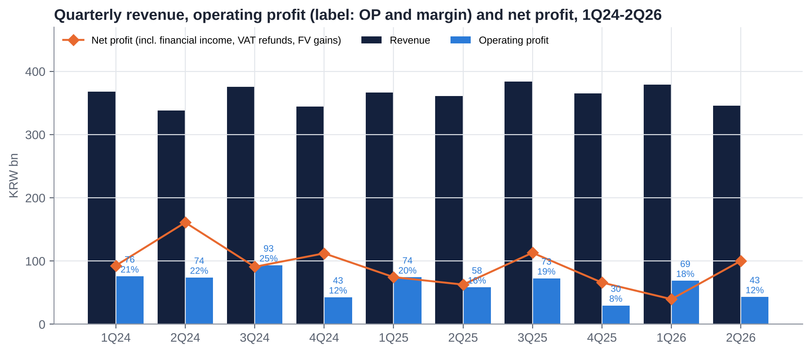
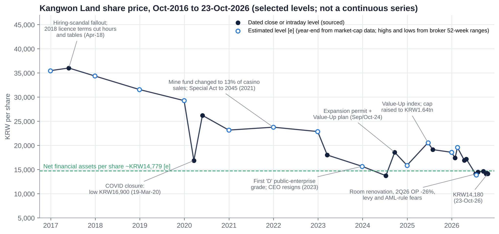
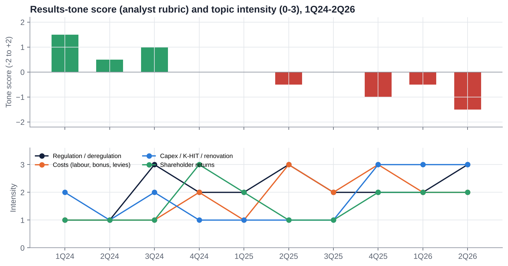
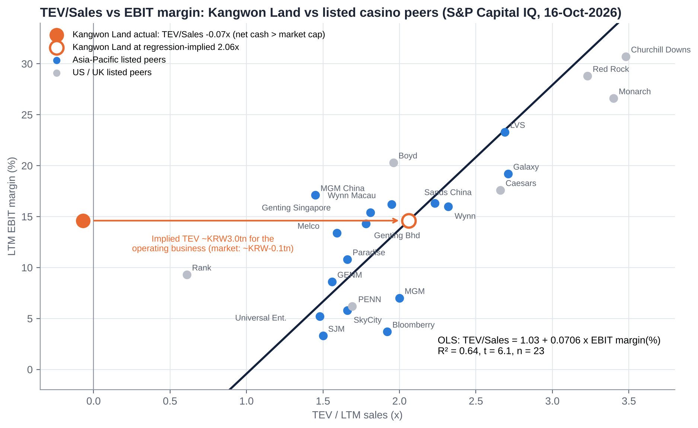
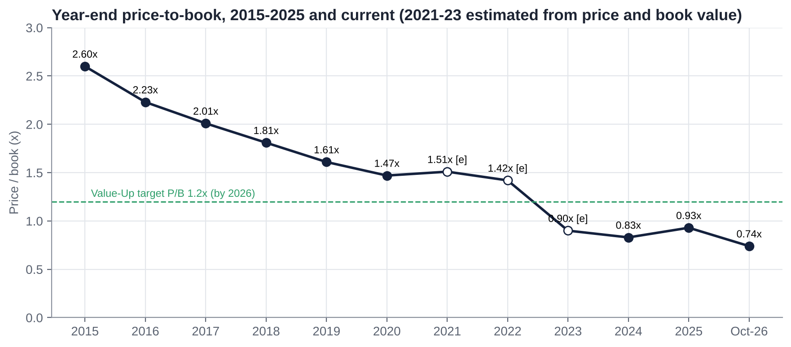
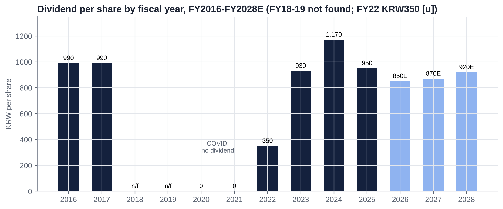
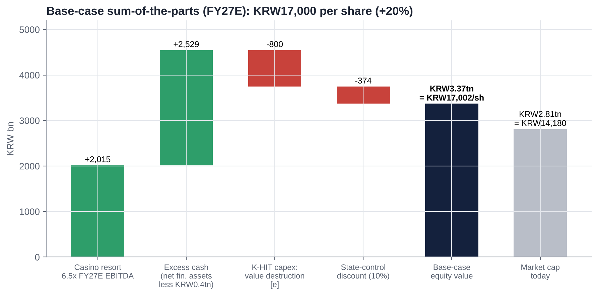
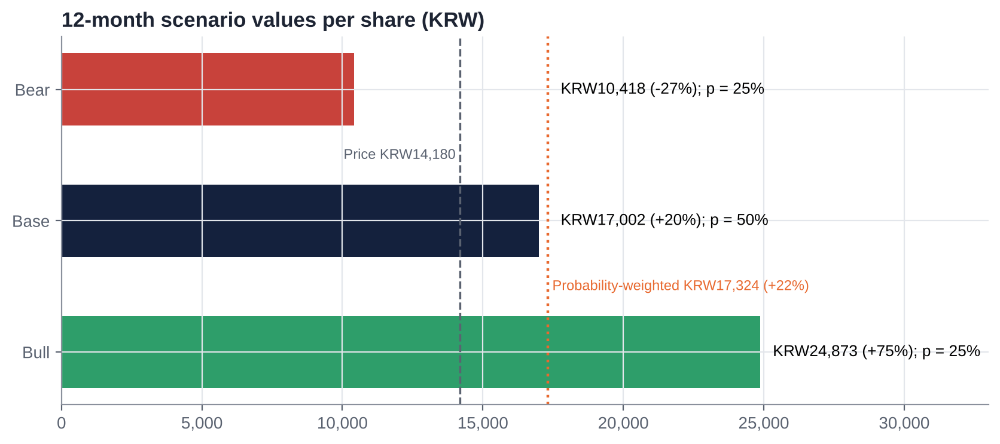

# Kangwon Land Inc. (035250 KS / KRX 035250): Equity Research Deep-Dive

**Value / event-driven special situation | Casinos & Gaming | South Korea | 25 October 2026**

> **Recommendation: BUY (value / event-driven, medium conviction). 12-month target KRW17,000 (+20%); probability-weighted value KRW17,300 (+22%); bear case KRW10,400 (−27%); plus a ~6% dividend yield.** Kangwon Land is the only casino in Korea that Koreans may enter, and its licence runs to 2045. It has no debt and holds ~KRW2.9tn of net financial assets [e]. That is slightly more than its KRW2.81tn market cap, so the market gives the casino resort (~KRW305bn of LTM EBITDA) a value of roughly zero. The discount reflects real problems: a ~KRW3tn expansion plan (K-HIT), a political CEO, a 42% government take, and new levy and anti-money-laundering (AML) proposals. Three things are turning in shareholders' favour. The controlling shareholder is a cash-hungry state agency with negative equity that needs dividends. Korea's 2025-26 Commercial Act reforms give minorities real levers (cumulative voting, a 3% cap on the controller in audit-committee votes, mandatory treasury-share cancellation). And the proposed tourism-levy rise may exclude Kangwon Land.

| Key data (23-Oct-2026 close) | | Key data | |
|---|---|---|---|
| Share price | KRW14,180 | Largest shareholder | KOMIR 36.27% (state); public bodies 51.01% in total |
| 52-week range | KRW13,920-19,590 [u: high 19,590-19,770] | Free float | ~41.6% (treasury 7.36%) |
| Market cap (ex-treasury) | KRW2.81tn / US$2.1bn [e] | Shares issued / outstanding | 213.94m / ~198.2m [e] |
| Net financial assets [e] | ~KRW2.93tn (~KRW14,780/share; 104% of price) | Enterprise value [e] | about −KRW0.12tn (negative) |
| LTM revenue / OP / EBITDA (Jun-26) | KRW1,474bn / 215bn / ~305bn [e] | Latest broker targets (Jun-Oct 2026) | KRW18,000-20,000 (all BUY) |
| P/E LTM / FY26E (ours) | 8.8x / 11.3x | Dividend | FY25 KRW950 (6.7%); FY26E KRW850 (ours, 6.0%) |
| P/B | ~0.74x [u] | Value-Up targets (FY24-26) | Payout ≥50%, total return ≥60%, P/B 1.2x |
| Ex-cash P/E (FY27E operating NOPAT) [e] | ~1.8x | Next catalyst | 3Q26 results (~28-Oct to 4-Nov-2026) |

# 1. Executive Summary and Investment Conclusion

## 1.1 The set-up in one paragraph

Kangwon Land runs **High1 Resort** in Jeongseon, a former coal-mining county in Gangwon Province. It was created under a 1995 special law to regenerate abandoned mining towns. Its casino is the **only one of Korea's 17 casinos open to Korean nationals**, and the law that grants this exemption now runs to 31-Dec-2045. It earned **KRW1.48tn of revenue in FY2025** (about 87% from the casino) and KRW235bn of operating profit. But governments took **KRW603bn, or 42% of gaming revenue**, through two levies (the tourism fund, 10% of sales, and the mine-region fund, 13% of casino sales) plus taxes. The company has **no debt and ~KRW2.9tn of net financial assets [e]**, so at KRW14,180 the market capitalisation (KRW2.81tn) is below the cash. The shares are **down 27% from their February high** and 60% from their 2016-17 levels. The causes are a hotel renovation that will run until 2028 (2Q26 operating profit −26%), a proposal to raise the casino tourism levy to 15%, a draft AML rule that management says could cut revenue by 26%, and the appointment of a Democratic Party politician and former army general as CEO in September 2026.

## 1.2 Investment thesis: four forces converging

1. **The casino is in the price for free.** Net financial assets of ~KRW2.93tn [e] exceed the KRW2.81tn market cap. After a KRW0.4tn operating reserve, the market values a statutory monopoly earning ~KRW305bn of EBITDA at **~0.9x EBITDA** (listed peers 7.4x NTM; casino deals 9.2x). The peer regression implies ~KRW3.0tn for the operating business alone.
2. **The controller needs cash, so payouts are politically safe.** KOMIR (36.27%) has **negative equity of KRW3.16tn** and KRW8.06tn of liabilities. Public bodies receive **~55% of every dividend** (KOMIR 39%, mine-region municipalities and Gangwon ~16%). The Value-Up plan (payout ≥50%, total return ≥60%) has been met for two years, and Korea's new separate taxation of dividends (2026-28) rewards high payers.
3. **New legal levers for minorities.** Under the 2025-26 Commercial Act amendments:
   - Cumulative voting became mandatory for companies with assets ≥KRW2tn from 10-Sep-2026.
   - Audit-committee elections cap the largest shareholder at 3%.
   - Treasury shares must be cancelled. The deadline for existing holdings is ~Sep-2027 unless shareholders approve retention each year.
   - Kangwon Land holds **7.36% in treasury**.
   - How these interact with the Public Institutions Act is untested [u].
4. **The levy and capex risks are arguably over-priced.**
   - **Levy:** an official at the Ministry of Culture, Sports and Tourism (MCST) said Kangwon Land is expected to be **excluded** from the 15% levy because it already pays 13% to the mine fund [u]. Kangwon Land fell only ~3% in the levy week while Paradise fell 23%.
   - **K-HIT:** the new CEO's Organisational Diagnosis and Innovation Committee (Oct-Dec 2026) is reviewing the feasibility of the ~KRW3tn K-HIT plan, a chance to rescope it.

## 1.3 Why it is cheap: what the bears are right about

- **Earnings are falling.** Operating profit fell 18% in FY25 and 16% in 1H26. Our FY26E OP of KRW201bn is 18% below the May consensus, because 757 rooms (~41%) are closed until Nov-27 to Apr-28 and labour and bonus costs keep rising.
- **The cash may not belong to minorities in practice.** K-HIT targets ~KRW3tn of capex to 2035, roughly the whole cash pile, at a remote mountain site. A state enterprise has little incentive to earn its cost of capital.
- **Governance is political.**
  - The CEO post was filled by acting CEOs for ~32 months; a DP politician and ex-general without casino experience was then appointed.
  - The company received a "D" in the 2023 public-enterprise evaluation and "C" for FY24 and FY25.
  - The Aug-2026 EGM amended the articles to allow treasury shares to be **kept or sold**.
- **Regulatory tail risks are real:**
  - the AML customer-due-diligence rule (company estimate: revenue −25.8%);
  - a possible Korean-access casino at Saemangeum, after President Lee mentioned a "public casino" (Dec-25);
  - the 15% levy;
  - the 2045 sunset.

## 1.4 Valuation and scenarios

| | Bear (25%) | Base (50%) | Bull (25%) |
|---|---|---|---|
| Key assumption | Levy applies and AML partly enforced (EBITDA KRW240bn) at 5.0x; K-HIT destroys KRW1.3tn; 15% state-control discount | FY27E EBITDA KRW310bn at 6.5x; K-HIT destroys KRW0.8tn; 10% discount | FY28E EBITDA KRW345bn at 8.0x after deregulation and the second casino; K-HIT disciplined (−KRW0.2tn); 5% discount |
| Value per share | **KRW10,400 (−27%)** | **KRW17,000 (+20%)** | **KRW24,900 (+75%)** |

**Probability-weighted value: KRW17,300 (+22%)**, plus a ~6% dividend yield. **12-month target: KRW17,000.** Broker targets cluster at KRW18,000-20,000 after the August cuts (iM KRW18,000 on 23-Oct).

## 1.5 What has to go right

- Kangwon Land is excluded from the 15% tourism-levy bracket, or the increase is diluted to below ~KRW30bn a year.
- The AML due-diligence rule is modified (thresholds or exemptions) rather than applied to every chip purchase.
- FY26 DPS is held at ≥KRW850, and the next Value-Up plan (FY27-29, due ~Feb-2027) keeps total return ≥60%.
- The 7.36% treasury stake is cancelled by the Commercial Act deadline (~Sep-2027) rather than retained.
- K-HIT is phased with disclosed IRR hurdles, keeping net financial assets ≥KRW2tn through 2030.

## 1.6 Positioning

**Value / event-driven, medium conviction. Build a full position over 4-6 weeks.** Liquidity is only ~KRW4.8bn (~US$3.6m) a day [e], so a 5% stake would take ~6-7 months at 20% of volume. Add on:

- 3Q26 results (late Oct / early Nov) showing casino drop holding;
- formal confirmation that Kangwon Land is outside the levy bracket;
- an FY26 DPS of ≥KRW850 (Feb-2027) or a treasury-cancellation resolution.

A possible pair, **long Kangwon Land / short Paradise or Lotte Tour**, isolates the levy exclusion and the domestic net-cash floor from China VIP and won exposure.

**Hard review triggers:**
- the AML rule enacted unmodified;
- a legislated Korean-access casino outside Jeongseon;
- FY26 DPS below KRW700, or payout below 50%;
- K-HIT exempted from the feasibility study with no IRR disclosure;
- a disposal of treasury shares to a related party.

# 2. Layman's Guide: What Kangwon Land Does and How It Makes Money

**In one sentence:** Kangwon Land owns a large mountain resort three hours east of Seoul. Its centrepiece is the only casino in South Korea where Korean citizens are allowed to gamble, and it surrounds the casino with hotels, a ski resort, a golf course and a water park.

**How the money is made.** Like any casino, Kangwon Land keeps the net amount that customers lose over time (gross gaming revenue). In Korea, citizens are barred from the 16 other casinos, which serve only foreigners. Kangwon Land exists by legal exception, to bring jobs and tax money to the former coal-mining towns of Jeongseon, Taebaek, Samcheok and Yeongwol. Most customers are ordinary Korean mass-market players on table games (mainly baccarat) and slot machines. A smaller group of "member" (VIP) players bet more. The hotels, ski runs and water park bring families and give the region a reason to exist beyond gambling, but they are small contributors to profit.

**The government is the biggest partner.**
- Out of every KRW100 of gaming revenue in 2025, about KRW25 went to two public funds:
  - the Tourism Promotion and Development Fund, 10% of sales;
  - the Abandoned Mine Region Development Fund, 13% of casino sales since 2021.
- About KRW17 went in national and local taxes.
- Shareholders' operating profit was about KRW16.
- The State also owns 51% of the company, so it collects a second time through dividends.

**How each activity contributes:**

| Activity | What it is | Revenue (latest) | Share of revenue | Trend |
|---|---|---|---|---|
| Casino | 200 tables and ~1,360 machines (permit to expand to 250 / 1,610), 20 hours a day; mass floor plus member (VIP) lounges | ~KRW1.28tn FY25 [e]; 2Q26 casino GGR ~KRW282bn [u] | ~87% | Mass flat to down; VIP up after the 2025 betting-limit rises; member lounges +27.6% in 1Q26 |
| Hotels and condos | Grand Hotel, High1 Hotel, Mountain Condo, Palace Hotel [u]; ~1,850 rooms [e], of which 757 are under renovation from Mar-26 | 2Q26 non-gaming KRW25.7bn (−12.3%) | ~13% (non-casino, all lines) | Down 20-30% a quarter during the renovation |
| Ski, golf, water park, theme park | High1 ski resort, golf course, High1 Water World (opened 2018), Choo Choo Park (subsidiary) | Included above | | Ski visitors −20% in 1Q26; Water World repaired and reopened Apr-26 |

Source: company results via press (ASGAM, ddaily, newstomato), IB Tomato, NGCC. [e] = our estimate; [u] = unverified.

**What changed in 2026:**
- **Renovation:** a ~KRW200bn renovation of 757 rooms began in March, cutting non-casino revenue until 2028.
- **New CEO:** after ~32 months of acting heads, the government installed a permanent CEO (Kim Do-kyun, 2-Sep-2026).
- **Policy proposals:** the government floated a 15% casino tourism levy (July) and AML rules (July).
- **K-HIT:** the company is pursuing its ~KRW3tn plan to 2035, targeting 13m visitors and KRW3.5tn of revenue, which would more than double the business.

# 3. Business Model, Products, Customers, Suppliers and Competitors

## 3.1 Business model in simple terms

Kangwon Land is a **regulated, state-controlled, single-site domestic gaming monopoly** with a large financial balance sheet. Its economics rest on four things:

- **Legal exclusivity.** The Special Act on Assistance to the Development of Abandoned Mine Areas (1995, extended in 2021 to 2045) lets Koreans gamble only here. Korea's other 16 casinos are foreigner-only. Illegal gambling (KRW95.9tn in 2025, 3.7x the legal market) is the real competitor.
- **Capacity and rules set by the State.** Ministry of Culture, Sports and Tourism (MCST) permits fix tables, machines and floor area. The National Gambling Control Commission (NGCC) sets an annual **sales cap** (KRW1.64tn for 2025, not binding at ~KRW1.43tn of gaming revenue). Hours (20 a day), entry days (15 a month) and bet limits are prescribed.
- **A high, mostly variable government take.**
  - The tourism fund levies 10% of sales; the mine fund 13% of casino gross sales.
  - Individual consumption and education taxes are collected through the KRW9,000 admission fee [u].
  - Corporate tax is ~26% [e].
  - This leaves an operating margin of ~15% today, against ~30-35% before the 2021 change to the mine fund [u].
- **Fixed costs and a cash pile.**
  - Labour, depreciation and resort upkeep are largely fixed, so small revenue changes swing profit. In 2Q26, revenue fell 4.2% and OP fell 26.2%.
  - About half of net profit now comes from financial income on the KRW2.8-2.9tn portfolio.

## 3.2 Key products and services

| Asset | Products / capacity | Notes |
|---|---|---|
| High1 Casino (Korean floor) | 200 tables, ~1,360 machines (MCST permit of Sep-2024: 250 tables, 1,610 machines, floor 14,513 → 20,261 m²) | Expansion depends on the second casino (KRW179.6bn, completion Dec-2027) |
| Member (VIP) lounges | Higher limits since May-2025 (baccarat minimum KRW50k → 500k; banker/player differential KRW2m → 30m) | VIP drop +46% in the following quarter; 3Q25 VIP revenue +23.6% |
| Foreigner zone (pilot) | Opened Feb-2025; now open to permanent residents; maximum bet KRW300k → KRW300m pending rule change | Small; a future growth option |
| Hotels and condos | ~1,850 rooms [e]; 757 under renovation (Grand Hotel main tower 477 rooms to ~Apr-2028; Mountain Condo 280 rooms to ~Nov-2027) | Infinity pool (KRW7.5bn, 2025) |
| High1 ski resort, golf, High1 Water World | Seasonal leisure | Water World cost KRW167.2bn (2018) |
| Subsidiaries | High1 Choo Choo Park (99.6%), High1 Entertainment (100%) | Persistent losses and impairments (Section 20) |

## 3.3 Main customers

- **Korean mass-market players** are the core of the business. There were ~559k casino visits in 2Q26 and ~660k in 3Q25, roughly 2.4m a year [e]. Many visit repeatedly, which is why the 15-days-a-month entry cap exists.
- **Member (VIP) players** pay higher stakes in the lounges; their visits rose 18% in 2Q26, but hold was unfavourable.
- **Leisure guests:** skiers, golfers, families at the water park, and corporate events.
- **Foreigners** (a small pilot zone) and permanent residents.
- No customer is material on its own.

## 3.4 Main suppliers and counterparties

| Category | Named counterparties |
|---|---|
| Owners / State | KOMIR (36.27%); Jeongseon County (5.02%), Gangwon Development Corp (4.57%), Gangwon Province (1.45% [u]), Samcheok (1.33%), Taebaek (1.30%), Yeongwol (1.08%); MOTIE (CEO recommendation), MOEF (non-standing directors) |
| Regulators | MCST (licence, permits, bet limits); NGCC (sales cap, soundness evaluation); Financial Intelligence Unit (AML); Ministry of Economy and Finance (public-institution evaluation) |
| Gaming equipment | Global slot and electronic-table-game makers and tables [u: vendors not disclosed in our sources]; in-house **"KL Saberi"** slot brand developed with local SMEs |
| Construction | Room renovation and second casino (contractors not disclosed [u]); K-HIT design and feasibility advisers [u] |
| Fund beneficiaries | Tourism Promotion and Development Fund (MCST); Abandoned Mine Region Development Fund (Gangwon and the four mine-region municipalities) |
| Labour | Union-represented workforce; local hiring commitments |

## 3.5 Competitors

| Segment | Competitors | Listed? |
|---|---|---|
| Korean nationals (legal) | None; the monopoly runs to 2045. Potential: a Saemangeum IR with Korean access (Jeonbuk proposal, Jul-2026; needs a special act) | n/a |
| Korean nationals (illegal) | Illegal online casinos (KRW21.5tn), sports betting and offline gambling; overseas trips to Macau, the Philippines and Cambodia | No |
| Other legal gambling (substitutes) | Horse racing (KRA), cycle and motorboat racing, lottery and Sports Toto | State-run |
| Foreigner-only casinos | Paradise (A034230), GKL (A114090), Lotte Tour / Jeju Dream Tower (A032350), Inspire (Bain-controlled), Jeju operators | Mostly listed |
| Future regional supply | MGM Osaka IR (autumn-2030), Philippines, Vietnam, Cambodia | Via parents |

## 3.6 Key markets and geographies

Essentially **100% domestic (Korea)**, from a single site in Jeongseon, Gangwon Province. Customers come mainly from the Seoul metropolitan area and the eastern provinces. Kangwon Land has no foreign-currency exposure and does not depend on China, which separates it from Paradise, GKL and Lotte Tour (sold off in Oct-2026 on Chinese capital controls and a strong won).

## 3.7 Contracts and key payment terms

| Contract / rule | Key terms |
|---|---|
| Special Act on Abandoned Mine Areas | Korean-access exception to **31-Dec-2045** (extended from 2025 in 2021); public shareholders must hold ≥51%; mine-fund levy **13% of casino gross sales** (from 25% of profit before 2021), payable even in a loss year |
| Casino licence (Tourism Promotion Act, MCST) | Renewal conditions have cut hours and tables before (2017 renewal: −2 hours from Apr-2018; general tables 180 → 160). The Jul-2026 proposal adds **5-year licence renewal** and prior approval of major-shareholder changes |
| Tourism Promotion and Development Fund | 10% of annual sales above KRW10bn; proposal to add a **15% bracket** (reportedly on sales above KRW300bn per venue [u]); applicability to Kangwon Land disputed |
| NGCC sales cap | KRW1.434tn (2024), KRW1.64tn (2025) after an "S" soundness grade; breaches (2013-16) bring extra levies and orders to curtail operations |
| Entry and admission | KRW9,000 admission (individual consumption tax 6,300, education tax 1,890, VAT 810 [u]); 15-days-a-month limit triggers restrictions |
| Payment terms | Cash and chip play; no casino credit to Korean nationals [u]; comps (>KRW100bn accrued a year, >70% spent at Kangwon Land outlets) |

Source: Special Act (2021 amendment), kidd.co.kr, MCST, NGCC, Hankyung, Newsis, MTN, Bizhankook. [u] = unverified.

# 4. Key Business Drivers

| Driver | Mechanism | Latest reading | Sensitivity / direction |
|---|---|---|---|
| **Visitation (mass)** | Base for casino drop | 2Q26 visitors 559,481 (−3.3%); mass wagers −3.9% | 1% of casino revenue ≈ KRW12.8bn of revenue, ~KRW8-9bn of OP after levies [e] |
| **Hold / VIP mix** | Member lounges add volatility | 2Q26 VIP visits +18%, wagers +7.2%, revenue −7.6% (low hold); 3Q25 low hold | ±0.5pt of hold on VIP can swing a quarter's OP by ±KRW10-15bn [e] |
| **Regulation (capacity)** | Tables, machines, hours, entry days, bet limits | Permit to 250 tables / 1,610 machines (Sep-24), effective with the second casino (~2028); higher bet limits May-25 | A 25% capacity rise would be the biggest organic lever after 2028 |
| **Levies and taxes** | 10% tourism fund + 13% mine fund + taxes | 2025 government take KRW603bn (42% of gaming revenue) | A 15% bracket above KRW300bn would cost ~KRW56bn a year (~26% of LTM OP) [e] |
| **AML / customer due diligence** | Full ID checks on every chip purchase | Company estimate: −25.8% revenue (~KRW330bn) | Worst case ~−KRW200bn of EBITDA [e]; likely to be modified |
| **Non-casino capacity** | 757 rooms closed from Mar-26 | Non-gaming revenue −12.3% in 2Q26 | −KRW25-35bn of revenue a year until 2028 [e] |
| **Costs** | Labour, bonus (public-enterprise evaluation), D&A, donations | 2Q25 one-off KRW24.5bn bonus and early retirement; "195% bonus guaranteed" criticised (Oct-26) [u] | A 1% wage rise ≈ KRW3-4bn [e] |
| **Financial income** | ~KRW2.9tn portfolio | 2Q26 valuation gain KRW97.3bn; recurring ~KRW140-180bn a year [e] | ~45% of pre-tax profit; falls as K-HIT spends cash |
| **Capex** | Renovation, second casino, K-HIT | 2025 KRW143.7bn; 2026 budget KRW145.4bn; K-HIT ~KRW3tn to 2035 | The key swing factor for excess cash |

# 5. Macro and Micro Factors; Tailwinds and Headwinds

## 5.1 Macro

- **Korea:**
  - The KOSPI rose ~82% in the year to Oct-2026 on AI and semiconductors and governance reform (from 3,846 in Oct-25 to ~7,000 in Oct-26). Casino stocks were left behind.
  - The won strengthened sharply (~KRW1,335/US$ implied [e]). That matters for foreigner-only casinos but not for Kangwon Land's revenue.
- **Consumers:** Kangwon Land depends on domestic discretionary spending by older, mass-market Koreans. Traffic weakened from June 2026 and into July.
- **Policy:**
  - **President Lee's pro-shareholder agenda:** Commercial Act amendments, dividend tax reform, Value-Up.
  - **Public-institution restructuring:** "Public Institution DIET 2026" and evaluations.
  - **Gambling-addiction scrutiny:** in Dec-2025 the President ordered an independent review of the company's addiction data.

## 5.2 Micro

- **Results:** 2Q26 revenue −4.2% and OP −26.2%; casino visitors −3.3%; non-gaming −12.3% as 757 rooms were taken offline.
- **Valuation:** the stock trades at 0.74x book and a ~6.7% trailing yield, below its net financial assets.
- **Management:** CEO Kim Do-kyun (from 2-Sep-2026) and VP Yoo Jeong-bae (ex-Korea Coal Corp). An Organisational Diagnosis and Innovation Committee runs to year-end, including a K-HIT feasibility review.

## 5.3 Tailwinds and headwinds

| Tailwinds | Headwinds |
|---|---|
| Domestic monopoly to 2045; no China or FX exposure | Renovation of 41% of rooms until Nov-27 to Apr-28 |
| Permitted capacity +25% tables and +18% machines once the second casino opens (~2028) | AML due-diligence rule (company: −25.8% revenue) |
| Higher VIP bet limits (May-2025); "regulatory reform year" asks (time-based entry, mass limit KRW300k → 1m) | 15% tourism-levy bracket (applicability disputed); 5-year licence renewal |
| Value-Up plan met; separate dividend taxation (2026-28) | Political CEO; "C" evaluation grades; criticism of bonuses and comps |
| Commercial Act: cumulative voting, 3% audit-committee cap, treasury cancellation | Aug-2026 EGM allowed treasury shares to be retained or sold |
| KOMIR's negative equity creates a cash need aligned with dividends | K-HIT ~KRW3tn capex; feasibility exemption sought |
| Market already prices zero for the casino | "Public casino" / Saemangeum debate; 2045 sunset |

# 6. Competitive Position and Economic Moats

## 6.1 Product strength vs competitors

- **Perceived value.** For a Korean who wants to gamble legally in a casino, there is no domestic alternative. The product is a mass-market mountain resort, not a luxury integrated resort. It competes on legality and access, not on quality, against Macau, Manila and illegal online sites.
- **Branding.** "High1" is a strong domestic leisure brand, but the casino brand also carries a stigma: addiction, the ruin of local towns, and the 2013 hiring scandal.
- **Marketing.** Comps worth more than KRW100bn accrue each year; lawmakers want them spent locally. Marketing is constrained by addiction-prevention rules and the sales cap.
- **Versus foreigner-only casinos.** Kangwon Land has a captive domestic market and no China risk, while Paradise and GKL depend on Chinese and Japanese VIPs. But the government takes far more from Kangwon Land: 42% of gaming revenue, against ~6.5% at the foreigner-only casinos (NGCC, 2025).

## 6.2 Moat scorecard

| Moat category | Rating | Evidence for | Evidence against |
|---|---|---|---|
| **Brand** | Moderate | "High1" known nationally; 2.4m casino visits a year [e] | Stigma; no premium positioning |
| **Hard assets** | Moderate | Large integrated site (casino, ~1,850 rooms, ski, golf, water park) built over 25 years; land and infrastructure in place | Remote location (~3 hours from Seoul); ageing hotels need ~KRW200bn of renovation now |
| **Long-term contracts / licence** | Strong | Statutory Korean-access exception to 2045 | Licence conditions can be tightened at renewal (2018 hours and tables cut); 5-year renewal proposed |
| **Network effect** | Weak | None of substance | — |
| **Regulatory and switching costs** | Strong (regulatory) / Weak (switching) | The only legal option for Korean nationals; new entry needs a special act | Customers can switch to illegal online (KRW95.9tn market) or overseas casinos |
| **Oligopolistic / monopolistic industry** | Strong | Monopoly in its legal segment | A Saemangeum or "public casino" with Korean access would break it |
| **Cash-flow predictability** | Moderate | Mass-market drop is stable; FY23-25 revenue KRW1.39-1.48tn | Policy shocks (hours cut 2018, mine-fund change 2021, COVID closure 2020: OP −KRW432bn) |
| **Scalability** | Weak to moderate | Permit for +25% tables; K-HIT targets a doubling of revenue | Sales cap, entry limits and addiction policy cap growth; returns on K-HIT doubtful |
| **Risk / history of government interference** | Weak (high risk) | Government extended the Act to 2045; Value-Up supported | Hours and table cuts (2018), mine-fund change (2021), levy proposals (2026), AML (2026), political CEOs, regional projects imposed on the company |
| **Bargaining power over stakeholders** | Strong over customers / weak over the State | Price-setter over captive customers (within limits) | The State sets capacity, prices (taxes) and management; labour well organised |

**Verdict: a wide but government-owned moat.** Exclusivity is legally protected to 2045, but the State captures most of the economic rent through levies and taxes, and could reallocate the rest (higher levies, regional capex, a second Korean-access casino). The moat protects the business but not the minority shareholder. That is why the value case rests on the balance sheet and on payout policy rather than on growth.

# 7. Supply Chain Map: From Upstream Inputs to the End Customer

![Figure: Kangwon Land supply-chain and stakeholder map. Source: company IR, MCST/NGCC, press; [u] = vendors not disclosed in our sources.](KWL_charts/supply_chain.png)

| Stage | Role | Named counterparties |
|---|---|---|
| 1. Owners and State | Control, CEO and director appointments | KOMIR 36.27% (negative equity −KRW3.16tn); Jeongseon 5.02%, Gangwon Development Corp 4.57%, Gangwon Province 1.45% [u], Samcheok 1.33%, Taebaek 1.30%, Yeongwol 1.08%; MOTIE and the President (CEO), MOEF (non-standing directors, evaluations) |
| 2. Capital providers | Equity only; no meaningful debt | Minority holders ~41.6% (NPS ~6.1%, foreigners ~12% [u], domestic institutions and retail); treasury 7.36% |
| 3. Licences and rules | Permission to operate | MCST (licence, permits, bet limits), NGCC (sales cap), FIU (AML), Special Act (to 2045) |
| 4. Construction and capex | Renovation, second casino, K-HIT | Contractors not disclosed [u]; KRW200bn phase 1 (rooms, condo, cable car, parking); second casino KRW179.6bn |
| 5. Gaming equipment | Slots, ETGs, tables, systems | Global and Korean vendors [u]; in-house "KL Saberi" slot brand with local SMEs; entry-management and AI addiction-prevention systems (2026 core task) |
| 6. Labour and local supply | Operations | Unionised staff; local hiring; Gangwon F&B and service suppliers [u] |
| 7. Access | Bringing customers to the mountain | Highways (~3 hours from Seoul); Taebaek-line rail (Gohan-Sabuk station) [u]; casino shuttles; OTAs for rooms |
| 8. Tax and fund collectors | Government take | Tourism Promotion and Development Fund (10%), Abandoned Mine Region Development Fund (13% of casino sales), National Tax Service, local governments: KRW603bn in 2025 |
| 9. End customers | Spend | Korean mass and member players; leisure guests; a small foreigner zone |

**Where Kangwon Land sits:** it is a toll collector whose toll is set by the State. Its suppliers are commoditised and its customers are captive. The two parties with real bargaining power are the government (rules, levies, management) and, under the new Commercial Act, potentially the minority shareholders.

# 8. Five-Year Financial Analysis by Division and Geography

All figures are KRW bn, consolidated, fiscal years to 31 December, unless stated. Kangwon Land reports revenue split into casino and non-casino (hotel, condo, ski, golf, water park, other), but does not report segment profit. It has one geography (Korea).

## 8.1 Group income statement, FY2021-FY2025 and LTM to Jun-2026

| KRW bn | FY2021 | FY2022 | FY2023 | FY2024 | FY2025 | LTM Jun-26 | 1H26 |
|---|---|---|---|---|---|---|---|
| Revenue | 788.4 | 1,270.7 | 1,388.6 | 1,426.9 | 1,476.7 | 1,474.0 | 724.5 |
| Growth | +64.7% | +61.2% | +9.3% | +2.8% | +3.5% | +1.8% | −0.4% |
| Operating profit | −52.7 | 217.6 [u] | 282.3 | 285.8 | 235.2 | 214.5 | 112.1 |
| Operating margin | −6.7% | 17.1% | 20.3% | 20.0% | 15.9% | 14.6% | 15.5% |
| EBITDA [e] (OP + ~KRW90bn D&A) | ~37 | ~308 | ~372 | ~376 | ~327 | ~305 (CIQ 20.7%) | ~157 |
| Implied non-operating income [e] | n/a | n/a | ~+166 | ~+315 (incl. ~KRW123bn VAT refunds) | ~+181 | ~+205 | ~+72 |
| Net profit (attributable) | n/a | 115.6 [u] | 341.0 | 456.7 (record) | 316.5 | 319.1 | 140.0 |
| Net margin | n/a | 9.1% | 24.6% | 32.0% | 21.4% | 21.6% | 19.3% |
| DPS (KRW) | 0 | 350 [u] | 930 | 1,170 | 950 | | |
| Payout | n/a | n/a | 55.3% | ~51% | 59.2% (total return 62.6%) | | |
| Capex executed | n/f | n/f | 64.7 | 119.8 | 143.7 | | 87.2 |

Source: preliminary and final results via ASGAM, GGRAsia, Quartr, ddaily, Sigma; Daishin, Eugene, Hana broker tables; IB Tomato (capex). FY2020: revenue KRW478.6bn, OP −KRW431.5bn (closed 223 days). FY2019: revenue KRW1,520.1bn. Implied non-operating income = net profit / (1 − ~24% tax) − OP [e]. n/f = not found.

## 8.2 Revenue by division

| KRW bn | FY2022 | 3Q25 | 1Q26 | 2Q26 | Comment |
|---|---|---|---|---|---|
| Casino | 1,110.0 (87.4%) | 333.7 (+4.2%) | 330.4 (+4.3%) | ~319.9 [e] | Member lounges +27.6% (1Q26); 2Q26 casino GGR reported −2.4% to KRW281.8bn [u] |
| Non-casino | 160.7 (12.6%) | 50.0 (−9.4%) | 48.6 (−1.8%) | 25.7 (−12.3%) [u: narrower definition] | Ski visitors −20% (1Q26); 757 rooms closed from Mar-26 |
| **Total** | **1,270.7** | **384.1** | **378.9** | **345.6** | |

The NGCC reports Kangwon Land's 2025 "gaming sales" at ~KRW1.43tn. That is above reported casino revenue (~KRW1.28tn [e]) because of definitional differences, such as comps and other deductions [u]. The 42% government take is measured on the NGCC base. Non-casino revenue has been flat to down for years. That is why K-HIT targets a non-gaming share of 40% (from ~13-20%), and it is also why the plan's economics are doubtful.

## 8.3 Geography

100% Korea, from one site. There is no foreign-currency revenue and no overseas assets of note. That isolates Kangwon Land from the China VIP, capital-control and won-strength factors behind the foreigner-only casinos' October 2026 sell-off.

## 8.4 Trends in growth and margins: what changed and why

- **FY2021-22: COVID recovery.** Normal operation resumed only on 16-May-2022. Revenue recovered to 84% of FY2019 by FY2022.
- **FY2023-24: peak normalised profitability.** OP margin was ~20%. Net profit hit a record KRW456.7bn in FY24, helped by ~KRW123bn of VAT-litigation refunds booked in 2Q24 and 4Q24, which inflated non-operating income.
- **FY2025-1H26: margin compression.** Revenue still grew (+3.5% in FY25), but OP fell 17.7% in FY25 and 15.6% in 1H26. The causes:
  - **Labour costs:** KRW24.5bn of bonus and early-retirement cost in 2Q25 after a "B" evaluation grade [u], plus annual wage and bonus creep.
  - **Higher D&A** from rising capex.
  - **Donations:** +KRW17.1bn in 2Q25; KRW19.5bn booked in 2Q25.
  - **Lower hold** in 3Q25 and 2Q26.
  - **The room renovation**, which took 757 rooms offline from Mar-26.
- **Structural step-down since 2021.** The 2021 amendment replaced "25% of profit" with "13% of casino gross sales" for the mine fund, which rose from ~KRW140bn to ~KRW200bn a year. The levy is now payable even in a loss year. Pre-2021 operating margins were ~30-35% [u]; today they are ~15%.

## 8.5 Quarterly trend (1Q24-2Q26)

| Quarter | Revenue (YoY) | OP (YoY) | OP margin | Net profit (YoY) | Stated drivers |
|---|---|---|---|---|---|
| 1Q24 | 368.3 | 75.9 (+8.9%) | 20.6% | 92.8 (−8.5%) | Record hold; OP beat |
| 2Q24 | 338.0 (+2.1%) | 73.9 (−9.9%) | 21.9% | 161.0 (+76%) | VAT-lawsuit refund ~KRW75bn in other income |
| 3Q24 | 375.9 (+0.5%) | 93.3 | 24.8% | 90.9 (+22.6%) | Peak quarter; one source shows OP 88.0 (conflict) |
| 4Q24 | 344.7 (+5.9%) | 42.7 (+4.9%) | 12.4% | 112.2 (+61%) | VAT refund ~KRW47.8bn [u] |
| 1Q25 | 366.3 (−0.5%) | 74.3 (−2.1%) | 20.3% | 74.6 (−19.6%) | Lower fair-value gains |
| 2Q25 | 360.7 (+6.8%) | 58.5 (−21%) | 16.2% | 62.8 (−62%) | KRW24.5bn bonus and early retirement; donations; management: OP +5.1% ex one-offs |
| 3Q25 | 384.1 (+2.2%) | 72.7 (−22%) | 18.9% | 113.1 (+24%) | Drop +6.9%, low hold; VIP +23.6% on higher limits; labour and D&A |
| 4Q25 | 365.4 (+6.0%) | 29.7 (−30.5%) | 8.1% | 66.0 (−41%) | Higher SG&A; OP missed consensus |
| 1Q26 | 378.9 (+3.4%) | 68.9 (−7.2%) | 18.2% | 39.7 (−46.8%) | OP beat (consensus ~63.5); NP missed (consensus 73.7); renovation from March |
| 2Q26 | 345.6 (−4.2%) | 43.2 (−26.2%) | 12.5% | 100.3 (+59.8%) | Visitors −3.3%; VIP hold; non-gaming −12.3%; KRW97.3bn valuation gain |

Source: company preliminary results via the press and Quartr; broker reviews. 2Q25 OP and NP are the restated comparatives (58.5 / 62.8; preliminary 57.9 / 60.6).

## 8.6 Most relevant operational KPIs

| KPI | 2024 | 2025 | Latest / trend |
|---|---|---|---|
| Casino visits | n/f | ~2.4m a year [e] | 2Q26 559,481 (−3.3%); 3Q25 ~660k (+2.2%) |
| Drop (wagers) | n/f | 3Q25 +6.9% | 2Q26 mass −3.9%, VIP +7.2% |
| NGCC sales cap vs gaming sales | KRW1.434tn cap vs ~KRW1.364tn [u] | KRW1.64tn cap vs ~KRW1.43tn | Cap not binding; 2026 Korean quota reportedly separated from foreigner volume [u] |
| Tables / machines | 200 / ~1,360 | Same | Permit for 250 / 1,610 with the second casino (~2028) |
| Rooms in service | ~1,850 [e] | Same | ~1,090 from Mar-26 (757 under renovation) [e] |
| Government take | KRW570bn [e] | KRW603.3bn (+5.8%), 42% of gaming sales | Funds KRW354.7bn, taxes KRW248.6bn |
| Capex | 119.8 | 143.7 | 2026 budget 145.4 (87.2 spent in 1H26) |
| Total shareholder return (payout incl. buybacks) | 60.1% | 62.6% | Value-Up target ≥60% |

# 9. Historical Share Price Catalysts (Moves of More Than 10%)

**Data caveat.** Our sources (search-engine summaries; S&P Capital IQ was not authorised for this session) gave dated price points rather than a continuous series. The chart joins sourced closes with year-end levels estimated from market-cap data [e]. It shows direction and magnitude, not exact weekly moves.

**Performance (price only):**
- **1 year:** −26% (WiseReport [u]), against the KOSPI's ~+82% [e].
- **YTD 2026:** about −24% [e], from ~KRW18,600 at end-2025 [e] to KRW14,180.
- **10 years:** about −60% [e], from ~KRW35,500 at end-2016.
- **From the all-time high:** −69% (KRW45,900, 20-Aug-2015).
- **Price-to-book** fell from 2.60x (2015) to ~0.74x.

## 9.1 Single-day moves of 10% or more (last five years)

**None found.** Kangwon Land is a low-volatility stock; the largest daily move we found in recent years was +5.67% (20-May-2020, operating hours extended after the COVID closure). The contrast with peers on the levy news is telling:

| Date | Kangwon Land | Paradise | GKL | Lotte Tour | Trigger |
|---|---|---|---|---|---|
| 15-Jul-2026 | ~−3% over five days | −13.5% (−23% over five days) | −10.8% | −14.6% (−20% intraday) | MCST floats a 15% tourism-levy bracket |
| Feb-high → Oct-2026 | −27% | −55% to −58% | 52-week low KRW8,400 | 52-week closing low (12-Oct) | China capital controls, strong won, levy, earnings |

## 9.2 Multi-week swings of 10% or more since Oct-2021

| Period | Move | Drivers |
|---|---|---|
| Mar-22 → Mar-23 | **−35%** (52-week low KRW18,040 on 17-Mar-23) | Slow post-COVID ramp; illegal gambling; labour and public-sector controversies |
| 2H23 | ~−13% to ~KRW15,700 at year-end [e] | First-ever "D" in the public-enterprise evaluation (Jun-23); CEO Lee Sam-geol resigns (Nov/Dec-23) |
| Jul-24 → Sep-24 | **+35%** (KRW13,760 → 18,610) | MCST expansion permit (floor +40%, tables 250, machines 1,610; 5-Sep-24); Value-Up plan (10-Oct-24) |
| Late-24 → mid-25 | **~+30%** to the 2025 high (~KRW20,600 [u]) | Record FY24 dividend (KRW1,170; 7.3% yield); KRX Value-Up index inclusion (Jun-25); sales cap raised to KRW1.64tn; VIP bet limits up 10x |
| Feb-26 → Jul-26 | **−28%** (~KRW19,600 → 13,920 low [u]) | Renovation; weak 1Q26 net profit (−47%); levy proposal (Jul-26); AML due-diligence proposal (Jul-26); rotation into AI and semiconductors |
| Aug-26 → Oct-26 | Flat (KRW14,100-14,700) | 2Q26 OP −26%; target cuts (Hana, Kiwoom, Eugene, iM); CEO appointment; held up better than foreigner-only peers in October |

## 9.3 Ten-year context

The ten-year decline from ~KRW35,500 to KRW14,180 is mostly policy, not demand. Revenue in FY2025 (KRW1.48tn) is still below FY2016 (~KRW1.7tn [u]). But three government decisions permanently lowered the earning power available to minorities:
- the 2018 licence conditions (two fewer hours, fewer tables);
- the 2021 mine-fund change (from 25% of profit to 13% of casino sales);
- the cost creep of public-enterprise governance.

Book value per share kept rising as profits were retained, so P/B halved twice: from 2.6x (2015) to 1.5x (2020), then to 0.74x (2026). The stock now trades below its net financial assets for the first time in our data.

# 10. Earnings Calls, Management Focus and Sentiment

**Method.** S&P Capital IQ and ProntoNLP were not available in this session, and Kangwon Land's results calls are not transcribed in public sources. We therefore scored each quarter's results release and the press and broker coverage of management commentary on a disclosed four-part rubric:
- results vs consensus (±1);
- management tone (±0.5);
- outlook (±0.5);
- one-offs and quality (±0.5).

## 10.1 Quarter-by-quarter summary

| Quarter | What management emphasised | Result vs expectations | Score |
|---|---|---|---|
| 1Q24 | Record hold; steady mass | Beat | +1.5 |
| 2Q24 | VAT refund; resilient drop | Mixed (OP down, NP up on refund) | +0.5 |
| 3Q24 | Expansion permit (Sep-24); deregulation | OP up; NP +22.6% | +1.0 |
| 4Q24 | Value-Up plan; record FY24 dividend | OP +4.9%; NP one-off | 0.0 |
| 1Q25 | Foreigner-zone pilot; betting-limit applications | OP −2% | 0.0 |
| 2Q25 | "OP +5.1% excluding one-offs" (bonus, early retirement, donations) | OP −21% | −0.5 |
| 3Q25 | Low hold "temporary"; VIP +23.6% after higher limits | OP −22% | 0.0 |
| 4Q25 | K-HIT master plan (~KRW3tn, Nov-25); non-gaming to 40% | OP −30.5%, missed consensus | −1.0 |
| 1Q26 | Renovation started; member lounges +27.6% | OP beat, NP big miss | −0.5 |
| 2Q26 | Lower visitation and renovation; gains on financial assets | OP 12% below consensus; traffic weak into July | −1.5 |

## 10.2 What management is focused on

- **Capex and K-HIT:** room renovation (757 rooms), the second casino (KRW179.6bn, Dec-27), the ~KRW3tn master plan, and the request for a feasibility-study exemption.
- **Regulatory reform:** time-based entry limits, higher mass bet limits (KRW300k → 1m), longer hours, the foreigner zone. 2026 was billed as a "regulatory reform year".
- **Shareholder returns:** meeting the Value-Up targets (60% total return) and pointing to qualification for separate dividend taxation.
- **Defending against new rules:** the AML due-diligence proposal (company estimate −25.8% revenue) and the levy.
- **New CEO priorities:** "global, co-prosperity, culture reform" (Kim Do-kyun, Sep-26), plus the Organisational Diagnosis and Innovation Committee (Oct-Dec 2026).

## 10.3 How sentiment has shifted

- **2024: optimism.** Deregulation, the Value-Up plan and a record dividend took the stock up ~50% from its mid-2024 low.
- **2025: cost disappointment.** Revenue grew but OP fell every quarter from 2Q25. Management relied on "ex one-offs" framing.
- **2026: capex and policy anxiety.** The renovation, K-HIT, the levy and the AML proposal dominate. Profit increasingly comes from financial gains, not the casino.
- **Next turn to watch:** whether the new CEO's committee scales back K-HIT and whether the FY27-29 Value-Up plan raises the payout.

# 11. Latest Result: 2Q26 / 1H26 (released 4-Aug-2026)

## 11.1 Revenue and profit vs expectations

| KRW bn | 2Q26 | 2Q25 | YoY | Consensus | vs consensus |
|---|---|---|---|---|---|
| Revenue | 345.6 | 360.7 | −4.2% | ~in line | In line |
| Operating profit | 43.2 | 58.5 | −26.2% | ~49 [e] | **−12.1%** [u] |
| OP margin | 12.5% | 16.2% | −3.7pt | | |
| Net profit | 100.3 | 62.8 | +59.8% | n/f | Helped by a KRW97.3bn valuation gain |
| **1H26** revenue / OP / NP | 724.5 / 112.1 / 140.0 | 727.0 / 132.8 / 137.4 [e] | −0.4% / −15.6% / +1.9% | | |

## 11.2 Segment drivers

- **Casino:**
  - Visitors were 559,481 (−3.3%); mass visitors −3.5%; mass wagers −3.9%.
  - Member (VIP) visits rose 18% and wagers 7.2%, but VIP revenue fell 7.6% on unfavourable hold.
  - Reported casino GGR −2.4% to KRW281.8bn [u].
- **Non-gaming:** KRW25.7bn (−12.3%); hotel and condo −14.7% [u], as 757 rooms (~41%) were taken offline from March. The condo reopens ~Nov-27 and the Grand Hotel main tower ~Apr-28.
- **Traffic:** weak from June, and the weakness continued into July.

## 11.3 Margin trends

The OP margin fell to 12.5% from 16.2%. Kiwoom: "the high fixed-cost structure made the profit damage larger than the revenue decline". Costs that do not flex with revenue (labour, D&A, upkeep) absorbed the 4% revenue drop. Variable levies (23% of casino sales) did fall with revenue.

## 11.4 Guidance and outlook

No numeric guidance. Brokers expect no meaningful margin recovery before the renovations finish (4Q27-1Q28). Samsung expects growth only after 2028. **3Q26 preview (iM, 23-Oct-26):** revenue KRW378.4bn (−1%) and OP KRW64.2bn (−12%), against a consensus OP of KRW67.2bn. iM cut its target to KRW18,000.

## 11.5 Balance sheet flags

- **Liquidity:** current financial assets ~KRW2.8tn; current ratio 466%; debt ratio (liabilities/equity) 18%.
- **Operating cash flow was a net outflow in 1H26** (IB Tomato). This is likely seasonal and timing-related: levy and tax payments plus bonuses. It needs checking in 3Q.
- **Capex:** KRW87.2bn spent in 1H26 against a KRW145.4bn budget.
- **Earnings quality:** the KRW97.3bn valuation gain means 2Q26 net profit overstates recurring earnings.

## 11.6 Market reaction and what was priced in

- The stock closed at KRW14,500 on 4-Aug and KRW14,180 on 5-Aug (−2.2%).
- Hana cut its target from KRW22,000 to 19,000 (2026E P/E 11x), noting that shareholder returns limit downside.
- Kiwoom cut from KRW22,000 to 18,000; Eugene to KRW20,000 [u].
- The muted reaction suggests a weak quarter was already in the price after the 28% fall from February.

## 11.7 Unusual vs recent history

- **Revenue fell** YoY for the first time since the COVID recovery.
- **Net profit rose 60% while OP fell 26%.** The gap between operating and reported profit is now the widest in our data. Financial income is ~45% of pre-tax profit [e].
- **Donations** were shifted into 1Q, which makes the quarterly comparisons noisy.

# 12. Earnings Estimates, FY2026E-FY2028E

## 12.1 Our forecasts vs consensus

| KRW bn | FY2025A | FY2026E (ours) | Consensus FY26E | FY2027E (ours) | Consensus FY27E | FY2028E (ours) |
|---|---|---|---|---|---|---|
| Revenue | 1,476.7 | 1,454.5 | ~1,492 [u] | 1,480 | ~1,523 [u] | 1,560 |
| Growth | +3.5% | −1.5% | | +1.8% | | +5.4% |
| Operating profit | 235.2 | 201.1 | 246.5 | 215.0 | 260.2 | 245.0 |
| OP margin | 15.9% | 13.8% | 16.5% | 14.5% | 17.1% | 15.7% |
| EBITDA [e] | ~327 | ~293 | | ~310 | | ~345 |
| Net non-operating income [e] | ~181 | ~115 + 1H gains | | 115 | | 110 |
| Net profit | 316.5 | 248.0 | ~282 [e] | 244.2 | ~295 [e] | 262.7 |
| EPS (KRW) | 1,597 | 1,252 | 1,423 | 1,232 | 1,487 | 1,326 |
| DPS (KRW) | 950 | 850 | 970 (Hana) | 870 | 1,000 (Hana) | 920 |
| Payout | 59% | 68% | | 71% | | 69% |
| P/E at KRW14,180 | 8.9x | 11.3x | 10.0x | 11.5x | 9.5x | 10.7x |
| Dividend yield | 6.7% | 6.0% | 6.8% | 6.1% | 7.1% | 6.5% |

Consensus: Hana (4-May-26, pre-2Q26) and the StockHub aggregation; post-2Q26 consensus not found, but targets were cut 14-18% in August, so consensus has likely fallen towards our numbers. EPS is on ~198.2m outstanding shares.

**Our FY26-27E OP is 17-18% below the May consensus** because we assume:
- the renovation costs ~KRW30bn of revenue a year until 2028;
- wage and bonus costs grow faster than revenue;
- mass visitation stays flat until the second casino opens.

**Our EPS is 12-17% below**: we assume no further valuation gains and a ~26% effective tax rate after the 2026 corporate-tax increase [u].

## 12.2 Key assumptions

- **Revenue:**
  - 3Q26E revenue KRW378bn and OP KRW63bn (in line with iM); 4Q26E revenue KRW352bn (−3.7%) and OP KRW26bn.
  - FY27E casino +2.5%, non-casino −15% (renovation).
  - FY28E +5.4%: the second casino adds ~25% table capacity from 2028, rooms reopen, and VIP limits help.
- **Levies:** the current 10% tourism fund and 13% mine fund. **No 15% levy in the base case** (the MCST indicated an exclusion [u]). If it did apply, FY27E OP would fall by ~KRW56bn [e].
- **AML:** no full customer due diligence in the base case.
- **Financial income:** ~KRW140bn a year recurring (~5% on the portfolio, including fund gains), less ~KRW25bn of donations and other items. It declines as K-HIT draws on cash.
- **Shareholder returns:**
  - DPS KRW850/870/920.
  - KRW49bn of buybacks in 2026, then none assumed.
  - Treasury shares are not cancelled in our share count; cancellation would not change outstanding shares.

# 13. Capital Structure, Debt, Covenants and Liquidity

## 13.1 Summary (30-Jun-2026)

| Item | Value | Comment |
|---|---|---|
| Borrowings | ~nil | No bonds or bank debt of note found |
| Net financial assets [e] | ~KRW2.93tn | S&P Capital IQ net debt/EBITDA of −9.6x on LTM EBITDA of ~KRW305bn; IB Tomato: ~KRW2.8tn of current financial assets |
| Cash and equivalents | KRW162.1bn (Sep-25) | The rest sits in short-term financial instruments and funds |
| Current ratio | 466% | |
| Liabilities / equity | 18% | Implies liabilities of ~KRW0.7tn: payables, accrued levies, deposits [e] |
| Book equity [e] | ~KRW3.8tn (~KRW19,300/share) | From P/B of ~0.74x [u] |
| Net financial assets per share [e] | ~KRW14,780 | 104% of the share price |
| Credit rating | None needed | |

## 13.2 Cash path under our base case [e]

| KRW tn | 2026E | 2027E | 2028E | 2029E | 2030E |
|---|---|---|---|---|---|
| Operating cash flow | 0.33 | 0.33 | 0.35 | 0.36 | 0.37 |
| Capex (renovation, second casino, K-HIT ramp) | (0.15) | (0.25) | (0.30) | (0.40) | (0.45) |
| Dividends paid (prior FY) | (0.19) | (0.17) | (0.17) | (0.18) | (0.19) |
| Buybacks | (0.05) | – | – | – | – |
| **Year-end net financial assets** | **2.88** | **2.79** | **2.67** | **2.44** | **2.17** |

Even with K-HIT ramping to ~KRW0.45tn a year, net financial assets stay above KRW2tn to 2030 in our base case. That is ~KRW11,000 a share, or 77% of today's price. K-HIT's full ~KRW3tn runs to 2035, and the large phase (Grand Dome, 600-room hotel, 3,000-seat arena) falls in 2028-32. It still needs a feasibility exemption.

## 13.3 Cost of debt, covenants and ratings

Not applicable (no debt). The relevant constraints are statutory, not financial:
- the ≥51% public ownership floor;
- public-institution budget approval;
- the preliminary feasibility study required for large public projects. Kangwon Land is seeking an exemption for K-HIT.

## 13.4 Assessment

Kangwon Land is over-capitalised by any commercial standard. The cash pile is ~9.6x EBITDA. The question is not solvency but **who gets the cash**: minorities (via payouts), the State (via levies and KOMIR's dividends), or the mountain (via K-HIT). The balance sheet is the floor under the stock, and capital allocation is the thesis.

# 14. Valuation vs Peers and vs History

**Bottom line: the market values the operating business at roughly zero.**
- At KRW14,180, Kangwon Land trades at **8.8x LTM P/E and ~0.74x book**, with a 6.7% trailing yield.
- Its enterprise value is negative (about −KRW0.12tn).
- Peers trade at 7.4x NTM EV/EBITDA (Asia-Pacific median), 10.7x NTM P/E and ~1.2x book [CIQ].
- Even after a KRW0.4tn operating reserve, the implied value of the casino resort is ~KRW0.28tn: **~0.9x EBITDA and ~1.8x operating NOPAT**.

## 14.1 Headline valuation (23-Oct-2026, KRW14,180)

| Metric | Kangwon Land | Peer median (31) | Asia-Pac median | Signal |
|---|---|---|---|---|
| TEV/Sales (LTM) | −0.08x (n.m.) | 1.81x | 1.66x | **Extremely cheap** |
| TEV/EBITDA (LTM) | n.m. (negative) | 8.0x | 7.9x | **Extremely cheap** |
| Value of operations / EBITDA (after KRW0.4tn reserve) [e] | ~0.9x | | | **Extremely cheap** |
| P/E LTM / FY26E (ours) | 8.8x / 11.3x | 13.6x / 10.7x (NTM) | 13.4x / 10.7x | Cheap (LTM); fair (NTM) |
| Ex-cash P/E on FY27E operating NOPAT [e] | ~1.8x | | | **Extremely cheap** |
| EBITDA margin (CIQ) | 20.7% | 24.6% | 24.6% | Below peers (government take) |
| EBIT margin (CIQ) | 14.6% | 12.6% | 12.6% | Above median |
| Sales growth (LTM) | 1.8% | 6.0% | 7.9% | Below peers |
| Net debt / EBITDA | −9.6x | 4.4x | 4.4x | **Net cash** |
| Dividend yield | 6.7% | 1.1% | 2.7% | **High** |
| FCF yield [e] (EBITDA − capex, pre-tax) | ~5.7% | 10.0% | 10.6% | Below peers (capex rising) |
| P/B | ~0.74x [u] | ~1.2x | | Cheap |

Source: S&P Capital IQ peer data (16-Oct-2026; financials LTM to 30-Jun-2026), as tabulated in our Genting Malaysia report; Kangwon Land figures are our calculations at KRW14,180. Peer medians exclude Kangwon Land.

## 14.2 Listed peer comparison (multiples)

| Company | Ticker | Mkt cap US$m | TEV/Sales | TEV/EBITDA LTM | TEV/EBITDA NTM | TEV/EBIT | P/E LTM | P/E NTM |
|---|---|---|---|---|---|---|---|---|
| **Kangwon Land** | KOSE:A035250 | 2,117 | n.m. | n.m. | n.m. | n.m. | 8.7x | 10.1x |
| Paradise Co | KOSE:A034230 | 644 | 1.66x | 9.6x | 7.5x | 15.4x | 11.6x | 9.8x |
| Grand Korea Leisure | KOSE:A114090 | 394 | 0.33x | 1.7x | 1.6x | 2.7x | 11.2x | 9.3x |
| Genting Singapore | SGX:G13 | 5,750 | 1.81x | 5.6x | 5.1x | 11.7x | 23.5x | 17.0x |
| Genting Malaysia | KLSE:GENM | 1,763 | 1.56x | 8.1x | 6.6x | 18.2x | 23.1x | 14.9x |
| Genting Bhd | KLSE:GENTING | 1,368 | 1.78x | 6.4x | 6.1x | 12.4x | n/a | 8.8x |
| Sands China | SEHK:1928 | 11,849 | 2.23x | 8.5x | 7.8x | 13.7x | 13.4x | 11.3x |
| Galaxy Entertainment | SEHK:27 | 18,714 | 2.71x | 10.1x | 9.2x | 14.1x | 13.7x | 13.2x |
| Wynn Macau | SEHK:1128 | 3,391 | 1.95x | 7.9x | 7.5x | 12.0x | 9.5x | 10.1x |
| MGM China | SEHK:2282 | 4,770 | 1.45x | 6.2x | 5.2x | 8.5x | 8.2x | 8.3x |
| Melco Resorts & Ent. | NasdaqGS:MLCO | 1,578 | 1.59x | 6.4x | 6.2x | 11.8x | 6.9x | 7.7x |
| SJM Holdings | SEHK:880 | 1,081 | 1.50x | 12.4x | 10.3x | 44.9x | n/a | n.m. |
| NagaCorp | SEHK:3918 | 1,367 | 1.64x | 2.6x | 3.1x | 3.5x | 4.5x | 5.1x |
| Bloomberry Resorts | PSE:BLOOM | 347 | 1.92x | 10.7x | 7.4x | 52.5x | n/a | n/a |
| Universal Entertainment | TSE:6425 | 330 | 1.48x | 9.2x | n/a | 28.7x | n/a | n/a |
| SkyCity Entertainment | NZSE:SKC | 424 | 1.66x | 9.7x | 7.7x | 28.7x | 37.8x | 44.8x |
| Star Entertainment | ASX:SGR | 553 | 0.84x | n/a | 43.8x | n/a | n/a | n/a |
| Las Vegas Sands | NYSE:LVS | 24,618 | 2.69x | 7.8x | 6.9x | 11.6x | 14.7x | 11.7x |
| Wynn Resorts | NasdaqGS:WYNN | 7,670 | 2.32x | 9.2x | 7.6x | 14.5x | 18.1x | 17.8x |
| MGM Resorts | NYSE:MGM | 7,196 | 2.00x | 7.8x | 7.8x | 28.4x | 17.9x | 18.5x |
| Caesars Entertainment | NasdaqGS:CZR | 5,867 | 2.66x | 8.4x | 8.3x | 15.1x | n/a | n/a |
| Boyd Gaming | NYSE:BYD | 5,089 | 1.96x | 6.0x | 6.6x | 9.7x | 3.0x | 9.7x |
| Churchill Downs | NasdaqGS:CHDN | 5,694 | 3.48x | 8.9x | 8.3x | 11.3x | 13.9x | 11.6x |
| Red Rock Resorts | NasdaqGS:RRR | 2,854 | 3.23x | 7.9x | 7.5x | 11.2x | 17.4x | 20.2x |
| Monarch Casino & Resort | NasdaqGS:MCRI | 2,036 | 3.40x | 9.6x | 8.9x | 12.8x | 18.2x | 16.6x |
| PENN Entertainment | NasdaqGS:PENN | 1,903 | 1.69x | 7.2x | 6.4x | 27.2x | n/a | 9.4x |
| Rank Group | LSE:RNK | 470 | 0.61x | 4.0x | 3.9x | 6.6x | 12.0x | 8.4x |
| **Peer median (ex-Kangwon Land, 31 names)** | | | **1.81x** | **8.0x** | **7.5x** | **13.3x** | **13.6x** | **10.7x** |

Source: S&P Capital IQ, 16-Oct-2026 (Kangwon Land at KRW14,260 that day). The median covers all 31 peers in our Genting Malaysia report, including those not shown here (Melco International, Studio City, Bally's, Century, Full House). n.m. = negative TEV.

## 14.3 Listed peer comparison (operating and balance-sheet metrics)

| Company | Country | EBITDA margin | EBIT margin | Sales growth (LTM) | Net debt/EBITDA | Div. yield | FCF yield |
|---|---|---|---|---|---|---|---|
| **Kangwon Land** | South Korea | 20.7% | 14.6% | 1.8% | **−9.6x** | 6.7% | 4.3% |
| Paradise Co | South Korea | 17.4% | 10.8% | 8.4% | 3.0x | 1.5% | −19.8% |
| Grand Korea Leisure | South Korea | 19.8% | 12.4% | 8.0% | −4.3x | 4.9% | 19.3% |
| Genting Singapore | Singapore | 32.4% | 15.4% | 2.2% | −3.7x | 6.6% | 2.3% |
| Genting Malaysia | Malaysia | 19.2% | 8.6% | 19.1% | 5.6x | 5.5% | 7.3% |
| Sands China | Macau | 26.3% | 16.3% | 11.5% | 2.7x | 6.5% | 14.4% |
| Galaxy Entertainment | Macau | 26.9% | 19.2% | 11.1% | −0.8x | 4.5% | 7.6% |
| MGM China | Macau | 23.5% | 17.1% | 11.6% | 1.7x | 6.8% | 17.7% |
| NagaCorp | Cambodia | 61.9% | 46.5% | 11.4% | −0.8x | 3.3% | 22.4% |
| Bloomberry Resorts | Philippines | 18.0% | 3.7% | −4.9% | 8.3x | 0.0% | 22.4% |
| Caesars Entertainment | USA | 31.6% | 17.6% | 2.4% | 6.8x | 0.0% | 10.4% |
| Boyd Gaming | USA | 32.6% | 20.3% | 1.8% | 2.2x | 1.1% | 0.7% |
| **Peer median (ex-Kangwon Land)** | | **24.6%** | **12.6%** | **6.0%** | **4.4x** | **1.1%** | **10.0%** |

Source: S&P Capital IQ (16-Oct-2026). FCF yield = (LTM CFO − capex) / market cap. Kangwon Land's EBIT margin is above the median despite the 42% government take, because the levies sit above EBITDA.

## 14.4 Private and unlisted competitors

| Competitor | Owner | Listed? | Where it competes |
|---|---|---|---|
| Illegal online casinos and sports betting | Offshore operators | No | The main substitute for Korean nationals (KRW95.9tn illegal market in 2025; online casino KRW21.5tn) |
| Korea Racing Authority, cycle and motorboat racing, Sports Toto, Lotto | State | No | Legal gambling wallet share |
| Inspire Entertainment Resort (Incheon) | Bain Capital (after the Mohegan default, Feb-2025); for sale | No | Foreigner-only; regional IR supply |
| Jeju casinos (other than Dream Tower) | Various | Mostly no | Foreigner-only |
| Macau, Philippine and Cambodian IRs | LVS, Galaxy, Melco, Bloomberry, NagaCorp | Via parents | Korean outbound players |
| MGM Osaka IR (autumn-2030) | MGM/ORIX JV | Via parents | Future regional supply |
| Saemangeum IR (proposed) | Jeonbuk Province proposal | No | Potential Korean-access rival (needs a special act) |

## 14.5 Regression: TEV/Sales vs EBIT margin

| Regression (core sample, n = 23) | Intercept | Slope | R² | t-stat (slope) |
|---|---|---|---|---|
| TEV/Sales = a + b × EBIT margin (%) | 1.030 | 0.0706 | **0.64** | 6.13 |
| TEV/Sales = a + b × EBITDA margin (%) (cross-check) | 0.198 | 0.0724 | 0.67 | 6.56 |

The core sample is the same as in our Genting Malaysia report, with Genting Malaysia added as a peer and Kangwon Land excluded. Exclusions:
- Kangwon Land (negative TEV);
- Star Entertainment and Bally's (negative EBIT);
- NagaCorp (margin outlier);
- GKL (net-cash outlier);
- Century and Full House (micro-caps);
- Melco International and Studio City (double counts of Melco).

| What the line implies for Kangwon Land | Implied TEV/Sales | Implied TEV of operations | Equity value | Per share |
|---|---|---|---|---|
| Actual (16-Oct-2026, KRW14,260) | −0.07x | about −KRW0.10tn | KRW2.83tn | KRW14,260 |
| LTM EBIT margin 14.6% (regression) | **2.06x** | ~KRW3.04tn | KRW5.57-5.97tn | **KRW28,100-30,100** |
| At a 50% haircut to the implied TEV (state-control discount) | 1.03x | ~KRW1.52tn | KRW4.05-4.45tn | KRW20,400-22,400 |
| At the bear-case EBIT margin of ~10% (levy and AML) | 1.74x | ~KRW2.56tn | KRW5.09-5.49tn | KRW25,700-27,700 |

**Interpretation.**
- **The regression is mechanical but makes the point.** Peers with Kangwon Land's 14.6% EBIT margin trade at ~2.1x sales. Kangwon Land's operating business trades at about zero.
- **The range** comes from two cash bridges: excess cash after a KRW0.4tn reserve, or all net financial assets.
- **We do not use the regression as a target.** Peers are not state-controlled, cash-trapped, single-site monopolies with a sunset clause. But even halving the implied operating value gives ~KRW20,000-22,000.

## 14.6 Against its own history

| Series | Window | Range | Current | Comment |
|---|---|---|---|---|
| P/B (year-end) | 2015-2025 | 0.83x (2024) to 2.60x (2015) | ~0.74x | Lowest in our data; below the Value-Up target of 1.2x |
| Dividend yield (prior FY DPS) | 2016-2025 | ~2.7% (2016) to ~7.3% (Feb-25) | 6.7% | Near the top of its range |
| P/E (trailing) | 2023-2026 | ~8-11x [e] | 8.8x | Flattered by financial income and one-offs |
| Price vs net financial assets per share | 2016-2026 | n/f (well above 1.0x when P/B was 1.5-2.6x) | **0.96x** | First time below 1.0x in our data |

**Relative to peers over time.** Kangwon Land used to trade at a premium to the foreigner-only casinos for its domestic monopoly and net cash. In 2016 it had a ~36% operating margin [u] and traded at 2.2x book. That premium has gone as the State lifted its take (2021) and the company committed to K-HIT. The October 2026 sell-off was driven by China and the won and hit the foreigner-only casinos harder. Kangwon Land, which has neither exposure, was dragged into it.

## 14.7 Verdict: cheap, fair or expensive?

| Lens | Verdict |
|---|---|
| EV/EBITDA and EV/Sales vs peers | **Extremely cheap** (negative EV) |
| Regression | **Extremely cheap** (implied KRW28,000-30,000 mechanically; KRW20,000-22,000 at a 50% haircut) |
| P/E (LTM / forward) | Cheap / fair: 8.8x / 11.3x, but these include ~45% financial income |
| P/B and dividend yield vs history | **Cheap**: lowest P/B in our data, 6.7% yield |
| Sum-of-the-parts (Section 24) | **Cheap**: base KRW17,000 (+20%) after charging KRW0.8tn of K-HIT value destruction and a 10% discount |
| Market-implied | At KRW14,180, if net financial assets are taken at face value, the market charges **~KRW2.6tn (the whole excess cash pile) to future value destruction** (K-HIT, levies, political leakage). We think KRW0.8-1.3tn is a fairer charge |

# 15. M&A: Industry Transactions, Takeover Potential and Takeout Multiples

## 15.1 Recent industry M&A themes (2021-2026)

1. **Take-privates of listed casino operators at 9-11x EBITDA:**
   - Crown/Blackstone (2022).
   - Golden Entertainment/VICI-Sartini (2026).
   - Caesars/Fertitta (pending, 9.1x).
   - SkyCity/Oaktree (cancelled, ~10.8x).
2. **Distressed recapitalisations in Asia-Pacific:**
   - Inspire (Incheon) passed to Bain Capital after Mohegan's default (Feb-2025) and was put up for sale.
   - Bally's took a stake in Star Entertainment (2025).
3. **Family-holdco minority squeeze-outs:** Genting Bhd's RM2.35 offer for Genting Malaysia (2025, 8.1x LTM EBITDA; lapsed at 73.13%).
4. **State-asset restructuring in Korea:** KOMIR's financial distress (negative equity of KRW3.16tn), and a ministry discussion of using casino revenue towards Korea Coal Corp's debt [u].

## 15.2 Comparable transactions (last five years)

| Announced | Target | Acquirer | Status | EV | EV/EBITDA | EV/Sales |
|---|---|---|---|---|---|---|
| 13-Oct-2025 | Genting Malaysia (minority) | Genting Bhd | Lapsed at 73.13% | RM22.9bn | 8.1x LTM | 2.08x |
| 28-May-2026 | Caesars Entertainment | Fertitta Entertainment | Pending | US$31.7bn | 9.1x | 2.76x |
| 2-Sep-2026 | Cirsa Enterprises | Lottomatica | Announced | €4.7bn | 7.1x | 2.00x |
| 18-May-2026 | Evoke plc | Bally's Intralot | Announced | £2.2bn | 9.3x | 1.22x |
| 25-Aug-2026 | SkyCity Entertainment | Oaktree | Cancelled | NZ$1.5bn | ~10.8x [e] | ~1.84x |
| 6-Nov-2025 | Golden Entertainment | VICI / Sartini | Closed Apr-2026 | US$1.2bn | 9.8x | 1.88x |
| 13-Oct-2025 | OPAP | Allwyn | Closed Mar-2026 | €6.6bn | 8.4x | 4.02x |
| 26-Jul-2024 | Everi + IGT Gaming & Digital | Apollo | Closed Jul-2025 | US$2.2bn (Everi) | 6.7x | 2.77x |
| Feb-2022 | Crown Resorts | Blackstone | Closed Jun-2022 | A$9.8bn | 11.2x (FY19) | 3.35x |
| Feb-2025 | Inspire Entertainment Resort (Incheon) | Bain Capital (lender step-in) | Control transferred; sale process | n/a | n.m. (loss-making) | n/a |

Source: S&P Capital IQ Transactions (as compiled in our Genting Malaysia report); Yogonet and Asia Gaming Brief (Inspire). **Median EV/EBITDA 9.2x (n=10); land-based casino control deals cluster at 9-11x.**

## 15.3 Is Kangwon Land a takeover target?

**No.** The Special Act requires public bodies to hold ≥51%, and they hold 51.01%. No private buyer can gain control, and the public holders cannot sell down. The realistic "corporate events" are different:

| Possible event | Likelihood (12-24 months) | Effect on minorities |
|---|---|---|
| Higher payout or special dividend under the FY27-29 Value-Up plan, encouraged by KOMIR's cash needs and dividend tax reform | **Medium-high** | Positive: returns excess cash |
| Treasury-share cancellation (7.36%) by the Commercial Act deadline (~Sep-2027) | **Medium** (the Aug-26 EGM allowed retention) | Positive signal; neutral to per-share value at today's price |
| K-HIT rescoped or phased after the Organisational Diagnosis and Innovation Committee | **Medium** | Positive: protects cash |
| Transfer of the KOMIR stake to another state entity or ministry, or use of Kangwon Land cash to support Korea Coal Corp debt [u] | Low-medium | Negative if cash is diverted outside dividends |
| A legislated second Korean-access casino (Saemangeum) | Low (needs a special act) | Negative for the monopoly |
| Listing or spin-off of non-casino assets | Very low | Neutral |

## 15.4 Potential takeout multiples and values (theoretical)

A takeover is not possible, but deal multiples are a useful yardstick for the value of the operating business. It must be added to excess cash, because buyers pay for EBITDA and receive the cash.

| TEV / FY26E EBITDA (KRW293bn) | 5.0x | 6.0x | 7.0x | 8.0x | 9.2x (deal median) | 10.0x |
|---|---|---|---|---|---|---|
| Operating value (KRW tn) | 1.47 | 1.76 | 2.05 | 2.34 | 2.70 | 2.93 |
| Plus excess cash (KRW2.53tn) = equity (KRW tn) | 3.99 | 4.29 | 4.58 | 4.87 | 5.23 | 5.46 |
| Value per share (KRW) | 20,150 | 21,630 | 23,110 | 24,590 | 26,360 | 27,540 |
| Premium to KRW14,180 | +42% | +53% | +63% | +73% | +86% | +94% |

Equity = multiple × FY26E EBITDA + net financial assets less a KRW0.4tn reserve; 198.2m shares. These values ignore K-HIT value destruction and any state-control discount, which our SOTP charges explicitly (Section 24).

## 15.5 Acquisitions and disposals by Kangwon Land (last 10 years)

| Year | Transaction | Outcome |
|---|---|---|
| 2010s | Subsidiaries set up for regional development: High1 Choo Choo Park (99.6%), High1 Entertainment (100%), High1 Sangdong Theme Park (100%) | Persistent losses: High1 Entertainment KRW64.7bn invested, 83% impaired; Sangdong KRW42.5bn invested, 82% impaired and liquidated without opening [u]; Choo Choo Park ~KRW75bn invested, never profitable |
| 2012 | KRW15bn donation to Taebaek's O2 Resort (board-approved) | The company sued its own directors; in 2019 the Supreme Court upheld ~KRW3bn of liability for seven outside directors |
| 2016-2026 | No acquisitions or disposals of note found | — |

**Read-across:** past "investments" outside the core casino were regional-policy projects that destroyed value. This is the reason the market haircuts K-HIT.

# 16. Management Assessment

## 16.1 Archetype

**A political-appointee public enterprise.**
- The CEO is recommended by the industry ministry (MOTIE) through an executive recommendation committee. The appointment is approved by the Public Institutions Management Committee and shareholders, then made by the President, for a three-year term.
- CEOs have mostly been politicians or former officials. Tenures were cut short by scandal or politics, and the post was filled by acting CEOs for ~32 months (Dec-2023 to Sep-2026).
- Management is evaluated on government KPIs (social value, safety, addiction prevention, regional contribution) as much as on profit. Pay is limited by public-sector norms.

## 16.2 Key executives

| Name | Role | Since | Background |
|---|---|---|---|
| **Kim Do-kyun (김도균)** | CEO (11th) | 2-Sep-2026 (elected at EGM 26-Aug-2026; three-year term) | Age 61; retired army general (Korea Military Academy class 44; former Capital Defense Command commander; Ministry of National Defense North Korea policy director; Blue House defence-reform secretary). Joined the Democratic Party in Jun-2023 (defence spokesperson, Gangwon chapter chair). No casino or business experience; criticised as a "parachute" appointment |
| Yoo Jeong-bae (유정배) | Vice president | Aug/Sep-2026 | Former president of Korea Coal Corp |
| Nam Han-gyu (남한규) | Executive director, management support (acting CEO 5-Mar to 1-Sep-2026) | Mid-2024 | Former MOTIE regulatory-reform and legal director; director term to Jun-2026 [u: current status] |
| Choi Cheol-gyu (최철규) | VP and acting CEO, Dec-2023 to 4-Mar-2026 | — | Described as close to the previous government; resigned [reason not found] |
| CFO | n/f | | Not found |

## 16.3 Capital allocation and returns under recent management

| Decision | Assessment |
|---|---|
| **Value-Up plan (Oct-2024):** payout ≥50%, total return ≥60%, KRW100bn of buybacks over FY24-26, P/B 1.2x target | **Good.** The first state-owned enterprise to file one; targets met for FY24 (total return 60.1%) and FY25 (62.6%) |
| **Expansion permit (Sep-2024)** and higher betting limits (May-2025) | **Good.** VIP drop +46%; capacity +25% from ~2028 |
| **Room renovation (KRW200bn, from Mar-2026)** | Necessary maintenance, but poorly timed (41% of rooms offline) |
| **K-HIT (KRW2.5tn in Apr-2024, ~KRW3tn to 2035 in Nov-2025)**; feasibility-study exemption sought | **Poor so far.** Targets (13m visitors, KRW3.5tn revenue) look unrealistic for a remote site; no IRR disclosed |
| **Treasury shares:** bought ~KRW77bn in 2024-Jan-2026 but not cancelled; Aug-2026 EGM allowed retention or sale | **Poor signal.** Contrary to the Commercial Act's intent |
| **Labour and bonus:** KRW24.5bn bonus and early retirement (2Q25); "195% bonus guaranteed despite OP plunge" (Oct-2026 audit headline [u]) | **Poor.** Costs rise faster than revenue |
| **Return on equity** | ROE ~8% in FY25 (NP KRW316.5bn on ~KRW3.8tn equity [e]); the operating ROE ex-cash is much higher, but the cash drags it down |

## 16.4 Red flags

1. **Political appointments:**
   - The current CEO is a ruling-party politician with no industry experience.
   - The CEO post was vacant for ~32 months.
   - Former CEOs were caught in scandal: Choi Heung-jip (2013 hiring), Ham Seung-hee (suite and free-stay allegations [u]).
2. **Hiring-corruption scandal (2012-13):**
   - 226 irregular hires were dismissed in Mar-2018.
   - Lawmakers were prosecuted. Yeom Dong-yeol received one year on appeal [final ruling n/f]; Kwon Seong-dong was acquitted (2022).
3. **Regional projects and donations that destroyed value:** O2 Resort (directors held liable), the Sangdong theme park, High1 Entertainment, Choo Choo Park.
4. **Public-enterprise evaluation grades:**
   - "D" for FY2022 (announced 2023);
   - "C" for FY2024 and FY2025.
5. **Audit findings:**
   - lax access control and misuse of 95 official vehicles (Mar-2024 inspection);
   - overseas-travel pre-screening skipped (Dec-2025).
   - On the positive side, the internal audit was rated "A" by the Board of Audit and Inspection for four straight years (May-2026).
6. **Comps controversy:** more than KRW100bn of comps accrue a year, with >70% spent at the company's own outlets (2025 National Assembly audit).

## 16.5 Recent senior management changes

| Date | Change |
|---|---|
| Apr-2021 [e] | Lee Sam-geol (former vice-minister) appointed CEO |
| Jun-2023 | First-ever "D" grade; calls for the CEO to resign |
| Nov/Dec-2023 | Lee Sam-geol resigns; VP Choi Cheol-gyu becomes acting CEO |
| 4-Mar-2026 | Choi Cheol-gyu resigns; Nam Han-gyu becomes acting CEO (5-Mar) |
| Jun-2026 | Local groups and the union protest reports that an army general will be appointed |
| 13-Aug-2026 | Kim Do-kyun nominated |
| 26-Aug-2026 | EGM elects Kim Do-kyun (CEO) and Yoo Jeong-bae (VP); articles amended to allow treasury shares to be retained or sold |
| 2-Sep-2026 | Kim Do-kyun appointed for a three-year term |
| 2-Oct-2026 | Organisational Diagnosis and Innovation Committee launched (to year-end; includes a K-HIT feasibility review) |

# 17. Board of Directors

**How the board is chosen** (Public Institutions Act):
- The CEO is recommended by the executive recommendation committee, approved by the Public Institutions Management Committee and shareholders, and appointed by the President on MOTIE's proposal.
- The standing audit-committee member is appointed by the President on the MOEF minister's proposal.
- **Non-standing (outside) directors are appointed by the MOEF minister**, after shareholder election.
- Standing directors are appointed by the CEO.

| Director / seat | Role | Notes |
|---|---|---|
| Kim Do-kyun | CEO, standing director | Since Sep-2026 |
| Yoo Jeong-bae | Vice president, standing director | Since Aug/Sep-2026 |
| Standing audit-committee member | Presidential appointee | Name n/f |
| Choi Woo-sik | Non-standing director and audit-committee member (tabled 14-Apr-2026) | Lawyer (Landmark law firm), Press Arbitration Commission [u: vote outcome] |
| Other non-standing directors (~5-7 [u]) | Outside directors | Full roster n/f; a recruitment notice sought an accounting and finance expert (two-year term) |

**Assessment.**
- **Independence:** the board is formally majority non-standing, but every seat is filled through government channels, so it is not independent of the controlling shareholder.
- **Executive recommendation committee:** reportedly held no meetings for six months during the CEO vacancy [u].
- **Director liability:** the O2 Resort judgement (2019) shows that outside directors can be held personally liable for value-destroying regional donations. That is a useful precedent for minorities.
- **Commercial Act reforms:**
  - From 10-Sep-2026, companies with assets ≥KRW2tn cannot opt out of cumulative voting.
  - Audit-committee members elected separately rise to two or more.
  - In those elections the largest shareholder's votes are capped at 3%.
- **Untested:** how these rules interact with the Public Institutions Act's appointment process is an open legal question [u].

## 17.1 Board changes in the last five years

| Date | Change |
|---|---|
| 2021-2023 | Lee Sam-geol era; board composition n/f |
| Dec-2023 to Sep-2026 | Acting CEOs; executive recommendation committee inactive for long periods [u] |
| Apr-2026 | Choi Woo-sik tabled as non-standing director and audit-committee member [u] |
| Aug-2026 | New CEO and VP elected at the EGM |

# 18. Shareholders, Activism and Short Interest

## 18.1 Shareholders (company IR, 30-Jun-2026)

| Holder | % of issued | % of outstanding (ex-treasury) [e] | Type |
|---|---|---|---|
| KOMIR (Korea Mine Rehabilitation and Mineral Resources Corp) | 36.27% (77.59m shares) | 39.1% | State agency; negative equity −KRW3.16tn |
| Jeongseon County | 5.02% | 5.4% | Local government |
| Gangwon Development Corp (100% Gangwon Province) | 4.57% | 4.9% | Provincial |
| Gangwon Special Self-Governing Province (direct) | 1.45% [u] | 1.6% | Provincial |
| Samcheok City | 1.33% | 1.4% | Local government |
| Taebaek City | 1.30% | 1.4% | Local government |
| Yeongwol County | 1.08% | 1.2% | Local government |
| **Public sector total** | **51.01%** | **55.1%** | Legal floor of 51% |
| Treasury shares | 7.36% (~15.75m) | — | Retention allowed by the Aug-26 EGM articles amendment |
| National Pension Service | ~6.1% (Jan-26) [u] | ~6.6% | Within the free float |
| Foreign investors | ~12.3% (Jan-26) [u] (from 29.7% in 2020) | ~13% | Within the free float |
| Other domestic institutions and retail | ~23% [e] | ~25% | |
| **Free float** | **41.63%** | **44.9%** | |

Source: Kangwon Land IR page (contents key 2547), Simply Wall St, broker report (29-Jan-2026). Sources disagree on the KOMIR stake (35.27-38.7%) and the Gangwon Development Corp stake (4.57-5.34%) depending on basis and date.

**What the register means:**
- The public sector receives ~55% of every dividend. This is the political case for payouts: cash paid as dividends goes straight to KOMIR (which needs it) and to the mine-region municipalities.
- **Foreign ownership has collapsed** from ~30% to ~12%, so the stock lacks the foreign value and activist holders who have driven Korean re-ratings elsewhere.
- **NPS (~6%)** is the largest independent holder and has a stewardship code. In 2026, Solidarity for Economic Reform urged NPS to vote against the treasury-share retention amendment.

## 18.2 Activism

| Episode | Who | Ask | Outcome |
|---|---|---|---|
| 2012-2019 | Company vs its own former directors | Recover the KRW15bn O2 Resort donation | Supreme Court upheld ~KRW3bn of liability (2019) |
| 2022-2023 | Regional civic groups | Removal of CEO Lee Sam-geol | CEO resigned (late 2023) |
| Aug-2026 EGM | Solidarity for Economic Reform (civic group) | NPS to vote against the treasury-share retention amendment; questioned the CEO's qualifications | Amendment and CEO passed [vote details n/f]; the share price was flat |
| Oct-2025 / Oct-2026 National Assembly audits | Lawmakers | Spend comps locally; scrutiny of bonuses | Ongoing political pressure |
| — | Activist funds (domestic or foreign) | — | **No campaign found** |

**Why there has been no fund activism:** the 51% statutory public stake makes control impossible. Foreign ownership is low, and the "cash pile" problem looked unsolvable while KOMIR could rely on regional politics. The 2025-26 Commercial Act changes and KOMIR's balance sheet change that calculation (Section 26).

## 18.3 Short interest

Korea banned short selling on 6-Nov-2023 and fully resumed it on 31-Mar-2025 [u: background knowledge, not re-verified this session]. No short-balance data for Kangwon Land were found. With a 6-7% yield and net cash above market cap, borrowing to short is expensive and fundamentally unattractive. We would not expect a large short base.

# 19. Strategic Initiatives (2016-2026)

| Year | Initiative | Investment | Outcome |
|---|---|---|---|
| 2016-2018 | Licence renewal conditions | — | Hours cut by two (Apr-2018); general tables 180 → 160 |
| 2018 | High1 Water World | KRW167.2bn | Opened Jul-2018; profitability n/f; closed for ~1 month of repairs, reopened 24-Apr-2026 |
| 2020-2022 | COVID closures and reopening | — | Closed 223 days in 2020; full normal operation from 16-May-2022 |
| 2021 | Special Act extended to 2045; mine-fund base changed | — | Licence security bought with a ~KRW60bn a year higher levy [e] |
| Apr-2024 | K-HIT 1.0: global IR by 2032 | KRW2.5tn | Superseded |
| Sep-2024 | MCST expansion permit: Korean floor +40%; 250 tables, 1,610 machines; foreigner zone open to permanent residents | Second casino KRW179.6bn | Completion Dec-2027; capacity effective ~2028 |
| Oct-2024 | Value-Up plan | KRW100bn buybacks FY24-26 | Targets met FY24 and FY25 |
| Feb-2025 | Foreigner-zone pilot | Small | Under way |
| Mar-2025 | Grand Hotel infinity pool | KRW7.5bn | Done |
| May-2025 | VIP baccarat limits raised 10x; blackjack and Hold'em limits tripled | — | VIP drop +46%; 3Q25 VIP revenue +23.6% |
| Nov-2025 | K-HIT master plan: ~KRW3tn to 2035; 13m visitors; KRW3.5tn revenue; Grand Dome, ~600-room hotel, 3,000-seat arena; non-gaming 20% → 40% | ~KRW3tn | Feasibility-study exemption requested; under review by the new CEO's committee |
| Mar-2026 | Phase 1: 757-room renovation, cable car (846m), 1,880 parking spaces | ~KRW200bn | Condo ~Nov-2027; hotel ~Apr-2028 |
| 2026 | "Regulatory reform year": time-based entry, mass limit KRW300k → 1m, hours | — | Pending; the President ordered a review in Dec-2025 |
| Oct-2026 | Organisational Diagnosis and Innovation Committee | — | Running to year-end; includes a K-HIT feasibility review |

# 20. Stakes in Other Companies

| Company | Stake | Activity | Book value / P&L |
|---|---|---|---|
| High1 Choo Choo Park | 99.6% (0.4% Korea Rail Network Authority) | Rail-themed park in Samcheok | ~KRW75bn invested; never profitable; FY2016 net loss KRW14bn; rail bike suspended in 2024 (tunnel leaks) |
| High1 Entertainment | 100% | Regional entertainment and IT | KRW64.7bn invested, KRW53.8bn (83%) impaired; FY2016 net loss KRW1.9bn |
| High1 Sangdong Theme Park | 100% | Theme park in Yeongwol (never opened) | KRW42.5bn invested, KRW34.7bn (82%) impaired; FY2016 loss KRW28bn; liquidated [u]; ex-CEO sued for breach of trust |
| Financial investments | — | ~KRW2.8tn in short-term financial instruments, funds and deposits | Generate ~KRW140-180bn a year of financial income and fair-value gains [e] |
| Other (High1 Partners etc.) | n/f | | Not found |

Source: Pressian, Money Today (2017), NewDaily, Kukinews, IB Tomato. Current book values and 2025 P&L for the subsidiaries were not found (the DART 2025 business report would have them). **They are immaterial to value today, but they are a warning on how a regional-development mandate allocates capital.**

# 21. Dividends, Buybacks and Treasury Shares (Five-Year Timeline)

| FY | DPS (KRW) | Total dividend (KRW bn) | Payout | Buybacks | Total return | Notes |
|---|---|---|---|---|---|---|
| 2016 | 990 | ~200 | ~44% | — | | Yield 2.7%; NP KRW454.5bn |
| 2017 | 990 | 200.7 | n/f | — | | Yield 2.8% |
| 2018-2019 | n/f | n/f | | — | | Not found |
| 2020 | 0 | 0 | — | — | | COVID loss (OP −KRW431.5bn) |
| 2021 | 0 | 0 | — | — | | COVID; first two years in a row without a dividend |
| 2022 | 350 [u] | ~70 [e] | ~61% [e] | — | | One source says no dividend was budgeted (conflict) |
| 2023 | 930 | ~188 [e] | 55.3% | — | | Approved 8-Mar-2024 |
| 2024 | 1,170 | 234.5 | ~51% | KRW40bn | **60.1%** | Record DPS; 7.3% yield at the time |
| 2025 | 950 | 188.3 | 59.2% | KRW7.7bn (2025) [u] + KRW29bn (Jan-2026) | **62.6%** | Board 27-Feb-2026; AGM 31-Mar-2026; paid 24-Apr-2026 |
| 2026E | 850 (ours) / 970 (Hana) | ~168 | ~68% | KRW49bn plan (KRW20bn more in 2H26) | ≥60% target | First year of separate dividend taxation |

**Treasury shares:**
- Holdings rose from ~5.2% (early 2025) to **7.36%** (~15.75m shares; Aug-2026) after the buybacks.
- None have been cancelled.
- **Commercial Act (third amendment, passed 25-Feb-2026):** newly acquired treasury shares must be cancelled within one year. Existing holdings get an extra six months, a deadline of about Sep-2027 [e]. Shares may be retained only for employee schemes with annual shareholder approval.
- **Kangwon Land's Aug-2026 EGM** amended the articles to allow treasury shares to be retained or sold "for management purposes". The company said it had "no specific plan" to sell or cancel.
- **Conflicting signals:**
  - A broker report says the company is "considering cancelling 7.4% by Aug-2027".
  - A KIND filing (Jun-2026) refers to a treasury-share cancellation, with an average acquisition cost of KRW24,321 [u].

**Dividend tax:**
- Separate taxation applies to dividends paid from 1-Jan-2026 to end-2028 by "high-dividend" companies.
- Rates: 14% up to KRW20m, 20% to KRW300m, 25% to KRW5bn, 30% above.
- Qualification: payout ≥40%, or ≥25% with ≥10% dividend growth, plus a Value-Up disclosure. Some versions also require no cut in dividends [u: exact condition].
- Kangwon Land qualified on its FY2025 payout. **A DPS cut in FY2026 could put qualification at risk** [u]. That is one reason we think management will defend a DPS of ≥KRW850.

# 22. Adversarial Analysis I: The Bull Case

1. **You get the casino for free.** Net financial assets (~KRW2.93tn [e]) exceed the market cap (KRW2.81tn). A statutory monopoly earning ~KRW305bn of EBITDA, with a licence to 2045, is priced at ~0.9x EBITDA after a generous cash reserve. Peers trade at 7.4x; casino deals at 9.2x.
2. **The controlling shareholder needs dividends.**
   - KOMIR has negative equity of KRW3.16tn and KRW8.06tn of liabilities.
   - Public bodies receive ~55% of all dividends, so a higher payout is a transfer from the mountain (K-HIT) to the State and the mine-region municipalities. That is politically easier to defend than a KRW3tn resort on a remote site.
   - Separate dividend taxation (2026-28) adds a personal-tax reason for minorities to demand payouts.
3. **The legal toolkit has changed.**
   - Cumulative voting (from 10-Sep-2026), the 3% controller cap in audit-committee elections, and mandatory treasury cancellation (deadline ~Sep-2027 for the 7.36% stake) give organised minorities real influence at the Mar-2027 AGM. This is the first time that has been true.
4. **The levy fear is misdirected.** The 15% bracket is aimed at foreigner-only casinos. An MCST official said Kangwon Land should be excluded because it already pays 13% to the mine fund [u]. The market partly sees this (Kangwon Land −3% vs Paradise −23% in the levy week), but the stock is still priced as if risk is shared.
5. **Earnings trough in 2026-27, recovery in 2028.**
   - The renovation ends in Nov-27 (condo) and Apr-28 (hotel).
   - The second casino adds ~25% table capacity from 2028.
   - The higher VIP limits are already lifting drop.
   - FY28E OP of KRW245bn (+22% vs FY26E) with a 15.7% margin.
6. **A new CEO is a reset.** The Organisational Diagnosis and Innovation Committee could rescope K-HIT. A ruling-party CEO may win regulatory concessions (hours, mass bet limits, levy exemption) that a technocrat could not.
7. **Paid to wait.** A ~6% yield, Value-Up total return ≥60%, and a balance sheet that protects the downside (net financial assets of ~KRW11,000 a share even in 2030 under our capex path).

# 23. Adversarial Analysis II: The Bear Case, Pre-Mortem and Contrarian View

## 23.1 Two to three risks that could permanently impair the business

1. **AML customer due diligence on every chip purchase.** Management's own estimate is a 25.8% revenue loss (~KRW330bn), pushing players to illegal online sites. If enacted unmodified, EBITDA could fall by ~KRW200bn [e], about KRW5,900 a share of value.
2. **Loss of exclusivity.** President Lee floated a "public casino" (Dec-2025); Jeonbuk is pursuing a Saemangeum IR with Korean access (Jul-2026); the Special Act sunsets in 2045. Any second Korean-access casino nearer Seoul would break the monopoly.
3. **The cash is spent, not returned.** K-HIT (~KRW3tn to 2035) consumes the cash pile at returns below the cost of capital. The market already prices much of this, but a feasibility-study exemption plus a free-spending political CEO would confirm it.

## 23.2 Margin compression and revenue deceleration risks

- **Fixed costs** (labour, D&A) are rising faster than revenue; OP margin fell from 20% (FY23-24) to 14.6% (LTM).
- **Levies are a high, sales-linked cost:** 23% of casino sales. Any increase (a 15% tourism bracket, or a higher mine-fund rate) falls straight through to profit.
- **Mass visitation is flat to down** (2Q26 −3.3%), and the core customer base is ageing.
- **Non-casino revenue** will fall 20-30% a quarter until 2028.

## 23.3 Are expectations too high?

- **Consensus:** FY26E OP of KRW246.5bn (May) looks ~18% too high; post-August cuts have narrowed the gap.
- **Value-Up:** the target of P/B 1.2x by 2026 will be missed (0.74x).
- **K-HIT:** targets of 13m visitors and KRW3.5tn of revenue by 2035 are not credible, but they are not in our numbers.

## 23.4 Are valuation multiples too high?

No. At ~0.74x book and below net cash, multiples are not the risk. The risk is that cash is not worth face value to minorities: in a state enterprise it can be redirected by levy, mandate or capex. **Our SOTP charges KRW0.8tn (base) to KRW1.3tn (bear) for this, plus a 10-15% state-control discount.**

## 23.5 Pre-mortem: "It is October 2027 and the position lost 30%. What happened?"

1. The FIU enacted full customer due diligence on chip purchases from mid-2027. Casino visits fell ~15% and FY27 OP fell to ~KRW120bn.
2. The Tourism Promotion Act amendment set the 15% bracket per venue on sales above KRW300bn, with no carve-out for Kangwon Land: ~KRW56bn a year.
3. The government granted K-HIT a feasibility-study exemption as a "national strategic project". The new CEO launched the Grand Dome phase early, and the board cut the payout to the 50% minimum: DPS ~KRW600.
4. Treasury shares were placed with a public employee scheme instead of being cancelled. NPS abstained at the AGM.
5. A Saemangeum special act passed committee, and the market began to discount the 2045 sunset.
6. Dividend tax qualification was lost after the DPS cut, and retail holders sold.
7. **Warning signs to watch:** the FIU rule text; the levy decree thresholds; any K-HIT exemption announcement; FY26 DPS (Feb-2027); the treasury vote at the Mar-2027 AGM; Saemangeum bill progress.

## 23.6 Contrarian view: what the market refuses to see

The market treats Kangwon Land as a "cash-trapped SOE with casino beta" and sold it with China-exposed foreigner-only casinos. Three things contradict that framing:

1. **The State is the shareholder that most needs dividends.** KOMIR's balance sheet makes the controller an ally of higher payouts. This is unusual among state-controlled companies, and it strengthens as KOMIR's debt burden grows.
2. **The new governance rules apply here.** Assets exceed KRW2tn, so cumulative voting and the 3% audit cap apply. With a 41.6% free float, organised minorities could out-vote non-KOMIR public holders in audit-committee elections [e].
3. **Political connections cut both ways.** A ruling-party CEO increases capex risk, but also the odds of deregulation (hours, mass bet limits) and of a levy carve-out. Both would lift earnings power in 2027-28.

At KRW14,180 the market charges the entire excess cash pile to future value destruction. We think the fair charge is KRW0.8-1.3tn.

# 24. Scenario Analysis (12-Month View)

| Assumption | Bear (25%) | Base (50%) | Bull (25%) |
|---|---|---|---|
| Regulatory outcome | 15% levy applies (~KRW56bn); AML partly enforced | Levy carve-out or diluted; AML modified | Carve-out; deregulation (hours, mass limits); second casino on time |
| EBITDA basis | KRW240bn (stressed FY27E) | KRW310bn (FY27E) | KRW345bn (FY28E) |
| EV/EBITDA on operations | 5.0x | 6.5x | 8.0x |
| Operating value | KRW1.20tn | KRW2.02tn | KRW2.76tn |
| Excess cash (net financial assets less KRW0.4tn) | KRW2.53tn | KRW2.53tn | KRW2.63tn |
| K-HIT NPV (value destruction) [e] | −KRW1.3tn | −KRW0.8tn | −KRW0.2tn (phased, IRR-gated) |
| State-control discount | 15% | 10% | 5% |
| FY26E DPS | KRW650-700 | KRW850 | KRW950-1,000 |
| **Equity value** | **KRW2.07tn** | **KRW3.37tn** | **KRW4.93tn** |
| **Value per share** | **KRW10,400 (−27%)** | **KRW17,000 (+20%)** | **KRW24,900 (+75%)** |
| Implied P/B (BVPS ~KRW19,300 [e]) | 0.54x | 0.88x | 1.29x |

**Probability-weighted value: KRW17,300 (+22%)**, plus a ~6% dividend yield. Expected total return is ~28%. **12-month target: KRW17,000 (+20%).**
- **Valuation range:** KRW10,400-24,900.
- **Shape:** the distribution is **asymmetric (−27% / +75%)** because the balance sheet supports the downside: even the bear case keeps ~KRW1.2tn of cash after K-HIT losses.
- **Key swing factors:** the K-HIT charge and the AML outcome.

**Sensitivity of the base case (KRW/share, after the 10% discount):**

| K-HIT NPV ↓ / operating multiple → | 5.5x | 6.5x | 7.5x |
|---|---|---|---|
| −KRW1.3tn | 13,320 | 14,730 | 16,140 |
| −KRW0.8tn | 15,590 | **17,000** | 18,410 |
| −KRW0.3tn | 17,870 | 19,270 | 20,680 |

| Other sensitivities (base case) | Impact per share |
|---|---|
| Excess cash KRW2.0tn / KRW2.93tn (no reserve) | KRW14,600 / KRW18,820 |
| 15% tourism levy applied (−KRW56bn EBITDA) | −KRW1,650 |
| Full AML due diligence (−KRW200bn EBITDA) [e] | −KRW5,900 |
| +1x operating multiple | +KRW1,410 |

# 25. The Short-Seller's Case and Forensic Accounting Review

**The short thesis in one line:** "A state-run casino in a dying mining region, whose cash belongs to politicians, whose monopoly is leaking to illegal online gambling, and whose regulators are about to impose AML checks that would gut it."

## 25.1 What could structurally break how Kangwon Land makes money?

- **AML due diligence:** a 25.8% revenue hit on management's own numbers.
- **A second Korean-access casino:** Saemangeum or another "public casino".
- **The 2045 sunset:** the licence has ~19 years left, so terminal value is contingent on another extension.
- **Illegal online gambling:** a KRW95.9tn market, 3.7x the legal one, with online casinos at KRW21.5tn. It captures younger players.

## 25.2 Where is revenue concentrated, and what if that shifts?

- **Concentration:** one site, about 87% casino and mostly mass-market Koreans.
- **VIP volatility:** the member segment adds hold volatility (2Q26 VIP revenue −7.6% on +7.2% wagers).
- **Exposure to policy and demographics:** traffic weakened from Jun-2026 and the core player base is ageing.
- **No diversification:** no overseas assets and non-casino revenue in decline.

## 25.3 Why the moat is weaker than bulls think

- **The State owns the moat and taxes it at 42%.** It can change the toll at any time (2018 hours, 2021 mine fund, 2026 levy and AML proposals).
- **Capacity is capped by rule:** tables, hours, entry days, the sales cap.
- **Customers have exits:** the moat does not stop them moving to illegal online or overseas casinos.

## 25.4 The most dangerous competitor bulls underestimate

**Illegal online casinos.** They operate 24 hours a day, need no ID or travel, offer higher limits, and the AML proposal would widen their advantage. Every regulatory tightening at Kangwon Land is a subsidy to them. That is the industry's own argument against the AML rule.

## 25.5 The worst capital-allocation decisions

1. **Regional subsidiaries:** Sangdong theme park (82% impaired; never opened), High1 Entertainment (83% impaired), Choo Choo Park (never profitable).
2. **O2 Resort:** a KRW15bn donation, for which the directors were held liable.
3. **K-HIT's escalation** from KRW2.5tn to ~KRW3tn with no IRR disclosed, plus a request to bypass the feasibility study.
4. **Treasury shares:** bought (KRW77bn, 2024-26) but not cancelled, with the articles amended to allow sale.
5. **Labour costs:** a bonus culture tied to public-enterprise grades rather than returns.

## 25.6 Related-party transactions, accounting and incentives

- **Public shareholders:** KOMIR and the municipalities benefit from dividends but also from regional spending, donations and local procurement.
- **Board:** directors are appointed through government channels.
- **Management incentives:** pay is tied to public-enterprise evaluation grades (social value, safety) rather than to TSR or ROIC.
- **Donations:** booked below the operating line (KRW19.5bn in 2Q25), which flatters OP.

## 25.7 What must hold for the current price to be justified, and what if growth disappoints by 20-30%?

- **What the price implies:** at KRW14,180 the market assumes the excess cash is fully lost to K-HIT and leakage, or that operating EBITDA is permanently impaired.
- **20% EBITDA shortfall:** if EBITDA falls 20-30% to KRW215-245bn (AML or levy), our base value falls to ~KRW14,200-15,100 at 6.5x. That is broadly today's price.
- **Why that matters:** today's price already discounts a 20-30% earnings hit **or** the full loss of excess cash. It cannot be fully exposed to both at once, unless both happen together, which is our bear case.

## 25.8 The single scenario that would permanently impair the business

AML due diligence applied to every chip purchase, together with a K-HIT feasibility exemption. Revenue would drop by a quarter while cash is committed to a ~KRW3tn build that could never earn its cost of capital. Value would be ~KRW9,000-10,000 a share.

## 25.9 Forensic accounting review: red flags and risks

| Area | Observation | Risk |
|---|---|---|
| **Earnings quality** | Non-operating income is ~45% of pre-tax profit [e]: KRW97.3bn valuation gain in 2Q26; ~KRW123bn of VAT refunds in FY24 | **High.** Reported NP overstates recurring earnings; strip valuation gains and refunds |
| **Cash-flow conversion** | Operating cash flow was a net outflow in 1H26 (IB Tomato) | **Medium.** Likely levy, tax and bonus timing; check 3Q26 |
| **Composition of financial assets** | Cash and equivalents only KRW162bn (Sep-25) vs ~KRW2.8tn of financial assets in short-term instruments and funds | **Medium.** Credit, duration and fund risk not disclosed in our sources; fair-value gains are volatile |
| **Bonus and labour accruals** | KRW24.5bn one-off in 2Q25; accrual timing linked to evaluation grades | Medium: quarterly OP noise |
| **Donations** | Below OP; timing shifts between quarters (1Q26 vs 2Q25) | Medium: flatters OP; the true cost of social licence |
| **Comps and points** | >KRW100bn a year accrues; >70% redeemed at Kangwon Land outlets | Medium: revenue recognition, net vs gross |
| **Levies** | Mine fund at 13% of casino gross sales, payable even in a loss year; NGCC gaming sales (~KRW1.43tn) vs reported casino revenue (~KRW1.28tn [e]) | Low-medium: base definitions differ |
| **Subsidiaries** | History of 80%+ impairments | Low today (immaterial) |
| **Tax disputes** | VAT litigation won (refunds in 2024) | Low: reversal risk n/f |
| **Capitalisation of K-HIT costs** | Design and feasibility costs may be capitalised | Medium as spending ramps |

**Overall:** no evidence of manipulation. The main forensic issue is that headline net profit and P/E are flattered by financial income and one-offs. On operating profit alone, after tax, the FY27E P/E ex-cash is ~1.8x.

# 26. Is There an Activist Angle? What an Activist Would Push For

**Yes, for the first time.** Control is impossible: there is a statutory 51% public floor. But the 2025-26 Commercial Act amendments and KOMIR's balance sheet create a constructive-activism case built on capital allocation, with the controller's own cash needs as the argument.

| Lever | Mechanism | What it is worth |
|---|---|---|
| **1. Cumulative voting** (mandatory from 10-Sep-2026 for assets ≥KRW2tn) | The 41.6% free float concentrates votes on a minority nominee | One or two board seats when several directors are elected at once [e]; interplay with MOEF appointment of non-standing directors untested [u] |
| **2. Separate audit-committee election, 3% cap on the largest shareholder** | KOMIR (36.27%) votes only 3%. Other public holders (14.75%) vote fully if they are not treated as KOMIR's related parties [u] | Minorities (41.6%) could out-vote public holders (~17.75%) on audit-committee seats [e] |
| **3. Treasury-share retention needs annual approval** | Vote against retention; the Commercial Act forces cancellation by ~Sep-2027 [e] | Cancels 7.36%; signals discipline |
| **4. AGM shareholder proposals** | Holders of 1% (0.5% for large listed companies, held 6 months) can table dividend or articles proposals [u: exact thresholds] | Puts a higher payout or special dividend to a vote |
| **5. KOMIR alignment** | KOMIR receives 39% of every dividend, and the municipalities ~16% | The political argument: "pay the mine regions directly instead of building a dome" |
| **6. NPS stewardship (~6%)** | The largest independent holder; already lobbied by civic groups | A swing vote on treasury and audit items |

## 26.1 What an activist would ask for

1. **Return ~KRW1tn of excess cash over FY27-29** (~KRW5,000 a share, 35% of the price) through special dividends and buybacks with cancellation, keeping ≥KRW1.5tn for phase 1 and the second casino.
2. **Cancel the 7.36% treasury stake** at the Mar-2027 AGM, and reverse the Aug-2026 articles amendment.
3. **Value-Up 2.0 (FY27-29):**
   - payout ≥70%;
   - a DPS floor of KRW1,000;
   - total return ≥80%;
   - automatic buybacks when P/B is below 1.0x.
4. **K-HIT discipline:**
   - publish phase-by-phase IRRs, with a hurdle of ≥8%;
   - complete the full preliminary feasibility study rather than an exemption;
   - cap commitments at ~KRW1.5tn until the second casino's returns are proven.
5. **Board:** elect a minority-nominated, capital-allocation-qualified director and audit-committee member through cumulative voting and the 3% rule.
6. **Pay:** link management bonuses to ROIC and TSR as well as to public-enterprise grades.

**Value of the asks:**
- At today's price the market charges ~KRW2.6tn to value destruction.
- If credible capital-return commitments cut that to ~KRW0.8tn, the equity is worth ~KRW17,000-19,000 a share (+20-35%).
- The ~6% yield covers carrying costs.

## 26.2 Feasibility and limits

| Supports activism | Limits |
|---|---|
| KOMIR's negative equity: the controller wants cash | 51% statutory public floor; no control or proxy fight possible |
| New Commercial Act tools (cumulative voting, 3% cap, treasury cancellation) | Interplay with the Public Institutions Act untested; MOEF appoints non-standing directors |
| The government's own Value-Up and dividend tax agenda | The CEO is a ruling-party appointee; the regional political constituency favours K-HIT spending |
| Clear, quantifiable value gap (casino at ~0x EBITDA) | Liquidity ~KRW4.8bn a day [e]: a 5% stake (~KRW150bn) takes ~160 trading days at 20% of volume |
| Civic groups (Solidarity for Economic Reform) already campaigning; NPS stewardship | Foreign ownership low (~12%); few like-minded holders today |
| Precedent: directors held personally liable for value-destroying donations (2019) | Public-sector culture; changes need ministry sign-off |

**Our view:** a quiet, coalition-based approach (NPS, domestic value funds, civic groups) aimed at the **Feb-2027 Value-Up 2.0 announcement and the Mar-2027 AGM** has a realistic chance of winning a higher payout and treasury cancellation. A public campaign against the government would not.

# 27. Fifteen Questions for the CEO and Chairman (Ordered by Information Value)

1. **AML:** what exactly has the FIU proposed, what modifications are you negotiating, and what is your own revenue-impact estimate if a threshold-based regime is adopted instead of full due diligence?
2. **Levy:** has the MCST confirmed in writing that Kangwon Land is outside the proposed 15% bracket? What is the worst-case cost if it is not?
3. **K-HIT:** what IRR does each phase need to clear? Will you complete the full preliminary feasibility study rather than seek an exemption?
4. **Capital return:** will the FY27-29 Value-Up plan raise the payout above 60%? Would you consider a special dividend from cash beyond phase-1 needs?
5. **Treasury shares:** will the 7.36% be cancelled before the Commercial Act deadline? Why did the Aug-2026 EGM amend the articles to allow sale?
6. **KOMIR:** has KOMIR or MOTIE asked for higher dividends, or for Kangwon Land cash to support Korea Coal Corp?
7. **FY26 DPS:** will DPS be held at the FY25 level of KRW950 to keep separate dividend-tax qualification?
8. **Organisational Diagnosis and Innovation Committee:** what are its mandate, members and deliverables, and will its K-HIT findings be published?
9. **Cumulative voting:** how will the company apply mandatory cumulative voting and the 3% audit-committee cap alongside the Public Institutions Act?
10. **Financial assets:** what is the composition, duration and credit quality of the KRW2.8tn portfolio? Why was 1H26 operating cash flow negative?
11. **Capacity:** when will the 250 tables and 1,610 machines be fully operational, and what is the expected revenue uplift?
12. **Deregulation:** what is the status of time-based entry limits, higher mass bet limits and longer hours, and what has the President's office indicated?
13. **Costs:** what is the outlook for labour and bonus costs, and the "195% bonus guarantee" raised at the National Assembly audit?
14. **Saemangeum / "public casino":** how do you assess the risk of a second Korean-access casino before 2045?
15. **Your mandate:** what three numbers will define success for your three-year term?

# 28. Timeline of Key Past Events and Upcoming Catalyst Calendar

## 28.1 Timeline of key past events

| Date | Event | Impact |
|---|---|---|
| Dec-1995 | Special Act on Assistance to the Development of Abandoned Mine Areas | Legal basis for Korean-access casino |
| 1998 / 2000 / 2003 | Kangwon Land founded; small casino opens; main casino and hotel open [u] | Start of operations |
| 20-Aug-2015 | All-time high KRW45,900 | Peak valuation |
| 2017-2018 | 2012-13 hiring-scandal fallout; 226 irregular hires dismissed (Mar-2018); licence renewal cuts hours by two (Apr-2018) and tables 180 → 160 | Structural profit cut; reputational damage |
| Jul-2018 | High1 Water World opens (KRW167.2bn) | Non-casino expansion |
| 23-Feb-2020 | COVID closure (223 days closed in 2020) | FY20 OP −KRW431.5bn; no dividend FY20-21 |
| Mar-2021 | Special Act extended to 2045; mine fund changed to 13% of casino gross sales | Licence security vs higher levy |
| 16-May-2022 | Full normal operation resumes | Recovery |
| Jun-2023 | First-ever "D" public-enterprise grade | CEO pressure |
| Nov/Dec-2023 | CEO Lee Sam-geol resigns; acting CEO era begins | ~32-month vacancy |
| Apr-2024 | K-HIT 1.0 (KRW2.5tn to 2032) | Capex overhang |
| 5-Sep-2024 | MCST expansion permit (250 tables / 1,610 machines; floor +40%) | +35% rally |
| 10-Oct-2024 | Value-Up plan (payout ≥50%, total return ≥60%, KRW100bn buybacks) | Re-rating |
| Mar-2025 | Sales cap raised to KRW1.64tn after an "S" soundness grade | Headroom |
| May-2025 | VIP baccarat limits 10x; blackjack and Hold'em limits 3x | VIP drop +46% |
| Jun-2025 | KRX Value-Up index inclusion | 2025 high ~KRW20,600 [u] |
| 19-Nov-2025 | K-HIT master plan (~KRW3tn to 2035) | Capex overhang grows |
| 16-Dec-2025 | President Lee mentions a "public casino" and orders an addiction-data review | Exclusivity and regulatory risk |
| 25-Feb-2026 | Commercial Act third amendment (treasury cancellation) | Governance lever |
| 27-Feb-2026 | FY25 DPS KRW950 (payout 59.2%; total return 62.6%) | Dividend cut from KRW1,170 |
| Mar-2026 | Room renovation begins (757 rooms) | Non-casino −12% |
| 4-Mar-2026 | Acting CEO Choi Cheol-gyu resigns | Leadership vacuum |
| 9-Jul-2026 | FIU AML due-diligence proposal reported (company estimate −25.8% revenue) | Major regulatory risk |
| 15/16-Jul-2026 | MCST floats a 15% tourism-levy bracket | Peers −11% to −15%; Kangwon Land ~−3% |
| 4-Aug-2026 | 2Q26: OP −26.2%; targets cut | Stock ~KRW14,200-14,500 |
| 26-Aug-2026 | EGM: CEO Kim Do-kyun elected; treasury-retention amendment | Governance concern |
| 10-Sep-2026 | Mandatory cumulative voting applies (assets ≥KRW2tn) | Minority lever |
| 2-Oct-2026 | Organisational Diagnosis and Innovation Committee launched | K-HIT review |
| 23-Oct-2026 | iM cuts target to KRW18,000; close KRW14,180 | Reference price |

## 28.2 Upcoming catalyst calendar

| Date | Event | Why it matters | Importance |
|---|---|---|---|
| ~28-Oct to 4-Nov-2026 [e] | 3Q26 results | iM: OP KRW64.2bn vs consensus KRW67.2bn; drop trend; operating cash flow | HIGH |
| Nov-Dec 2026 | Tourism Promotion Act amendment (post-audit) and decree design | Whether Kangwon Land is carved out of the 15% bracket | CRITICAL |
| Nov-Dec 2026 | FIU decision on AML customer due diligence | Revenue risk of up to ~26% | CRITICAL |
| By 31-Dec-2026 | Organisational Diagnosis and Innovation Committee findings | K-HIT rescoping vs acceleration | HIGH |
| Dec-2026 | NGCC 2027 sales cap; 2027 budget and capex plan | Headroom; capex trajectory | MEDIUM |
| Late Jan-2027 | FY26 preliminary results | Earnings trough confirmation | MEDIUM |
| ~Late Feb-2027 | FY26 DPS and **Value-Up 2.0 (FY27-29)** | Payout policy for the next three years; dividend-tax qualification | **CRITICAL** |
| Mar-2027 | AGM: cumulative voting, audit-committee election (3% cap), treasury-retention vote | First test of the new minority levers | HIGH |
| May-2027 | First filings under separate dividend taxation | Retail demand for high payers | LOW-MEDIUM |
| Jun-2027 | Public-enterprise evaluation (FY26 grade) | Bonuses; CEO standing | MEDIUM |
| ~Sep-2027 [e] | Commercial Act deadline to cancel existing treasury shares | Cancel 7.36% or seek annual retention | HIGH |
| Nov-2027 / Dec-2027 / Apr-2028 | Mountain Condo reopens; second casino completes; Grand Hotel reopens | Earnings recovery in 2028 | HIGH |
| Any time | Saemangeum special act; "public casino" policy; KOMIR restructuring | Exclusivity; cash diversion | MEDIUM |
| 2045 | Special Act sunset | Terminal value | LONG TERM |

# Appendix A: Sources, Methodology and Data Notes

## A.1 Data sources

- **S&P Capital IQ:** peer multiples, operating metrics and transaction data as of 16-Oct-2026, as compiled for our Genting Malaysia report. **S&P Global (Deterministic and Adaptive Retrieval) and ProntoNLP were not authorised in this session**, so Kangwon Land drill-down data come from the sources below.
- **Company:**
  - preliminary and final results (via press and Quartr event summaries);
  - Kangwon Land IR page (shareholders);
  - 4Q23 IR deck;
  - Value-Up disclosures (Oct-2024; Nov-2025 progress report);
  - EGM and AGM notices.
- **Regulators and government:**
  - MCST (permits, levy proposal);
  - NGCC (sales caps; 2025 government-take data);
  - Financial Services Commission and FIU (AML proposal);
  - National Assembly audits;
  - Special Act on Abandoned Mine Areas (2021 amendment);
  - Commercial Act amendments (2025-26);
  - dividend tax reform (2025 tax law).
- **Broker research (via public summaries):** Hana, Eugene, Kiwoom, Samsung, Shinhan, Hanwha, iM, Daishin, Meritz, KB.
- **Press:**
  - Korean: Yonhap, Money Today, MTN, Newsis, Asia Economy, Hankyung, Edaily, ddaily, Kukinews, newstomato / IB Tomato, Dealsite, Bizhankook, Pressian, Seoul Shinmun, Segye, Jeonbuk Ilbo.
  - Gaming trade: ASGAM, GGRAsia, Asia Gaming Brief, Sigma, iGaming Business, Casino Beats, Focus GN, Yogonet.
  - Data aggregators: StockHub, Investing.com, WiseReport, companiesmarketcap.
- **Research method:** web searches only. Direct page access was blocked in this environment, and the session's web-search budget (200 calls) was exhausted during research.

## A.2 Key definitions

- **Net financial assets [e]:** cash, short-term financial instruments and investments, less borrowings, derived as S&P Capital IQ net debt/EBITDA (−9.6x) × LTM EBITDA (20.7% × KRW1,474bn). Cross-checked against IB Tomato's ~KRW2.8tn of current financial assets.
- **Excess cash [e]:** net financial assets less a KRW0.4tn reserve for accrued levies, payables and the operating float.
- **EBITDA [e]:** operating profit plus ~KRW90-100bn of D&A (CIQ LTM margin 20.7%).
- **Government take:** NGCC-reported fund contributions plus national and local taxes, as a share of NGCC gaming sales.
- **[u]** = unverified or single secondary source; **[e]** = our estimate or derivation; **n/f** = not found.

## A.3 Model notes

- **Forecasts:**
  - 3Q26E in line with iM's preview; 4Q26E revenue −3.7% with seasonally low OP.
  - FY27E casino +2.5%, non-casino −15%.
  - FY28E +5.4% (second casino, rooms reopen).
  - Tax 26%; recurring net non-operating income KRW110-115bn; no valuation gains assumed; DPS KRW850/870/920.
- **SOTP:** operations at 5.0x / 6.5x / 8.0x EBITDA (bear / base / bull), plus excess cash, less K-HIT value destruction (KRW1.3tn / 0.8tn / 0.2tn), less a state-control discount (15% / 10% / 5%). Shares outstanding ~198.2m.
- **Regression:** OLS of TEV/Sales on LTM EBIT margin across 23 core listed peers (R² 0.64). TEV/Sales is plotted on the x-axis and EBIT margin on the y-axis, as in our prior reports.
- **Price chart:** sourced dated closes plus estimated year-end levels derived from companiesmarketcap market caps converted at approximate year-end exchange rates [e]. It is not a continuous price series.

## A.4 Important caveats

- **Search summaries, not filings.** Press-sourced facts rest on search-engine summaries and should be checked against DART filings and company disclosures before external use. Check these items in particular:
  - FY2022 DPS and net profit;
  - the current board roster;
  - NPS and foreign ownership;
  - whether the 15% levy applies to Kangwon Land;
  - the AML rule's status;
  - the treasury-share cancellation filings (KIND, Jun-2026);
  - how the Commercial Act interacts with the Public Institutions Act;
  - the exact separate-dividend-tax conditions.
- **Consensus:** consensus estimates largely predate the 2Q26 results; post-August consensus was not available.
- **Use:** this document is for internal investment-committee discussion only and is not investment advice.
